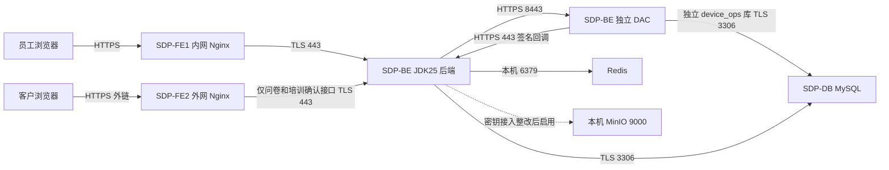

# NPDMS 正式环境四机部署操作手册

## 2026-11-02 正式部署当前配置

- 2026-11-04，前端两机激活 `SDP20261104_INSTALL_STATUS`，增加安装状态筛选并移除列表地址要求列；后端、DAC 和数据库未操作。见[部署回执](../../generated/2026-11-04-install-status-deployment/report.md)。

- 2026-11-04，后端和两台前端激活 `SDP20261104_INSTALLATION_SITES`；增加本项目有效安装站点复用及方案地址选择，未执行数据库迁移。测试和正式页面核验范围见[部署回执](../../generated/2026-11-04-installation-sites-deployment/report.md)。

- 2026-11-04，部署硬件安装筛选及产品描述可配置过滤，后端和两台前端当前版本 `SDP20261104_INSTALLATION_FILTER`；正式参数保留原类型条件并追加描述条件。真实页面核验免填36台、必填4台；本次未执行迁移。此前待发布的项目列表办事处选项一并发布。详见[部署回执](../../generated/2026-11-04-installation-filter-deployment/report.md)。

需求方明确以本正式部署配置及服务器实时环境为准，分支旧状态记录不代表当前配置。以下本次确认值优先于后文历史安装记录和示例值：

- 系统名称：`SDP`；中文名称：`服务交付平台`。
- 2026-11-03 03:04，服务修复最终后端为`SDP20261103_SERVICE_REPAIR_BACKEND_R2`（PID114421），独立DAC为`SDP20261103_SERVICE_REPAIR_DAC`（PID112439），两者自动重启0。显式使用Quartz内存存储并恢复全部可用任务的既定启停状态，两项原漏恢复任务已有真实成功执行日志；UMC生效凭据已补齐，BE/DB每日加密备份已启用但尚无异机复制。更正下方历史判断：合同任务已于02:00实际成功，旧Quartz排除类名未阻止Boot4.1调度启动。现存默认文件配置为id=1、bucket=sdp。详见[服务修复及测试环境对照](../../generated/2026-11-03-production-service-repair/report.md)。
- 2026-11-03，按需求方“部署”补发名称变更前端`SDP20261103_BRANDING`至两台FE，正式构建标题为“服务交付平台”；Nginx平滑reload及浏览器标题、左上名称、项目列表只读核验通过，旧前端版本保留。后端/DAC和数据库未操作。见[前端回执](../../generated/2026-11-03-domain-merge-deployment/frontend-branding-receipt.json)。
- 2026-11-03，按需求方“批准迁移并继续部署”完成V534及后端`SDP20261103_CONTRACT_PROJECTION`激活；后端PID106906、readiness为UP、自动重启0，DAC保持PID17159。合同号扩列为MEDIUMTEXT并保留排序规则，81,321行合同号摘要不变；每日02:00任务已登记，但既有Quartz自动配置仍被排除，自动执行尚未生效。未手动全量同步。见[合并及部署回执](../../generated/2026-11-03-domain-merge-deployment/report.md)。
- 2026-11-02 23:37，按需求方批准完成MinIO新上传路径修复，活动后端版本`SDP20261102_STORAGE_PATH`。默认文件配置为`id=2 / bucket=sdp`，旧`id=1 / bucket=npdms`保留；桶名由`minio_bucket`统一配置。切换时漏检现网`NPDMS_SERVER_IP`与适配器`SERVER_IP`的命名差异，引发5次自动重试，补映射后恢复；最终readiness为UP，DAC未重启。实际浏览器上传、下载内容摘要一致，详见[存储路径修复回执](../../generated/2026-11-02-production-storage-path/report.md)。
- 员工入口：`https://sdp.dptech.com`，FE1 `172.20.19.2`。
- 客户入口：`https://sdp-customer.dptech.com`，FE2 `172.20.20.2`；此前临时提供的 `sdp-cust.dptech.com` 已被更正，不使用。
- BE `172.17.73.104`，后端 HTTPS 443、独立 DAC HTTPS 8443；DB `172.17.74.19:3306`，独立 `npdms` 与 `device_ops`；服务器实际为 Ubuntu 24.04.4，原生部署，不运行 Docker。
- 本次空库主迁移采用已裁决的 [178运行结构B531包](../../../sql/releases/production-178-runtime-20261101/README.md)，518张业务表；独立DAC迁移至V26。后文B530是此前候选记录，不能覆盖本项。
- 需求方批准记录前端存量样式格式问题后继续部署，并明确后续跳过自动化测试。编译、制品冻结、服务启动与连接核对仍执行；跳过项不得记作通过。
- 本次部署已获明确授权；真实完成情况以部署回执为准，不以历史文档的“未部署”或编译成功判断服务已上线。
- 初次部署HTTPS沿用既有部署CA；需求方明确由运维统一分发CA信任。不得关闭证书/主机名校验，也不擅自将CA加入操作者本机信任。CA证书SHA-256指纹：`27:8A:99:B8:40:97:B4:4E:AE:06:BB:8C:40:E9:08:56:BB:D7:7D:47:EE:3B:2E:D4:D4:92:79:5C:62:08:0C:E1`；后端内部链路继续使用该CA。
- 需求方曾提供根目录`_.dptech.com`公共证书并要求“暂不配置”，当时未切换。2026-11-02 15:53按后续明确授权，使用两台FE的`/opt/sdp/ssl/_.dptech.com.cer`及匹配私钥，完成GlobalSign `*.dptech.com`证书切换（有效期至2027-04-04，SHA-256 `BC:87:DC:11:79:EB:E0:C3:6D:8D:FA:24:0A:54:0F:0F:7E:08:EC:08:2D:64:F0:5A:4C:FB:40:AE:AC:10:76:27`）。活动证书为`/etc/sdp/tls/public-cert-20261102.crt`，私钥由systemd主机加密凭据在启动时恢复至`/run/sdp-nginx-tls/public-cert-20261102.key`；本次仅平滑重载Nginx，未重启BE或DAC。两个正式域名的80端口固定308跳转至各自HTTPS域名，保留路径和查询参数。原配置保留于各FE的`/opt/sdp/config/public-cert-20261102/`。服务器及操作者本机直连检查均通过证书校验，HTTP跳转和HTTPS资源200通过；不代表业务验收或忘记密码邮件已恢复。BE中的JKS未启用：通配域名证书不覆盖当前内部IP身份，不能直接替换。见[证书及跳转回执](../../generated/2026-11-02-production-certificates/receipt.json)。
- 2026-11-02 16:06，按需求方批准修复正式“忘记密码”邮件TLS信任配置并仅重启后端一次。后端通过`/etc/systemd/system/sdp.service.d/mail-trust.conf`改用`/etc/sdp/tls/java-truststore-mail-candidate-20261102.p12`，保留部署CA并加入GlobalSign Root CA R3；原信任库保留，DAC配置不变。候选文件初始读取权限不一致导致启动暂时等待数据库，随后修正为与原文件一致的`0644 root:root`，同一JVM恢复，未再次重启。后端PID由73107变为80347，readiness为UP，自动重启计数0；DAC PID始终17159。16:06:31账号`w02611`验证码邮件记录3为SUCCESS，旧失败记录1、2保留；页面显示发送提示，未提交密码重置；随后需求方于2026-11-02明确确认“已收到验证码，邮件发送正常了”，验证码发送及实际收件验收通过，本次邮件故障闭环。见[邮件修复回执](../../generated/2026-11-02-production-mail-repair/receipt.json)。
- 2026-11-02本次执行：正式版本`SDP20261102_cb21b3015`已在两台FE及BE后端/DAC激活；主库B531和独立DAC至V26迁移、迁移后校验完成。初始化核对518/24张业务表、240个主库触发器及59类表6,026条配置数量一致。主库迁移账号临时SUPER已撤销，`log_bin_trust_function_creators`仍为0。
- 后端443与DAC8443 readiness均返回`UP`；两域名入口TLS身份校验及HTTP200通过，页面标题为“SDP 服务交付平台”；FE1同源API代理可达。该结果仅为部署和连接核对，不等于浏览器业务验收。
- 正式管理员`admin`已按初始化脚本启用；真实初始密码在BE的`/opt/sdp/config/credentials/backend/admin-production-20261102.json`（root、0600），不写入文档。后端/DAC/MinIO凭据保持systemd加密及运行时注入；Nginx、MySQL、Redis已补充启动时恢复所需秘密的配置。
- 两台Nginx及后端、DAC、MySQL、Redis、MinIO均已配置开机启动；未重启服务器或演练断电恢复。部署前空库定义、账号、原配置及恢复依赖已加密备份到DB与BE的`/data/backups/production-20261102/pre-migration.tar.gz.cms`，并完成BE内存解密摘要核对；不是完整灾难恢复演练或持续异机备份方案。
- 本次回执：[2026-11-02正式部署](../../generated/2026-11-02-production-deployment/receipt.json)。后文2026-10-30/11-01的未部署、空库、disabled状态仅描述对应历史时点。
- 2026-11-02 01:27，需求方明确批准并完成SPMS、CRM正式数据源及同步连接配置，连接管理的两次测试均显示“连接正常”。SPMS沿用178的`spms.dptech.com:3306/dpspms`及`useSSL=false`，即明文传输；CRM使用`172.17.74.18:1433/crm_MSCRM`，`encrypt=true;trustServerCertificate=true`，即加密传输但不验证服务器证书。两项均为需求方明确要求的当前配置，不代表证书校验已经完成。密码通过现有数据源服务加密保存，不写本文。
- 2026-11-02 01:44，按需求方明确要求，通过正式Flyway应用 [V531.2基础同步任务迁移](../../../sql/releases/production-base-sync-20261102/V531_2__register_formal_base_sync_tasks.sql)：对照178去重后登记SPMS 23项、CRM 2项，参数逐项一致；运行和绑定记录仍为0，未执行同步。迁移后主库版本531.2，原B531保留且validate通过；V532仍保留未来发布顺序。迁移前五张配置及历史表备份加密后分别存于DB、BE的`/data/backups/production-20261102/pre-base-sync-configuration.sql.cms`并核对摘要；未重启服务。[执行回执](../../generated/2026-11-02-production-base-sync/receipt.json)。
- 2026-11-02 04:06，按需求方单独批准，在活动同步事务全部提交后激活`SDP20261102_DICT`并重启正式后端一次；readiness为`UP`，DAC进程17159保持。P08正式读取617、新增5、保留612，重放预览全部未变；三个重大项目级别保留正式初始化值。P38模板初始化已完成7072个项目，74249个因模板未启用保持未变。04:10另经需求方明确批准，为`npdms_app@172.17.73.104`补充仅`npdms.*`的`CREATE TEMPORARY TABLES`权限，供P22数量分配临时表使用；未增加永久建表、改表或删表权限。授权前旧空闲连接已重建，活动P15事务连接保留，未再次重启服务。执行结果见[基础同步续执行回执](../../generated/2026-11-02-production-base-sync/continuation-report.md)。
- 为修复数据源密码加密密钥长度无效，按需求方批准仅重启正式后端一次；停机后确认数据源密文、设备凭据及相关Redis令牌均为空，切换为新的主机加密凭据；旧加密凭据保留。当前覆盖文件为`/etc/systemd/system/sdp.service.d/datasource-credential.conf`，不可擅自切回旧密钥，否则已创建的数据源密文将无法解密。DAC及基础服务未重启。[本次连接回执](../../generated/2026-11-02-production-connections/receipt.json)。

适用：2026-10-30 用户给定的 Ubuntu 24.04.4 四机拓扑。本文是部署操作资产，不更改 PRD、授权、状态机或历史数据。配套入口：[scripts/production](../../../scripts/production/README.md)。状态：四机基础软件安装、MySQL 空库初始化及基础服务启动已完成；BE→DB 的 TLS 连接校验未完成。未执行业务迁移、发布应用或完成生产验收，不能作为上线放行证明。

本版为第四版：沿用第三版的宿主机原生安装方式，并统一持久数据目录为`/data`。用户明确要求正式服务器禁用Docker；此要求替代本手册前两版的容器承载方式，仓库根`compose.yaml`仅保留既有本地开发用途，本次不修改。

2026-11-01 16:00的本地只读状态记录仅检查systemd、监听、挂载和磁盘；没有SQL或认证业务探针，不替代TLS、应用和业务验收。回执保留在本地，本次仅提交操作文档，未刷新服务器状态，也未执行部署。

### 初始化实施状态（2026-10-30）

用户已授权使用本机交互密码登录、禁用本次连接的主机校验，并在本机下载合适安装包后通过SFTP上传安装。四机均已成功以root连接，公钥认证和SSH agent未使用；SSH 登录密码不写入本机脚本、命令参数或日志，也未修改全局SSH配置。后续首次安装密码按用户明确要求记录在目标机第6.1节规定的 root 专用目录。首次Nginx离线包通过临时命令通道传输；用户明确SFTP要求后的BE/DB制品均通过SFTP上传。

| 主机 | 已安装组件 | 本次验证 |
|---|---|---|
| FE1 / FE2 | Nginx `1.24.0-2ubuntu7.19` | 包校验、`nginx -t`通过；HTTPS 基础入口已启动，返回404；开机自启`disabled` |
| BE | Temurin JDK `25.0.1+8`、Redis `7.4.12`、Flyway OSS `11.10.5` | 原生入口与版本检查通过；Redis已启动，认证PING返回PONG，未认证请求拒绝 |
| BE | LibreOffice `24.2.7.2`、Noto CJK中文字体 | 76个依赖包安装，无已有软件升级/删除；`sdp`账号临时中文HTML转PDF成功 |
| BE | MinIO `LOCAL.2025-10-15T17-29-55Z` | 官方发布标签源码、本机Go `1.26.10`交叉构建Linux amd64；S3服务已启动，认证ListBuckets成功，未认证请求拒绝；未创建业务桶 |
| DB | MySQL Community `8.4.13`（官方Ubuntu24.04二进制） | `mysqld/mysql/mysqldump`版本、资源路径及安装文件校验通过；实例已初始化，root密码已轮换；`npdms`、`device_ops`两库已创建，业务表数量为0 |

安装入口为`/opt/sdp/jdk`、`redis`、`flyway`、`minio`、`mysql`，均指向本次独立版本目录。BE/DB复用已有服务账号和`/data`目录；独立XFS挂载、目录归属和权限已核验，没有格式化、迁移已有数据或递归改权。Nginx和LibreOffice安装时临时禁止包管理器启动服务，临时`policy-rc.d`已清除；启动后的Redis仅监听127.0.0.1:6379，MinIO监听回环9000/9001；DB监听172.17.74.19:3306，FE分别监听自身IP的443。

服务器不能访问外网，采用本机下载、校验、上传的离线流程。JDK/Flyway使用官方GitHub发布摘要，Redis使用官方Ubuntu24.04软件源摘要，MySQL官方APT索引通过Oracle GPG签名验证后逐包核对SHA256；Ubuntu依赖与现有APT索引摘要核对。MinIO固定源码提交`9e49d5e7a648f00e26f2246f4dc28e6b07f8c84a`，保留AGPLv3许可证、构建信息和新制品SHA256；标记`LOCAL`以区别于上游预编译发行包。

MySQL通用glibc2.28包曾因缺少`libaio.so.1`无法运行，已改用官方Ubuntu24.04包并保留其`lib/mysql/private`、`lib/mysql/plugin`及`share/mysql-8.4`布局；没有伪造系统动态库链接。当前`/opt/sdp/mysql`指向`mysql-8.4.13-noble`，原通用包目录保留但未激活。LibreOffice转换成功，但仍有`javaldx`提示：未安装/验证LibreOffice Java桥接功能；该结果只证明Writer/Web转PDF的环境检查，不代表全部Office或业务文件验收通过。

执行回执、最终版本、包清单及验证输出：本地初始化回执`docs/generated/2026-10-30-production-initialization/initialization-20261030.json`（本次不提交）。该记录不含密码；本机下载、构建和SFTP过程文件位于被忽略的`.run/ssh-install-session-20261030/`。历史`.run/production-preflight-20261030.json`及`production-scaffold*-result-20261030.json`保留，后者记录了此前账号/目录准备，不能再把这部分写成“尚未执行”。前序严格主机校验和公钥认证失败已由本次用户指定的密码连接方式解决，不再作为当前阻塞。

基础服务启动及空库回执见本地基础服务回执`docs/generated/2026-10-30-production-initialization/foundation-services-20261030.json`（本次不提交）。已沿用部署专用CA签发FE/DB的IP证书，MySQL启用`require_secure_transport`，`secure_file_priv`显式限定为`/data/mysql-tmp`。root当前密码与Redis/MinIO密码已在目标机对应`/opt/sdp/config/credentials/`目录记录，目录0700、文件0600；密码值不写入本记录。

BE→DB的TLS身份校验**未完成**：MySQL在TLS握手前返回`Host '172.17.73.104' is not allowed to connect`。当前仅有系统账号和`root@localhost`，没有BE应用账号；正确IP与错误IP两次OpenSSL检查均未进入TLS握手，不能作为证书通过或拒绝证据。用户随后明确选择“先保持空库，仅完成记录”，因此不新增账号或授权，后续配置专用账号后另行验证。

MySQL、Redis、MinIO及两台Nginx均为active/running，开机自启仍disabled；未演练重启或秘密恢复，不宣称具备自动恢复能力。Redis的`vm.overcommit_memory=1`已设置。未执行业务迁移、未发布后端/前端/DAC、未创建业务数据或进行生产浏览器验收。后续迁移、发布及重启按各自授权执行。

### 数据目录约束（按用户调整后的清单）

本次按用户指定的[服务部署目录要求](项目交付系统-配置目录文件清单.md)执行：持久数据统一进入独立挂载的`/data`，日志按该文件的明确例外留在`/var/log`，程序/配置仍在`/opt`和`/etc`。原清单标注Ubuntu22.04，本次只采用目录要求，服务器OS仍按已提供的Ubuntu24.04.4，不擅自更换系统。

| 主机/用途 | 路径 |
|---|---|
| DB：MySQL数据库及binlog | `/data/mysql` |
| DB：MySQL临时文件 | `/data/mysql-tmp` |
| BE：Redis RDB/AOF | `/data/redis` |
| BE：MinIO对象及运行目录 | `/data/minio`、`/data/minio-runtime` |
| BE：后端和DAC工作目录/用户目录 | `/data/backend`、`/data/dac` |
| DB：加密备份输出 | `/data/backups/已批准异机挂载点/` |
| 日志 | `/var/log/sdp/backend`、`dac`、`mysql`；Nginx沿用`/var/log/nginx` |

BE/DB安装前先由运维核验`lsblk -f`和`findmnt /data`，按真实UUID登记挂载并验证重启；不提供格式化或自动覆盖fstab命令。`/data`必须是独立挂载点，不能只是根分区普通目录或符号链接。各持久服务配置挂载依赖和挂载点条件，避免数据盘未挂载时落入根盘。先创建全部服务账号，再执行`bash /opt/sdp/tools/prepare-data.sh be --approved`或`... db --approved`；只创建空目录，已有路径仅核验，不迁移数据、不递归改权。正文后续目录创建命令也必须在此前提下执行。

上传临时目录沿用应用和宿主机默认机制，不额外指定专用路径；上传完成后的持久化文件仍须进入`/data`。MinIO运行目录、DAC相对路径也进入`/data`；管理员配置的其他存储路径必须核验不落根盘。FE不持久保存业务内容；Nginx上传缓冲如需落地应使用受限内存临时目录并验证容量，不能新增根盘业务文件目录。

将`be/logrotate-sdp`安装到`/etc/logrotate.d/npdms`，执行`logrotate -d`审核；14天、100MiB为工程建议值，须按实际保留要求调整。copytruncate存在极短竞态丢日志窗口；必须永久留存的业务审计以现有审计存储/平台为准，不以临时进程日志替代。MySQL错误日志由DBA按原生MySQL安全重开日志流程轮转，Nginx沿用发行版轮转，Redis/MinIO stdout使用受控journald容量上限；不得将Java轮转规则直接套在binlog或数据库文件上。


已有`/srv`或`/var/lib`数据不得直接移动或清空：停写窗口、备份验证、复制校验、归属权限、配置切换、验收和回退须单独制定并批准，本次未执行。备份输出位于`/data/backups`不代表已有异机备份，须核验实际远端挂载；备份/恢复还要包含`/etc`配置和密钥系统的受控恢复材料，不能把“只备份数据分区”理解为丢弃解密依赖。

## 1. 主机与访问链路

| 主机 | 地址 | 承载 |
|---|---|---|
| SDP-FE1 | 172.20.19.2 | 员工内网前端，宿主机 Nginx |
| SDP-FE2 | 172.20.20.2 | 客户外链前端，宿主机 Nginx |
| SDP-BE | 172.17.73.104 | 宿主机 JDK25 后端（HTTPS 443）和独立 DAC（HTTPS 8443）；原生 Redis、MinIO；原生 Flyway CLI |
| SDP-DB | 172.17.74.19 | 原生 MySQL 8.4，持久化数据与 binlog |

用户已确认两个入口复用同一前端，外网用于客户外链填写，也允许只部署两个页面。本版采用**同一静态制品、外网白名单仅暴露两个页面**；不是独立的双页面构建，`assets` 仍可能含员工前端代码。若要求外网磁盘上没有员工端代码，须增加独立 Vite 入口并完成两个页面的浏览器验收，不能简单删除动态 chunk。



图中地址为私有地址。“对外”需要企业网关/NAT、DNS和证书，不能把 `172.20.20.2` 当成互联网可直达地址。未提供的域名、证书、服务器现有数据和硬件容量均未假定。模板按 Nginx 终止 TLS、后端再次 TLS 加密配置；已有企业网关终止模式应由运维确认后调整，不能直接关掉证书校验。

## 2. 上线前必须落实的输入

- 内外域名、证书链、后端证书 SAN/DNS、数据库证书 SAN/DNS、企业 CA 信任链；数据库 DNS 指向 `172.17.74.19`，后端 DNS 指向 `172.17.73.104`。若不能使用 DNS，需签发相应 IP SAN 并调整模板，不能使用 `VERIFY_CA`/关闭校验替代身份验证。
- 每台机器是否全新、已有服务/监听端口/挂载盘、资源容量、运维责任人、变更窗口、允许的来源网段。四机部署并不等于 HA；现有 [ADR-0004](../../decisions/0004-phase3-production-assurance-directions.md) 的托管数据 HA 方向与单节点承载的差异待裁决，不能宣称已有主备。
- 已批准 releaseId、后端冻结清单、前端版本、迁移目录和目标版本、配置版本、空库/升级库验证、恢复证据。现有测试库或历史首次安装包不能直接作为新正式库内容。
- KMS/Secrets Manager、启动前内存秘密注入及重启恢复方式、轮换和审计。SSH 使用用户给定的 root 身份进行初始化，但密码只在 SSH 交互提示中输入；不写入手册、命令行、环境模板、Git或制品。常态运维使用个人审计账号和 sudo，Java 以 `sdp` 用户运行。
- MinIO 应用接入：当前 `S3FileClientConfig.accessSecret` 经 `FileConfigDO.FileClientConfigTypeHandler.toJson()` 写入配置 JSON，未找到秘密引用解析。2026-11-01需求方批准复用测试包的`ServerMinioDeploymentConfiguration`：数据库只保存`credential:minio_app_user`与`credential:minio_app_password`引用，适配器在运行时从systemd凭据解析，保留已有存储配置校验；四机版端点为BE本机`http://127.0.0.1:9000`。禁止向页面/SQL写入生产AK/SK；适配器构建和真实文件读写通过前仍不能宣称文件业务可用。问题登记见 [open-questions](../../decisions/open-questions.md#q-prod-four-hosts-20261030--四机生产部署待决项)。
- DAC已由用户明确部署在BE，使用HTTPS 8443；2026-11-01已批准沿用测试包RSA服务JWT及systemd加密凭据；文件扫描服务不启用。设备网络、UMC、Office转换、外部系统和Telemetry按实际启用范围落实地址及授权。服务端DAC与Windows桌面DAC分别管理，不能以其中一个替代另一个的验收。

以上输入不阻止准备文档/脚本，但未关闭的适用问题阻止正式发布。不得以占位参数或技术探针成功代替审批及业务验收。

## 3. 网络与端口

| 来源 → 目标 | 端口 | 用途/限制 |
|---|---|---|
| 运维跳板 → 四机 | TCP 22 | 仅批准管理网段，核验 SSH 主机指纹 |
| 员工网络 → FE1 | TCP 443 | 内网界面；不对互联网开放 |
| 企业外网入口 → FE2 | TCP 443 | 两类客户页面及必要 API |
| FE1、FE2 → BE | TCP 443 | 后端 HTTPS；不得允许互联网绕过 FE2 直达 |
| BE后端 → 同机DAC | TCP 8443 | HTTPS及签名鉴权，仅本机/批准运维源；不允许FE2或互联网直达 |
| DAC → 同机后端 | TCP 443 | HTTPS签名回调，直接访问BE，不经客户前端 |
| BE → DB | TCP 3306 | MySQL TLS；另允许批准的 DBA/备份源 |
| BE 本机 → Redis | TCP 6379 | 仅发布到 127.0.0.1，ACL认证 |
| BE 本机 → MinIO | TCP 9000/9001 | S3/管理台均仅回环；禁止公开桶、外网管理台 |
| BE → 已批准 DAC/扫描/外部系统 | 按实际注册 | 单独核准，不任意开放全网 |

不提供通用 `ufw reset` 或全开放命令。各服务直接绑定宿主机地址，使用网络设备和主机防火墙限制来源；Redis/MinIO只监听回环。先保存现有规则，由网络运维按表增量配置并从允许/拒绝来源实测。脚本不更改防火墙，不停止其他服务。

## 4. 制品构建与冻结

后端构建必须在本工作树使用 `scripts/worktree-build.ps1`；不在服务器编译，也不直接并发写 `target`。本次未重建业务制品。

```powershell
# 在 E:\AICoding\Projects\NPDMS；该入口持有工作树构建锁
./scripts/worktree-build.ps1 -Target backend
./scripts/worktree-build.ps1 -Target dac
# 取输出 manifest 所指的冻结 JAR，核验清单；复制为单独 staging/backend/yudao-server.jar。
# 不从运行目录或变动中的 target 随意取包。
```

前端在干净的批准源码/独立发布工作区执行（不要覆盖其他会话的 dist），复用仓库 `packageManager` 所规定 Corepack/pnpm版本。两台机器部署同一个发布目录；API同源，外链生成指向外网域名：

```powershell
$env:VITE_BASE_URL = ''
$env:VITE_API_URL = '/admin-api'
$env:VITE_CUSTOMER_CONFIRM_BASE_URL = 'https://已确认的外网域名'
$env:VITE_UPLOAD_TYPE = 'server'
$env:VITE_SOURCEMAP = 'false'
Set-Location E:\AICoding\Projects\NPDMS\yudao-ui\yudao-ui-admin-vue3
corepack pnpm install --frozen-lockfile
corepack pnpm ts:check
corepack pnpm lint
corepack pnpm build:prod
# 每条失败都应停止发布，不能拿 build 成功覆盖其他失败。
```

在发布会话中使用这些环境变量，结束后关闭该会话或恢复原值。确认产物中没有 `localhost:48080`、开发服务地址、source map、Secret。默认 `.env.prod` 仍包含 localhost，不能不带覆盖直接构建。文件上传采用后端路径，不让客户直连 MinIO。

```bash
# 以下在具备 Python3 的发布工作区运行；R20261030_01只是命令示例，不是已批准版本。
python3 scripts/production/release.py pack backend R20261030_01 staging/backend release/backend
python3 scripts/production/release.py pack frontend R20261030_01 yudao-ui/yudao-ui-admin-vue3/dist-prod release/frontend
# staging/migrations必须是已审核的该次发布迁移集合，不能把整个工作树临时SQL混入。
python3 scripts/production/release.py pack migrations R20261030_01 staging/migrations release/migrations
```

`release.json`检查目录内文件的SHA-256及增删，不是签名或审批证明。传输前另记录该清单自身哈希并通过受信渠道核对；后端原冻结manifest、测试报告和审批单另保存，不能用新清单抹去来源。禁止向上述目录放秘密文件。

## 5. 配置渲染与主机准备

复制 `scripts/production/site.example.json` 为受控的非秘密配置，填写真实DNS和数据库名。软件版本、来源、许可证及原生安装包SHA256另登记到批准发布清单（MySQL8.4、Redis7.4、Flyway11.10.5、JDK25及批准MinIO版本），不使用latest或未校验的在线安装脚本。

```bash
python3 scripts/production/render.py site.json generated-config-v1
```

输出目录必须不存在，避免覆盖已批准配置。将 `scripts/production` 目录内容发送到对应主机 `/opt/sdp/tools/`；将渲染配置按角色目录结构发送到 `/opt/sdp/config/v1/`；用标准 scp/企业发布平台交互认证，不使用带密码的脚本。运维提前从企业审核软件源安装Nginx（FE1/FE2）、Python3.12以上、curl、OpenSSL，以及BE的LibreOffice和文档字体。MySQL、Redis、MinIO、Flyway、JDK按第5.1节原生安装。无需安装Docker Engine、Compose或容器运行时；也不卸载/停止目标机已有其他业务组件。

首次准备（仅确认新目录、没有已有同名服务后）：

```bash
# 四台均执行。以下命令是首次安装流程；升级时先比对配置，禁止无备份覆盖。
install -d -m 0755 /etc/sdp/tls /opt/sdp
# BE执行：账号已有时核验UID、用途，不复用不明账号
getent passwd sdp || useradd --system --home-dir /data/backend --shell /usr/sbin/nologin sdp
install -d -o sdp -g sdp -m 0750 /data/backend /var/log/sdp/backend
install -d -m 0755 /etc/sdp/backend
install -m 0644 /opt/sdp/config/v1/be/application-prod.yaml /etc/sdp/backend/application-prod.yaml
install -m 0644 /opt/sdp/config/v1/be/redis.conf /etc/sdp/
install -m 0644 /opt/sdp/config/v1/be/sdp-redis.service /opt/sdp/config/v1/be/sdp-minio.service /etc/systemd/system/
install -m 0644 /opt/sdp/config/v1/be/sdp.service /etc/systemd/system/
systemctl daemon-reload
# 暂不启动后端，也不执行enable --now。
```

DB将`db/mysql.cnf`安装至`/etc/sdp/mysql.cnf`、`db/sdp-mysql.service`安装至`/etc/systemd/system/`，执行`systemctl daemon-reload`。首次部署以`useradd --system --no-create-home --shell /usr/sbin/nologin 用户名`分别创建DB上的`sdp-mysql`、BE上的`sdp-redis`和`sdp-minio`。使用`install -d -o 对应用户 -g 对应用户 -m 0750 路径`创建`/data/mysql`、`/var/log/sdp/mysql`、`/data/redis`、`/data/minio`。已有账号或业务目录先核验，不递归改归属、不chmod777。

FE1/FE2各自将`fe1/npdms.conf`或`fe2/npdms.conf`安装至`/etc/nginx/conf.d/npdms.conf`；FE2另外将`customer-proxy.conf`安装至`/etc/sdp/customer-proxy.conf`。将对应`sdp-nginx-tmpfiles.conf`安装到`/etc/tmpfiles.d/sdp-nginx.conf`并执行`systemd-tmpfiles --create /etc/tmpfiles.d/sdp-nginx.conf`，确认实际worker用户为模板中的`www-data`且`/run`为tmpfs。先审查已有default_server和其他站点，确认没有旁路代理/重复域名。证书公钥位于`/etc/sdp/tls/frontend.crt`，BE CA位于`backend-ca.crt`；私钥由秘密代理提供到`/run/sdp-secrets/frontend.key`。此时`nginx -t`仅验证配置，不代表站点已可用。

FE1基础同步任务的对外地址为`/api/v1/pms/integration/base-sync/`。该Controller不在平台`controller.admin`包下，后端也使用此原路径；Nginx按FE1模板限定此前缀原样转发，不追加`/admin-api/`，其他`/api/`路径仍默认拒绝。基础同步页面的`tasks`和`registrations`读取成功须通过真实浏览器确认，发布验收不执行`preview`或`execute`。

### 5.1 原生软件安装（无容器）

安装脚本`install-native.py`只解包校验过的二进制发行包，拒绝错误SHA256、目录穿越、逃逸链接和已有安装路径，不初始化数据库、不创建服务、不启动进程。软件落在`/opt/sdp/software/组件-版本`，建立`/opt/sdp/组件`软链接。升级时不会覆盖旧版本或自动切换，应另行评审维护窗口、兼容性及回退。

| 主机 | 组件 | 安装包要求/最终入口 |
|---|---|---|
| DB | MySQL 8.4 | 官方适配Ubuntu24.04的二进制包，保留原生库/插件/资源布局后打包；`/opt/sdp/mysql/bin/mysqld`。generic包须先核验ABI，不能假定Ubuntu24.04具备`libaio.so.1` |
| BE | Redis 7.4 | 优先使用官方Ubuntu24.04原生包，或在同构受控构建机编译固定源码并测试；打包`bin/redis-server`、`bin/redis-cli`并保留许可证及上游摘要；`/opt/sdp/redis/bin/redis-server` |
| BE | MinIO | 批准的Linux原生二进制打包为`bin/minio`；`/opt/sdp/minio/bin/minio`；产品线/许可证/支持周期须记录 |
| BE | Flyway 11.10.5 | Linux CLI发行包，根目录含`flyway`、所需lib/JDBC driver及发行包运行时；`/opt/sdp/flyway/flyway` |
| BE | JDK25 | Linux JDK发行包，`/opt/sdp/jdk/bin/java`；后端和DAC均使用该入口 |
| FE1/FE2 | Nginx | 企业批准的Ubuntu原生deb源或离线deb包，记录精确版本，使用发行版`nginx.service` |

原生tar包可以带单层顶目录；禁止使用源码包冒充可执行发行包。Redis/MinIO重新打包时同时保留上游签名/源码版本/原始哈希/构建日志及新包SHA256。SHA256必须来自受信发布清单，不能仅在待安装机器上对未知包算一个值就视为审核通过。

```bash
# DB；参数中的版本、文件名、SHA256全部取实际批准清单
python3 /opt/sdp/tools/install-native.py mysql 8.4.已批准补丁 /opt/incoming/mysql-linux.tar.xz 实际SHA256 --approved
# BE（版本参数须使用实际ASCII版本号，以下为占位命令）
python3 /opt/sdp/tools/install-native.py redis 已批准版本 /opt/incoming/redis-native.tar.gz 实际SHA256 --approved
python3 /opt/sdp/tools/install-native.py minio 已批准版本 /opt/incoming/minio-native.tar.gz 实际SHA256 --approved
python3 /opt/sdp/tools/install-native.py flyway 11.10.5 /opt/incoming/flyway-linux.tar.gz 实际SHA256 --approved
python3 /opt/sdp/tools/install-native.py jdk 已批准25版本 /opt/incoming/jdk25-linux.tar.gz 实际SHA256 --approved
```

`install-native.py`要求Python3.12以上；Ubuntu24.04使用系统Python即可。先用`uname -m`核验架构，并对可信发行包执行`ldd`检查依赖，再通过企业软件源补齐MySQL所需libaio/libnuma等实际依赖；不盲目改动态库软链接。核对`mysqld --version`为8.4、`redis-server --version`为7.4、`flyway -v`为11.10.5及`java -version`为25。安装器校验文件，不代替版本、许可证、ABI和启动验证。

首次空库初始化必须单独批准：完成账号/目录/原生程序准备后运行`bash /opt/sdp/tools/init-mysql.sh --approved-empty-database`。脚本只允许DB机上未运行服务且完全空的`/data/mysql`，拒绝现有数据；初始化临时root口令先进入权限0700的`/run/sdp-mysql-bootstrap/initialize.log`，脚本再自动提取到`/opt/sdp/config/credentials/mysql/`下root专用文件（目录0700、文件0600），不打印密码。不自动启动MySQL。

DBA在目标机受控读取该凭据文件，准备好TLS证书/私钥后启动`sdp-mysql`，通过本机socket使用`MYSQL_HISTFILE=/dev/null /opt/sdp/mysql/bin/mysql --socket=/run/sdp-mysql/mysql.sock --connect-expired-password -uroot -p`交互登录并立即轮换临时口令，确认审计/诊断日志不记录口令值。随后按批准SQL创建`npdms`、`device_ops`及独立应用/迁移/备份身份，口令由秘密管理器提供，不使用共用root连接应用。确认已轮换后，将已验证的新密码按第6.1节记录为新文件，再删除内存bootstrap日志；临时密码文件保留temporary标记，不能作为当前密码使用。不要复制整份日志或密码到工单。现有库跳过初始化，按独立升级流程处理。

Flyway在BE直接运行，不是常驻服务。`operate.sh`调用`/opt/sdp/flyway/flyway`，分别读取内存`flyway.conf`或`dac-flyway.conf`，显式指定对应冻结迁移目录，并强制禁用clean和自动baseline。配置采用该CLI支持的`flyway.url/user/password`等属性，URL必须含正确独立库名与`sslMode=VERIFY_IDENTITY`。Flyway自带JRE或独立运行时也必须信任数据库CA，不能只向应用JDK导入CA后遗漏迁移器。执行身份及凭据文件均由发布流程受控管理；不在命令行传密码。

## 6. 秘密、证书与启动恢复

所有模板均不含真实Secret。`/run/sdp-secrets`必须为内存路径，由受控systemd加密凭据恢复流程在服务启动前注入，设置最小可读权限；运行时秘密注入仍按本节实施；首次安装密码按用户最新要求另存第6.1节的root专用配置文件，不用普通 `.env` 或发布包承载。不要开启shell xtrace、打印秘密、把明文导出到工单或命令历史。停机/重启后`/run`内容会丢失，必须验证秘密代理重新取回并按序启动原生服务；systemd的Restart策略本身不能解决秘密恢复。

| 消费者 | 内存或加密输入 |
|---|---|
| DB MySQL | `/run/sdp-secrets/mysql-server-key.pem`、`mysql-backup.cnf`；MySQL管理员口令由DBA交互使用，不作为守护进程启动环境变量 |
| DB TLS公钥 | `/etc/sdp/mysql-tls/ca.pem`、`server-cert.pem` |
| BE Redis | `/run/sdp-secrets/redis.acl`；使用default用户、强密码的SHA256 ACL哈希，禁止nopass；可用命令/键权限按客户端功能审核 |
| BE MinIO | systemd加密凭据`/etc/credstore.encrypted/sdp-minio-user`、`sdp-minio-password`（凭据名分别为`minio-user`、`minio-password`）；进程用`MINIO_ROOT_*_FILE`读取内存文件；应用不得使用root账号 |
| BE Flyway | `/run/sdp-secrets/flyway.conf`：迁移专用身份、TLS JDBC URL、目标库；不要将密码作为CLI参数 |
| BE Java | `/etc/credstore.encrypted/sdp-backend`、`sdp-tls`，使用systemd加密凭据，解密后仅服务可读 |

运维可由批准的秘密管理器输出直接管道送入`systemd-creds encrypt --name=application-secrets.properties - /etc/credstore.encrypted/sdp-backend`，PKCS12以`--name=backend.p12`同样处理。密码交接文件仅允许按第6.1节保存；私钥/PKCS12等仍直接加密输入，不另存持久明文。密文恢复依赖目标机解密机制，必须做重启/灾难恢复演练；2026-11-01需求方批准采用测试环境已有的本机systemd加密凭据方式，不以外部秘密管理服务作为本轮前置条件；仍须分别验证加密加载与重启恢复，不宣称已完成灾备。

Java秘密属性流至少提供模板引用的`NPDMS_DB_USER`、`NPDMS_DB_PASSWORD`、`NPDMS_REDIS_PASSWORD`、`NPDMS_MYBATIS_ENCRYPTOR_PASSWORD`、`NPDMS_TLS_KEYSTORE_PASSWORD`、`NPDMS_API_ENCRYPT_REQUEST_KEY`、`NPDMS_API_ENCRYPT_RESPONSE_KEY`，以及批准的DAC签名参数、`minio_app_user/minio_app_password`；文件扫描本轮明确关闭。属性值按Java properties格式正确转义，不能简单拼接不受控文本。保留原数据加密密钥版本，禁止升级时生成新密钥导致旧数据不可读。

JDBC信任企业CA：将公钥CA导入本机JDK受控truststore，或由正式配置指定独立truststore；验证`VERIFY_IDENTITY`成功且错误证书失败。DB应用账号与迁移账号分离，应用账号无CREATE/ALTER/DROP等DDL权限；迁移账号按审核SQL需要配置触发器/函数权限，不把root作为应用账号，不为通过迁移全局放宽生产规则。

`application-prod.yaml`沿用现有docker剖面的必要自动配置排除项，但独立启用`prod`，不加载`local/dev/docker`，关闭Flyway/Liquibase/SQL init/Flowable/Hibernate/Batch/Quartz自动DDL，开启租户及服务端权限，禁用mock/demo。该配置尚未经目标环境启动验证；其他集成参数必须随release补齐，不使用开发默认地址。

### 6.1 首次安装密码输出（用户明确要求）

首次安装涉及的MySQL root、数据库应用/迁移/备份账号、Redis认证密码、MinIO管理员账号、后台管理员及已有OS管理员密码，统一按服务记录到`/opt/sdp/config/credentials/<service>/`，service分别为`mysql`、`redis`、`minio`、`backend`、`dac`、`os`。此为目标服务器本地明文密码交接目录：目录0700、文件0600，仅root可读；是本次用户明确要求的例外，不扩展为业务数据库明文存储Secret或把密码写进模板/Git/发布包。该目录独立于可分发的`/opt/sdp/config/v1/`，版本配置目录仍不含真实密码。

`record-credential.py`只记录真实密码，不修改账号、重置密码或猜测默认值。MySQL初始化脚本自动保存生成的临时root密码；轮换后的正式密码以及其他服务实际采用的密码由运维通过无回显交互输入记录。不得给没有密码的服务虚构root账号；Nginx、Flyway本身没有独立管理员密码，Flyway使用的数据库迁移账号归入mysql。多个数据库账号用不同account和record_id区分（例如`npdms-app`、`dac-app`、`npdms-migration`），记录标识不替代真实授权范围。

```bash
# 在对应目标机，先完成账号配置并验证登录，再记录已验证密码；密码不作为参数传递
python3 /opt/sdp/tools/record-credential.py mysql root first-install --state verified
python3 /opt/sdp/tools/record-credential.py redis default first-install --state verified
python3 /opt/sdp/tools/record-credential.py minio 实际管理员账号 first-install --state verified
python3 /opt/sdp/tools/record-credential.py backend 实际后台管理员账号 first-install --state verified
python3 /opt/sdp/tools/record-credential.py os root first-install --state verified
```

实际账号参数应使用ASCII账号标识；不要直接照抄中文占位符。`--state configured`表示已配置但未验登录，`verified`由操作者在成功登录后指定，不是记录脚本的验证结论；`temporary`用于必须轮换的临时口令。现有同名文件拒绝覆盖，密码轮换使用新的record_id；交接时注明当前有效记录，撤销旧密码不等于删除历史记录。文件名形如`mysql/root-first-install.json`，含账号、密码和状态，不能被静态前端或Web下载接口映射。

MinIO仍使用systemd加密凭据运行；将同一实际管理员密码记录到minio配置目录即可，不能记录一个未被服务采用的新随机值。Redis同理，交接文件记录原密码，运行ACL使用对应哈希。OS已存在的root密码需要操作人无回显输入，脚本不从系统反查明文，不自动重置。后端/DAC已保存数据的加密主密钥与签名密钥不随本步骤重新生成，原有恢复与轮换要求保持。

配置凭据目录须纳入独立加密备份和运维访问审计；不能只备份`/data`后丢失密码恢复资料，也不能把`/opt/sdp/config/`整体打进公开交付包。本次只提供工具，不生成或保存实际服务器密码到本工作区。若记录失败，立即保留现场并修复目录/权限问题；尤其MySQL已初始化时禁止重复初始化来重新获取密码。

### 已部署环境操作注意事项

- 本文前述安装、服务与空库结论对应记录日期，不代表操作当日的实时状态。继续部署前先核对当前激活版本、进程、数据库表及Flyway历史，再选择首次部署或升级路径。
- 已安装的MySQL、Redis、MinIO、Nginx沿用现有实例和数据目录；不得重复初始化MySQL、清空`/data`、重新生成服务密码或覆盖现有证书来重做安装步骤。已有业务库不得执行B530空库初始化包。
- 原生部署保持程序、配置和数据路径约定；正式服务器不启动Docker/Compose。制品先校验清单与摘要，再发布到新的版本目录；不要直接覆盖当前激活产物。
- 在BE专用数据库账号配置及TLS身份验证完成前，不以基础服务active或端口连通作为应用可部署的依据；不要将root账号用作应用连接，也不要跳过证书验证。
- 当前记录未证明开机自启、秘密恢复和备份恢复可用。不得未经批准重启服务器或服务以试验恢复；每次迁移、应用激活及重启均按对应窗口授权执行。
- 升级前保留数据库与文件的一致备份，核对可恢复性和回退边界。已产生新业务写入时不能直接恢复旧备份；应用回切也不能假定可以撤销数据库迁移。
- 后端与DAC分别管理，前端两机核对同一批准版本。发布后分别验证认证、数据范围、文件访问和真实浏览器业务；HTTP成功、通知送达或进程启动不代表业务完成。

## 7. 初始化、迁移与发布顺序

1. 确认上线输入、准入策略、秘密代理、容量及恢复方案。首次安装不能指向已有未知数据盘；已有库必须先对账及备份，不能清目录、删除数据或自动baseline。
2. 在DB、BE分别执行 `bash /opt/sdp/tools/operate.sh db preflight`、`... be preflight`。预检只检查主机/工具/配置，端口与磁盘输出由运维核对，不自动判定容量。
3. 窗口批准后执行`... db infra-up --approved`，核验DB TLS登录、数据卷、binlog和业务/迁移账号；执行`... be infra-up --approved`，核验Redis带认证PONG、MinIO健康及持久卷。systemd active或mysqladmin ping只证明进程响应，不证明授权/业务健康。
4. 将审核迁移包上传BE，执行下列分步命令：

```bash
bash /opt/sdp/tools/operate.sh be publish migrations /opt/incoming/release/migrations --approved
bash /opt/sdp/tools/operate.sh be activate migrations R20261030_01 --approved
bash /opt/sdp/tools/operate.sh be migrate-info
bash /opt/sdp/tools/operate.sh be migrate-validate
# 只有批准DDL窗口、备份可恢复且目标版本/SQL清单核对完成后：
bash /opt/sdp/tools/operate.sh be migrate --approved
bash /opt/sdp/tools/operate.sh be migrate-info
bash /opt/sdp/tools/operate.sh be migrate-validate
```

新的空业务库使用已复审的[178来源B530初始化包](../../../sql/releases/production-178-v530-r2/README.md)，不再回放V1或从B498推导。当前冻结迁移制品标识为`INIT178V530R2`，执行上述`activate migrations`时须使用实际制品标识，不能照抄示例`R20261030_01`。本包包含518张表、240个触发器和6,026条选定配置；不复制测试业务、测试人员或源环境凭据。[本地隔离验证](../../generated/2026-11-01-production-178-review/README.md)已通过，但没有在正式环境执行。

生产执行前按包内说明核验目标空库、来源清单、SHA256及数据库大小写/字符集设置；原生Flyway必须保持`cleanDisabled=true`、`baselineOnMigrate=false`、`validateOnMigrate=true`、`validateMigrationNaming=true`和`placeholderReplacement=false`，后者保护BPMN/表单中的业务表达式。通过`migrate`执行B530，不用`baseline`替代；包内Compose仅供本地演练。迁移后核对结构、种子摘要和引用，使用`bootstrap-admin.sql`经安全通道初始化管理员，并补齐目标存储、外部连接、人员授权及业务验收。正式巡检规则仍受`Q-PROD-INS-RULE-20261101`阻塞。

升级库继续原有迁移链，核验Flyway历史和checksum，不得切换到本B530覆盖已有库；正式执行后基线不可重生成，后续仅追加大于V530的迁移。不执行`repair/clean/baseline`掩盖漂移，不照搬本地`*:missing`宽泛豁免。失败立即保留现场，按具体失败决定前向修复，不自动重试未知副作用SQL。

5. 迁移和种子核验完成后，在BE发布后端：

```bash
bash /opt/sdp/tools/operate.sh be publish backend /opt/incoming/release/backend --approved
bash /opt/sdp/tools/operate.sh be activate backend R20261030_01 --approved
systemctl status sdp --no-pager
# 使用后端证书对应DNS与CA；不要用curl -k。
curl --fail --cacert /etc/sdp/tls/backend-ca.crt https://后端证书DNS:443/actuator/health
```

`activate backend`包含明确的重启操作，须每次批准；不操作本地59191或48182。脚本只检查进程活跃，业务依赖探针另行执行。DAC按第7.1节独立部署，不以其就绪作为后端启动/重启门槛；后续采集闭环不通过则不能发布相应能力。

6. 两台前端按各自角色发布同一前端目录：

```bash
# FE1使用fe1；FE2把下列角色改为fe2
bash /opt/sdp/tools/operate.sh fe1 publish frontend /opt/incoming/release/frontend --approved
bash /opt/sdp/tools/operate.sh fe1 activate frontend R20261030_01 --approved
```

7. 所有业务验收完成后，运维将Nginx、后端、DAC、MySQL、Redis、MinIO和秘密代理的开机顺序纳入服务管理并演练重启。不要仅执行`systemctl enable`就认定重启恢复可用。

### 7.1 DAC独立服务（HTTPS 8443）

用户已明确：后端HTTPS 443，DAC同机HTTPS 8443。后端调用`https://后端证书DNS:8443`；DAC回调`https://后端证书DNS:443/api/v1/pms/integration/device-ops/callbacks`。回调Controller位于`integration.deviceops`，不适用`controller.admin`的`/admin-api`前缀。DAC和后端使用各自PKCS12凭据，SAN均覆盖上述DNS（也可由运维签发同机不同证书）；该DNS在BE解析到`172.17.73.104`。两端JDK均须信任企业CA，禁止跳过证书校验。8443仅允许BE自身和批准运维来源，FE2不增加DAC代理。

后端systemd服务以`sdp`运行，只授予`CAP_NET_BIND_SERVICE`以监听443；无需root运行Java或全局降低低端口限制。DAC以独立`sdp-dac`账号运行，无需该能力。两个服务没有`Requires/BindsTo`依赖；启动、停止和重启均分别审批，不因DAC离线阻止后端启动。

DAC使用DB机上独立`device_ops`数据库、专用应用/迁移账号，不能共用NPDMS库或Flyway历史。DBA确认新建库授权后创建库和最小权限账号，已有库先备份对账。迁移只取同一冻结DAC版本的`device-ops-platform/device-ops-adapter-persistence-jdbc/src/main/resources/db/mysql-migration`；在隔离MySQL演练成功后发布，不使用H2脚本。DAC启动显式关闭自动Flyway，迁移走独立操作入口。

```bash
# 发布工作区：JAR必须来自worktree-build.ps1 -Target dac输出的冻结清单
python3 scripts/production/release.py pack dac R20261030_02 staging/dac release/dac
python3 scripts/production/release.py pack dac-migrations R20261030_02 staging/dac-migrations release/dac-migrations
# staging/dac只放device-ops-server.jar；不将桌面MSI当服务端JAR。

# BE首次安装；账号/目录已有时先核验归属，不覆盖其他业务
getent passwd sdp-dac || useradd --system --home-dir /data/dac --shell /usr/sbin/nologin sdp-dac
install -d -o sdp-dac -g sdp-dac -m 0750 /data/dac /var/log/sdp/dac
install -d -m 0755 /etc/sdp/dac
install -m 0644 /opt/sdp/config/v1/be/application-dac-prod.yaml /etc/sdp/dac/
install -m 0644 /opt/sdp/config/v1/be/sdp-dac.service /etc/systemd/system/
systemctl daemon-reload

bash /opt/sdp/tools/operate.sh be publish dac-migrations /opt/incoming/release/dac-migrations --approved
bash /opt/sdp/tools/operate.sh be activate dac-migrations R20261030_02 --approved
bash /opt/sdp/tools/operate.sh be dac-migrate-info
bash /opt/sdp/tools/operate.sh be dac-migrate-validate
# 已批准DAC库DDL窗口及备份后：
bash /opt/sdp/tools/operate.sh be dac-migrate --approved
bash /opt/sdp/tools/operate.sh be dac-migrate-validate
bash /opt/sdp/tools/operate.sh be publish dac /opt/incoming/release/dac --approved
bash /opt/sdp/tools/operate.sh be activate dac R20261030_02 --approved
curl --fail --cacert /etc/sdp/tls/backend-ca.crt https://后端证书DNS:8443/actuator/health/readiness
```

DAC秘密属性通过systemd加密凭据`/etc/credstore.encrypted/sdp-dac`（凭据名`application-secrets.properties`）注入：`DEVICE_OPS_DB_USER/PASSWORD`、`DEVICE_OPS_CREDENTIAL_MASTER_KEY`、`DEVICE_OPS_TLS_KEYSTORE_PASSWORD`、`NPDMS_DAC_REQUEST_SIGNING_KEY`、`NPDMS_DAC_CALLBACK_SIGNING_KEY`；无需外部`OIDC_ISSUER_URI/OIDC_JWK_SET_URI/OIDC_AUTHORITY`。PKCS12使用`/etc/credstore.encrypted/sdp-dac-tls`（凭据名`dac.p12`），按第6节直接从秘密管理器加密输入，不能保存明文。请求和回调签名密钥分别与后端对应值一致；稳定AES-256-GCM凭据主密钥Base64解码必须为32字节，备份恢复不可丢失/随意轮换。

2026-11-01需求方批准沿用测试包的服务认证：后端部署适配器使用RSA-3072私钥签发5分钟RS256 JWT，3分钟后自动续签；DAC适配器校验签名、`urn:npdms:server-dac`签发者、`device-ops`受众及有效期，继续执行现有scope、namespace、project授权。仅用于后端到DAC的既有技术主体，不替代用户登录、不启用`local`调试认证。私钥通过`/etc/credstore.encrypted/sdp-dac-service-private-key`以`dac_service_private_key`名加载，仅公钥发布至`/etc/sdp/tls/dac-service-public.pem`；已有密钥必须复用，不能自动覆盖。HTTPS端点必须与批准配置完全一致；两侧通过`/etc/sdp/tls/java-truststore.p12`信任已核验CA，不关闭证书校验。独立`/run/sdp-secrets/dac-flyway.conf`只指向`device_ops`及专用迁移身份，TLS连接要求同NPDMS数据库；两个迁移配置不得互换。备份额外对`device_ops`执行第9节加密备份，并保留DAC加密主密钥/配置、任务与回调水位。

独立启停使用`bash /opt/sdp/tools/operate.sh be service dac start --approved`，操作可替换为`stop`或`restart`，仅在相应操作明确批准后执行；不同时操作`sdp`。后端单独操作将`dac`替换为`backend`。回退用`operate.sh be activate dac 旧releaseId --approved`，前提是旧DAC与当前schema兼容，不回滚数据库。DAC只部署一个实例，不宣称具备多节点故障切换；解析器发布/能力注册和设备可达网络须按实际业务补齐。验收须覆盖有效签名请求、错误签名/过期令牌拒绝、HTTPS证书拒绝、采集/解析、回调业务入账、重复回调幂等及独立重启后的恢复；readiness成功不是采集完成。

## 8. 客户外链边界与验收

实际接口源为 `SatisfactionQuestionnairePublicController`、`TrainingPublicController`；平台自动添加`/admin-api`前缀。外网只放行：

| 方法 | 路径 |
|---|---|
| GET | `/satisfaction-questionnaires/{token}`、`/training-records/{token}`（页面） |
| GET | `/admin-api/api/v1/pms/satisfaction-questionnaires/{token}` |
| POST | 同上`/{token}/responses`、`/{token}/files/initialize`、`/{token}/files/{sessionId}/complete` |
| GET / POST | `/admin-api/api/v1/pms/training-records/{token}` / `.../{token}/confirm` |

静态`/assets/`和favicon按需读取；其他路径返回404，公开POST接口拒绝其他方法。GET在Nginx中同时允许HEAD。代理保持原URI、透传租户头，不自行固定tenant-id、不绕过token/过期/重复提交/不可变历史校验；外网剥离员工Authorization和Cookie。不要为了“页面能打开”放开整个`/admin-api/`。

外链包含原始token和tenantId：FE网关访问日志不记录URI/query/header/body，响应设置no-referrer，关闭可能带URI的站点error log；故障通过脱敏指标/受控诊断定位。企业WAF、网关、后端访问审计和异常日志同样必须验证token脱敏，**仅Nginx不记URI并不足以证明整链没有Secret落盘**。

真实浏览器从内外网络分别验收：

- 员工登录、项目查询、区域权限拒绝、文件上传/预览/下载；Office中文字体及PDF排版；适用的DAC/UMC与回调闭环。
- 员工生成链接/二维码确实指向外网域名，tenantId正确。客户无员工登录可打开两个页面；培训签名确认，问卷答案/附件/签名提交，刷新显示已确认且后台事实正确。
- 错误token、过期token、错误tenantId、重复提交、非法上传及已确认不可篡改均符合现有业务规则；用批准的验收数据，保留审计，不改正式历史。
- 外网`/login`、`/admin-api/system/auth/login`、内部项目API、`/actuator/health`、Swagger、培训文件下载管理API、未知路径均不可访问；外部主机不能直达BE/DB/Redis/MinIO。验证SPA内部跳转也不能获得内部API数据。
- 检查浏览器网络没有localhost、内网IP直连、混合内容或跨域失败。拒绝测试与页面成功测试同样必须保留。HTTP200、端口监听、编译通过均不能替代这些验收。

## 9. 备份、回退及升级

既定目标：RPO≤1小时、RTO≤4小时；每日35天、月度13个月、年度7年留存，依据 [部署设计](../../design/18-deployment-design.md) 与相关ADR。单次SQL导出不能证明这些目标，需要binlog连续异机归档、MinIO版本/对象备份、加密配置/密钥恢复、隔离恢复演练和监控。不能把备份只存原数据盘。

DB备份账号的受控client配置由秘密代理提供至`mysql-backup.cnf`，安装审核版age后：

```bash
bash /opt/sdp/tools/backup-db.sh --approved age1实际备份公钥 /data/backups/异机备份挂载点 npdms
```

此脚本流式加密SQL，不落明文；失败保留`.partial`且不会报成功。备份窗口禁止并行DDL，确认所有相关表的事务特性；该脚本不备份MySQL账号/授权和实例配置，这些由DBA独立加密备份。恢复在隔离库用受控解密流导入并核验，**不提供对当前生产库的一键覆盖恢复**。MinIO需审核对象版本与不可变记录保留方案，不能用带删除参数的mirror覆盖历史；Redis按会话/幂等/队列用途验证恢复行为。

应用回退先评估数据库向后兼容和已发生外部副作用，再对旧releaseId执行`activate ... --approved`；脚本输出前版本完整路径供留痕，不删除旧版本，不修改Flyway历史。前后端版本分别记录，回退后重新验收。数据库失败采用批准的前向修复或灾难恢复流程，不能自动down migration。切换后失败不自动回退，以免未知副作用下错误恢复；先停止新增入口、保留日志与现场，由发布责任人决策。

## 10. 参考与验证范围

工程依据：[docs/README](../../README.md)、[部署设计](../../design/18-deployment-design.md)、[生产环境实例化ADR](../../decisions/0018-deployment-time-environment-and-kms-selection.md)、当前应用配置及两类公开Controller/前端API。软件语义核对：[Nginx proxy模块](https://nginx.org/en/docs/http/ngx_http_proxy_module.html)、[MySQL原生二进制安装](https://dev.mysql.com/doc/refman/8.4/en/binary-installation.html)、[Redis源码构建](https://redis.io/docs/latest/operate/oss_and_stack/install/archive/install-redis/install-redis-from-source/)、[systemd凭据](https://www.freedesktop.org/software/systemd/man/latest/systemd.exec.html)。原生二进制需要适配目标OS/CPU/动态库；当前MinIO官方Linux文档指向AIStor产品线，须对实际选用版本、许可证和二进制来源单独审核，不能自动切换产品或假定旧下载地址仍适用。

部署材料的本地验证结果见配套README；2026-10-30目标机软件安装和环境验证见本文初始化记录，该记录不是当前服务状态的实时检查。该次实施未修改业务代码、未执行迁移或启动业务服务。基础服务启动与空库初始化已完成；BE→DB TLS、秘密恢复、升级迁移和业务浏览器验收仍需后续实施。本文后续归档提交不代表执行了新的服务器操作。
