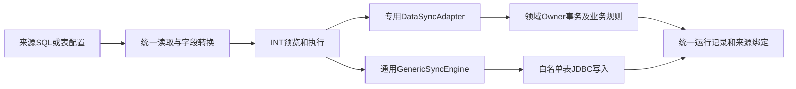

# 迁入过程共同处理规则

本包当前为27项任务，保留37份原来源组件。2026-10-15复核粒度、归属及旧SQL的有效项目范围；21份新库配置已保存并停用；原SQL/配置及2026-10-14结构证据仍作为原基线。六组合并规则见[任务目录](../../../superpowers/plans/2026-10-14-dppms-production-migration.md)。

## 通用任务与专用适配器

统一INT任务框架负责来源连接、SQL/表采集、字段转换、预览/执行、分页/分块、任务运行、来源绑定、回执和恢复。SyncDefinitionValidator将TABLE_MAPPING交GenericSyncEngine.bind；其他适配器按DataSyncAdapter.descriptor.key注册。专用适配器也使用这套框架。

GenericSyncEngine已支持每个来源1～10个目标步骤、业务键、字段枚举/LOOKUP、跨步骤ID、目标表查找、NULL策略、更新白名单、较新时间/tieBreaker、租户/逻辑删除/所有权保护以及流式分块。复杂SELECT、JOIN、窗口函数、源SQL预检或目标多表本身，都不能作为“不用通用任务”的充分理由。

但当前通用目标写入由GenericSyncJdbcStore直接执行白名单表INSERT/UPDATE，没有调用各领域正式业务Owner。它不能替代组织/权限缓存、成员授权/主责、项目状态初始化、商务权威接收、正式设备指派、不可变历史业务核验或许可加密采集。P11/P15（含原P26～P29）当前使用通用映射，源SQL与映射可复用；生产须接正式Owner。P29已有专用适配器可直接作为接入基线。没有依据要求为其余5项一律新造专用类，应先复用现有Owner及统一任务能力。

原P30～P37八份来源组件已有业务Owner/专用试点入口，但没有已保存的独立全量任务；当前归属为P30/P31/P33/P34/P35/P37六项。其材料SQL不是全量任务已实现的证明；须补统一任务入口、生产参数、分页/来源身份和Owner调用。P31内原P32分支还需要落实最新成员历史裁决。

本包43张目标表覆盖全部来源组件的主要承接表及2张重要附带业务表的结构清单。统一任务还维护int_sync_task、int_sync_run和int_sync_binding；既有项目材料/Owner迁移路径另使用原有来源快照、plt_migration_batch、plt_migration_source_record、plt_migration_issue及PLT命令/Outbox等技术记录。这些记录由各自框架维护，不是原业务字段的新承接点，也不提供直接写入脚本；新环境不复制旧运行与技术目标ID。

## 来源及范围

- 当前主线为类型10的有效项目。按[旧SQL证据及派生范围](project-scope.md)，先对全部同类型同编码记录取最大projectId，再筛disabled=0且effectiveTo IS NULL。projectIds空字符串只表示不进一步缩小有效规范集合；有效集合为空返回零行，不回退原全历史查询。空权限集合仍返回空。
- P16内部身份步骤（原P17）仅桥接自身有效且属于入选规范组的旧ID；有效的非最大ID仍保留范围内明细。无效规范组不回退旧版本，失效/停用旧ID及其项目归属明细不迁入、不按同码自动回挂。
- 合同、执行单、订单、回款、发货、设备及历史任务中按项目限定的来源共用同一有效集合；来源筛选不新增“正式项目必须先创建”的依赖，原可空引用保持。独立共享基础资料按既有批准范围，不随项目过滤删除或清理。生命周期状态不作为有效性过滤；已闭环但仍有效的项目保留。
- 公司/部门/账号/角色等任务各自保留批准筛选；不能把29个部门、8个EHR部门或试点范围称为全组织。
- SQL附件为无副作用SELECT。32份新来源SQL已在只读事务中EXPLAIN核对，P16作一次只读抽样；未执行任务预览/迁移。
- TABLE模式附件按MysqlSyncReader.compile等价展开，位置参数用具名参数显示并列原值；SQL模式逐字保留已保存语句。运行时还会追加已实现的游标/排序/来源上界等包装。
- 没有独立全量任务的材料查询保留现有参数；生产应由批准范围及P16的入选有效来源身份提供，不能把示例参数当成可执行生产名单。

## 转换与空值

- DIRECT/REFERENCE保留值，REFERENCE不是自动跨模块外键解析；最终引用由业务Owner或已配置LOOKUP确认。
- STRING转文本；TRIM仅执行明确配置的首尾去空格；LONG使用精确整数转换，DECIMAL使用原数值精度；DATETIME按既有JDBC时间契约转换，不随意变更时区或伪造来源时间。
- ENUM未定义值阻断；LOOKUP未命中返回NULL，是否允许NULL由目标契约继续判断。所有业务字典和逐源决定完整保存在任务JSON中。
- DPPMS公司01/02/03/04转001/002/003/004仅在适用转换处生效；未知非空公司阻断，不能对所有来源码无条件补零。
- 通用步骤nullPolicy=IGNORE时不以NULL覆盖已有值；OVERWRITE按该步骤定义覆盖。发货合同保修年数的NULL权威规则在专门转换中处理，不向其他字段泛化。
- 原审计NULL必须沿对应表裁决显式保存；仅已批准表允许更新时间空时取同一原记录创建时间。不得自动填管理员或当前迁入时间伪造历史。
- 原密码/MD5凭据不读取、不迁移；许可码只能在受控内存加密后进入专用Owner。普通采集、快照、日志和本包均不包含明文秘密。

## 身份、归并与写入

- 来源主键、查询sourceKey、正式业务唯一键、正式目标主键分开列示。旧ID不直接当新外键；正式身份经来源绑定/公开Owner解析。
- 多来源同目标必须保留每条来源身份及归并依据；同键异值不任选。无主键出厂版本按冻结组合及重复序号保存，不用SN覆盖所有历史。
- 租户、权限、公司范围、当前运行/配置版本及来源真实性始终生效。空输入/空权限不放宽条件，已删除目标不自动复活。
- 已有目标必须核实Owner、业务键和完整前值；后续人工变更阻断。新环境不能复制原targetId、userId、definitionId、运行/checkpoint或恢复证明。
- 旧fieldCarryProof、migrationRestoration、baseline、expectedProjectVersion、_expectedFingerprint仅是原目标限定证明，数量和去向列明，不打包为生产映射；18项业务排除和540个批准审计原码等业务LOOKUP完整保留。
- 初始化当前成员授权、主责、项目状态和设备归属只走对应正式Owner。历史记录不自动产生当前访问权、审批、任务、发货、安装或升级完成事实。
- P12同编码正式名称以CRM为准，未来不写产品标签扩展；P31内原P32历史最终客户联系人落PROJ成员历史，不要求准确最终客户，不写CUS联系人新批次。原已执行数据及不可变回执保持。

## 分页、失败与重放

- 读取方式按每项实际readStrategy/autoPaging列示。整树或需全部绑定的任务不能擅自改为独立分块；无主键组合身份只能按已支持的一次性快照方式处理。
- maxRows只是现配置限制，不代表全量完成。生产须按稳定源身份和既有分页机制覆盖完整范围，根运行已汇总子页时不得重复累计。
- 通用任务保留RETAIN/UPSERT约束及源issueField；专用适配器的来源冲突、精度、关联或历史保护失败继续返回ISSUE/CONFLICT或阻断事务。
- 失败保留原运行、来源与已提交块；只通过任务恢复/重试或获准Owner补偿，不直接SQL修改业务、运行状态、绑定或审计。
- 重放既要不重复新增，也须重新核实来源/目标是否改变；接口成功、PREVIEW_READY带ISSUE、编译通过均不等于业务迁移完成。

## 本轮合并与证据边界

> 下段为初次配置保存时点的历史事实；当前后续结果见[修复预览报告](preview-repair-20261015.md)及[前置矩阵](prerequisite-dependencies.md)。

2026-10-15：21份配置经正式API校验并保存到npdms_reverify_20261014，全部停用；P17原记录保留历史并禁止新运行/调度。原库未修改，未调用预览或迁移接口。新配置只合并读取/任务，保留原来源身份、权限、Owner和前值保护；P26重复合同五列目标步骤已删除，P15原权威补值继续生效。

同目标多表使用UNION ALL并按目标业务唯一身份归组；不使用UNION去掉原身份，不用MIN/任选值掩盖冲突。P04/P05共用账号/角色聚合；P06/P07引用同租户、同连接、当前任务配置版本已成功全量运行的不可变来源证据。缺少完整来源回执立即阻断，不能回退重新扫描或放宽范围。

Java定向检查63项（62通过、1项既有条件跳过），Python41项通过；32份SQL在MySQL5.7只读EXPLAIN通过，P16抽样验证一次读取两类结果。后端构建通过。155张业务及迁移表行数保存前后相同。没有真实浏览器业务验收、业务迁移或生产部署。CRM来源连接按既有配置保存，本轮未重新采集完整SQL Server结构。

P30/P31/P33/P34/P35/P37仍使用现有材料采集和Owner，未新增完整INT适配器。产品/最终客户/历史成员等原Owner缺口保留；配置校验不证明这些生产前置已齐备。原51份SQL、43份Owner Mapper、schema及全部原组件映射不修改。
