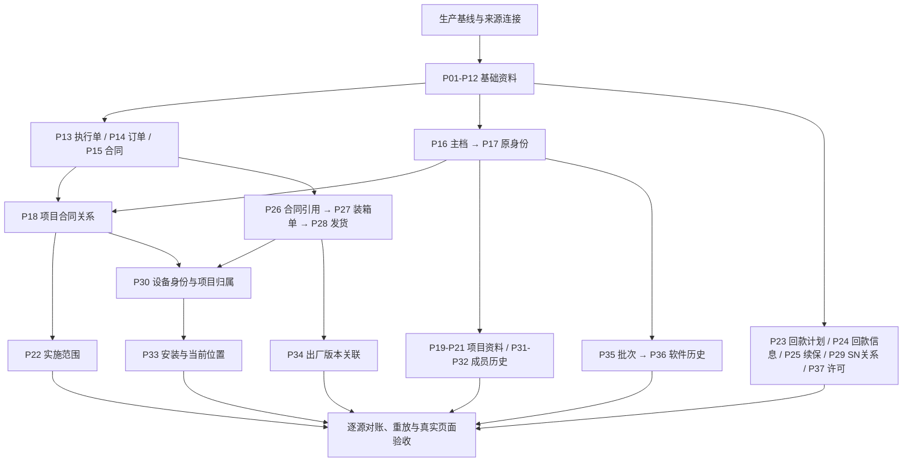

# DPPMS生产迁移最终任务集

整理日期：2026-10-14。工作范围：既有DPPMS迁移专项。文档用途：生产迁移任务目录与执行顺序；当前状态：**清单已收敛，生产执行条件未全部满足**。

**最终为37个业务任务，另有6项准备、执行与验收工作。** 原45项中，A/B的24项沿用业务范围与映射基线；C01当前组合拆成5项；另补8项已有业务承接的统一任务入口。剩余20项旧重复、纠正和样本任务只保留证据。这里的“复用”不等于旧配置可不经核对直接执行。

本轮只整理文档及结构化目录，没有创建或修改数据库任务，没有发起预览或业务写入，没有操作生产环境。原验证库不动，新验证库后续预览仍暂停发起；此前“暂不新增73,580个项目”和“合同/发货暂不执行”的决定继续有效。生产实际创建、关联和授权范围须以对应批次的明确授权为准。

## 范围与依据

- 项目范围沿用 `projectTypes=10`（用服），来源任务参数 `projectIds=""` 表示不按项目限制；这不适用于权限集合，空权限集合仍返回空。基础目录保留各自已批准筛选，不将它们误称为全组织、全账号迁移。
- 生产目标是否为空、已有业务/种子、租户、连接和部署身份尚未绑定。按“生产首次业务迁入”组织任务，但**不假设生产库没有数据**；已有数据必须走正式身份及现值保护。
- 本目录沿用既有专项裁决及用户后续明确调整，不改变PRD、业务状态或数据Owner；正式承接依对应领域Owner。P12按2026-10-14最新裁决采用CRM同编码名称，不再使用产品目录扩展承接差异；此前裁决及执行证据保留追溯。
- P32按2026-10-14最新裁决改由PROJ项目成员历史承接；历史项目无法准确归集最终客户，不强建客户联系人归属。P31与P32为同一成员Owner下不同来源角色及授权条件的批次，均落成员表，合计任务数仍为37。
- 目录里的P编号是本文件计划编号，不是数据库任务ID。JSON同样是目录，不能直接提交 `/tasks` 或作为执行批准。

来源：[2026-10-14-dppms-original-task-migration-inventory.md](../../generated/2026-10-14-dppms-original-task-migration-inventory.md)及其JSON（45项，采集时间 `2026-10-14T18:01:18.729001`）；[2026-10-13-dppms-migration-mapping/README.md](../../generated/2026-10-13-dppms-migration-mapping/README.md)；[2026-10-14-dppms-full-preview-blocker-repair.md](../../generated/2026-10-14-dppms-full-preview-blocker-repair.md)；[现行问题与裁决](../../decisions/open-questions.md)。

2026-10-13的SQL合集保留原始查询溯源；当前配置以清单中所列任务版本及受控导出的 `original-task-definitions.json` 为准。后续生成生产配置时必须固定这些来源版本，不能把旧SQL附件当作最新配置，也不能照搬其中的目标环境ID。

完整逐项明细：[来源、目标、SQL、字段映射、承接规则及适配器取舍](../../generated/2026-10-13-dppms-migration-mapping/production-tasks/README.md)。其中明确列出当前配置与最新裁决差异，并包含Owner实际Mapper SQL及附带写入表；这是评审材料，不是可执行任务配置。

## 最终业务任务

“前置”是迁入或本轮执行安排所需依赖；允许NULL的引用不被人为变成强依赖。所有任务的生产版本均待新环境预览；下列准备状态不是生产放行状态。P15、P26～P30保留现有合同/发货执行暂停边界。

### 基础资料（12项）

| 编号 / 最终任务 | 来源 | 主要目标 / Owner | 前置 | 配置来源 / 准备状态 |
| --- | --- | --- | --- | --- |
| [P01 公司与基础部门](../../generated/2026-10-13-dppms-migration-mapping/production-tasks/tasks/P01.md) | ehr_company、ehr_department | `system_company`、`system_dept` / SYSTEM | 生产基线与适用目录 | A01 / `2101562667583217666` v16；复用并重验 |
| [P02 已批准的FND补充部门](../../generated/2026-10-13-dppms-migration-mapping/production-tasks/tasks/P02.md) | fnd_department，精确参考 ehr_department | `system_dept` / SYSTEM | P01 | A03 / `2108524501517955073` v1；恢复批准范围 |
| [P03 八个EHR补充部门及主管补关联](../../generated/2026-10-13-dppms-migration-mapping/production-tasks/tasks/P03.md) | ehr_department，精确参考 fnd_department 和原主管账号 | `system_dept` / SYSTEM | P01、P02 | A02 / `2108538095265562625` v0；复用并重验 |
| [P04 账号与任职资料](../../generated/2026-10-13-dppms-migration-mapping/production-tasks/tasks/P04.md) | t_user、t_user_info、fnd_user_info；EHR精确人员参考 | `system_users` / SYSTEM | P01、P02、P03 | A04 / `2108524822998773762` v0；首次迁入适配 |
| [P05 角色定义及来源角色绑定](../../generated/2026-10-13-dppms-migration-mapping/production-tasks/tasks/P05.md) | t_role、fnd_roles | `system_role` / SYSTEM | P04 | A05 / `2108554583850524673` v0；首次迁入适配 |
| [P06 用户角色关系](../../generated/2026-10-13-dppms-migration-mapping/production-tasks/tasks/P06.md) | t_user_role、fnd_user_info.roleIds | `system_user_role` / SYSTEM | P04、P05 | A06 / `2108568095503093761` v0；复用并重验 |
| [P07 用户公司与部门范围](../../generated/2026-10-13-dppms-migration-mapping/production-tasks/tasks/P07.md) | t_user、t_user_info、fnd_user_info、t_user_role、fnd_user_power | `system_user_company_department_scope` / SYSTEM | P01、P02、P03、P04、P05、P06 | A07 / `2108569376783273985` v0；复用并重验 |
| [P08 基础字典类型](../../generated/2026-10-13-dppms-migration-mapping/production-tasks/tasks/P08.md) | fnd_basic_data_type；已批准的缺失分组 | `system_dict_type` / SYSTEM | P04 | A08 / `2109351154645135362` v0；复用并重验 |
| [P09 基础字典项](../../generated/2026-10-13-dppms-migration-mapping/production-tasks/tasks/P09.md) | fnd_basic_data | `system_dict_data` / SYSTEM | P08 | A09 / `2109371486114320385` v0；复用并重验 |
| [P10 CRM客户主档](../../generated/2026-10-13-dppms-migration-mapping/production-tasks/tasks/P10.md) | CRM SQL Server：Account及原任务查询 | `cus_customer_master` / CUS | 生产基线与适用目录 | A10 / `2102221608959250434` v2；复用并重验 |
| [P11 CRM正式产品目录](../../generated/2026-10-13-dppms-migration-mapping/production-tasks/tasks/P11.md) | CRM SQL Server：DPtech_v_product_info_single | `ast_product_official_info` / AST | 生产基线与适用目录 | A11 / `2102221608179109889` v1；正式Owner接入 |
| [P12 DPPMS缺失产品补齐与编码关联](../../generated/2026-10-13-dppms-migration-mapping/production-tasks/tasks/P12.md) | fb_items | `ast_product_official_info` / AST | P11 | A12 / `2108534088732168194` v2；首次迁入适配 |

### 商务与项目主线（13项）

| 编号 / 最终任务 | 来源 | 主要目标 / Owner | 前置 | 配置来源 / 准备状态 |
| --- | --- | --- | --- | --- |
| [P13 CRM执行单](../../generated/2026-10-13-dppms-migration-mapping/production-tasks/tasks/P13.md) | pm_project_property_from_sms及原任务关联SQL | `com_crm_execution_order` / COM | P01、P10 | B01 / `2101625228492091393` v11；复用并重验 |
| [P14 销售订单与订单行](../../generated/2026-10-13-dppms-migration-mapping/production-tasks/tasks/P14.md) | pm_order_data_from_erp、pm_order_line_from_erp | `com_sales_order`、`com_sales_order_line` / COM | P01、P10、P12、P13 | B02 / `2101587859478949890` v31；首次迁入适配 |
| [P15 正式合同主档](../../generated/2026-10-13-dppms-migration-mapping/production-tasks/tasks/P15.md) | 当前C01/v14的CONTRACT来源：ERP订单分组及已批准合同补充 | `com_contract` / COM | P01、P10 | C01 / `2107037031219654657` v14 / CONTRACT；正式Owner接入 |
| [P16 规范项目主档与基础最终客户资料](../../generated/2026-10-13-dppms-migration-mapping/production-tasks/tasks/P16.md) | pm_project_header/pm_project，当前规范项目SQL | `proj_project`、`proj_project_party` / PROJ | P01、P02、P03、P04、P09、P10 | B03 / `2108608417343934465` v10；首次迁入适配 |
| [P17 全部原项目身份桥接](../../generated/2026-10-13-dppms-migration-mapping/production-tasks/tasks/P17.md) | pm_project原ID、类型和编码 | `int_sync_binding` / PROJ/INT | P16 | B04 / `2109622534918856706` v6；复用并重验 |
| [P18 项目合同关系及正式商务关联](../../generated/2026-10-13-dppms-migration-mapping/production-tasks/tasks/P18.md) | pm_project_contract、pm_project_group、pm_project_group_relationship | `com_project_contract_relation` / COM/PROJ | P04、P13、P14、P15、P17 | B05 / `2109363204544983041` v12；复用并重验 |
| [P19 项目相关方与发货/执行状态资料](../../generated/2026-10-13-dppms-migration-mapping/production-tasks/tasks/P19.md) | pm_project_related_party、pm_project_state | `proj_project_party`、`plt_entity_extension_value` / PROJ/PLT | P04、P09、P17 | B11 / `2109968219214897153` v5；首次迁入适配 |
| [P20 项目真实产品](../../generated/2026-10-13-dppms-migration-mapping/production-tasks/tasks/P20.md) | pm_project_product_line_real及其原上游引用 | `proj_project_real_product` / PROJ | P04、P17 | B09 / `2109865269478027265` v4；复用并重验 |
| [P21 项目租赁产品与产品配置](../../generated/2026-10-13-dppms-migration-mapping/production-tasks/tasks/P21.md) | pm_project_product_lease_line_from_crm、pm_project_product_config_level_info_from_crm | `proj_project_lease_product`、`proj_project_product_configuration` / PROJ | P04、P17 | B10 / `2109865270430134273` v4；复用并重验 |
| [P22 项目产品实施范围](../../generated/2026-10-13-dppms-migration-mapping/production-tasks/tasks/P22.md) | pm_project_product_line及已批准的项目/合同/订单行解析 | `com_delivery_scope`、`com_delivery_scope_detail` / COM | P01、P02、P03、P12、P14、P17、P18 | B08 / `2109829769958453249` v7；首次迁入适配 |
| [P23 合同回款计划](../../generated/2026-10-13-dppms-migration-mapping/production-tasks/tasks/P23.md) | pm_pb_plan_from_sms | `com_contract_collection_plan` / COM | P04 | B06 / `2108574253093683202` v10；复用并重验 |
| [P24 合同实际回款信息](../../generated/2026-10-13-dppms-migration-mapping/production-tasks/tasks/P24.md) | sms_ofst_contract_head_sap | `com_contract_receivable` / COM | P04 | B07 / `2109967339937804289` v4；复用并重验 |
| [P25 设备逐次续保记录](../../generated/2026-10-13-dppms-migration-mapping/production-tasks/tasks/P25.md) | fb_service | `ast_device_warranty_renewal_record` / AST | 生产基线与适用目录 | B12 / `2110010787726274561` v5；复用并重验 |

### 发货与设备（5项，保留暂缓执行）

| 编号 / 最终任务 | 来源 | 主要目标 / Owner | 前置 | 配置来源 / 准备状态 |
| --- | --- | --- | --- | --- |
| [P26 发货合同引用与保修年数](../../generated/2026-10-13-dppms-migration-mapping/production-tasks/tasks/P26.md) | C01/v14的SHIPMENT_CONTRACT：fb_contract | `com_shipment_contract_reference`、`com_contract` / COM | P01、P02、P03、P15 | C01 / `2107037031219654657` v14 / SHIPMENT_CONTRACT；正式Owner接入 |
| [P27 装箱单与物流](../../generated/2026-10-13-dppms-migration-mapping/production-tasks/tasks/P27.md) | C01/v14的PACKAGE：fb_shipment及物流参考 | `com_shipment_package` / COM | P26 | C01 / `2107037031219654657` v14 / PACKAGE；正式Owner接入 |
| [P28 设备发货事实](../../generated/2026-10-13-dppms-migration-mapping/production-tasks/tasks/P28.md) | C01/v14的DEVICE_SN：fb_shipment_barcode及合同/装箱单/产品目录 | `ast_device_shipment` / AST | P12、P14、P26、P27 | C01 / `2107037031219654657` v14 / DEVICE_SN；正式Owner接入 |
| [P29 主SN与附加SN关系](../../generated/2026-10-13-dppms-migration-mapping/production-tasks/tasks/P29.md) | C01/v14的DEVICE_RELATION：fb_shipment_barcode_relation | `ast_device_relationship` / AST | P12、P15 | C01 / `2107037031219654657` v14 / DEVICE_RELATION；正式Owner接入 |
| [P30 设备主档及项目归属衔接](../../generated/2026-10-13-dppms-migration-mapping/production-tasks/tasks/P30.md) | 已迁发货事实及可核实的原项目/合同/设备关联 | `ast_device`、`ast_device_project_relationship` / AST/PROJ | P12、P14、P17、P18、P28 | 原45项无对应独立全量任务；补统一任务入口 |

### 补齐的项目与设备明细入口（7项）

| 编号 / 最终任务 | 来源 | 主要目标 / Owner | 前置 | 配置来源 / 准备状态 |
| --- | --- | --- | --- | --- |
| [P31 项目成员历史与获准授权](../../generated/2026-10-13-dppms-migration-mapping/production-tasks/tasks/P31.md) | pm_project_member：已批准账号成员角色，与P32历史联系人分批承接 | `proj_project_member_assignment` / PROJ/SYSTEM | P04、P05、P06、P07、P17 | 原45项无对应独立全量任务；补统一任务入口 |
| [P32 历史最终客户联系人作为项目成员](../../generated/2026-10-13-dppms-migration-mapping/production-tasks/tasks/P32.md) | pm_project_member：memberRole=60，按原项目身份关联 | `proj_project_member_assignment` / PROJ | P04、P17 | 原45项无对应独立全量任务；补统一任务入口 |
| [P33 普通安装历史及获准当前位置](../../generated/2026-10-13-dppms-migration-mapping/production-tasks/tasks/P33.md) | pm_project_shipment：已批准普通安装范围 | `imp_eng_installation`、`ast_device_location`、`ast_address`、`ast_device` / IMP/AST | P04、P17、P30 | 原45项无对应独立全量任务；补统一任务入口 |
| [P34 出厂软件版本记录](../../generated/2026-10-13-dppms-migration-mapping/production-tasks/tasks/P34.md) | fb_soft_version | `ast_device_factory_version_record` / AST | P17、P28 | 原45项无对应独立全量任务；补统一任务入口 |
| [P35 项目软件变更批次](../../generated/2026-10-13-dppms-migration-mapping/production-tasks/tasks/P35.md) | pm_project_soft_change_logs | `ast_device_software_change_batch` / AST/PROJ | P04、P17 | 原45项无对应独立全量任务；补统一任务入口 |
| [P36 设备软件版本历史](../../generated/2026-10-13-dppms-migration-mapping/production-tasks/tasks/P36.md) | pm_project_soft_version | `ast_device_software_version_record`、`plt_entity_extension_value` / AST/PLT | P04、P17、P35 | 原45项无对应独立全量任务；补统一任务入口 |
| [P37 设备许可历史](../../generated/2026-10-13-dppms-migration-mapping/production-tasks/tasks/P37.md) | pm_project_license_info_from_license，受控加密采集 | `ast_device_license_record` / AST | 生产基线与适用目录 | 原45项无对应独立全量任务；补统一任务入口 |

## 每项任务的收口要求

下列要求直接继承既有裁决；有实现/业务缺口的任务列出缺口，不把试点通过等同于生产全量可运行。

### P01 公司与基础部门

- 配置与补齐：沿用公司映射与 depGrade<=2、LENGTH(depCode)=6 的基础部门条件；它不是全组织树。核对生产公司编码、父部门及目录种子。
- 完成依据：公司与部门逐来源有处置；父部门唯一；不按旧库数值ID关联，不自动扩大目录筛选。

### P02 已批准的FND补充部门

- 配置与补齐：当前任务只取163130；生产配置复用 DppmsDepartmentSyncTemplate 的已批准28码，再纳入已单独批准的163130，共29码。不得只复制当前单码参数，也不扩为所有部门。
- 完成依据：29个选定编码逐项核对来源、父级、启停和审计；生产已有项按Owner规则处理，冲突保留。
- 规则来源：[2026-10-09-dppms-system-dept-table-decision.md](../../generated/2026-10-09-dppms-system-dept-table-decision.md)。

### P03 八个EHR补充部门及主管补关联

- 配置与补齐：保留8码及各自主来源规则。先创建部门，主管未绑定时保留待关联；P04完成后在同任务重跑主管补关联。
- 完成依据：8项齐全，主管只按正式用户来源绑定解析；重跑不改已有历史审计或生成新授权。
- 规则来源：[2026-10-09-dppms-system-dept-eight-missing-table-decision.md](../../generated/2026-10-09-dppms-system-dept-eight-missing-table-decision.md)。

### P04 账号与任职资料

- 配置与补齐：保留已批准账号范围、合并优先级和三项EHR例外；不读取旧密码。旧admin审计关联的正式身份须在生产核实，不能照搬ID1。首次写入即保留原NULL审计，不重放557项旧纠正证明。
- 完成依据：账号资料和来源别名完整；原NULL/历史日期不被自动填充改写；角色、项目访问及认证激活分别受控。
- 规则来源：[2026-10-09-dppms-system-users-table-decision.md](../../generated/2026-10-09-dppms-system-users-table-decision.md)；[2026-10-09-dppms-user-contact-and-login-decision.md](../../generated/2026-10-09-dppms-user-contact-and-login-decision.md)；[2026-10-09-dppms-user-null-updater-correction.md](../../generated/2026-10-09-dppms-user-null-updater-correction.md)。

### P05 角色定义及来源角色绑定

- 配置与补齐：保留18项原角色编码映射、既有角色引用及停用排除；首次迁入即使用已裁决的原审计，不带13角色旧纠正目标ID。
- 完成依据：来源角色到正式角色唯一可追溯；不由角色名称猜权限，不新增未批准菜单授权。
- 规则来源：[2026-10-09-dppms-role-identity-mapping-decision.md](../../generated/2026-10-09-dppms-role-identity-mapping-decision.md)；[2026-10-09-dppms-role-audit-correction-decision.md](../../generated/2026-10-09-dppms-role-audit-correction-decision.md)。

### P06 用户角色关系

- 配置与补齐：通过新环境用户/角色绑定构建已批准关系；保持原停用、空公司及关系去重规则。
- 完成依据：有效授权、只作引用和排除分别对账；不把历史关系自动扩为全部项目访问。
- 规则来源：[2026-10-09-dppms-user-selected-scope-decision.md](../../generated/2026-10-09-dppms-user-selected-scope-decision.md)。

### P07 用户公司与部门范围

- 配置与补齐：保留已批准的公司转换、多任职及主范围裁决；所有正式引用在生产重新解析。
- 完成依据：原范围与主标记逐项一致；公司/部门范围不自动替代按项目授权。
- 规则来源：[2026-10-09-dppms-user-company-department-scope-table-decision.md](../../generated/2026-10-09-dppms-user-company-department-scope-table-decision.md)；[2026-10-09-dppms-user-scope-primary-conflicts.md](../../generated/2026-10-09-dppms-user-scope-primary-conflicts.md)。

### P08 基础字典类型

- 配置与补齐：沿用原31类加49缺失组的80类规则；核对生产已有字典及业务种子。
- 完成依据：编码唯一、停用与原审计保留；不覆盖生产人工维护值。
- 规则来源：[2026-10-12-dppms-system-dictionary-table-proposal.md](../../generated/2026-10-12-dppms-system-dictionary-table-proposal.md)。

### P09 基础字典项

- 配置与补齐：保留531项承接及原ID114一项排除；普通字典字段、状态及NULL处理沿已批准规则。
- 完成依据：来源项、正式类型、启停、审计逐项对账；排除有原ID和理由。
- 规则来源：[2026-10-12-dppms-system-dictionary-table-proposal.md](../../generated/2026-10-12-dppms-system-dictionary-table-proposal.md)。

### P10 CRM客户主档

- 配置与补齐：重建只读CRM连接，沿用CRM权威值域及身份规则；核对生产已有客户，不按名称合并。
- 完成依据：客户编码/CRM身份及属性完整；来源到目标唯一可追溯；连接未验证前不称可执行。

### P11 CRM正式产品目录

- 配置与补齐：复用现有源查询和字段映射；当前TABLE_MAPPING直接写AST表，生产入口须接AST正式Owner并核对产品唯一键。
- 完成依据：同编码沿用CRM正式字段；已有产品碰撞、权限、空集合和事务边界保持。

### P12 DPPMS缺失产品补齐与编码关联

- 配置与补齐：按2026-10-14最新裁决，以租户+产品编码关联；同编码名称不同以CRM为准，既有正式字段保持。缺失产品仍按item/itemname/describe_补齐编码、型号、名称和描述并设ACTIVE，原id不作业务键。生产模板、适配器及AST Owner的迁入/解析路径须移除产品扩展定义、标签匹配及扩展读写依赖，不再要求migrationDefinitionRevisionId或创建dppms_catalog_labels；不转存到其他扩展或描述字段。现有代码仍依赖扩展，属于本任务待改项。
- 完成依据：全部来源编码有处置；CRM同编码异名时正式字段保持且不新增/更新产品扩展，缺失产品按批准规则创建，重放不重复写入。同编码解析不以DPPMS标签齐备为前提；租户、权限、删除及身份冲突保护保持。原库已有扩展、绑定和历史证据保留。
- 规则来源：[2026-10-09-dppms-official-product-table-decision.md](../../generated/2026-10-09-dppms-official-product-table-decision.md)。

### P13 CRM执行单

- 配置与补齐：沿用用服类型参数、公司码转换及自动分页；原项目ID参数为空表示全量来源。
- 完成依据：根回执合计与分页来源闭合；按业务键/完整来源身份核对，不把最后一页当全量。
- 规则来源：[2026-10-09-dppms-crm-execution-order-table-decision.md](../../generated/2026-10-09-dppms-crm-execution-order-table-decision.md)。

### P14 销售订单与订单行

- 配置与补齐：准备首次迁入配置，旧91161项fieldCarryProof仅留原环境追溯；生产已有订单必须重新取得Owner前值证明。保留头/行顺序、精确ERP公司业务键及Q023/Q025冲突保护。
- 完成依据：完整原字段、公司、父单、执行单及来源绑定对账；410条来源执行单冲突不能任取一条；不复活236259条旧清理绑定。
- 规则来源：[2026-10-09-dppms-sales-order-table-decision.md](../../generated/2026-10-09-dppms-sales-order-table-decision.md)；[2026-10-09-dppms-sales-order-line-table-decision.md](../../generated/2026-10-09-dppms-sales-order-line-table-decision.md)；[2026-10-14-dppms-full-preview-blocker-repair.md](../../generated/2026-10-14-dppms-full-preview-blocker-repair.md)。

### P15 正式合同主档

- 配置与补齐：仅抽出当前组合的CONTRACT段，不能用旧C03/v3成功回执替代。保留两份批准合同和两项客户码特例的精确范围；经COM Owner承接，Q024客户冲突继续阻断。
- 完成依据：合同来源、公司、客户和全部批准字段可追溯；194个缺合同案例按权威来源解决，不从MIN客户号猜配。
- 规则来源：[2026-10-13-dppms-migration-mapping/contract-master-approved-source-mapping.json](../../generated/2026-10-13-dppms-migration-mapping/contract-master-approved-source-mapping.json)；[2026-10-14-dppms-full-preview-blocker-repair.md](../../generated/2026-10-14-dppms-full-preview-blocker-repair.md)。

### P16 规范项目主档与基础最终客户资料

- 配置与补齐：同类型同码最大projectId规则及原NULL/空名称裁决保持；首次创建不带6570项旧恢复凭据及10项旧目标版本。当前主档任务只承接主档，需补第二子步骤：原column013经已批准的ProjectHeaderFinalCustomerService所属PROJ Owner承接FINAL_CUSTOMER相关方；不把现有主档任务当作已实现此步。最终客户原文保留不等于已准确归集客户主档，不能据名称或购货方猜配客户ID。主档与最终客户资料分步验收，后者不作为P17身份桥接或P32历史成员迁入的前置。生产已有项目重新核对接管与冲突。
- 完成依据：全部规范项目有处置；主档、公司/办事处、审计及最终客户原始资料可追溯，客户身份未核实不强行归集；创建范围单独批准，不因映射已批准就创建空项目。
- 规则来源：[2026-10-09-dppms-proj-project-table-decision.md](../../generated/2026-10-09-dppms-proj-project-table-decision.md)；[2026-10-12-dppms-whole-table-task-correction.md](../../generated/2026-10-12-dppms-whole-table-task-correction.md)；[2026-10-14-dppms-full-preview-blocker-repair.md](../../generated/2026-10-14-dppms-full-preview-blocker-repair.md)。

### P17 全部原项目身份桥接

- 配置与补齐：把所有原ID绑定到规范主档；本任务负责身份，不再创建同码项目。对P16的依赖仅要求主档身份就绪，不以最终客户资料子步骤完成为条件。
- 完成依据：原ID、规范ID、类型和绑定一一可查；来源多ID不变成多份正式项目。
- 规则来源：[2026-10-09-dppms-identity-table-decision.md](../../generated/2026-10-09-dppms-identity-table-decision.md)。

### P18 项目合同关系及正式商务关联

- 配置与补齐：保持正式项目+合同归并、当前/历史及审计裁决，保留18项逐源排除。原组及成员只按Q015/Q016规则参与关系，smsProjectCode须沿正式合同/订单/执行单链核对。
- 完成依据：所有原合同/组成员身份和正式关系可追溯；历史不参与当前授权。商务链缺失/多义保留为问题，不用项目扩展数组代替。
- 规则来源：[2026-10-12-dppms-project-contract-relation-table-proposal.md](../../generated/2026-10-12-dppms-project-contract-relation-table-proposal.md)；[2026-10-14-dppms-full-preview-blocker-repair.md](../../generated/2026-10-14-dppms-full-preview-blocker-repair.md)。

### P19 项目相关方与发货/执行状态资料

- 配置与补齐：重建正式状态扩展定义；55项旧_expectedFingerprint不当生产前值。状态更新时间保留原含义，审批及工程计划缓存不承接。
- 完成依据：相关方原角色、审计、区间及两类状态/更新时间完整；不触发生命周期、审批或任务完成。
- 规则来源：[2026-10-13-dppms-migration-mapping/remaining-carry-implementation.md](../../generated/2026-10-13-dppms-migration-mapping/remaining-carry-implementation.md)。

### P20 项目真实产品

- 配置与补齐：保留完整原字段及来源修订关系；缺项目不创建项目，未形成项目清单的独立上游资料不混入。
- 完成依据：所有来源行与正式清单逐项对账，后续人工变更受保护。
- 规则来源：[2026-10-10-dppms-real-product-table-decision.md](../../generated/2026-10-10-dppms-real-product-table-decision.md)。

### P21 项目租赁产品与产品配置

- 配置与补齐：两个来源对象分别保留原字段、键与结果；沿同一已有适配器，不拆出重复Owner。
- 完成依据：两表分别对账；已发现3条原项目缺失仍登记，不能挂靠同名项目。
- 规则来源：[2026-10-10-dppms-lease-product-table-decision.md](../../generated/2026-10-10-dppms-lease-product-table-decision.md)；[2026-10-10-dppms-product-configuration-table-decision.md](../../generated/2026-10-10-dppms-product-configuration-table-decision.md)。

### P22 项目产品实施范围

- 配置与补齐：105项旧baseline不带入生产；按新目标生成保护前值。保留精确订单行、办事处和正数量约束，不用默认数量消除来源缺项。
- 完成依据：每条来源有准确项目、合同、订单行及数量；原330781/330782仍受正数量保护，其他缺办事处/订单行逐项闭合。
- 规则来源：[2026-10-09-dppms-delivery-scope-table-decision.md](../../generated/2026-10-09-dppms-delivery-scope-table-decision.md)；[2026-10-14-dppms-full-preview-blocker-repair.md](../../generated/2026-10-14-dppms-full-preview-blocker-repair.md)。

### P23 合同回款计划

- 配置与补齐：保留540个已批准未关联审计编码的原码承接，不因无账号过滤原行或补造账号。Owner允许未唯一匹配合同的计划保留NULL合同ID，P15不是全部计划的强制入库前置；原缓存键仅用于本次冻结基线，禁止跨刷新自动重绑。
- 完成依据：计划原字段、原合同号及审计一致；与实际回款信息分开对账，不制造收款完成事实；正式合同引用仅精确唯一时补关联。
- 规则来源：[2026-10-09-dppms-contract-collection-plan-table-decision.md](../../generated/2026-10-09-dppms-contract-collection-plan-table-decision.md)。

### P24 合同实际回款信息

- 配置与补齐：保留39原字段、金额比例及7条空合同号的原裁决。合同ID只在精确唯一时补关联，缺唯一主档按批准保留NULL，不阻断该原始回款事实。
- 完成依据：金额/比例精度、NULL和原合同号完整；项目展示另须P18正式合同关系，不把P15强行变成所有回款行的入库前置。
- 规则来源：[2026-10-13-dppms-migration-mapping/remaining-carry-implementation.md](../../generated/2026-10-13-dppms-migration-mapping/remaining-carry-implementation.md)。

### P25 设备逐次续保记录

- 配置与补齐：沿17列及id+barcode来源身份，全部原state值承接；不要求当前设备/合同主档必先存在。项目展示与计算依赖另核对。
- 完成依据：每次续保起止、等级、原state完整；并列日期不任选最新；不复制view_warranty派生结果。
- 规则来源：[2026-10-13-dppms-renewal-and-warranty-table-proposal.md](../../generated/2026-10-13-dppms-renewal-and-warranty-table-proposal.md)。

### P26 发货合同引用与保修年数

- 配置与补齐：抽出该来源及两个写入步骤，接COM Owner；保留合同原字段与年数转换、NULL裁决，不能把旧2条纠正证明平移执行。
- 完成依据：发货引用、正式合同补充字段及年数单位准确；空业务身份问题单列，原合同权威字段受保护。
- 规则来源：[2026-10-10-dppms-shipment-contract-reference-table-decision.md](../../generated/2026-10-10-dppms-shipment-contract-reference-table-decision.md)。

### P27 装箱单与物流

- 配置与补齐：复用当前来源SQL与8原字段规则，改经COM Owner；物流编码与名称分别保存。
- 完成依据：原装箱单、发货合同引用、日期及物流一致；缺引用不猜配，不把物流送达当业务完成。
- 规则来源：[2026-10-09-dppms-shipment-package-table-decision.md](../../generated/2026-10-09-dppms-shipment-package-table-decision.md)。

### P28 设备发货事实

- 配置与补齐：保留全部原业务字段，正式订单行引用经Owner精确解析；通用写表步骤改为AST入口。固定业务字段落正式列，原证据不得充当业务承接。
- 完成依据：主附SN、订单行、产品、时间、保修、RMA及原审计完整；重复发货保留，不能自动生成安装或验收完成。
- 规则来源：[2026-10-09-dppms-ast-device-shipment-table-decision.md](../../generated/2026-10-09-dppms-ast-device-shipment-table-decision.md)；[2026-10-10-dppms-equipment-association-repair-decision.md](../../generated/2026-10-10-dppms-equipment-association-repair-decision.md)。

### P29 主SN与附加SN关系

- 配置与补齐：沿当前来源范围，接已有DPPMS_DEVICE_RELATIONSHIP适配器及AST Owner；保留8原字段、19正式列、360项自关联排除及正确历史审计。
- 完成依据：原关系、合同及两侧产品逐项对账；不恢复旧设备缓存/当前投影步骤，不自动改变设备归属或授权。
- 规则来源：[2026-10-12-dppms-device-relationship-table-decision.md](../../generated/2026-10-12-dppms-device-relationship-table-decision.md)；[2026-10-12-dppms-device-relationship-self-exclusions.md](../../generated/2026-10-12-dppms-device-relationship-self-exclusions.md)。

### P30 设备主档及项目归属衔接

- 配置与补齐：现C01的DEVICE_SN只写发货事实，不能计为设备主档完成。复用已有DppmsAssetEntityImportApi和正式设备指派Owner边界，补统一任务入口；不得复活C05/C06旧通用条码写法。
- 完成依据：SN身份、最新发货及当前项目归属分别核对；多项目竞争、较新归属或已删除主档冲突阻断，不按任务先后抢占SN。
- 规则来源：[2026-10-10-dppms-equipment-association-repair-decision.md](../../generated/2026-10-10-dppms-equipment-association-repair-decision.md)。

### P31 项目成员历史与获准授权

- 配置与补齐：把已批准34列及迁移Owner接为整表参数化任务；历史保存与有效授权、主责变更分别核验。原10项目的主责裁决不能扩展为全历史。与P32共用PROJ成员Owner，来源角色筛选互斥、同项目串行，不把原角色60归入账号授权批次。
- 完成依据：原人员、联系方式、来源、区间和审计完整；每条当前授权经资格核验；未关联/不合格只作历史，其他角色及重复区间不猜配。
- 规则来源：[2026-10-11-dppms-project-member-table-decision.md](../../generated/2026-10-11-dppms-project-member-table-decision.md)；[2026-10-11-dppms-project-member-owner-conflicts.md](../../generated/2026-10-11-dppms-project-member-owner-conflicts.md)。

### P32 历史最终客户联系人作为项目成员

- 配置与补齐：按2026-10-14用户裁决，通过P17原项目身份归入项目成员历史，复用现成员表34列及PROJ成员Owner；不依赖准确最终客户、FINAL_CUSTOMER相关方或CUS联系人主档，不写cus_project_customer_contact_relation。保留原姓名、人员编码、电话、邮箱、登记来源、有效期和审计；原角色60保留历史最终客户联系人的含义，不改成经理、销售或普通账号成员角色。采用既有authorization_confirmed=false，无法精确关联账号时user_id保持NULL。现有成员迁入仍排除角色60、旧联系人入口仍强制最终客户相关方，须补成员历史承接、显示及统一任务入口；P04仅用于既定审计人员核对，不要求这些联系人具备账号。
- 完成依据：逐原15字段与项目来源绑定核对；缺最终客户或联系人账号仍能保存和查询成员历史。原NULL操作者和有效区间保持，更新时间沿既定规则使用原更新时间、缺失时取原创建时间、二者均空保持NULL，来源原NULL由既有证据保留。不生成账号、系统角色、当前项目授权、主责或客户联系人完成事实；当前成员与正常业务维护保护保持。与P31来源不重复，重放不重复新增；原库已迁9条CUS联系人及其绑定、回执保留，不在本轮搬移或删除。
- 规则来源：[2026-10-11-dppms-project-member-table-decision.md](../../generated/2026-10-11-dppms-project-member-table-decision.md)；[2026-10-12-dppms-final-customer-contact-table-decision.md](../../generated/2026-10-12-dppms-final-customer-contact-table-decision.md)。

### P33 普通安装历史及获准当前位置

- 配置与补齐：沿32列安装实体及正式位置Owner补首次迁入任务；旧DppmsInstallationAddressImportService对非空命令已拒绝，现DppmsInstallationRecordMigrationService要求已有安装及完整baseline，不能作为首次创建入口。须接正式安装/地址Owner完成首次创建与快照，再复用已批准的历史状态/区间和位置保护规则。空地址、超长地址另受既有未决约束，串货本轮不迁。
- 完成依据：每条安装的项目、设备、原地址、区间及审计准确；历史承接与当前位置写入分别对账，不覆盖较新位置。
- 规则来源：[2026-10-10-dppms-existing-installation-table-decision.md](../../generated/2026-10-10-dppms-existing-installation-table-decision.md)；[2026-10-13-dppms-migration-mapping/remaining-carry-implementation.md](../../generated/2026-10-13-dppms-migration-mapping/remaining-carry-implementation.md)。

### P34 出厂软件版本记录

- 配置与补齐：沿已批准13列和完整重复保留规则补一次性任务。原表无稳定主键，以冻结来源和同值出现次数保留逐行身份；持续修订/消失处理不启用。
- 完成依据：五原字段及重复次数完整；项目引用仅保留可核实关联，缺当前设备不丢记录；不任选最新、不自动覆盖唯一出厂主档。
- 规则来源：[2026-10-10-dppms-factory-version-record-table-decision.md](../../generated/2026-10-10-dppms-factory-version-record-table-decision.md)。

### P35 项目软件变更批次

- 配置与补齐：沿正式11列、9原字段和NULL审计规则补整表任务；不携带原6条纠正目标ID。
- 完成依据：批次身份、版本、日期及原审计逐项一致；旧latest/登记时间不生成每台设备升级完成事实。
- 规则来源：[2026-10-10-dppms-software-batch-table-decision.md](../../generated/2026-10-10-dppms-software-batch-table-decision.md)。

### P36 设备软件版本历史

- 配置与补齐：沿正式31列、28原字段及8项批准扩展补一次性任务；重建扩展定义引用，logId精确关联P35。正式设备ID仅精确核实，缺失按批准保留SN。
- 完成依据：历史版本、原Bak/Change和审计完整；不使用旧software_observation/network_version_event承接，不刷新当前设备版本。
- 规则来源：[2026-10-10-dppms-software-version-maintenance-table-decision.md](../../generated/2026-10-10-dppms-software-version-maintenance-table-decision.md)；[2026-10-10-dppms-software-existing-record-correction-decision.md](../../generated/2026-10-10-dppms-software-existing-record-correction-decision.md)；[2026-10-11-dppms-obsolete-software-event-decision.md](../../generated/2026-10-11-dppms-obsolete-software-event-decision.md)。

### P37 设备许可历史

- 配置与补齐：沿16列和专用受控加密Owner补一次性任务；不得用普通原文采集/日志保存licenseCode。生产密钥由部署身份配置并验证恢复；缓存自增ID不用于持续同步。
- 完成依据：8原字段以受控内存核验，秘密只存认证密文；缺设备/合同按批准保持NULL和原业务值；页面不泄露秘密，不激活许可。
- 规则来源：[2026-10-11-dppms-license-record-table-decision.md](../../generated/2026-10-11-dppms-license-record-table-decision.md)。

## 旧45项的完整处置

| 原清单 | 处理 | 最终去向 |
| --- | --- | --- |
| A01～A12（12项） | 保留业务任务，处理目录范围、Owner和新环境引用 | P01～P12；其中A02→P03、A03→P02 |
| B01～B12（12项） | 保留业务任务，首次迁入与旧恢复/纠正配置分开 | P13、P14、P16～P25 |
| C01（1项） | 以当前v14来源为基线拆成5个可分别预览和授权的任务 | P15、P26～P29 |
| C02～C07（6项） | 历史重复配置保留，不作为生产默认入口 | 对应业务由P15、P26～P30承接；旧C03成功v3不覆盖当前C01/v14规则 |
| C08（1项） | 旧imp条码表入口保留历史 | 不迁为新功能入口 |
| D01～D04（4项） | 旧指定目标纠正批次保留 | 原NULL审计、保修年数、关系审计裁决用于P04/P05/P26/P29首次正确写入；旧证明不迁 |
| D05（1项） | 原缺目标订单行绑定清理已完成，原记录保留 | 新库不复制这些绑定，也不重放236,259条旧清理 |
| E01～E08（8项） | 验收、自连接、500/2000条样本保留证据 | 不进入生产全量任务集 |

核对：25个原任务进入任务基线、20个仅保留证据，合计45；25个中C01拆为5项，得到29项，再补P30～P37八项，最终37项。组织的3个入口因来源、筛选和主管补关联不同保留，不能只按目标表相同合并；订单头/行、租赁/配置、相关方/状态继续复用既有适配器。

## 生产配置必须处理的差异

| 类别 | 保留什么 | 新环境处理 |
| --- | --- | --- |
| 业务规则 | 公司/角色/状态码，合同关系18项逐源裁决，540个审计原码，4份合同的精确特例，NULL与历史规则 | 保留原限定范围和来源核验；不能批量清空LOOKUP、扩大特例或改用猜测值 |
| 旧目标证明 | 订单91,161项fieldCarryProof；项目6,570项restoration及10项版本；实施范围105项baseline；相关方55项前值 | 留原环境追溯。新目标使用首次创建路径；生产已有实体重新取完整前值并走Owner。不能伪造旧绑定，也不能通过删除校验使执行通过 |
| 连接与实体扩展 | 原连接语义、项目状态、软件8属性的已批准定义 | P19/P36由正式Owner创建/发布同语义定义后解析新修订ID；P12取消产品标签扩展及其定义依赖。不照搬旧connectionId、definitionId、targetId或userId |
| 历史运行 | 原回执、旧绑定、恢复证据、撤回及纠正记录 | 原样留原库；新环境从无历史运行状态创建配置，不复制checkpoint/activeRunId或旧成功状态 |
| 通用表映射 | 已批准源SQL、字段、顺序和冲突规则 | 当前GenericSyncEngine经GenericSyncJdbcStore写表，覆盖AST/COM表；P11/P15/P26～P29须接正式Owner后再生产执行。P29已有专用适配器可复用 |
| 当前设备与历史 | P28发货事件、P29主附SN关系、P30当前设备身份/项目归属 | 三类事实分开核对；前两项有数据不证明设备主档和当前归属已完成，不恢复旧自动投影步骤 |
| 账号与许可秘密 | 原账号筛选及已批准许可加密规则 | 不读取旧密码；许可专用采集在内存加密，普通源行证据/页面/日志不能含明文许可码；本机DPAPI文件不代表生产身份可恢复 |

代码依据：`pms-module-integration/.../sync/generic/GenericSyncEngine.java`、`.../dal/mysql/sync/GenericSyncJdbcStore.java`、`DppmsDeviceRelationshipSyncAdapter.java`；设备衔接依据为 `DppmsAssetEntityImportApi` 及 `DppmsAssetEntityImportService.importShipment`。这些是本次只读核查的现状，本轮未修改代码。

## 执行次序与6项交付工作

这些R项是已有迁移所需准备和验收，不是新增业务Gate或额外数据库迁移任务。

| 编号 | 工作 | 交付条件 |
| --- | --- | --- |
| R01 | 生产环境与数据库基线 | 确认租户、目标实例、生产已有业务/种子、来源截止时点和备份恢复；新安装与已有库升级分别核对。新验证库建库成功不能证明已有库升级通过；原Flyway差异不得以repair/clean覆盖。 |
| R02 | 来源连接与目录依赖 | 建立DPPMS、CRM只读连接，使用受保护凭据；不迁原验证库自连接。核对公司、全部批准补充部门、岗位/字典、真实执行人和适用数据范围。P03在P04后补关联主管。 |
| R03 | 首次迁入配置与正式Owner | 将旧恢复/纠正凭据与业务映射分开；重绑连接及当前目标引用，P19/P36按批准定义重绑正式实体扩展。P12移除产品扩展定义、标签匹配及扩展读写依赖。P32接入PROJ历史成员承接，取消最终客户相关方及CUS联系人入口依赖。P11/P15/P26至P29不能把GenericSyncJdbcStore跨域直接写表当成生产Owner入口；补齐P30至P37的任务化。 |
| R04 | 完整预览与问题闭合 | 在匹配生产基线的隔离环境按任务依赖演练；完整来源身份逐项有处置、根分页总量对账。PREVIEW_READY带ISSUE不等于全部可迁，带未解决行的分批范围须明确。来源冲突、目标人工变化、权限/租户、失败回滚和重放按实际改动验证；批准排除与未解决问题分别列清。 |
| R05 | 生产批次执行 | 形成冻结任务版本、来源范围、预计新增/更新/接管实体数量及每层关联清单后，按已批准批次经任务API和领域Owner执行。全部任务默认停用，首次运行手动发起；不复制旧运行、断点或来源绑定，不自动启用定时同步。 |
| R06 | 正式页面验收与交接 | 按项目/合同/设备真实登录操作并重开查询，覆盖授权、当前/历史成员（含P32历史联系人）、主责/联系人、安装、软件及许可；与Owner回执和逐字段对账闭合。发货与续保输入齐备后按批准原规则核对维保计算，既有投影变化单独预览，不直接覆盖。 |

主依赖顺序如下。独立任务可以在其前提齐备后执行；实际执行仍按批次授权。

图仅展示主要顺序，准确依赖见各P项及JSON。P03先建立部门，P04后再重跑主管补关联；P23/P24/P25/P37已批准的可空引用继续有效，不因图中阶段安排被改成强制主档条件。P17只依赖P16主档身份就绪；P32通过P17关联项目，不等待P16最终客户资料子步骤，也不要求准确最终客户或CUS联系人主档。P31/P32按同项目串行，来源角色互斥；相同目标/同一Owner存在写入重叠时不能并发抢写。

每次执行前固定来源截止时点、任务版本和参数。支持分页的任务使用稳定源键及既有分页机制，不能把maxRows改成一个大数便认为读取完整；要求整批账号/角色核对的适配器保留其整批约束。新环境不得接续旧环境断点。

每批验收至少能够回答：原始来源身份是否全部有处置、每个处置是否有正式值或明确原因、多源共目标与一源多目标是否分别对账、后续人工修改是否受保护、重放是否不重复写入。根运行已汇总子页时不得再次相加；有限明细样本不能代替全量问题清单。失败先保留来源与已提交回执，通过既有恢复/重试或批准的Owner补偿处理，不用直接SQL删改业务、运行状态或证据。

## 尚未满足的生产条件

| 问题 | 影响任务 | 现有事实及处理 |
| --- | --- | --- |
| 生产基线与环境尚未绑定 | 全部 | 原库曾有Flyway历史差异；新验证库可初始化是另一事实，不能据此宣称生产升级通过。先完成R01，不更改旧回执 |
| 首次迁入配置、Owner入口、全量任务入口未齐 | P02/P04/P05/P11/P12/P14/P16/P19/P22/P26～P37相关项 | 按各任务明确缺口实施和预览；本次整理没有完成这些实现 |
| Q023/Q025订单来源及目标冲突 | P14及其订单行消费者 | 410行/169组的差异来自原借货过程执行单展开，不能任选单值主执行单；SO078894碰撞及8项旧行差异仍保留。目标碰撞数量属于原环境，生产需重新核对 |
| Q024合同权威来源/客户未确定 | P15/P18及依赖合同的任务 | 原验证库缺194个合同：125个ERP客户冲突、69个无ERP分组；4个已批准合同特例不能普遍推广。产品缺口此前已补齐，不再重复列为原库未解决问题 |
| 原项目公司/办事处、范围订单行与正数量 | P16/P18/P22 | 原NULL不能靠补目录变成有值；主档允许原NULL不代表实施范围也允许缺办事处。原330781/330782仍受正数量保护，不重复申请已拒绝例外 |
| Q016正式商务链及全历史成员/安装差异 | P18/P30/P31/P33 | 商务码沿正式关系核对；多项目SN归属、主责/角色资格、空/超长地址等不能用10项目试点规则任意推断。保留既有BLOCKED_BY_SPEC项，只停依赖部分 |
| 无稳定来源身份或敏感采集 | P23/P34/P36/P37 | 本批仅按已批准一次性历史承接组织；回款计划及许可缓存ID刷新、出厂版本无主键等持续同步策略未解决，不启用定时更新/删除 |
| 实际执行暂停与范围授权 | P15/P16及其关联层、P26～P30 | 当前清单整理不撤销既有暂停，不产生项目创建、明细层、授权或发货写入许可 |

数量参照：2026-10-14来源只读核对为规范项目80,170、原项目身份80,320、执行单100,136、订单头90,478＋行376,757、项目合同关系83,472、相关方/状态268,878、实施范围345,034、真实产品7,848、租赁/配置1,402、回款计划35,451、回款信息79,321、续保453,454。这些是当时的来源量，不是生产预计新增量；正式预计新增/更新/不变必须在生产基线对应的预览后计算。

新验证库已经证明直接平移原配置不够：主档先被用户来源绑定缺失阻断，订单被旧fieldCarryProof所需绑定阻断；身份、相关方/状态和合同关系预览主要缺基础主档。没有将这些新库依赖问题解释为旧来源冲突已消失。

## 本次不新增的迁移任务及保留缺口

| 对象 | 本轮处理 |
| --- | --- |
| view_warranty计算结果 | 不独立迁移；依发货/期限/续保正式输入计算；既有记录和结构保留 |
| 维护记录、串货、工程事件、审批过程 | 按已批准范围暂缓或不迁；不制造办理/完成事实 |
| 回访问卷、周报、通知、指导、监理、ITR、分包报价/付款等 | 原专项暂缓；不因本目录以生产为目标自动纳入 |
| warranty_info、warranty_change_logs | 正式承接主体仍待确认，BLOCKED_BY_SPEC；不是已批准丢弃，也不算37项已覆盖 |
| PM项目组合/父子树及旧合同组模型 | 不从旧组/拆分备注制造新组合或项目树；只按既定关系规则承接 |

原67表清单仍是覆盖检查输入。未形成项目真实产品清单的独立上游资料、用户isSysUser/userCustom3/4的既有字段缺口，以及未批准的独立维保登记/人工变更，不因本目录完成而被计为已迁或可丢弃。它们沿原问题和映射文档保留；37项覆盖的是当前已批准业务范围，不代表旧系统所有历史域均已获准迁移。

## 本轮交付与验证边界

交付本任务目录及同名JSON。只核对37项唯一编号、依赖无环、45项原任务完整处置、C01五个来源的对应关系、既有文档引用和当前Owner代码边界。没有构建、服务操作、数据库改写、生产预览、真实迁移或浏览器业务验收；这些不能标为本轮已完成。

结构化文件：[2026-10-14-dppms-production-migration.json](2026-10-14-dppms-production-migration.json)。
