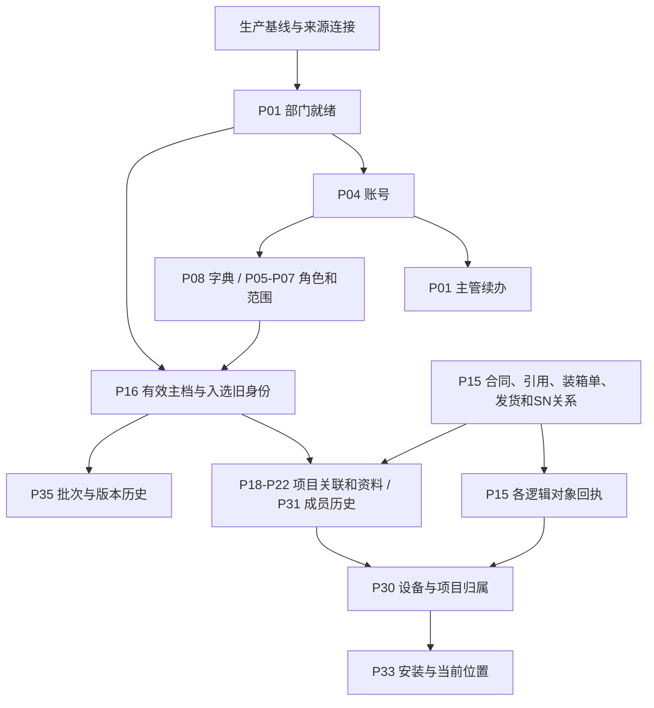

# DPPMS生产迁移最终任务集

**当前为27项业务任务，保留37份原来源组件；21项统一任务配置已保存到 `npdms_reverify_20261014`，全部停用。** P17原记录仅保留历史，禁止新运行。另6项沿现有采集/Owner入口，完整INT入口缺口继续列明。

初次配置保存阶段已修改代码、来源SQL、配置及目录，当时未执行预览、迁移、定时启用或生产操作。后续隔离验证库预览见[当前修复预览报告](../../generated/2026-10-13-dppms-migration-mapping/production-tasks/preview-repair-20261015.md)；业务迁移写入0，生产及Owner缺口保留。原验证库 `npdms_domain_test` 未修改。原“暂不新增项目”和合同/发货执行暂停继续有效。

## 范围与依据

- 项目类型沿用 `projectTypes=10`（用服），只迁有效项目。先按二进制同类型同编码取最大`projectId`，再筛`disabled=0 AND effectiveTo IS NULL`；来源旧ID也须有效。`projectIds=""`只表示在有效规范项目内不再缩小，空有效集合返回零行。依据及明细传播见[旧系统SQL与有效项目范围](../../generated/2026-10-13-dppms-migration-mapping/production-tasks/project-scope.md)。基础资料各自保留已批准筛选。
- 生产目标是否为空、已有业务/种子、租户、连接和部署身份尚未绑定。按“生产首次业务迁入”组织任务，但**不假设生产库没有数据**；已有数据必须走正式身份及现值保护。
- 本目录沿用既有专项裁决及用户后续明确调整，不改变PRD、业务状态或数据Owner；正式承接依对应领域Owner。P12按2026-10-14最新裁决采用CRM同编码名称，不再使用产品目录扩展承接差异；此前裁决及执行证据保留追溯。
- P31合并原P31/P32成员历史：来源角色60保留历史最终客户联系人含义，不强建客户联系人归属，也不产生当前账号授权。
- 目录里的P编号是本文件计划编号，不是数据库任务ID。JSON同样是目录，不能直接提交 `/tasks` 或作为执行批准。

来源：[2026-10-14-dppms-original-task-migration-inventory.md](../../generated/2026-10-14-dppms-original-task-migration-inventory.md)及其JSON（45项，采集时间 `2026-10-14T18:01:18.729001`）；[2026-10-13-dppms-migration-mapping/README.md](../../generated/2026-10-13-dppms-migration-mapping/README.md)；[2026-10-14-dppms-full-preview-blocker-repair.md](../../generated/2026-10-14-dppms-full-preview-blocker-repair.md)；[现行问题与裁决](../../decisions/open-questions.md)。

2026-10-13的SQL合集保留原始查询溯源；当前配置以清单中所列任务版本及受控导出的 `original-task-definitions.json` 为准。后续生成生产配置时必须固定这些来源版本，不能把旧SQL附件当作最新配置，也不能照搬其中的目标环境ID。

完整逐项明细：[来源、目标、SQL、字段映射、承接规则及适配器取舍](../../generated/2026-10-13-dppms-migration-mapping/production-tasks/README.md)。其中明确列出当前配置与最新裁决差异，并包含Owner实际Mapper SQL及附带写入表；原37份组件是评审基线；另有21份新验证库配置保存在runtime-configurations，均已停用。

## 任务粒度复核

同库多表同目标使用SQL UNION并按目标业务身份提前归组；相同读取/聚合共用一次结果，逐源身份及Owner保护保留。

| 原编号 | 当前任务 | 处理 | 核对结论 |
| --- | --- | --- | --- |
| P01、P02、P03 | P01 | MERGE | 同一组织目录被按基础导入、29码补丁、8码补丁拆成三项；来源差异应保留为同一任务内的来源分支。 |
| P08、P09 | P08 | MERGE | 类型和字典项是一套字典迁入的父子步骤；缺失类型本来还需从字典项分组补出。 |
| P15、P26、P27、P28、P29 | P15 | MERGE | 五来源在同一SQL中UNION ALL，先按目标业务唯一身份归组；统一有效合同范围。保留全部原来源键、NULL及冲突规则；P26与P15重复的com_contract五列更新已移除。正式COM/AST Owner接入仍是生产执行前置。 |
| P16、P17 | P16 | MERGE | 两条SQL均按二进制projectType＋projectCode取MAX(projectId)；有效主档与入选旧ID绑定是同一次项目迁入的两个结果。 |
| P31、P32 | P31 | MERGE | 两项使用逐字相同的pm_project_member查询；最新裁决又使两者都落proj_project_member_assignment，只是来源角色与是否可授权不同。 |
| P35、P36 | P35 | MERGE | 版本行以logId关联变更批次，现有ProjectLegacyEntityMigrationService已经把softwareObservations与softwareBatches交给同一个DppmsAssetSourceHistoryApi.Command。 |
| P04、P05、P06、P07 | P04、P05、P06、P07 | SHARE_READ_KEEP_AUTHORIZATION_BOUNDARIES | P04/P05分别合并同目标来源SQL；P06/P07复用P04/P06已成功来源证据，消除重复账号/角色扫描。账号资料、角色定义、授权、数据范围保留既定权限及Owner边界。 |
| P10、P11、P12 | P10、P11、P12 | KEEP | 客户与产品是不同对象；P11为CRM SQL Server权威产品，P12为DPPMS MySQL只补缺和编码关联，连接及更新规则不同，保留两个产品来源任务及既定优先级。 |
| P13、P14 | P13、P14 | KEEP | 执行单与订单是独立商务对象；P14已经合并订单头和行。共享执行单/项目解析不意味着可将独立业务唯一键合并。 |
| P18、P19 | P18、P19 | KEEP | 项目合同关系和相关方/发货执行状态是不同来源事实；P19已合并自己的两来源。P16的基础最终客户与P19共享相关方表，但来源、角色和写入规则不同。 |
| P20、P21、P22 | P20、P21、P22 | KEEP | 真实产品、租赁/配置、COM实施范围语义和Owner规则不同；P21已将租赁/配置放在一项。实施范围的正数量、订单行等校验不能扩散到其他历史清单。 |
| P23、P24 | P23、P24 | KEEP | 回款计划和实际回款是不同事实，来源、业务键和可空关联分别处理；不因同属合同或共享SMS参考而合并。 |
| P25 | P25 | KEEP | 逐次续保记录独立于发货保修期限和计算结果，不能按SN取最新而丢失多次续保。 |
| P30 | P30 | KEEP | P30消费正式发货记录创建或关联当前设备，身份是租户+SN，另有当前归属校验；P15负责逐次发货事实，两者不是重复目标步骤。现有材料采集包只读取一次同域来源；P30全量INT入口仍未实现。 |
| P33 | P33 | KEEP | 安装历史与当前位置本来就在同一任务，仍保留两层Owner及较新位置保护；不能因共享设备而并入发货。 |
| P34 | P34 | KEEP | 出厂版本原表无主键，需冻结组合和同值出现次数；虽可复用软件历史API，但不属于logId批次/版本父子链，保持独立来源身份策略。 |
| P37 | P37 | KEEP | 许可有受控内存加密采集和专用Owner，不能并入普通软件采集/快照。 |

## 最终业务任务

| 编号 / 任务 | 来源组件 | 目标 / Owner | 前置 | 配置 / 生产准备状态 |
| --- | --- | --- | --- | --- |
| [P01 公司、部门与主管关联](../../generated/2026-10-13-dppms-migration-mapping/production-tasks/tasks/P01.md) | P01、P02、P03 | `system_company`、`system_dept` / SYSTEM | 基线及适用目录 | SAVED_DISABLED_PREVIEW_EXECUTED；CONFIGURATION_SAVED_EXECUTION_PENDING |
| [P04 账号与任职资料](../../generated/2026-10-13-dppms-migration-mapping/production-tasks/tasks/P04.md) | P04 | `system_users` / SYSTEM | P01 | SAVED_DISABLED_PREVIEW_EXECUTED；ADAPT_FIRST_IMPORT |
| [P05 角色定义及来源角色绑定](../../generated/2026-10-13-dppms-migration-mapping/production-tasks/tasks/P05.md) | P05 | `system_role` / SYSTEM | P04 | SAVED_DISABLED_PREVIEW_EXECUTED；ADAPT_FIRST_IMPORT |
| [P06 用户角色关系](../../generated/2026-10-13-dppms-migration-mapping/production-tasks/tasks/P06.md) | P06 | `system_user_role` / SYSTEM | P04、P05 | SAVED_DISABLED_PREVIEW_EXECUTED；REUSE_AND_REVALIDATE |
| [P07 用户公司与部门范围](../../generated/2026-10-13-dppms-migration-mapping/production-tasks/tasks/P07.md) | P07 | `system_user_company_department_scope` / SYSTEM | P01、P04、P05、P06 | SAVED_DISABLED_PREVIEW_EXECUTED；REUSE_AND_REVALIDATE |
| [P08 基础字典类型与字典项](../../generated/2026-10-13-dppms-migration-mapping/production-tasks/tasks/P08.md) | P08、P09 | `system_dict_type`、`system_dict_data` / SYSTEM | P04 | SAVED_DISABLED_PREVIEW_EXECUTED；CONFIGURATION_SAVED_EXECUTION_PENDING |
| [P10 CRM客户主档](../../generated/2026-10-13-dppms-migration-mapping/production-tasks/tasks/P10.md) | P10 | `cus_customer_master` / CUS | 基线及适用目录 | SAVED_DISABLED_PREVIEW_EXECUTED；REUSE_AND_REVALIDATE |
| [P11 CRM正式产品目录](../../generated/2026-10-13-dppms-migration-mapping/production-tasks/tasks/P11.md) | P11 | `ast_product_official_info` / AST | 基线及适用目录 | SAVED_DISABLED_PREVIEW_EXECUTED；OWNER_ENTRY_REQUIRED |
| [P12 DPPMS缺失产品补齐与编码关联](../../generated/2026-10-13-dppms-migration-mapping/production-tasks/tasks/P12.md) | P12 | `ast_product_official_info` / AST | P11 | SAVED_DISABLED_PREVIEW_EXECUTED；REUSE_AND_REVALIDATE |
| [P13 CRM执行单](../../generated/2026-10-13-dppms-migration-mapping/production-tasks/tasks/P13.md) | P13 | `com_crm_execution_order` / COM | P01、P10 | SAVED_DISABLED_PREVIEW_EXECUTED；REUSE_AND_REVALIDATE |
| [P14 销售订单与订单行](../../generated/2026-10-13-dppms-migration-mapping/production-tasks/tasks/P14.md) | P14 | `com_sales_order`、`com_sales_order_line` / COM | P01、P10、P12、P13 | SAVED_DISABLED_PREVIEW_EXECUTED；ADAPT_FIRST_IMPORT |
| [P15 正式合同、发货合同引用与发货事实](../../generated/2026-10-13-dppms-migration-mapping/production-tasks/tasks/P15.md) | P15、P26、P27、P28、P29 | `com_contract`、`com_shipment_contract_reference`、`com_shipment_package`、`ast_device_shipment`、`ast_device_relationship` / COM、AST | P01、P10、P12、P14 | SAVED_DISABLED_PREVIEW_EXECUTED；CONSOLIDATED_ENTRY_PENDING |
| [P16 有效项目主档、来源身份与基础最终客户资料](../../generated/2026-10-13-dppms-migration-mapping/production-tasks/tasks/P16.md) | P16、P17 | `proj_project`、`proj_project_party`、`int_sync_binding` / PROJ、INT | P01、P04、P08、P10 | SAVED_DISABLED_PREVIEW_EXECUTED；CONFIGURATION_SAVED_EXECUTION_PENDING |
| [P18 项目合同关系及正式商务关联](../../generated/2026-10-13-dppms-migration-mapping/production-tasks/tasks/P18.md) | P18 | `com_project_contract_relation` / COM、PROJ | P04、P13、P14、P15、P16 | SAVED_DISABLED_PREVIEW_EXECUTED；REUSE_AND_REVALIDATE |
| [P19 项目相关方与发货/执行状态资料](../../generated/2026-10-13-dppms-migration-mapping/production-tasks/tasks/P19.md) | P19 | `proj_project_party`、`plt_entity_extension_value` / PROJ、PLT | P04、P08、P16 | SAVED_DISABLED_PREVIEW_EXECUTED；ADAPT_FIRST_IMPORT |
| [P20 项目真实产品](../../generated/2026-10-13-dppms-migration-mapping/production-tasks/tasks/P20.md) | P20 | `proj_project_real_product` / PROJ | P04、P16 | SAVED_DISABLED_PREVIEW_EXECUTED；REUSE_AND_REVALIDATE |
| [P21 项目租赁产品与产品配置](../../generated/2026-10-13-dppms-migration-mapping/production-tasks/tasks/P21.md) | P21 | `proj_project_lease_product`、`proj_project_product_configuration` / PROJ | P04、P16 | SAVED_DISABLED_PREVIEW_EXECUTED；REUSE_AND_REVALIDATE |
| [P22 项目产品实施范围](../../generated/2026-10-13-dppms-migration-mapping/production-tasks/tasks/P22.md) | P22 | `com_delivery_scope`、`com_delivery_scope_detail` / COM | P01、P12、P14、P16、P18 | SAVED_DISABLED_PREVIEW_EXECUTED；ADAPT_FIRST_IMPORT |
| [P23 合同回款计划](../../generated/2026-10-13-dppms-migration-mapping/production-tasks/tasks/P23.md) | P23 | `com_contract_collection_plan` / COM | P04 | SAVED_DISABLED_PREVIEW_EXECUTED；REUSE_AND_REVALIDATE |
| [P24 合同实际回款信息](../../generated/2026-10-13-dppms-migration-mapping/production-tasks/tasks/P24.md) | P24 | `com_contract_receivable` / COM | P04 | SAVED_DISABLED_PREVIEW_EXECUTED；REUSE_AND_REVALIDATE |
| [P25 设备逐次续保记录](../../generated/2026-10-13-dppms-migration-mapping/production-tasks/tasks/P25.md) | P25 | `ast_device_warranty_renewal_record` / AST | 基线及适用目录 | SAVED_DISABLED_PREVIEW_EXECUTED；REUSE_AND_REVALIDATE |
| [P30 设备主档及项目归属衔接](../../generated/2026-10-13-dppms-migration-mapping/production-tasks/tasks/P30.md) | P30 | `ast_device`、`ast_device_project_relationship` / AST、PROJ | P12、P14、P16、P18、P15 | EXISTING_COLLECTOR_OWNER_ONLY_NO_FULL_INT_ENTRY；TASK_ENTRY_MISSING |
| [P31 项目成员历史、历史联系人与获准授权](../../generated/2026-10-13-dppms-migration-mapping/production-tasks/tasks/P31.md) | P31、P32 | `proj_project_member_assignment` / PROJ、SYSTEM | P04、P16 | EXISTING_COLLECTOR_OWNER_ONLY_NO_FULL_INT_ENTRY；EXISTING_COMBINED_COLLECTOR_FULL_ENTRY_PENDING |
| [P33 普通安装历史及获准当前位置](../../generated/2026-10-13-dppms-migration-mapping/production-tasks/tasks/P33.md) | P33 | `imp_eng_installation`、`ast_device_location`、`ast_address`、`ast_device` / IMP、AST | P04、P16、P30 | EXISTING_COLLECTOR_OWNER_ONLY_NO_FULL_INT_ENTRY；TASK_ENTRY_MISSING |
| [P34 出厂软件版本记录](../../generated/2026-10-13-dppms-migration-mapping/production-tasks/tasks/P34.md) | P34 | `ast_device_factory_version_record` / AST | P16、P15 | EXISTING_COLLECTOR_OWNER_ONLY_NO_FULL_INT_ENTRY；TASK_ENTRY_MISSING |
| [P35 软件变更批次与设备版本历史](../../generated/2026-10-13-dppms-migration-mapping/production-tasks/tasks/P35.md) | P35、P36 | `ast_device_software_change_batch`、`ast_device_software_version_record`、`plt_entity_extension_value` / AST、PROJ、PLT | P04、P16 | EXISTING_COLLECTOR_OWNER_ONLY_NO_FULL_INT_ENTRY；EXISTING_COMBINED_COLLECTOR_FULL_ENTRY_PENDING |
| [P37 设备许可历史](../../generated/2026-10-13-dppms-migration-mapping/production-tasks/tasks/P37.md) | P37 | `ast_device_license_record` / AST | 基线及适用目录 | EXISTING_COLLECTOR_OWNER_ONLY_NO_FULL_INT_ENTRY；TASK_ENTRY_MISSING |

P01部门身份就绪后可供P04使用，主管后续补关联；P16主档及原ID映射同一批次处理。P31历史不自动产生当前授权。P15内五种结果分别对账，不以发货完成代替当前设备归属完成。

## 每项任务的收口要求

### P01 公司、部门与主管关联

- 配置与待补齐：已保存合并组织配置：同库来源UNION后按公司码/部门码归组，保留原EHR/FND来源身份与批准筛选，沿既有SYSTEM Owner校验。主管未有唯一用户时保留待关联，P04完成后续办同一任务。
- 完成依据：基础目录、29码和8码逐源有处置，来源范围和主来源不变；部门与主管分别出具就绪结果，已完成目录的原回执保留，失败块按既有事务回滚。
- 新库配置：ID `2110439242576203777`，版本 0，停用；配置保存不等于已迁入。
- 规则来源：[2026-10-09-dppms-system-dept-table-decision.md](../../generated/2026-10-09-dppms-system-dept-table-decision.md)；[2026-10-09-dppms-system-dept-eight-missing-table-decision.md](../../generated/2026-10-09-dppms-system-dept-eight-missing-table-decision.md)。

### P04 账号与任职资料

- 配置与待补齐：保留已批准账号范围、合并优先级和三项EHR例外；不读取旧密码。旧admin审计关联的正式身份须在生产核实，不能照搬ID1。首次写入即保留原NULL审计，不重放557项旧纠正证明。 三账号来源已改为一次UNION查询，按账号身份归组并共用EHR聚合；不额外读取账号密码。
- 完成依据：账号资料和来源别名完整；原NULL/历史日期不被自动填充改写；角色、项目访问及认证激活分别受控。
- 新库配置：ID `2110439242966274050`，版本 0，停用；配置保存不等于已迁入。
- 规则来源：[2026-10-09-dppms-system-users-table-decision.md](../../generated/2026-10-09-dppms-system-users-table-decision.md)；[2026-10-09-dppms-user-contact-and-login-decision.md](../../generated/2026-10-09-dppms-user-contact-and-login-decision.md)；[2026-10-09-dppms-user-null-updater-correction.md](../../generated/2026-10-09-dppms-user-null-updater-correction.md)。

### P05 角色定义及来源角色绑定

- 配置与待补齐：保留18项原角色编码映射、既有角色引用及停用排除；首次迁入即使用已裁决的原审计，不带13角色旧纠正目标ID。 两类角色来源一次UNION，按已批准正式角色编码归组，保留每个原角色ID。
- 完成依据：来源角色到正式角色唯一可追溯；不由角色名称猜权限，不新增未批准菜单授权。
- 新库配置：ID `2110439243297624066`，版本 0，停用；配置保存不等于已迁入。
- 规则来源：[2026-10-09-dppms-role-identity-mapping-decision.md](../../generated/2026-10-09-dppms-role-identity-mapping-decision.md)；[2026-10-09-dppms-role-audit-correction-decision.md](../../generated/2026-10-09-dppms-role-audit-correction-decision.md)。

### P06 用户角色关系

- 配置与待补齐：通过新环境用户/角色绑定构建已批准关系；保持原停用、空公司及关系去重规则。 FND账号来源复用P04同租户/同连接/当前配置版本成功全量运行的不可变来源证据；T_USER_ROLE关系一次聚合。
- 完成依据：有效授权、只作引用和排除分别对账；不把历史关系自动扩为全部项目访问。
- 新库配置：ID `2110439243515727873`，版本 0，停用；配置保存不等于已迁入。
- 规则来源：[2026-10-09-dppms-user-selected-scope-decision.md](../../generated/2026-10-09-dppms-user-selected-scope-decision.md)。

### P07 用户公司与部门范围

- 配置与待补齐：保留已批准的公司转换、多任职及主范围裁决；所有正式引用在生产重新解析。 三账号来源复用P04证据，用户角色来源复用P06证据，仅FND权限来源另查一次；缺成功来源证据阻断，不回退重复扫描。
- 完成依据：原范围与主标记逐项一致；公司/部门范围不自动替代按项目授权。
- 新库配置：ID `2110439243805134849`，版本 0，停用；配置保存不等于已迁入。
- 规则来源：[2026-10-09-dppms-user-company-department-scope-table-decision.md](../../generated/2026-10-09-dppms-user-company-department-scope-table-decision.md)；[2026-10-09-dppms-user-scope-primary-conflicts.md](../../generated/2026-10-09-dppms-user-scope-primary-conflicts.md)。

### P08 基础字典类型与字典项

- 配置与待补齐：已保存合并字典配置：类型、由字典项派生的缺失类型与字典项使用同一UNION查询；保留父子关系、原类型码/项ID、全量及SYSTEM Owner约束。
- 完成依据：类型、项及其关联分别对账，保留原编码、审计、启停与排除；重放不重复建类型或项。
- 新库配置：ID `2110439244555915266`，版本 0，停用；配置保存不等于已迁入。
- 规则来源：[2026-10-12-dppms-system-dictionary-table-proposal.md](../../generated/2026-10-12-dppms-system-dictionary-table-proposal.md)。

### P10 CRM客户主档

- 配置与待补齐：重建只读CRM连接，沿用CRM权威值域及身份规则；核对生产已有客户，不按名称合并。
- 完成依据：客户编码/CRM身份及属性完整；来源到目标唯一可追溯；连接未验证前不称可执行。
- 新库配置：ID `2110439244857905153`，版本 0，停用；配置保存不等于已迁入。

### P11 CRM正式产品目录

- 配置与待补齐：复用现有源查询和字段映射；当前TABLE_MAPPING直接写AST表，生产入口须接AST正式Owner并核对产品唯一键。
- 完成依据：同编码沿用CRM正式字段；已有产品碰撞、权限、空集合和事务边界保持。
- 新库配置：ID `2110439245117952002`，版本 0，停用；配置保存不等于已迁入。

### P12 DPPMS缺失产品补齐与编码关联

- 配置与待补齐：按2026-10-14最新裁决，以租户+产品编码关联；同编码名称不同以CRM为准，既有正式字段保持。缺失产品仍按item/itemname/describe_补齐编码、型号、名称和描述并设ACTIVE，原id不作业务键。生产模板、适配器及AST Owner的迁入/解析路径须移除产品扩展定义、标签匹配及扩展读写依赖，不再要求migrationDefinitionRevisionId或创建dppms_catalog_labels；不转存到其他扩展或描述字段。现有代码仍依赖扩展，属于本任务待改项。
- 完成依据：全部来源编码有处置；CRM同编码异名时正式字段保持且不新增/更新产品扩展，缺失产品按批准规则创建，重放不重复写入。同编码解析不以DPPMS标签齐备为前提；租户、权限、删除及身份冲突保护保持。原库已有扩展、绑定和历史证据保留。
- 新库配置：ID `2110439245344444418`，版本 0，停用；配置保存不等于已迁入。
- 规则来源：[2026-10-09-dppms-official-product-table-decision.md](../../generated/2026-10-09-dppms-official-product-table-decision.md)。

### P13 CRM执行单

- 配置与待补齐：沿用用服类型参数、公司码转换及自动分页；原项目ID参数为空只表示全部有效规范项目，空有效范围返回零行。
- 完成依据：根回执合计与分页来源闭合；按业务键/完整来源身份核对，不把最后一页当全量。
- 新库配置：ID `2110439245579325441`，版本 0，停用；配置保存不等于已迁入。
- 规则来源：[2026-10-09-dppms-crm-execution-order-table-decision.md](../../generated/2026-10-09-dppms-crm-execution-order-table-decision.md)。

### P14 销售订单与订单行

- 配置与待补齐：准备首次迁入配置，旧91161项fieldCarryProof仅留原环境追溯；生产已有订单必须重新取得Owner前值证明。保留头/行顺序、精确ERP公司业务键及Q023/Q025冲突保护。
- 完成依据：完整原字段、公司、父单、执行单及来源绑定对账；410条来源执行单冲突不能任取一条；不复活236259条旧清理绑定。
- 新库配置：ID `2110306872558583810`，版本 1，停用；配置保存不等于已迁入。
- 规则来源：[2026-10-09-dppms-sales-order-table-decision.md](../../generated/2026-10-09-dppms-sales-order-table-decision.md)；[2026-10-09-dppms-sales-order-line-table-decision.md](../../generated/2026-10-09-dppms-sales-order-line-table-decision.md)；[2026-10-14-dppms-full-preview-blocker-repair.md](../../generated/2026-10-14-dppms-full-preview-blocker-repair.md)。

### P15 正式合同、发货合同引用与发货事实

- 配置与待补齐：五来源在同一SQL中UNION ALL，先按目标业务唯一身份归组；统一有效合同范围。保留全部原来源键、NULL及冲突规则；P26与P15重复的com_contract五列更新已移除。正式COM/AST Owner接入仍是生产执行前置。
- 完成依据：一份任务配置、一个物理查询和五类来源回执；合同、引用、装箱单、发货、SN关系分别对账，空正式引用仍按原规则保留；历史发货不代表当前设备归属完成。
- 新库配置：ID `2110439255301722114`，版本 0，停用；配置保存不等于已迁入。
- 规则来源：[contract-master-approved-source-mapping.json](../../generated/2026-10-13-dppms-migration-mapping/contract-master-approved-source-mapping.json)；[2026-10-14-dppms-full-preview-blocker-repair.md](../../generated/2026-10-14-dppms-full-preview-blocker-repair.md)；[2026-10-10-dppms-shipment-contract-reference-table-decision.md](../../generated/2026-10-10-dppms-shipment-contract-reference-table-decision.md)；[2026-10-09-dppms-shipment-package-table-decision.md](../../generated/2026-10-09-dppms-shipment-package-table-decision.md)；[2026-10-09-dppms-ast-device-shipment-table-decision.md](../../generated/2026-10-09-dppms-ast-device-shipment-table-decision.md)；[2026-10-10-dppms-equipment-association-repair-decision.md](../../generated/2026-10-10-dppms-equipment-association-repair-decision.md)；[2026-10-12-dppms-device-relationship-table-decision.md](../../generated/2026-10-12-dppms-device-relationship-table-decision.md)；[2026-10-12-dppms-device-relationship-self-exclusions.md](../../generated/2026-10-12-dppms-device-relationship-self-exclusions.md)。

### P16 有效项目主档、来源身份与基础最终客户资料

- 配置与待补齐：主档与入选原ID现在共用一次MAX及有效范围查询；一个批次内先由PROJ Owner承接主档，再使用本批回执保存原ID映射，免除P17第二次查询/运行。原P17保留历史并禁止新运行或调度。基础最终客户Owner接入的原缺口仍待完成。
- 完成依据：有效规范主档、入选旧ID及排除原因分别对账；每个入选旧ID唯一指向经Owner核验的正式项目，范围内非最大旧ID的明细仍可解析。停用/失效主档、旧ID及其项目归属明细不迁入；无效规范行不能由旧行补位，已闭环但仍有效的项目不能误排。主档失败不产生成功绑定；重放不重绑、不重复创建、不自动授权。
- 新库配置：ID `2110306158427996161`，版本 1，停用；配置保存不等于已迁入。
- 规则来源：[2026-10-09-dppms-proj-project-table-decision.md](../../generated/2026-10-09-dppms-proj-project-table-decision.md)；[2026-10-12-dppms-whole-table-task-correction.md](../../generated/2026-10-12-dppms-whole-table-task-correction.md)；[2026-10-14-dppms-full-preview-blocker-repair.md](../../generated/2026-10-14-dppms-full-preview-blocker-repair.md)；[2026-10-09-dppms-identity-table-decision.md](../../generated/2026-10-09-dppms-identity-table-decision.md)。

### P18 项目合同关系及正式商务关联

- 配置与待补齐：保持正式项目+合同归并、当前/历史及审计裁决，保留18项逐源排除。原组及成员只按Q015/Q016规则参与关系，smsProjectCode须沿正式合同/订单/执行单链核对。
- 完成依据：所有原合同/组成员身份和正式关系可追溯；历史不参与当前授权。商务链缺失/多义保留为问题，不用项目扩展数组代替。
- 新库配置：ID `2110307139123380226`，版本 1，停用；配置保存不等于已迁入。
- 规则来源：[2026-10-12-dppms-project-contract-relation-table-proposal.md](../../generated/2026-10-12-dppms-project-contract-relation-table-proposal.md)；[2026-10-14-dppms-full-preview-blocker-repair.md](../../generated/2026-10-14-dppms-full-preview-blocker-repair.md)。

### P19 项目相关方与发货/执行状态资料

- 配置与待补齐：重建正式状态扩展定义；55项旧_expectedFingerprint不当生产前值。状态更新时间保留原含义，审批及工程计划缓存不承接。
- 完成依据：相关方原角色、审计、区间及两类状态/更新时间完整；不触发生命周期、审批或任务完成。
- 新库配置：ID `2110306421847064577`，版本 1，停用；配置保存不等于已迁入。
- 规则来源：[remaining-carry-implementation.md](../../generated/2026-10-13-dppms-migration-mapping/remaining-carry-implementation.md)。

### P20 项目真实产品

- 配置与待补齐：保留完整原字段及来源修订关系；缺项目不创建项目，未形成项目清单的独立上游资料不混入。
- 完成依据：所有来源行与正式清单逐项对账，后续人工变更受保护。
- 新库配置：ID `2110439264646631425`，版本 0，停用；配置保存不等于已迁入。
- 规则来源：[2026-10-10-dppms-real-product-table-decision.md](../../generated/2026-10-10-dppms-real-product-table-decision.md)。

### P21 项目租赁产品与产品配置

- 配置与待补齐：两个来源对象分别保留原字段、键与结果；沿同一已有适配器，不拆出重复Owner。
- 完成依据：两表分别对账；已发现3条原项目缺失仍登记，不能挂靠同名项目。
- 新库配置：ID `2110439264919261186`，版本 0，停用；配置保存不等于已迁入。
- 规则来源：[2026-10-10-dppms-lease-product-table-decision.md](../../generated/2026-10-10-dppms-lease-product-table-decision.md)；[2026-10-10-dppms-product-configuration-table-decision.md](../../generated/2026-10-10-dppms-product-configuration-table-decision.md)。

### P22 项目产品实施范围

- 配置与待补齐：105项旧baseline不带入生产；按新目标生成保护前值。保留精确订单行、办事处和正数量约束，不用默认数量消除来源缺项。
- 完成依据：每条来源有准确项目、合同、订单行及数量；原330781/330782仍受正数量保护，其他缺办事处/订单行逐项闭合。
- 新库配置：ID `2110439265175113729`，版本 0，停用；配置保存不等于已迁入。
- 规则来源：[2026-10-09-dppms-delivery-scope-table-decision.md](../../generated/2026-10-09-dppms-delivery-scope-table-decision.md)；[2026-10-14-dppms-full-preview-blocker-repair.md](../../generated/2026-10-14-dppms-full-preview-blocker-repair.md)。

### P23 合同回款计划

- 配置与待补齐：保留540个已批准未关联审计编码的原码承接，不因无账号过滤原行或补造账号。Owner允许未唯一匹配合同的计划保留NULL合同ID，P15不是全部计划的强制入库前置；原缓存键仅用于本次冻结基线，禁止跨刷新自动重绑。
- 完成依据：计划原字段、原合同号及审计一致；与实际回款信息分开对账，不制造收款完成事实；正式合同引用仅精确唯一时补关联。
- 新库配置：ID `2110439265489686530`，版本 0，停用；配置保存不等于已迁入。
- 规则来源：[2026-10-09-dppms-contract-collection-plan-table-decision.md](../../generated/2026-10-09-dppms-contract-collection-plan-table-decision.md)。

### P24 合同实际回款信息

- 配置与待补齐：保留39原字段、金额比例及7条空合同号的原裁决。合同ID只在精确唯一时补关联，缺唯一主档按批准保留NULL，不阻断该原始回款事实。
- 完成依据：金额/比例精度、NULL和原合同号完整；项目展示另须P18正式合同关系，不把P15强行变成所有回款行的入库前置。
- 新库配置：ID `2110439265737150465`，版本 0，停用；配置保存不等于已迁入。
- 规则来源：[remaining-carry-implementation.md](../../generated/2026-10-13-dppms-migration-mapping/remaining-carry-implementation.md)。

### P25 设备逐次续保记录

- 配置与待补齐：沿17列及id+barcode来源身份，全部原state值承接；不要求当前设备/合同主档必先存在。项目展示与计算依赖另核对。
- 完成依据：每次续保起止、等级、原state完整；并列日期不任选最新；不复制view_warranty派生结果。
- 新库配置：ID `2110439265988808706`，版本 0，停用；配置保存不等于已迁入。
- 规则来源：[2026-10-13-dppms-renewal-and-warranty-table-proposal.md](../../generated/2026-10-13-dppms-renewal-and-warranty-table-proposal.md)。

### P30 设备主档及项目归属衔接

- 配置与待补齐：现C01的DEVICE_SN只写发货事实，不能计为设备主档完成。复用已有DppmsAssetEntityImportApi和正式设备指派Owner边界，补统一任务入口；不得复活C05/C06旧通用条码写法。
- 完成依据：SN身份、最新发货及当前项目归属分别核对；多项目竞争、较新归属或已删除主档冲突阻断，不按任务先后抢占SN。
- 规则来源：[2026-10-10-dppms-equipment-association-repair-decision.md](../../generated/2026-10-10-dppms-equipment-association-repair-decision.md)。

### P31 项目成员历史、历史联系人与获准授权

- 配置与待补齐：补一个统一成员任务入口，复用同一来源行核验、项目身份和成员Owner。角色60分支仍待实现；不能沿用当前CONTACT_SUBJECT_PENDING后直接跳过。授权依赖仅约束获准授权步骤，不把全部历史成员变成必须具备当前资格。 当前材料采集只读取一次pm_project_member；普通历史与角色60历史分支共用该来源。当前授权仍须单独获准。
- 完成依据：每条原成员有唯一处置；角色60保留历史且authorization_confirmed=false；当前账号成员授权逐项获准，主责更新独立对账，同项目写入串行。
- 规则来源：[2026-10-11-dppms-project-member-table-decision.md](../../generated/2026-10-11-dppms-project-member-table-decision.md)；[2026-10-11-dppms-project-member-owner-conflicts.md](../../generated/2026-10-11-dppms-project-member-owner-conflicts.md)；[2026-10-12-dppms-final-customer-contact-table-decision.md](../../generated/2026-10-12-dppms-final-customer-contact-table-decision.md)。

### P33 普通安装历史及获准当前位置

- 配置与待补齐：沿32列安装实体及正式位置Owner补首次迁入任务；旧DppmsInstallationAddressImportService对非空命令已拒绝，现DppmsInstallationRecordMigrationService要求已有安装及完整baseline，不能作为首次创建入口。须接正式安装/地址Owner完成首次创建与快照，再复用已批准的历史状态/区间和位置保护规则。空地址、超长地址另受既有未决约束，串货本轮不迁。
- 完成依据：每条安装的项目、设备、原地址、区间及审计准确；历史承接与当前位置写入分别对账，不覆盖较新位置。
- 规则来源：[2026-10-10-dppms-existing-installation-table-decision.md](../../generated/2026-10-10-dppms-existing-installation-table-decision.md)；[remaining-carry-implementation.md](../../generated/2026-10-13-dppms-migration-mapping/remaining-carry-implementation.md)。

### P34 出厂软件版本记录

- 配置与待补齐：沿已批准13列和完整重复保留规则补一次性任务。原表无稳定主键，以冻结来源和同值出现次数保留逐行身份；持续修订/消失处理不启用。
- 完成依据：五原字段及重复次数完整；项目引用仅保留可核实关联，缺当前设备不丢记录；不任选最新、不自动覆盖唯一出厂主档。
- 规则来源：[2026-10-10-dppms-factory-version-record-table-decision.md](../../generated/2026-10-10-dppms-factory-version-record-table-decision.md)。

### P35 软件变更批次与设备版本历史

- 配置与待补齐：复用现有软件历史Owner组合命令，补一个批次与版本历史的统一任务入口；按原logId建立父子关系，缺失、跨项目或冲突仍沿Owner校验处理。 当前采集包及既有Owner组合命令已经统一批次和版本；未创建原P36独立任务。
- 完成依据：批次、版本行、8项扩展及其来源关联逐项对账；不能只迁批次即报完成，也不能生成设备升级事件或刷新当前版本。
- 规则来源：[2026-10-10-dppms-software-batch-table-decision.md](../../generated/2026-10-10-dppms-software-batch-table-decision.md)；[2026-10-10-dppms-software-version-maintenance-table-decision.md](../../generated/2026-10-10-dppms-software-version-maintenance-table-decision.md)；[2026-10-10-dppms-software-existing-record-correction-decision.md](../../generated/2026-10-10-dppms-software-existing-record-correction-decision.md)；[2026-10-11-dppms-obsolete-software-event-decision.md](../../generated/2026-10-11-dppms-obsolete-software-event-decision.md)。

### P37 设备许可历史

- 配置与待补齐：沿16列和专用受控加密Owner补一次性任务；不得用普通原文采集/日志保存licenseCode。生产密钥由部署身份配置并验证恢复；缓存自增ID不用于持续同步。
- 完成依据：8原字段以受控内存核验，秘密只存认证密文；缺设备/合同按批准保持NULL和原业务值；页面不泄露秘密，不激活许可。
- 规则来源：[2026-10-11-dppms-license-record-table-decision.md](../../generated/2026-10-11-dppms-license-record-table-decision.md)。

## 旧45项的完整处置

| 原清单 | 处理 | 当前去向 |
| --- | --- | --- |
| A01～A12（12项） | 保留原来源基线，合并组织与字典内部步骤 | A01/A02/A03→P01；A08/A09→P08；其余→P04～P07、P10～P12 |
| B01～B12（12项） | 项目主档与身份桥接合并，其他保持业务边界 | B03/B04→P16；其余→P13/P14、P18～P25 |
| C01（1项） | 保留v14五个来源段，CONTRACT/SHIPMENT_CONTRACT收进同一任务 | P15，一项 |
| C02～C07（6项） | 旧重复配置保留证据 | 对应业务由P15、P30承接，不恢复旧规则 |
| C08（1项） | 旧imp条码入口保留历史 | 不作为新功能入口 |
| D01～D04（4项） | 旧指定目标纠正批次保留 | 已批准NULL审计等裁决用于首次正确写入，旧证明不复制 |
| D05（1项） | 既有订单行绑定清理完成证据保留 | 新库不复制旧绑定、不重放旧清理 |
| E01～E08（8项） | 验收、自连接、样本配置保留证据 | 不进入生产全量任务 |

25个原任务作为来源基线、20个只保留证据，合计45。原37个来源组件仍全部有唯一归属：六组合并减少10项，当前27项；来源任务的版本及对象没有删除。原8项入口缺口中，成员两项合成P31、软件两项合成P35，其余缺口仍保留，不能将数量减少写成代码已完成。

## 生产配置必须处理的差异

| 类别 | 保留什么 | 新环境处理 |
| --- | --- | --- |
| 项目有效范围 | 原主档/身份及各项目筛选SQL作为历史证据 | P16只解析一次MAX后筛有效；各项目归属来源复用同一集合。范围外项目及明细不迁入，空集合不回退全历史；既有共享基础资料范围不变 |
| 业务规则 | 公司/角色/状态码，合同关系18项逐源裁决，540个审计原码，4份合同的精确特例，NULL与历史规则 | 保留原限定范围和来源核验；不能批量清空LOOKUP、扩大特例或改用猜测值 |
| 旧目标证明 | 订单91,161项fieldCarryProof；项目6,570项restoration及10项版本；实施范围105项baseline；相关方55项前值 | 留原环境追溯。新目标使用首次创建路径；生产已有实体重新取完整前值并走Owner。不能伪造旧绑定，也不能通过删除校验使执行通过 |
| 连接与实体扩展 | 原连接语义、项目状态、软件8属性的已批准定义 | P19/P35由正式Owner创建/发布同语义定义后解析新修订ID；P12取消产品标签扩展及其定义依赖。不照搬旧connectionId、definitionId、targetId或userId |
| 历史运行 | 原回执、旧绑定、恢复证据、撤回及纠正记录 | 原样留原库；新环境从无历史运行状态创建配置，不复制checkpoint/activeRunId或旧成功状态 |
| 通用表映射 | 已批准源SQL、字段、顺序和冲突规则 | 当前GenericSyncEngine经GenericSyncJdbcStore写表，覆盖AST/COM表；P11/P15（含原P26～P29）须接正式Owner后再生产执行。原P29已有专用适配器可复用 |
| 当前设备与历史 | P28发货事件、P29主附SN关系、P30当前设备身份/项目归属 | 三类事实分开核对；前两项有数据不证明设备主档和当前归属已完成，不恢复旧自动投影步骤 |
| 账号与许可秘密 | 原账号筛选及已批准许可加密规则 | 不读取旧密码；许可专用采集在内存加密，普通源行证据/页面/日志不能含明文许可码；本机DPAPI文件不代表生产身份可恢复 |

代码依据：`pms-module-integration/.../sync/generic/GenericSyncEngine.java`、`.../dal/mysql/sync/GenericSyncJdbcStore.java`、`DppmsDeviceRelationshipSyncAdapter.java`；设备衔接依据为 `DppmsAssetEntityImportApi` 及 `DppmsAssetEntityImportService.importShipment`。这些是本次只读核查的现状，本轮已修改合并与来源范围代码，相关Owner缺口仍保留。

## 执行次序与6项交付工作

这些R项是已有迁移所需准备和验收，不是新增业务Gate或额外数据库迁移任务。

| 编号 | 工作 | 交付条件 |
| --- | --- | --- |
| R01 | 生产环境与数据库基线 | 确认租户、目标实例、生产已有业务/种子、来源截止时点和备份恢复；新安装与已有库升级分别核对。新验证库建库成功不能证明已有库升级通过；原Flyway差异不得以repair/clean覆盖。 |
| R02 | 来源连接与目录依赖 | 建立DPPMS、CRM只读连接，使用受保护凭据；不迁原验证库自连接。核对公司、全部批准补充部门、岗位/字典、真实执行人和适用数据范围。P01在P04后续办主管补关联。 |
| R03 | 首次迁入配置与正式Owner | 21份统一INT配置已保存并停用，合并SQL及有效项目范围已接入。旧恢复/纠正证明不复制；P19旧状态定义在新库不存在，已清除引用，须经Owner重绑。P12已消除revision/标签依赖，P31角色60历史Owner、COM/AST正式Owner接入以及P30/P31/P33/P34/P35/P37全量INT入口等原缺口继续保留。 |
| R04 | 完整预览与问题闭合 | 在匹配生产基线的隔离环境按任务依赖演练；完整来源身份逐项有处置、根分页总量对账。PREVIEW_READY带ISSUE不等于全部可迁，带未解决行的分批范围须明确。来源冲突、目标人工变化、权限/租户、失败回滚和重放按实际改动验证；批准排除与未解决问题分别列清。 按新有效范围重新计算主档、来源身份和项目明细数量；不能沿用80,170/80,320及73,580旧口径作为新批次预计量。 |
| R05 | 生产批次执行 | 形成冻结任务版本、来源范围、预计新增/更新/接管实体数量及每层关联清单后，按已批准批次经任务API和领域Owner执行。全部任务默认停用，首次运行手动发起；不复制旧运行、断点或来源绑定，不自动启用定时同步。 |
| R06 | 正式页面验收与交接 | 按项目/合同/设备真实登录操作并重开查询，覆盖授权、当前/历史成员（含P31内原P32历史联系人）、主责/联系人、安装、软件及许可；与Owner回执和逐字段对账闭合。发货与续保输入齐备后按批准原规则核对维保计算，既有投影变化单独预览，不直接覆盖。 |

主依赖顺序如下。独立任务可以在其前提齐备后执行；实际执行仍按批次授权。

图只展示合并相关主线，27项完整依赖以表格和JSON为准。P01主管续办依赖P04，但P04只等待P01部门就绪；P16有效主档成功后绑定有效范围内旧ID，P31历史联系人不等待最终客户资料，也不依赖CUS联系人。P31的当前授权步骤单独满足账号角色和范围条件。同一目标/Owner有写入重叠时按既定顺序串行。

每次执行前固定来源截止时点、任务版本和参数。支持分页的任务使用稳定源键及既有分页机制，不能把maxRows改成一个大数便认为读取完整；要求整批账号/角色核对的适配器保留其整批约束。新环境不得接续旧环境断点。

每批验收至少能够回答：原始来源身份是否全部有处置、每个处置是否有正式值或明确原因、多源共目标与一源多目标是否分别对账、后续人工修改是否受保护、重放是否不重复写入。根运行已汇总子页时不得再次相加；有限明细样本不能代替全量问题清单。失败先保留来源与已提交回执，通过既有恢复/重试或批准的Owner补偿处理，不用直接SQL删改业务、运行状态或证据。

## 尚未满足的生产条件

| 问题 | 影响任务 | 现有事实及处理 |
| --- | --- | --- |
| 生产基线与环境尚未绑定 | 全部 | 原库曾有Flyway历史差异；新验证库可初始化是另一事实，不能据此宣称生产升级通过。先完成R01，不更改旧回执 |
| 有效项目范围已接入、实际迁移尚未验证 | P16及项目筛选消费者 | 统一范围SQL和采集前检查已实现；32份SQL在MySQL5.7只读核对通过，未执行迁移；原库及历史回执保持 |
| 首次迁入配置、合并入口、Owner接入未齐 | 六组合并任务，以及P04/P05/P11/P12/P14/P19/P22/P27～P30/P33/P34/P37 | 按各任务明确缺口实施和预览；21份INT配置已保存；6项材料/Owner任务仍缺全量INT入口，其他既有Owner缺口未因合并消失 |
| Q023/Q025订单来源及目标冲突 | P14及其订单行消费者 | 410行/169组的差异来自原借货过程执行单展开，不能任选单值主执行单；SO078894碰撞及8项旧行差异仍保留。目标碰撞数量属于原环境，生产需重新核对 |
| Q024合同权威来源/客户未确定 | P15/P18及依赖合同的任务 | 原验证库缺194个合同：125个ERP客户冲突、69个无ERP分组；4个已批准合同特例不能普遍推广。产品缺口此前已补齐，不再重复列为原库未解决问题 |
| 原项目公司/办事处、范围订单行与正数量 | P16/P18/P22 | 原NULL不能靠补目录变成有值；主档允许原NULL不代表实施范围也允许缺办事处。原330781/330782仍受正数量保护，不重复申请已拒绝例外 |
| Q016正式商务链及全历史成员/安装差异 | P18/P30/P31/P33 | 商务码沿正式关系核对；多项目SN归属、主责/角色资格、空/超长地址等不能用10项目试点规则任意推断。保留既有BLOCKED_BY_SPEC项，只停依赖部分 |
| 无稳定来源身份或敏感采集 | P23/P34/P35/P37 | 本批仅按已批准一次性历史承接组织；回款计划及许可缓存ID刷新、出厂版本无主键等持续同步策略未解决，不启用定时更新/删除 |
| 实际执行暂停与范围授权 | P15/P16及其关联层、P15及P27～P30 | 当前清单整理不撤销既有暂停，不产生项目创建、明细层、授权或发货写入许可 |

数量参照：2026-10-14来源只读核对为规范项目80,170、原项目身份80,320、执行单100,136、订单头90,478＋行376,757、项目合同关系83,472、相关方/状态268,878、实施范围345,034、真实产品7,848、租赁/配置1,402、回款计划35,451、回款信息79,321、续保453,454。这些均为旧全历史口径来源量。2026-10-15对10月14日规范项目快照分类，79,429条有效、741条被有效期条件排除；随后实时只读聚合确认有效原身份79,442；当前预览量见本轮报告，不与旧全历史明细数量混算，73,580个待新增也是旧口径。上述数量不是实时预览或生产预计新增量；正式预计新增/更新/不变必须在生产基线对应的预览后计算。

新验证库已经证明直接平移原配置不够：主档先被用户来源绑定缺失阻断，订单被旧fieldCarryProof所需绑定阻断；身份、相关方/状态和合同关系预览主要缺基础主档。没有将这些新库依赖问题解释为旧来源冲突已消失。

## 本次不新增的迁移任务及保留缺口

| 对象 | 本轮处理 |
| --- | --- |
| view_warranty计算结果 | 不独立迁移；依发货/期限/续保正式输入计算；既有记录和结构保留 |
| 维护记录、串货、工程事件、审批过程 | 按已批准范围暂缓或不迁；不制造办理/完成事实 |
| 回访问卷、周报、通知、指导、监理、ITR、分包报价/付款等 | 原专项暂缓；不因本目录以生产为目标自动纳入 |
| warranty_info、warranty_change_logs | 正式承接主体仍待确认，BLOCKED_BY_SPEC；不是已批准丢弃，也不算27项已覆盖 |
| PM项目组合/父子树及旧合同组模型 | 不从旧组/拆分备注制造新组合或项目树；只按既定关系规则承接 |

原67表清单仍是覆盖检查输入。未形成项目真实产品清单的独立上游资料、用户isSysUser/userCustom3/4的既有字段缺口，以及未批准的独立维保登记/人工变更，不因本目录完成而被计为已迁或可丢弃。它们沿原问题和映射文档保留；27项覆盖的是当前已批准业务范围，不代表旧系统所有历史域均已获准迁移。

## 当前修复预览结果

[修复报告](../../generated/2026-10-13-dppms-migration-mapping/production-tasks/preview-repair-20261015.md)与[前置矩阵](../../generated/2026-10-13-dppms-migration-mapping/production-tasks/prerequisite-dependencies.md)。旧初次保存/历史预览段落保留其原时点，业务迁移写入0，Owner缺口保持。

## 本轮交付与验证边界

21份配置均通过实际服务端配置校验并保存到新库；保留原P17历史记录且禁止新运行。Java定向测试63项（62通过、1项既有条件跳过），Python41项通过，32份来源SQL通过MySQL5.7只读EXPLAIN，P16一次查询抽样返回主档及身份对象。后端构建通过。
初次配置保存的历史检查：保存前后155张业务及迁移记录表行数一致，当时未调用预览/迁移接口。后续预览及技术记录、业务基线边界见本轮预览报告。原51份SQL、43份Owner Mapper和结构/字段映射基线保留。未做业务迁移或真实浏览器业务验收，不将配置保存写成生产就绪。

结构化文件：[2026-10-14-dppms-production-migration.json](2026-10-14-dppms-production-migration.json)。

历史预览报告：[preview-20261015](../../generated/2026-10-13-dppms-migration-mapping/production-tasks/preview-20261015.md)，原失败和初次保存证据保留。
