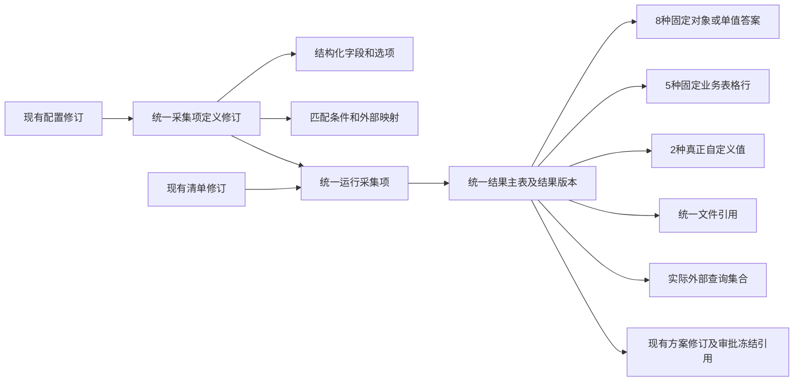

# 割接模块结构化存储完整表结构方案

- 状态：`BASELINE`；2026-10-13需求方确认“表字段的名称请统一规范，然后开始实施”。本稿是已批准实施输入，不是迁移或验收结果。
- 日期：2026-10-13；在同一方案文件中按“统一主数据、统一结果主表、按固定业务结构拆分结果明细子表”修订。
- 范围：CUT-01～CUT-10 的现有能力、已授权 V2 能力及割接专用 IMP/AST 来源事实；沿用 P1～P6、等级路线、状态机和模块 Owner。
- 实施范围已获批准；先按ADR-0019统一字段命名，再实施结构化存储、前向迁移及调用方。运行服务重启仍须另行明确批准。
- 业务依据：[PRD CUT-01～10](../../baseline/prd-v1.8.md)、当前会话已确认的角色待办最小只读范围及[结构化存储决策](../../decisions/open-questions.md#q-cut-structured-storage-20261013--割接固定业务结构的持久化)。不变更 PRD 业务语义。
- 正式设计落点：[数据库设计](../../design/09-database-design.md)、[数据模型](../../design/08-data-model.md)、[接口设计](../../design/10-api-design.md) 已引用本方案的完整字段定义；本方案不改变既有业务语义。

## 1. 表数与本次调整

以当前工作树的迁移定义和数据对象为盘点基线，共复用现有 **28 张表**，其中 **22 张结构化调整、4 张仅命名调整、2 张直接复用**；新增 **47 张从属表**，方案共 **75 张表**。命名调整不改变表数及业务边界；本数不包含未改动的SYSTEM、BPM、PLT、CUS通用表，也不表示真实实例已经具备目标结构。

| Owner | 现有表 | 其中调整 | 其中直接复用 | 新增表 | 方案总表数 |
|---|---:|---:|---:|---:|---:|
| CUT | 26 | 24 | 2 | 41 | 67 |
| IMP割接专用 | 1 | 1 | 0 | 5 | 6 |
| AST割接专用 | 1 | 1 | 0 | 1 | 2 |
| 合计 | 28 | 26 | 2 | 47 | 75 |

上一稿新增 33 张，本稿新增 47 张，净增 14 张：取消原拟定的单张宽结果行表，以 **8 张固定对象/单值答案表、5 张固定业务表格行表、2 张真正自定义值表**替换。统一结果根、配置修订及其他来源明细保持复用。15 张内容子表都没有独立发布、审批或业务修订。

| 业务范围 | 复用现有 | 新增 | 合计 |
|---|---:|---:|---:|
| [配置与统一主数据](#group-1) | 3 | 9 | 12 |
| [P1/P2任务与评估](#group-2) | 4 | 1 | 5 |
| [P3统一结果及业务明细](#group-3) | 3 | 22 | 25 |
| [P4方案](#group-4) | 3 | 5 | 8 |
| [P5审批](#group-5) | 6 | 1 | 7 |
| [P6闭环与采集回执](#group-6) | 4 | 1 | 5 |
| [CUT-08备件](#group-7) | 3 | 2 | 5 |
| [IMP割接就绪事实](#group-8) | 1 | 5 | 6 |
| [AST割接结果消费](#group-9) | 1 | 1 | 2 |

V450/V451/V453/V454 中已存在的工作流身份、采集证据、IMP就绪快照和AST结果表计入“现有”，不能再次算作本方案新增。IMP/AST只调整本专项的割接专用事实，由原 Owner 实现，通过公开 API 协作；CUT不得直接读写其业务表。

## 2. 统一主数据与结果根的关系

三类采集项共用 `cut_cutover_checklist_item_definition_revision`；所有结果版本共用 `cut_cutover_checklist_item_result`。按业务内容结构选择子表，不按 RISK、BUSINESS_SURVEY、DUAL_MACHINE_CHECK 复制三套主数据与结果根。普通风险与双机的同构检查反馈共用一张子表，当前/目标版本公告共用同一公告结构。

`business_category_code` 和精确定义中的内置业务键决定允许的子表组合，由服务端固定映射。后台配置只选择业务字段，不允许填写物理表名或 SQL 列名。同一结果通常有一种固定业务答案；技术公告具有“总体反馈 + 多条公告”两层，文件及真正自定义补充值按实际定义关联。不能给同一结果随意拼接不相关的业务子表。

复用配置 `revision_no`、定义 `item_definition_version`、评估 `assessment_version`、清单 `checklist_version`、结果 `result_version`、方案 `revision_no` 以及既有审批和备件版本。字段定义直接从属现有定义修订，任务自定义项直接拥有自己的字段明细，不新增 Schema 修订根。

实施复核补齐结果主表的 `field_definition_id`：每次结果写入引用当时的精确根字段定义。清单项重新匹配可以改变当前定义，但不会改变旧结果的解释依据；这是历史保护引用，不另增表或修订体系。

新增答案子表通过 `checklist_result_id` 归属一个不可变结果版本；没有第二套 `result_version/current_marker`。暂存、分析、人工反馈或刷新形成新结果版本时，结果根与全部明细在同事务保存，再按原规则选用当前结果；旧值不覆盖。当前标记、失效/选择事实仍沿用原根表语义。

## 3. 实际填写值存在哪里

`cut_checklist_field_definition` 保存字段/列的定义、类型和约束；`cut_cutover_checklist_item_result` 保存一次结果的公共身份、版本和来源。**用户填写的固定业务值直接保存到以下子表的具名列。** 统一结果根只保留原有公共 `fact_description`，不新增业务答案宽列或 `extension_values`。

| 业务及现有输入键 | 实际值存放位置 | 每个结果的记录数 | 对应需求 |
|---|---|---|---|
| 割接背景：solvesOnlineIssue、issueTicketNo、issueHandler、repeatCutover、firstCutoverOwner、backgroundDescription | [cut_result_cutover_background](#cut_result_cutover_background)：solves_online_issue_flag、issue_ticket_no、issue_handler、repeat_cutover_flag、first_cutover_owner、background_description | 0或1行；草稿可未填，提交沿用条件必填 | CUT-03/10 |
| 业务简述：原INPUT文本值 | [cut_result_business_summary](#cut_result_business_summary).business_description | 0或1行 | CUT-03/10 |
| 影响范围：原SELECT选项值 | [cut_result_impact_scope](#cut_result_impact_scope).impact_scope_code | 0或1行 | CUT-03/10 |
| 连续性要求：原SELECT选项值 | [cut_result_continuity_requirement](#cut_result_continuity_requirement).continuity_requirement_code | 0或1行 | CUT-03/10 |
| 中断次数：原NUMBER输入值 | [cut_result_interruption](#cut_result_interruption).interruption_count | 0或1行 | CUT-03/10 |
| 普通风险及双机：normal、executed_flag、remark | [cut_result_check_feedback](#cut_result_check_feedback)：check_normal_flag、executed_flag、remark | 0或1行；executed_flag仅定义包含时使用 | CUT-03/09 |
| 重大割接备件：majorCutover、spareReference | [cut_result_spare_reference](#cut_result_spare_reference)：major_cutover_flag、spare_reference_text | 0或1行 | CUT-03/08/09 |
| 公告总体反馈：hasBulletins、queryBasis | [cut_result_bulletin_summary](#cut_result_bulletin_summary)：has_bulletins_flag、manual_query_basis；自动来源另读查询事实 | 0或1行 | CUT-03/09 |
| 设备部署位置行：deviceType、serialNumber、deviceName、location | [cut_result_device_location](#cut_result_device_location)：device_type、sn、device_name、location | 填写N行即保存N条记录 | CUT-03/10 |
| 接口互联行：localDevice、localInterface、remoteInterface、interfaceType、cableModel、remark | [cut_result_interface_plan](#cut_result_interface_plan)：local_device、local_interface、remote_interface、interface_type、cable_model、remark | N行 | CUT-03/10 |
| IP规划行：deviceName、interface、ip、mask、vrrpIp、gateway、remark | [cut_result_ip_plan](#cut_result_ip_plan)：device_name、interface_name、ip_address、subnet_mask、vrrp_ip、gateway、remark | N行；不因原类别名IP_VLAN_PLAN新增VLAN业务字段 | CUT-03/10 |
| 性能行：serialNumber、concurrentConnections、newConnections、cpuUsage、memoryUsage | [cut_result_performance](#cut_result_performance)：sn、concurrent_connections、new_connections、cpu_usage、memory_usage | N行 | CUT-03/10 |
| 公告行：number、subject、description、solution、involved_flag、measures | [cut_result_technical_bulletin](#cut_result_technical_bulletin)：bulletin_number、bulletin_subject、bulletin_description、bulletin_solution、involved_flag、measures及原始行引用 | N行；当前/目标版本是不同采集项和结果ID，共用此表 | CUT-03/09 |
| 所有FILE项及人工替代附件 | [cut_checklist_result_file](#cut_checklist_result_file)：file_artifact_id、file_version_no、file_reference_key、三项文件水位等；文件本体仍在PLT | 按实际文件数 | CUT-03/09/10 |
| 真正自定义的非表格字段值 | [cut_result_custom_value](#cut_result_custom_value).extension_values | 0或1行，精确定义根下的自定义值集合 | CUT-03/07/10 |
| 真正自定义表格的一行值 | [cut_result_custom_row](#cut_result_custom_row).extension_values | N行；行归属、父行和文件关系均结构化 | CUT-03/07/10 |

此映射对照[现有完整种子](../../../sql/migrations/V452__cutover_full_configuration_seed.sql)的12类调研、普通风险及97项双机检查。现网拓扑、连通性测试例、友商配置翻译，以及风险中的运行版本、热补丁、许可证、配置备份、机房/现场承诺等 FILE 项统一使用文件表；不为每个附件名称建内容表。

**对象式表单与多行表格的区别。** 现有 `interface_format_code=TABLE` 同时用于两种展示结构：`interfaceSchema.fields` 是一个对象中的若干属性，`interfaceSchema.columns` 或字段 `type=TABLE` 下的 `columns` 才是多行单元格。不能只看到 TABLE 就把每个对象属性拆成一条答案记录。字段定义中的 `node_kind_code` 为 ROOT/FIELD/COLUMN；`table_field_definition_id` 指向 `data_type_code=TABLE` 的整表 ROOT/FIELD 定义，不指向某个 COLUMN。

**五列、两行的具体示例。** 以下ID和数值仅用于说明结构，不是实际业务或种子数据。用户在性能调研中填两行、每行五列：

| 设备序列号 | 并发连接数 | 新建连接数 | CPU使用率 | 内存使用率 |
|---|---:|---:|---:|---:|
| 示例SN-A | 1200 | 80 | 23.5 | 41.2 |
| 示例SN-B | 900 | 50 | 18 | 37 |

1. 五个列定义在 `cut_checklist_field_definition` 中各有一条 COLUMN 元数据记录，共同归属整张性能表定义 `id=6000`。
2. 本次结果在 `cut_cutover_checklist_item_result` 中只有一行，例如 `id=9001、checklist_item_id=7001、result_version=3`。
3. 实际填写值保存在 `cut_result_performance` 的**两条**记录，五个单元格分别落五个业务列：

| checklist_result_id | table_field_definition_id | row_no | sn | concurrent_connections | new_connections | cpu_usage | memory_usage |
|---:|---:|---:|---|---:|---:|---:|---:|
| 9001 | 6000 | 1 | 示例SN-A | 1200 | 80 | 23.5 | 41.2 |
| 9001 | 6000 | 2 | 示例SN-B | 900 | 50 | 18 | 37 |

两行不是十条单元格记录，也不是把这两行封装成固定业务JSON；表中的主键、租户和审计列在下一节完整列出。背景表单的六项属性则保存在一条 `cut_result_cutover_background` 中。

真正自定义值的JSON例外共有7处：5张固定行表中只存额外自定义列的 `extension_values`，以及2张专用自定义值表。固定业务键、文件身份、查询来源、审批路由、权限、状态和关联不得进入这7列。固定对象表单如增加真实自定义属性，使用同结果的 `cut_result_custom_value`；不能增加另一个宽JSON答案入口。

## 4. 逐表完整字段清单

本节每张表分别列出全部物理列，包括主键、租户、现有历史列和审计列；不再用字段组缩写代替列清单。表内“复用”表示该列维持现有物理定义，“历史只读”表示保留原JSON或旧引用但停止新业务写入，“新增”表示本次建议增加的列。

字段命名遵循[ADR-0019](../../decisions/0019-domain-coded-database-naming.md)：统一小写下划线，同一业务使用同一名称。时间采用动作原形加`_time`；身份用`_id`，业务编码用`_code`，序号用`_no`，布尔判断用`_flag`；技术`deleted`与唯一当前版本marker保持既有含义。业务动作人员统一`动作_user_id`；平台审计账号`creator/updater`保持上游语义，不能与数值型实际办理人ID互换。

任务引用统一`task_id`，定义引用明确为`item_definition_revision_id`，选定结果引用统一`checklist_result_id`。文件的工件、引用、版本、范围及事实水位统一`file_*`前缀，设备序列号使用ADR已批准的`sn`。业务修订号与来源事实版本按原契约区分，不合并为一个version。对现有列的更名在下表逐列保留旧名；前向DDL、DO映射和SQL同步调整，HTTP/跨模块既有字段通过显式映射保持兼容。

- 所有业务唯一键 `U(...)` 均包含租户维度；同 Owner 关联校验父子同租户，跨模块只使用公开契约引用，不做跨 Owner 联表或外键。
- 现有列保留原类型、默认值和生成规则。新增不可变明细使用 `create_user_id/create_time`；可编辑配置/草稿明细沿用创建、更新和逻辑删除审计，修改时锁定所属既有修订，不另增明细业务版本。已发布/提交历史不因此开放编辑或删除。
- 可空是物理存储约定。草稿未填、无适用分支或旧原件缺失允许NULL；新业务提交按已有Schema、服务契约和状态规则验证必填。新增到现有根表的来源列允许历史NULL，不能靠默认值补造事实。
- 新编码/身份长度见各列；原无限制自由文本使用LONGTEXT，原1000/4000字正文使用TEXT并保持各精确定义的原长度校验。新增NUMBER使用DECIMAL(65,30)，实际迁移先核对原值范围/精度，禁止静默截断、四舍五入或新增业务阈值。
- 动态标量的 `value_type_code/value_*` 只用于字段选项、可配置维度和实际接口参数，按声明类型选取对应值；不作为固定业务答案的通用键值存储。设备类型/产品类型来源版本仍是字符串，客户等级事实版本仍是BIGINT。
- 原有状态枚举、唯一当前版本、来源幂等、非空联合、版本冲突和不可变保护继续生效。所列关键约束之外的既有索引、CHECK和外键，只有对应JSON结构被具名字段/关系等价替代时才调整。

### 4.1 配置与统一主数据：复用3张、新增9张，共12张

#### 4.1.1 cut_cutover_configuration_revision（配置修订根）

处理：**修改并复用现有表**；对应需求：CUT-07/09/10；CUT-04；完整列数：**30**。

作用：复用发布/停用生命周期及revision_no，5个固定JSON改为下面的列和从属表。

实际填写值/事实位置：配置页填写值在configuration_code、configuration_name、effective_start_time、effective_end_time、change_summary；导航在navigation_target_code。

关键关系与约束：U(configuration_code,revision_no)；保留唯一当前发布约束；发布后正文不可修改。

当前结构证据：[V128__fcut001_cutover_configuration.sql](../../../sql/migrations/V128__fcut001_cutover_configuration.sql), [V131__fcut001_cutover_configuration_auto_increment.sql](../../../sql/migrations/V131__fcut001_cutover_configuration_auto_increment.sql), [V191__fcut009_navigation_rule.sql](../../../sql/migrations/V191__fcut009_navigation_rule.sql)；[数据对象](../../../pms-module-cutover/src/main/java/cn/iocoder/yudao/module/pms/cutover/dal/dataobject/configuration/CutoverConfigurationRevisionDO.java)。以下字段以合并后的迁移定义为准。

| 字段 | 物理类型 | 可空 | 默认/生成 | 本次处理 | 含义及实际值 |
|---|---|---|---|---|---|
| `id` | `BIGINT` | 否 | AUTO_INCREMENT；沿用自增 | 复用 | 主键；已有业务主键保持不变 |
| `configuration_code` | `VARCHAR(64)` | 否 | 无默认；明确写入 | 复用 | 原配置编码 |
| `configuration_name` | `VARCHAR(128)` | 否 | 无默认；明确写入 | 复用 | 原配置名称 |
| `revision_no` | `INT` | 否 | 无默认；明确写入 | 复用 | 原业务修订号 |
| `status_code` | `VARCHAR(32)` | 否 | 无默认；明确写入 | 复用 | 本对象原业务状态编码；保持原状态机 |
| `effective_start_time` | `DATETIME` | 是 | `NULL` | 更名；原`effective_from` | 原生效时间 |
| `effective_end_time` | `DATETIME` | 是 | `NULL` | 更名；原`effective_to` | 原失效时间 |
| `dictionary_snapshot` | `JSON` | 是 | 新写入NULL | 历史只读；调整为可空 | 旧配置字典快照原件；新业务写入NULL，禁止更改历史原值 |
| `dimension_definition_snapshot` | `JSON` | 是 | 新写入NULL | 历史只读；调整为可空 | 旧配置维度定义原件；新业务写入NULL，禁止更改历史原值 |
| `plan_template_section_snapshot` | `JSON` | 是 | 新写入NULL | 历史只读；调整为可空 | 旧配置方案章节模板原件；新业务写入NULL，禁止更改历史原值 |
| `validation_result_snapshot` | `JSON` | 是 | 新写入NULL | 历史只读 | 旧配置完整性校验结果原件；新业务写入NULL，禁止更改历史原值 |
| `change_summary` | `VARCHAR(500)` | 是 | `NULL` | 复用 | 本次配置变更说明 |
| `publish_user_id` | `BIGINT` | 是 | `NULL` | 更名；原`published_by` | 配置实际发布人ID |
| `publish_time` | `DATETIME` | 是 | `NULL` | 更名；原`published_at` | 配置实际发布时间 |
| `disable_user_id` | `BIGINT` | 是 | `NULL` | 更名；原`disabled_by` | 配置实际停用人ID |
| `disable_time` | `DATETIME` | 是 | `NULL` | 更名；原`disabled_at` | 配置实际停用时间 |
| `published_marker` | `TINYINT` | 是 | 生成：`CASE WHEN `status_code` = 'PUBLISHED' AND `deleted` = 0 THEN 1 ELSE NULL END` | 复用 | 现有唯一当前发布标记；保留原生成表达式 |
| `version` | `INT` | 否 | `0` | 复用 | 现有乐观锁/并发版本，不另建业务修订 |
| `creator` | `VARCHAR(64)` | 是 | `''` | 复用 | 创建审计账号，由服务端写入 |
| `create_time` | `DATETIME` | 否 | `CURRENT_TIMESTAMP` | 复用 | 创建审计时间 |
| `updater` | `VARCHAR(64)` | 是 | `''` | 复用 | 更新审计账号，由服务端写入 |
| `update_time` | `DATETIME` | 否 | `CURRENT_TIMESTAMP`；ON UPDATE CURRENT_TIMESTAMP | 复用 | 更新审计时间 |
| `deleted` | `BIT(1)` | 否 | `b'0'` | 复用 | 原有逻辑删除标记；不可变历史不开放删除 |
| `tenant_id` | `BIGINT` | 否 | `0` | 复用 | 所属租户；由服务端确定 |
| `navigation_rule_snapshot` | `JSON` | 是 | 新写入NULL | 历史只读 | 旧提交后导航规则快照原件；新业务写入NULL，禁止更改历史原值 |
| `navigation_target_code` | `VARCHAR(64)` | 是 | NULL | 新增 | 原导航目标CURRENT_STAGE_WORKBENCH或TASK_OVERVIEW |
| `validation_valid_flag` | `BIT(1)` | 是 | NULL | 新增 | 最近一次完整性校验结论 |
| `current_validation_no` | `INT` | 是 | NULL | 新增 | 最近一次校验序号；问题明细按该序号读取 |
| `validate_time` | `DATETIME(3)` | 是 | NULL | 新增 | 最近一次校验时间 |
| `validate_user_id` | `BIGINT` | 是 | NULL | 新增 | 最近一次校验人 |

#### 4.1.2 cut_cutover_checklist_item_definition_revision（统一采集项定义修订）

处理：**修改并复用现有表**；对应需求：CUT-03/07/09/10；完整列数：**26**。

作用：三类采集项共用此表；字段定义直接从属该既有修订，保持item_definition_version。

实际填写值/事实位置：保存管理员填写的item_name、item_description、界面格式、反馈格式、必填、工作方式、启停、排序、外部接口与降级设置；不保存工程师填写结果。

关键关系与约束：U(configuration_revision_id,stable_item_key)；保留三类共表及双机项所属子表校验；business_category_code按已确认业务类别选择内容模型，禁止客户端指定物理表名。

当前结构证据：[V128__fcut001_cutover_configuration.sql](../../../sql/migrations/V128__fcut001_cutover_configuration.sql), [V131__fcut001_cutover_configuration_auto_increment.sql](../../../sql/migrations/V131__fcut001_cutover_configuration_auto_increment.sql), [V132__fcut001_matrix_contract.sql](../../../sql/migrations/V132__fcut001_matrix_contract.sql)；[数据对象](../../../pms-module-cutover/src/main/java/cn/iocoder/yudao/module/pms/cutover/dal/dataobject/configuration/CutoverChecklistItemDefinitionRevisionDO.java)。以下字段以合并后的迁移定义为准。

| 字段 | 物理类型 | 可空 | 默认/生成 | 本次处理 | 含义及实际值 |
|---|---|---|---|---|---|
| `id` | `BIGINT` | 否 | AUTO_INCREMENT；沿用自增 | 复用 | 主键；已有业务主键保持不变 |
| `configuration_revision_id` | `BIGINT` | 否 | 无默认；明确写入 | 复用 | 引用的配置修订ID |
| `stable_item_key` | `VARCHAR(96)` | 否 | 无默认；明确写入 | 复用 | 原采集项稳定业务键 |
| `item_definition_version` | `INT` | 否 | `1` | 复用 | 引用的采集项定义版本 |
| `item_type_code` | `VARCHAR(32)` | 否 | 无默认；明确写入 | 复用 | 原三类采集项类型编码 |
| `item_name` | `VARCHAR(255)` | 否 | 无默认；明确写入 | 复用 | 采集项名称填写值 |
| `item_description` | `TEXT` | 是 | `NULL` | 复用 | 采集项说明填写值 |
| `interface_format_code` | `VARCHAR(32)` | 否 | 无默认；明确写入 | 复用 | 原填写界面格式编码 |
| `interface_schema` | `JSON` | 是 | 新写入NULL | 历史只读；调整为可空 | 旧采集项字段结构原件；新业务写入NULL，禁止更改历史原值 |
| `feedback_format_code` | `VARCHAR(64)` | 否 | 无默认；明确写入 | 复用 | 原反馈格式编码 |
| `required_flag` | `BIT(1)` | 否 | `b'0'` | 复用 | 原是否必填或必选标记 |
| `work_mode_code` | `VARCHAR(32)` | 否 | `'MANUAL'` | 复用 | 原采集工作方式编码 |
| `external_source_config` | `JSON` | 是 | 新写入NULL | 历史只读 | 旧外部来源配置原件；新业务写入NULL，禁止更改历史原值 |
| `subtable_code` | `VARCHAR(64)` | 是 | `NULL` | 复用 | 原双机检查所属子表编码 |
| `status_code` | `VARCHAR(16)` | 否 | `'ENABLED'` | 复用 | 本对象原业务状态编码；保持原状态机 |
| `sort_order` | `INT` | 否 | `0` | 复用 | 原显示顺序 |
| `version` | `INT` | 否 | `0` | 复用 | 现有乐观锁/并发版本，不另建业务修订 |
| `creator` | `VARCHAR(64)` | 是 | `''` | 复用 | 创建审计账号，由服务端写入 |
| `create_time` | `DATETIME` | 否 | `CURRENT_TIMESTAMP` | 复用 | 创建审计时间 |
| `updater` | `VARCHAR(64)` | 是 | `''` | 复用 | 更新审计账号，由服务端写入 |
| `update_time` | `DATETIME` | 否 | `CURRENT_TIMESTAMP`；ON UPDATE CURRENT_TIMESTAMP | 复用 | 更新审计时间 |
| `deleted` | `BIT(1)` | 否 | `b'0'` | 复用 | 原有逻辑删除标记；不可变历史不开放删除 |
| `tenant_id` | `BIGINT` | 否 | `0` | 复用 | 所属租户；由服务端确定 |
| `business_category_code` | `VARCHAR(64)` | 是 | `NULL` | 复用 | 原采集项业务类别编码 |
| `external_interface_code` | `VARCHAR(128)` | 是 | NULL | 新增 | 正式集成目录的接口标识 |
| `external_manual_fallback_flag` | `BIT(1)` | 是 | NULL | 新增 | 外部加载失败时是否允许人工填写/证据替代 |

#### 4.1.3 cut_cutover_checklist_binding_rule_revision（统一多维绑定规则修订）

处理：**修改并复用现有表**；对应需求：CUT-03/07/09/10；完整列数：**16**。

作用：复用已有规则和修订引用；维度条件下沉为多值条件行。

实际填写值/事实位置：保存priority、required_result_flag、status_code；实际条件值存cut_checklist_binding_condition。

关键关系与约束：同规则不同维度AND、同维度多个允许值OR；保留优先级、冲突、必选覆盖与停用不参与。

当前结构证据：[V128__fcut001_cutover_configuration.sql](../../../sql/migrations/V128__fcut001_cutover_configuration.sql), [V131__fcut001_cutover_configuration_auto_increment.sql](../../../sql/migrations/V131__fcut001_cutover_configuration_auto_increment.sql), [V132__fcut001_matrix_contract.sql](../../../sql/migrations/V132__fcut001_matrix_contract.sql)；[数据对象](../../../pms-module-cutover/src/main/java/cn/iocoder/yudao/module/pms/cutover/dal/dataobject/configuration/CutoverChecklistBindingRuleRevisionDO.java)。以下字段以合并后的迁移定义为准。

| 字段 | 物理类型 | 可空 | 默认/生成 | 本次处理 | 含义及实际值 |
|---|---|---|---|---|---|
| `id` | `BIGINT` | 否 | AUTO_INCREMENT；沿用自增 | 复用 | 主键；已有业务主键保持不变 |
| `configuration_revision_id` | `BIGINT` | 否 | 无默认；明确写入 | 复用 | 引用的配置修订ID |
| `stable_rule_key` | `VARCHAR(96)` | 否 | 无默认；明确写入 | 复用 | 原绑定规则稳定业务键 |
| `item_definition_revision_id` | `BIGINT` | 否 | 无默认；明确写入 | 更名；原`item_definition_id` | 引用的采集项定义修订ID |
| `item_definition_version` | `INT` | 否 | `1` | 复用 | 引用的采集项定义版本 |
| `dimension_condition_snapshot` | `JSON` | 是 | 新写入NULL | 历史只读；调整为可空 | 旧规则维度条件原件；新业务写入NULL，禁止更改历史原值 |
| `priority` | `INT` | 否 | `0` | 复用 | 原绑定规则优先级 |
| `status_code` | `VARCHAR(16)` | 否 | `'ENABLED'` | 复用 | 本对象原业务状态编码；保持原状态机 |
| `version` | `INT` | 否 | `0` | 复用 | 现有乐观锁/并发版本，不另建业务修订 |
| `creator` | `VARCHAR(64)` | 是 | `''` | 复用 | 创建审计账号，由服务端写入 |
| `create_time` | `DATETIME` | 否 | `CURRENT_TIMESTAMP` | 复用 | 创建审计时间 |
| `updater` | `VARCHAR(64)` | 是 | `''` | 复用 | 更新审计账号，由服务端写入 |
| `update_time` | `DATETIME` | 否 | `CURRENT_TIMESTAMP`；ON UPDATE CURRENT_TIMESTAMP | 复用 | 更新审计时间 |
| `deleted` | `BIT(1)` | 否 | `b'0'` | 复用 | 原有逻辑删除标记；不可变历史不开放删除 |
| `tenant_id` | `BIGINT` | 否 | `0` | 复用 | 所属租户；由服务端确定 |
| `required_result_flag` | `BIT(1)` | 是 | `NULL` | 更名；原`required_result` | 原绑定规则是否要求必选结果 |

#### 4.1.4 cut_configuration_dimension（配置维度）

处理：**新增从属表**；对应需求：CUT-07；完整列数：**17**。

作用：承接原dimensions；跟随配置修订发布，不增加维度发布根。

实际填写值/事实位置：管理员定义值保存在上述具名列；不存运行匹配值。

关键关系与约束：U(configuration_revision_id,dimension_code)。

| 字段 | 物理类型 | 可空 | 默认/生成 | 本次处理 | 含义及实际值 |
|---|---|---|---|---|---|
| `id` | `BIGINT` | 否 | 无默认；明确写入 | 新增 | 本表主键 |
| `tenant_id` | `BIGINT` | 否 | 无默认；明确写入 | 新增 | 所属租户；必须与父对象一致 |
| `configuration_revision_id` | `BIGINT` | 否 | 无默认；明确写入 | 新增 | 所属配置修订 |
| `dimension_code` | `VARCHAR(64)` | 否 | 无默认；明确写入 | 新增 | 维度编码 |
| `dimension_name` | `LONGTEXT` | 否 | 无默认；明确写入 | 新增 | 维度名称 |
| `data_type_code` | `VARCHAR(32)` | 否 | 无默认；明确写入 | 新增 | 维度值数据类型 |
| `value_source` | `VARCHAR(128)` | 否 | 无默认；明确写入 | 新增 | 权威字典/公开来源引用 |
| `business_owner` | `VARCHAR(64)` | 否 | 无默认；明确写入 | 新增 | 已确认的数据Owner |
| `context_path` | `VARCHAR(255)` | 否 | 无默认；明确写入 | 新增 | 受控任务上下文取值路径 |
| `dictionary_snapshot_key` | `VARCHAR(128)` | 是 | NULL | 新增 | 旧字典引用快照的原键；仅引用型历史不补造值 |
| `enabled_flag` | `BIT(1)` | 否 | 无默认；明确写入 | 新增 | 是否启用 |
| `sort_order` | `INT` | 否 | 无默认；明确写入 | 新增 | 顺序 |
| `creator` | `VARCHAR(64)` | 否 | 无默认；明确写入 | 新增 | 创建审计账号；服务端写入 |
| `create_time` | `DATETIME(3)` | 否 | 无默认；明确写入 | 新增 | 创建审计时间 |
| `updater` | `VARCHAR(64)` | 否 | 无默认；明确写入 | 新增 | 更新审计账号；服务端写入 |
| `update_time` | `DATETIME(3)` | 否 | 无默认；明确写入 | 新增 | 更新审计时间 |
| `deleted` | `BIT(1)` | 否 | 无默认；明确写入 | 新增 | 草稿明细逻辑删除标记；已发布或已提交历史不开放删除 |

#### 4.1.5 cut_configuration_dictionary_value（配置冻结字典值）

处理：**新增从属表**；对应需求：CUT-07；完整列数：**13**。

作用：承接原快照实际保存的字典值与标签；旧版本只有字典引用时此表不造数据。

实际填写值/事实位置：值域来自已有权威字典；只冻结真实取值与原标签。

关键关系与约束：U(configuration_revision_id,dict_type,value_code)；历史标签缺失保留NULL。

| 字段 | 物理类型 | 可空 | 默认/生成 | 本次处理 | 含义及实际值 |
|---|---|---|---|---|---|
| `id` | `BIGINT` | 否 | 无默认；明确写入 | 新增 | 本表主键 |
| `tenant_id` | `BIGINT` | 否 | 无默认；明确写入 | 新增 | 所属租户；必须与父对象一致 |
| `configuration_revision_id` | `BIGINT` | 否 | 无默认；明确写入 | 新增 | 所属配置修订 |
| `dict_type` | `VARCHAR(128)` | 否 | 无默认；明确写入 | 新增 | 字典类型 |
| `value_code` | `VARCHAR(128)` | 否 | 无默认；明确写入 | 新增 | 当时实际字典值 |
| `label` | `LONGTEXT` | 是 | NULL | 新增 | 当时实际标签；不从当前字典倒填 |
| `sort_order` | `INT` | 否 | 无默认；明确写入 | 新增 | 原顺序 |
| `source_status_code` | `VARCHAR(32)` | 是 | NULL | 新增 | 原件已保存的来源状态 |
| `creator` | `VARCHAR(64)` | 否 | 无默认；明确写入 | 新增 | 创建审计账号；服务端写入 |
| `create_time` | `DATETIME(3)` | 否 | 无默认；明确写入 | 新增 | 创建审计时间 |
| `updater` | `VARCHAR(64)` | 否 | 无默认；明确写入 | 新增 | 更新审计账号；服务端写入 |
| `update_time` | `DATETIME(3)` | 否 | 无默认；明确写入 | 新增 | 更新审计时间 |
| `deleted` | `BIT(1)` | 否 | 无默认；明确写入 | 新增 | 草稿明细逻辑删除标记；已发布或已提交历史不开放删除 |

#### 4.1.6 cut_configuration_plan_section（配置方案章节）

处理：**新增从属表**；对应需求：CUT-04/07；完整列数：**12**。

作用：复用配置修订承接原方案模板章节。

实际填写值/事实位置：管理员填写章节标题、必填性及顺序；方案正文在P4业务表。

关键关系与约束：U(configuration_revision_id,stable_section_key)。

| 字段 | 物理类型 | 可空 | 默认/生成 | 本次处理 | 含义及实际值 |
|---|---|---|---|---|---|
| `id` | `BIGINT` | 否 | 无默认；明确写入 | 新增 | 本表主键 |
| `tenant_id` | `BIGINT` | 否 | 无默认；明确写入 | 新增 | 所属租户；必须与父对象一致 |
| `configuration_revision_id` | `BIGINT` | 否 | 无默认；明确写入 | 新增 | 所属配置修订 |
| `stable_section_key` | `VARCHAR(96)` | 否 | 无默认；明确写入 | 新增 | 稳定章节键 |
| `title` | `LONGTEXT` | 否 | 无默认；明确写入 | 新增 | 章节标题 |
| `required_flag` | `BIT(1)` | 否 | 无默认；明确写入 | 新增 | 是否必填 |
| `sort_order` | `INT` | 否 | 无默认；明确写入 | 新增 | 章节顺序 |
| `creator` | `VARCHAR(64)` | 否 | 无默认；明确写入 | 新增 | 创建审计账号；服务端写入 |
| `create_time` | `DATETIME(3)` | 否 | 无默认；明确写入 | 新增 | 创建审计时间 |
| `updater` | `VARCHAR(64)` | 否 | 无默认；明确写入 | 新增 | 更新审计账号；服务端写入 |
| `update_time` | `DATETIME(3)` | 否 | 无默认；明确写入 | 新增 | 更新审计时间 |
| `deleted` | `BIT(1)` | 否 | 无默认；明确写入 | 新增 | 草稿明细逻辑删除标记；已发布或已提交历史不开放删除 |

#### 4.1.7 cut_configuration_plan_section_scope（章节适用集合）

处理：**新增从属表**；对应需求：CUT-04/07；完整列数：**11**。

作用：拆分原cutoverTypeCodes和levelCodes集合。

实际填写值/事实位置：保存配置页选择的适用编码集合。

关键关系与约束：U(plan_section_id,scope_axis_code,scope_value)；两轴独立；该轴无条件仍表示原不限语义。

| 字段 | 物理类型 | 可空 | 默认/生成 | 本次处理 | 含义及实际值 |
|---|---|---|---|---|---|
| `id` | `BIGINT` | 否 | 无默认；明确写入 | 新增 | 本表主键 |
| `tenant_id` | `BIGINT` | 否 | 无默认；明确写入 | 新增 | 所属租户；必须与父对象一致 |
| `plan_section_id` | `BIGINT` | 否 | 无默认；明确写入 | 新增 | 章节ID |
| `scope_axis_code` | `VARCHAR(32)` | 否 | 无默认；明确写入 | 新增 | CUTOVER_TYPE或CUTOVER_LEVEL |
| `scope_value` | `VARCHAR(64)` | 否 | 无默认；明确写入 | 新增 | 该轴允许的权威编码 |
| `sort_order` | `INT` | 否 | 无默认；明确写入 | 新增 | 原集合顺序 |
| `creator` | `VARCHAR(64)` | 否 | 无默认；明确写入 | 新增 | 创建审计账号；服务端写入 |
| `create_time` | `DATETIME(3)` | 否 | 无默认；明确写入 | 新增 | 创建审计时间 |
| `updater` | `VARCHAR(64)` | 否 | 无默认；明确写入 | 新增 | 更新审计账号；服务端写入 |
| `update_time` | `DATETIME(3)` | 否 | 无默认；明确写入 | 新增 | 更新审计时间 |
| `deleted` | `BIT(1)` | 否 | 无默认；明确写入 | 新增 | 草稿明细逻辑删除标记；已发布或已提交历史不开放删除 |

#### 4.1.8 cut_configuration_validation_issue（配置校验问题明细）

处理：**新增从属表**；对应需求：CUT-07；完整列数：**11**。

作用：承接校验问题列表；不增加发布Gate。

实际填写值/事实位置：本表保存结构化关系或来源事实，不保存P3业务答案。

关键关系与约束：U(configuration_revision_id,validation_no,issue_no)；无问题时根上仍保留校验结论。

| 字段 | 物理类型 | 可空 | 默认/生成 | 本次处理 | 含义及实际值 |
|---|---|---|---|---|---|
| `id` | `BIGINT` | 否 | 无默认；明确写入 | 新增 | 本表主键 |
| `tenant_id` | `BIGINT` | 否 | 无默认；明确写入 | 新增 | 所属租户；必须与父对象一致 |
| `configuration_revision_id` | `BIGINT` | 否 | 无默认；明确写入 | 新增 | 所属配置修订 |
| `validation_no` | `INT` | 否 | 无默认；明确写入 | 新增 | 本次校验序号 |
| `issue_no` | `INT` | 否 | 无默认；明确写入 | 新增 | 问题顺序 |
| `location` | `VARCHAR(512)` | 否 | 无默认；明确写入 | 新增 | 配置位置 |
| `message` | `LONGTEXT` | 否 | 无默认；明确写入 | 新增 | 校验问题说明 |
| `validate_time` | `DATETIME(3)` | 否 | 无默认；明确写入 | 新增 | 校验时间 |
| `validate_user_id` | `BIGINT` | 否 | 无默认；明确写入 | 新增 | 校验人 |
| `create_user_id` | `BIGINT` | 否 | 无默认；明确写入 | 新增 | 创建人；历史投影由迁移执行身份记录，不冒充原业务办理人 |
| `create_time` | `DATETIME(3)` | 否 | 无默认；明确写入 | 新增 | 本行创建时间；原业务发生时间另按来源字段保留 |

#### 4.1.9 cut_checklist_field_definition（统一结构化字段定义）

处理：**新增从属表**；对应需求：CUT-03/07/09/10；完整列数：**34**。

作用：只保存字段元数据；直接属于既有定义修订或既有任务自定义项，不建Schema修订根。

实际填写值/事实位置：保存列名、类型、必填、条件及来源证据；没有工程师的实际填写值。

关键关系与约束：item_definition_revision_id与custom_checklist_item_id二选一；分别U(归属ID,node_path)；父子同归属且无环。COLUMN节点是列定义；table_field_definition_id只引用data_type_code=TABLE的FIELD/ROOT节点。

| 字段 | 物理类型 | 可空 | 默认/生成 | 本次处理 | 含义及实际值 |
|---|---|---|---|---|---|
| `id` | `BIGINT` | 否 | 无默认；明确写入 | 新增 | 本表主键 |
| `tenant_id` | `BIGINT` | 否 | 无默认；明确写入 | 新增 | 所属租户；必须与父对象一致 |
| `item_definition_revision_id` | `BIGINT` | 是 | NULL | 新增 | 系统采集项既有定义修订ID |
| `custom_checklist_item_id` | `BIGINT` | 是 | NULL | 新增 | 任务自定义清单项ID |
| `parent_field_id` | `BIGINT` | 是 | NULL | 新增 | 父定义节点 |
| `node_path` | `VARCHAR(512)` | 否 | 无默认；明确写入 | 新增 | 修订内稳定元数据路径 |
| `node_kind_code` | `VARCHAR(32)` | 否 | 无默认；明确写入 | 新增 | ROOT、FIELD或COLUMN |
| `field_code` | `VARCHAR(96)` | 是 | NULL | 新增 | 对外字段编码；兼容原code/key来源 |
| `source_name` | `LONGTEXT` | 是 | NULL | 新增 | 原字段name |
| `label` | `LONGTEXT` | 是 | NULL | 新增 | 显示标签 |
| `data_type_code` | `VARCHAR(32)` | 是 | NULL | 新增 | 控件/数据类型；包含TABLE |
| `required_flag` | `BIT(1)` | 否 | 无默认；明确写入 | 新增 | 是否必填 |
| `max_length` | `INT` | 是 | NULL | 新增 | 已有定义声明的长度限制 |
| `value_source_code` | `VARCHAR(128)` | 是 | NULL | 新增 | 已有受控选项/数据来源编码 |
| `sort_order` | `INT` | 否 | 无默认；明确写入 | 新增 | 节点顺序 |
| `builtin_field_code` | `VARCHAR(96)` | 是 | NULL | 新增 | 服务端声明的固定业务语义键；不是SQL列名 |
| `extension_field_key` | `VARCHAR(96)` | 是 | NULL | 新增 | 真正自定义字段键；不得占用内置键 |
| `visible_when_field_path` | `VARCHAR(512)` | 是 | NULL | 新增 | 原visibleWhen.field对应的同对象字段路径 |
| `visible_equals_type_code` | `VARCHAR(32)` | 是 | NULL | 新增 | 原equals的标量类型 |
| `visible_equals_text` | `LONGTEXT` | 是 | NULL | 新增 | 字符串相等条件 |
| `visible_equals_number` | `DECIMAL(65,30)` | 是 | NULL | 新增 | 数字相等条件 |
| `visible_equals_boolean` | `BIT(1)` | 是 | NULL | 新增 | 布尔相等条件 |
| `visible_equals_datetime` | `DATETIME(3)` | 是 | NULL | 新增 | 日期时间相等条件 |
| `source_file` | `LONGTEXT` | 是 | NULL | 新增 | 原检查来源文件 |
| `source_sheet` | `LONGTEXT` | 是 | NULL | 新增 | 原检查来源页签 |
| `source_row` | `INT` | 是 | NULL | 新增 | 原检查来源行 |
| `source_original_name` | `LONGTEXT` | 是 | NULL | 新增 | 原检查项名称 |
| `source_part` | `INT` | 是 | NULL | 新增 | 原拆分序号 |
| `source_split_flag` | `BIT(1)` | 是 | NULL | 新增 | 是否由原条目拆分 |
| `creator` | `VARCHAR(64)` | 否 | 无默认；明确写入 | 新增 | 创建审计账号；服务端写入 |
| `create_time` | `DATETIME(3)` | 否 | 无默认；明确写入 | 新增 | 创建审计时间 |
| `updater` | `VARCHAR(64)` | 否 | 无默认；明确写入 | 新增 | 更新审计账号；服务端写入 |
| `update_time` | `DATETIME(3)` | 否 | 无默认；明确写入 | 新增 | 更新审计时间 |
| `deleted` | `BIT(1)` | 否 | 无默认；明确写入 | 新增 | 草稿明细逻辑删除标记；已发布或已提交历史不开放删除 |

#### 4.1.10 cut_checklist_field_option（字段选项）

处理：**新增从属表**；对应需求：CUT-07；完整列数：**15**。

作用：字段选项结构化并跟随其现有定义修订。

实际填写值/事实位置：管理员配置的选项值；运行选择结果保存在对应业务结果子表。

关键关系与约束：U(field_definition_id,option_no)；按value_type_code选择对应标量列；原无label时为空。

| 字段 | 物理类型 | 可空 | 默认/生成 | 本次处理 | 含义及实际值 |
|---|---|---|---|---|---|
| `id` | `BIGINT` | 否 | 无默认；明确写入 | 新增 | 本表主键 |
| `tenant_id` | `BIGINT` | 否 | 无默认；明确写入 | 新增 | 所属租户；必须与父对象一致 |
| `field_definition_id` | `BIGINT` | 否 | 无默认；明确写入 | 新增 | 字段定义ID |
| `option_no` | `INT` | 否 | 无默认；明确写入 | 新增 | 选项顺序 |
| `label` | `LONGTEXT` | 是 | NULL | 新增 | 原选项标签 |
| `value_type_code` | `VARCHAR(32)` | 否 | 无默认；明确写入 | 新增 | 动态标量实际类型；只用于允许配置的元数据/参数 |
| `value_text` | `LONGTEXT` | 是 | NULL | 新增 | 字符串型标量实际值 |
| `value_number` | `DECIMAL(65,30)` | 是 | NULL | 新增 | 数字型标量实际值 |
| `value_boolean` | `BIT(1)` | 是 | NULL | 新增 | 布尔型标量实际值 |
| `value_datetime` | `DATETIME(3)` | 是 | NULL | 新增 | 日期时间型标量实际值 |
| `creator` | `VARCHAR(64)` | 否 | 无默认；明确写入 | 新增 | 创建审计账号；服务端写入 |
| `create_time` | `DATETIME(3)` | 否 | 无默认；明确写入 | 新增 | 创建审计时间 |
| `updater` | `VARCHAR(64)` | 否 | 无默认；明确写入 | 新增 | 更新审计账号；服务端写入 |
| `update_time` | `DATETIME(3)` | 否 | 无默认；明确写入 | 新增 | 更新审计时间 |
| `deleted` | `BIT(1)` | 否 | 无默认；明确写入 | 新增 | 草稿明细逻辑删除标记；已发布或已提交历史不开放删除 |

#### 4.1.11 cut_checklist_binding_condition（规则维度允许值）

处理：**新增从属表**；对应需求：CUT-03/07；完整列数：**15**。

作用：承接dimension_condition_snapshot。

实际填写值/事实位置：保存规则中选择的维度允许值；不是固定业务答案的键值表。

关键关系与约束：U(binding_rule_revision_id,configuration_dimension_id,value_no)；规则和维度必须同一配置修订。

| 字段 | 物理类型 | 可空 | 默认/生成 | 本次处理 | 含义及实际值 |
|---|---|---|---|---|---|
| `id` | `BIGINT` | 否 | 无默认；明确写入 | 新增 | 本表主键 |
| `tenant_id` | `BIGINT` | 否 | 无默认；明确写入 | 新增 | 所属租户；必须与父对象一致 |
| `binding_rule_revision_id` | `BIGINT` | 否 | 无默认；明确写入 | 新增 | 规则修订ID |
| `configuration_dimension_id` | `BIGINT` | 否 | 无默认；明确写入 | 新增 | 维度定义ID |
| `value_no` | `INT` | 否 | 无默认；明确写入 | 新增 | 同维度允许值次序 |
| `value_type_code` | `VARCHAR(32)` | 否 | 无默认；明确写入 | 新增 | 动态标量实际类型；只用于允许配置的元数据/参数 |
| `value_text` | `LONGTEXT` | 是 | NULL | 新增 | 字符串型标量实际值 |
| `value_number` | `DECIMAL(65,30)` | 是 | NULL | 新增 | 数字型标量实际值 |
| `value_boolean` | `BIT(1)` | 是 | NULL | 新增 | 布尔型标量实际值 |
| `value_datetime` | `DATETIME(3)` | 是 | NULL | 新增 | 日期时间型标量实际值 |
| `creator` | `VARCHAR(64)` | 否 | 无默认；明确写入 | 新增 | 创建审计账号；服务端写入 |
| `create_time` | `DATETIME(3)` | 否 | 无默认；明确写入 | 新增 | 创建审计时间 |
| `updater` | `VARCHAR(64)` | 否 | 无默认；明确写入 | 新增 | 更新审计账号；服务端写入 |
| `update_time` | `DATETIME(3)` | 否 | 无默认；明确写入 | 新增 | 更新审计时间 |
| `deleted` | `BIT(1)` | 否 | 无默认；明确写入 | 新增 | 草稿明细逻辑删除标记；已发布或已提交历史不开放删除 |

#### 4.1.12 cut_checklist_external_mapping（外部参数与返回映射）

处理：**新增从属表**；对应需求：CUT-03/07/09；完整列数：**14**。

作用：映射直接归现有采集项定义修订；不另建连接器或凭据主表。

实际填写值/事实位置：管理员填写的映射设置；外部实际返回值进入对应固定业务结果子表。

关键关系与约束：U(item_definition_revision_id,mapping_direction_code,target_key)；PARAM映射受控上下文，RETURN映射声明的业务字段；禁止任意SQL、脚本、URL和Secret。

| 字段 | 物理类型 | 可空 | 默认/生成 | 本次处理 | 含义及实际值 |
|---|---|---|---|---|---|
| `id` | `BIGINT` | 否 | 无默认；明确写入 | 新增 | 本表主键 |
| `tenant_id` | `BIGINT` | 否 | 无默认；明确写入 | 新增 | 所属租户；必须与父对象一致 |
| `item_definition_revision_id` | `BIGINT` | 否 | 无默认；明确写入 | 新增 | 所属采集项定义修订 |
| `mapping_direction_code` | `VARCHAR(16)` | 否 | 无默认；明确写入 | 新增 | PARAM或RETURN |
| `mapping_no` | `INT` | 否 | 无默认；明确写入 | 新增 | 映射顺序 |
| `source_path` | `VARCHAR(512)` | 否 | 无默认；明确写入 | 新增 | 受控上下文/外部响应字段路径 |
| `target_key` | `VARCHAR(128)` | 否 | 无默认；明确写入 | 新增 | 参数名或服务端声明的结果业务键 |
| `value_type_code` | `VARCHAR(32)` | 否 | 无默认；明确写入 | 新增 | 正式契约声明的数据类型 |
| `required_flag` | `BIT(1)` | 否 | 无默认；明确写入 | 新增 | 是否必需 |
| `creator` | `VARCHAR(64)` | 否 | 无默认；明确写入 | 新增 | 创建审计账号；服务端写入 |
| `create_time` | `DATETIME(3)` | 否 | 无默认；明确写入 | 新增 | 创建审计时间 |
| `updater` | `VARCHAR(64)` | 否 | 无默认；明确写入 | 新增 | 更新审计账号；服务端写入 |
| `update_time` | `DATETIME(3)` | 否 | 无默认；明确写入 | 新增 | 更新审计时间 |
| `deleted` | `BIT(1)` | 否 | 无默认；明确写入 | 新增 | 草稿明细逻辑删除标记；已发布或已提交历史不开放删除 |

### 4.2 P1/P2任务与评估：复用4张、新增1张，共5张

#### 4.2.1 cut_task（割接任务）

处理：**修改并复用现有表**；对应需求：CUT-01/02；EXE-06；完整列数：**58**。

作用：保留来源幂等、前序任务、状态机及任务范围；项目/客户事实转列，就绪引用IMP不可变快照。

实际填写值/事实位置：任务页填写task_name、background、cutover_type_code、network_mode_code、schedule_time；来源和权限事实由服务端公开契约提供。

关键关系与约束：保留来源唯一键、项目授权及任务状态机；不得以直接改状态承接迁移。

当前结构证据：[V177__fcut002_cutover_task_intake.sql](../../../sql/migrations/V177__fcut002_cutover_task_intake.sql), [V178__fcut003_p3_dynamic_checklist.sql](../../../sql/migrations/V178__fcut003_p3_dynamic_checklist.sql)；[数据对象](../../../pms-module-cutover/src/main/java/cn/iocoder/yudao/module/pms/cutover/dal/dataobject/taskv2/CutoverTaskDO.java)。以下字段以合并后的迁移定义为准。

| 字段 | 物理类型 | 可空 | 默认/生成 | 本次处理 | 含义及实际值 |
|---|---|---|---|---|---|
| `id` | `BIGINT` | 否 | 无默认；明确写入 | 复用 | 主键；已有业务主键保持不变 |
| `tenant_id` | `BIGINT` | 否 | 无默认；明确写入 | 复用 | 所属租户；由服务端确定 |
| `project_id` | `BIGINT` | 否 | 无默认；明确写入 | 复用 | 来源项目ID |
| `previous_task_id` | `BIGINT` | 是 | `NULL` | 复用 | 原前序割接任务ID |
| `task_no` | `VARCHAR(64)` | 否 | 无默认；明确写入 | 复用 | 原割接任务编号 |
| `task_name` | `VARCHAR(128)` | 否 | 无默认；明确写入 | 复用 | 割接任务名称填写值 |
| `background` | `VARCHAR(4000)` | 是 | `NULL` | 复用 | 任务背景填写值 |
| `cutover_type_code` | `VARCHAR(32)` | 是 | `NULL` | 更名；原`cutover_type` | 原割接类型 |
| `network_mode_code` | `VARCHAR(32)` | 是 | `NULL` | 更名；原`network_mode` | 原组网模式 |
| `schedule_time` | `DATETIME(3)` | 是 | `NULL` | 更名；原`scheduled_time` | 计划割接时间填写值 |
| `task_origin_code` | `VARCHAR(32)` | 否 | 无默认；明确写入 | 更名；原`task_origin` | 原任务来源标记 |
| `intake_source_type_code` | `VARCHAR(32)` | 否 | 无默认；明确写入 | 更名；原`intake_source_type` | 原准入来源分支 |
| `source_system` | `VARCHAR(64)` | 是 | `NULL` | 复用 | 原来源系统编码 |
| `source_business_no` | `VARCHAR(128)` | 是 | `NULL` | 复用 | 准入来源业务编号 |
| `business_event_id` | `VARCHAR(128)` | 是 | `NULL` | 复用 | 准入来源业务事件ID |
| `current_stage_code` | `VARCHAR(8)` | 是 | `NULL` | 更名；原`current_stage` | 割接任务当前阶段；仅由状态机变更 |
| `task_status_code` | `VARCHAR(32)` | 否 | 无默认；明确写入 | 更名；原`task_status` | 割接任务当前业务状态；仅由状态机变更 |
| `owner_user_id` | `BIGINT` | 是 | `NULL` | 复用 | 原割接任务负责人ID |
| `customer_id` | `BIGINT` | 是 | `NULL` | 复用 | 来源客户ID |
| `implementation_readiness_snapshot_id` | `BIGINT` | 是 | `NULL` | 复用 | IMP割接就绪快照ID |
| `implementation_readiness_snapshot_version` | `BIGINT` | 是 | `NULL` | 复用 | IMP割接就绪快照版本 |
| `project_scope_version` | `BIGINT` | 是 | `NULL` | 复用 | 来源项目范围版本 |
| `project_context_snapshot` | `JSON` | 是 | 新写入NULL | 历史只读 | 旧项目上下文原件；新业务写入NULL，禁止更改历史原值 |
| `device_scope_watermark` | `JSON` | 是 | 新写入NULL | 历史只读 | 旧设备范围水位原件；新业务写入NULL，禁止更改历史原值 |
| `customer_context_snapshot` | `JSON` | 是 | 新写入NULL | 历史只读 | 旧客户等级来源事实原件；新业务写入NULL，禁止更改历史原值 |
| `readiness_context_snapshot` | `JSON` | 是 | 新写入NULL | 历史只读 | 旧准入就绪来源事实原件；新业务写入NULL，禁止更改历史原值 |
| `manual_grade_code` | `VARCHAR(8)` | 是 | `NULL` | 更名；原`manual_grade` | 人工判定的割接等级填写值 |
| `current_assessment_id` | `BIGINT` | 是 | `NULL` | 复用 | 当前评估修订ID |
| `legacy_task_id` | `BIGINT` | 是 | `NULL` | 复用 | 历史来源任务ID |
| `legacy_cutover_type_raw` | `VARCHAR(32)` | 是 | `NULL` | 复用 | 历史来源割接类型原值 |
| `legacy_network_mode_raw` | `VARCHAR(32)` | 是 | `NULL` | 复用 | 历史来源组网模式原值 |
| `legacy_status_value` | `TINYINT` | 是 | `NULL` | 复用 | 历史来源状态值 |
| `legacy_source_version` | `INT` | 是 | `NULL` | 复用 | 历史来源记录版本 |
| `legacy_mapping_version` | `VARCHAR(64)` | 是 | `NULL` | 复用 | 历史来源映射版本 |
| `version` | `INT` | 否 | 无默认；明确写入 | 复用 | 现有乐观锁/并发版本，不另建业务修订 |
| `creator` | `VARCHAR(64)` | 否 | 无默认；明确写入 | 复用 | 创建审计账号，由服务端写入 |
| `create_time` | `DATETIME(3)` | 否 | 无默认；明确写入 | 复用 | 创建审计时间 |
| `updater` | `VARCHAR(64)` | 否 | 无默认；明确写入 | 复用 | 更新审计账号，由服务端写入 |
| `update_time` | `DATETIME(3)` | 否 | 无默认；明确写入 | 复用 | 更新审计时间 |
| `deleted` | `BIT(1)` | 否 | `b'0'` | 复用 | 原有逻辑删除标记；不可变历史不开放删除 |
| `configuration_revision_id` | `BIGINT` | 是 | `NULL` | 复用 | 引用的配置修订ID |
| `configuration_code` | `VARCHAR(64)` | 是 | `NULL` | 复用 | 原配置编码 |
| `configuration_revision_no` | `INT` | 是 | `NULL` | 复用 | 引用的配置修订号 |
| `project_version` | `BIGINT` | 是 | NULL | 新增 | 来源项目版本；历史原件缺失时可空，新业务按既有来源/提交规则必填 |
| `project_code` | `VARCHAR(128)` | 是 | NULL | 新增 | 来源项目编码；历史原件缺失时可空，新业务按既有来源/提交规则必填 |
| `project_name` | `VARCHAR(255)` | 是 | NULL | 新增 | 来源项目名称；历史原件缺失时可空，新业务按既有来源/提交规则必填 |
| `customer_code` | `VARCHAR(128)` | 是 | NULL | 新增 | 来源客户编码 |
| `customer_name` | `VARCHAR(255)` | 是 | NULL | 新增 | 来源客户名称 |
| `department_id` | `BIGINT` | 是 | NULL | 新增 | 来源部门ID |
| `department_code` | `VARCHAR(128)` | 是 | NULL | 新增 | 来源部门编码 |
| `department_name` | `VARCHAR(255)` | 是 | NULL | 新增 | 来源部门名称 |
| `customer_fact_status_code` | `VARCHAR(32)` | 是 | NULL | 新增 | 原客户等级事实状态；原无事实时不造默认状态 |
| `service_level_revision_id` | `BIGINT` | 是 | NULL | 新增 | 客户服务等级修订引用 |
| `service_level_code` | `VARCHAR(64)` | 是 | NULL | 新增 | 来源服务等级编码 |
| `customer_fact_version` | `BIGINT` | 是 | NULL | 新增 | CustomerLevelFact.factVersion；保留long类型 |
| `service_level_effective_start_time` | `DATETIME(3)` | 是 | NULL | 新增 | 来源等级生效时间 |
| `service_level_effective_end_time` | `DATETIME(3)` | 是 | NULL | 新增 | 来源等级失效时间 |
| `readiness_decision_code` | `VARCHAR(32)` | 是 | NULL | 新增 | 所引用就绪快照的原结论；独立准入不造READY |

#### 4.2.2 cut_task_device_scope（任务设备范围）

处理：**修改并复用现有表**；对应需求：CUT-01/02；完整列数：**16**。

作用：直接复用现有行；active_marker变化不覆盖历史SN、设备类型及归属水位。

实际填写值/事实位置：保存用户选择后经服务端核验的device_id及其来源事实。

关键关系与约束：保留当前有效范围唯一约束；历史评估不能按当前active行重建。

当前结构证据：[V177__fcut002_cutover_task_intake.sql](../../../sql/migrations/V177__fcut002_cutover_task_intake.sql), [V179__fcut_device_product_type_snapshot.sql](../../../sql/migrations/V179__fcut_device_product_type_snapshot.sql)；[数据对象](../../../pms-module-cutover/src/main/java/cn/iocoder/yudao/module/pms/cutover/dal/dataobject/taskv2/CutoverTaskDeviceScopeDO.java)。以下字段以合并后的迁移定义为准。

| 字段 | 物理类型 | 可空 | 默认/生成 | 本次处理 | 含义及实际值 |
|---|---|---|---|---|---|
| `id` | `BIGINT` | 否 | 无默认；明确写入 | 复用 | 主键；已有业务主键保持不变 |
| `tenant_id` | `BIGINT` | 否 | 无默认；明确写入 | 复用 | 所属租户；由服务端确定 |
| `task_id` | `BIGINT` | 否 | 无默认；明确写入 | 更名；原`cutover_task_id` | 所属割接任务ID |
| `project_id` | `BIGINT` | 否 | 无默认；明确写入 | 复用 | 来源项目ID |
| `device_id` | `BIGINT` | 否 | 无默认；明确写入 | 复用 | 来源设备ID |
| `sn` | `VARCHAR(128)` | 否 | 无默认；明确写入 | 更名；原`serial_number_snapshot` | 冻结的设备序列号 |
| `project_assignment_version` | `BIGINT` | 否 | 无默认；明确写入 | 复用 | 设备项目归属事实水位 |
| `active_marker` | `TINYINT` | 是 | `NULL` | 复用 | 原有生效范围标记；保留历史范围行 |
| `version` | `INT` | 否 | 无默认；明确写入 | 复用 | 现有乐观锁/并发版本，不另建业务修订 |
| `creator` | `VARCHAR(64)` | 否 | 无默认；明确写入 | 复用 | 创建审计账号，由服务端写入 |
| `create_time` | `DATETIME(3)` | 否 | 无默认；明确写入 | 复用 | 创建审计时间 |
| `updater` | `VARCHAR(64)` | 否 | 无默认；明确写入 | 复用 | 更新审计账号，由服务端写入 |
| `update_time` | `DATETIME(3)` | 否 | 无默认；明确写入 | 复用 | 更新审计时间 |
| `deleted` | `BIT(1)` | 否 | `b'0'` | 复用 | 原有逻辑删除标记；不可变历史不开放删除 |
| `device_type_code` | `VARCHAR(64)` | 是 | `NULL` | 更名；原`device_type_code_snapshot` | 冻结设备类型编码 |
| `device_type_source_version` | `VARCHAR(128)` | 是 | `NULL` | 更名；原`device_type_source_version_snapshot` | 冻结设备类型来源版本 |

#### 4.2.3 cut_task_stage_history（任务阶段事件历史）

处理：**修改并复用现有表**；对应需求：CUT-01～06；完整列数：**15**。

作用：保留已有15个物理列和只追加语义；不为迁移补造推进事件。

实际填写值/事实位置：状态机记录from/to、触发动作、操作者与时间；不是可编辑业务表单。

关键关系与约束：U(task_id,sequence_no)；只由状态机产生。当前DO声明deleted而迁移DDL未定义，实施时校正该映射，不据此新增历史删除能力。

当前结构证据：[V177__fcut002_cutover_task_intake.sql](../../../sql/migrations/V177__fcut002_cutover_task_intake.sql)；[数据对象](../../../pms-module-cutover/src/main/java/cn/iocoder/yudao/module/pms/cutover/dal/dataobject/taskv2/CutoverTaskStageHistoryDO.java)。以下字段以合并后的迁移定义为准。

| 字段 | 物理类型 | 可空 | 默认/生成 | 本次处理 | 含义及实际值 |
|---|---|---|---|---|---|
| `id` | `BIGINT` | 否 | 无默认；明确写入 | 复用 | 主键；已有业务主键保持不变 |
| `tenant_id` | `BIGINT` | 否 | 无默认；明确写入 | 复用 | 所属租户；由服务端确定 |
| `task_id` | `BIGINT` | 否 | 无默认；明确写入 | 更名；原`cutover_task_id` | 所属割接任务ID |
| `sequence_no` | `INT` | 否 | 无默认；明确写入 | 复用 | 同任务状态机事件顺序号 |
| `from_stage_code` | `VARCHAR(8)` | 否 | 无默认；明确写入 | 更名；原`from_stage` | 状态机动作前阶段 |
| `to_stage_code` | `VARCHAR(8)` | 否 | 无默认；明确写入 | 更名；原`to_stage` | 状态机动作后阶段 |
| `from_status_code` | `VARCHAR(32)` | 是 | `NULL` | 更名；原`from_status` | 状态机动作前状态 |
| `to_status_code` | `VARCHAR(32)` | 否 | 无默认；明确写入 | 更名；原`to_status` | 状态机动作后状态 |
| `trigger_type` | `VARCHAR(64)` | 否 | 无默认；明确写入 | 复用 | 原状态机触发动作编码 |
| `trigger_reference_id` | `BIGINT` | 是 | `NULL` | 复用 | 触发状态机动作的原业务对象ID |
| `actor_user_id` | `BIGINT` | 否 | 无默认；明确写入 | 更名；原`actor_id` | 本次动作实际操作者ID |
| `correlation_id` | `VARCHAR(128)` | 否 | 无默认；明确写入 | 复用 | 原动作关联跟踪标识 |
| `occur_time` | `DATETIME(3)` | 否 | 无默认；明确写入 | 更名；原`occurred_at` | 业务动作实际发生时间 |
| `creator` | `VARCHAR(64)` | 否 | 无默认；明确写入 | 复用 | 创建审计账号，由服务端写入 |
| `create_time` | `DATETIME(3)` | 否 | 无默认；明确写入 | 复用 | 创建审计时间 |

#### 4.2.4 cut_assessment（评估修订）

处理：**修改并复用现有表**；对应需求：CUT-02；完整列数：**48**。

作用：复用assessment_version，四项问卷转列；来源上下文在本评估修订冻结。

实际填写值/事实位置：四项问卷保存于新增四列；人工等级仍在manual_grade_code；不转成P3结果或新评估模型。

关键关系与约束：保留唯一当前评估、提交/失效及人工判级校验；D级仍不生成P3。

当前结构证据：[V177__fcut002_cutover_task_intake.sql](../../../sql/migrations/V177__fcut002_cutover_task_intake.sql)；[数据对象](../../../pms-module-cutover/src/main/java/cn/iocoder/yudao/module/pms/cutover/dal/dataobject/taskv2/CutoverAssessmentDO.java)。以下字段以合并后的迁移定义为准。

| 字段 | 物理类型 | 可空 | 默认/生成 | 本次处理 | 含义及实际值 |
|---|---|---|---|---|---|
| `id` | `BIGINT` | 否 | 无默认；明确写入 | 复用 | 主键；已有业务主键保持不变 |
| `tenant_id` | `BIGINT` | 否 | 无默认；明确写入 | 复用 | 所属租户；由服务端确定 |
| `task_id` | `BIGINT` | 否 | 无默认；明确写入 | 更名；原`cutover_task_id` | 所属割接任务ID |
| `assessment_version` | `INT` | 否 | 无默认；明确写入 | 复用 | 评估业务修订号 |
| `assessment_status_code` | `VARCHAR(32)` | 否 | 无默认；明确写入 | 更名；原`assessment_status` | 原评估状态 |
| `questionnaire_template_code` | `VARCHAR(64)` | 否 | 无默认；明确写入 | 复用 | 评估问卷模板编码 |
| `questionnaire_template_version` | `BIGINT` | 否 | 无默认；明确写入 | 复用 | 评估问卷模板版本 |
| `answer_snapshot` | `JSON` | 是 | 新写入NULL | 历史只读；调整为可空 | 旧四项评估问卷答案原件；新业务写入NULL，禁止更改历史原值 |
| `context_snapshot` | `JSON` | 是 | 新写入NULL | 历史只读；调整为可空 | 旧评估来源上下文原件；新业务写入NULL，禁止更改历史原值 |
| `manual_grade_code` | `VARCHAR(8)` | 是 | `NULL` | 更名；原`manual_grade` | 人工判定的割接等级填写值 |
| `simple_flow_flag` | `BIT(1)` | 否 | 无默认；明确写入 | 更名；原`simple_flow` | 原简化流程判定事实 |
| `submit_user_id` | `BIGINT` | 是 | `NULL` | 更名；原`submitted_by` | 实际提交人ID |
| `submit_time` | `DATETIME(3)` | 是 | `NULL` | 更名；原`submitted_at` | 实际提交时间 |
| `invalidate_user_id` | `BIGINT` | 是 | `NULL` | 更名；原`invalidated_by` | 实际失效操作人ID |
| `invalidate_time` | `DATETIME(3)` | 是 | `NULL` | 更名；原`invalidated_at` | 实际失效时间 |
| `invalidation_reason` | `VARCHAR(1000)` | 是 | `NULL` | 复用 | 原失效原因 |
| `current_marker` | `TINYINT` | 是 | `NULL` | 复用 | 现有唯一当前版本标记；保留原生成/更新规则 |
| `version` | `INT` | 否 | 无默认；明确写入 | 复用 | 现有乐观锁/并发版本，不另建业务修订 |
| `creator` | `VARCHAR(64)` | 否 | 无默认；明确写入 | 复用 | 创建审计账号，由服务端写入 |
| `create_time` | `DATETIME(3)` | 否 | 无默认；明确写入 | 复用 | 创建审计时间 |
| `updater` | `VARCHAR(64)` | 否 | 无默认；明确写入 | 复用 | 更新审计账号，由服务端写入 |
| `update_time` | `DATETIME(3)` | 否 | 无默认；明确写入 | 复用 | 更新审计时间 |
| `deleted` | `BIT(1)` | 否 | `b'0'` | 复用 | 原有逻辑删除标记；不可变历史不开放删除 |
| `business_importance_level` | `VARCHAR(64)` | 是 | NULL | 新增 | 填写值：业务重要程度 |
| `operation_complexity_level` | `VARCHAR(64)` | 是 | NULL | 新增 | 填写值：操作复杂程度 |
| `hidden_risk_level` | `VARCHAR(64)` | 是 | NULL | 新增 | 填写值：隐患程度 |
| `spare_part_applied_flag` | `BIT(1)` | 是 | NULL | 新增 | 填写值：是否申请备件 |
| `intake_source_type_code` | `VARCHAR(32)` | 是 | NULL | 新增 | 本次评估绑定的准入来源类型；历史原件缺失时可空，新业务按既有来源/提交规则必填 |
| `implementation_readiness_snapshot_id` | `BIGINT` | 是 | NULL | 新增 | IMP不可变就绪快照ID |
| `implementation_readiness_snapshot_version` | `BIGINT` | 是 | NULL | 新增 | IMP快照版本 |
| `readiness_decision_code` | `VARCHAR(32)` | 是 | NULL | 新增 | 原就绪结论 |
| `project_id` | `BIGINT` | 是 | NULL | 新增 | 来源项目ID；历史原件缺失时可空，新业务按既有来源/提交规则必填 |
| `project_version` | `BIGINT` | 是 | NULL | 新增 | 来源项目版本；历史原件缺失时可空，新业务按既有来源/提交规则必填 |
| `project_code` | `VARCHAR(128)` | 是 | NULL | 新增 | 来源项目编码；历史原件缺失时可空，新业务按既有来源/提交规则必填 |
| `project_name` | `VARCHAR(255)` | 是 | NULL | 新增 | 来源项目名称；历史原件缺失时可空，新业务按既有来源/提交规则必填 |
| `customer_id` | `BIGINT` | 是 | NULL | 新增 | 来源客户ID；原无客户时为空 |
| `customer_code` | `VARCHAR(128)` | 是 | NULL | 新增 | 来源客户编码 |
| `customer_name` | `VARCHAR(255)` | 是 | NULL | 新增 | 来源客户名称 |
| `department_id` | `BIGINT` | 是 | NULL | 新增 | 来源部门ID |
| `department_code` | `VARCHAR(128)` | 是 | NULL | 新增 | 来源部门编码 |
| `department_name` | `VARCHAR(255)` | 是 | NULL | 新增 | 来源部门名称 |
| `project_scope_version` | `BIGINT` | 是 | NULL | 新增 | 来源项目范围版本；历史原件缺失时可空，新业务按既有来源/提交规则必填 |
| `customer_fact_status_code` | `VARCHAR(32)` | 是 | NULL | 新增 | 原客户等级事实状态；原无事实时不造默认状态 |
| `service_level_revision_id` | `BIGINT` | 是 | NULL | 新增 | 客户服务等级修订引用 |
| `service_level_code` | `VARCHAR(64)` | 是 | NULL | 新增 | 来源服务等级编码 |
| `customer_fact_version` | `BIGINT` | 是 | NULL | 新增 | CustomerLevelFact.factVersion；保留long类型 |
| `service_level_effective_start_time` | `DATETIME(3)` | 是 | NULL | 新增 | 来源等级生效时间 |
| `service_level_effective_end_time` | `DATETIME(3)` | 是 | NULL | 新增 | 来源等级失效时间 |

#### 4.2.5 cut_assessment_device（评估冻结设备事实）

处理：**新增从属表**；对应需求：CUT-02；CUT-03；完整列数：**15**。

作用：分别承接devices和deviceProductTypes事实。

实际填写值/事实位置：本表保存结构化关系或来源事实，不保存P3业务答案。

关键关系与约束：U(assessment_id,device_id)；设备类型与产品类型的来源版本分开保存。

| 字段 | 物理类型 | 可空 | 默认/生成 | 本次处理 | 含义及实际值 |
|---|---|---|---|---|---|
| `id` | `BIGINT` | 否 | 无默认；明确写入 | 新增 | 本表主键 |
| `tenant_id` | `BIGINT` | 否 | 无默认；明确写入 | 新增 | 所属租户；必须与父对象一致 |
| `assessment_id` | `BIGINT` | 否 | 无默认；明确写入 | 新增 | 既有评估修订ID |
| `task_device_scope_id` | `BIGINT` | 是 | NULL | 新增 | 对应原任务范围行 |
| `device_id` | `BIGINT` | 否 | 无默认；明确写入 | 新增 | 设备ID |
| `project_id` | `BIGINT` | 否 | 无默认；明确写入 | 新增 | 当时归属项目 |
| `sn` | `VARCHAR(128)` | 否 | 无默认；明确写入 | 新增 | 当时序列号 |
| `project_assignment_version` | `BIGINT` | 否 | 无默认；明确写入 | 新增 | 当时归属水位 |
| `device_type_code` | `VARCHAR(64)` | 是 | NULL | 新增 | 原设备类型编码 |
| `device_type_source_version` | `VARCHAR(128)` | 是 | NULL | 新增 | 原设备类型来源版本，不透明字符串 |
| `product_type_code` | `VARCHAR(64)` | 是 | NULL | 新增 | 原产品类型编码 |
| `product_type_source_version` | `VARCHAR(128)` | 是 | NULL | 新增 | 原产品类型来源版本，不透明字符串 |
| `sort_order` | `INT` | 否 | 无默认；明确写入 | 新增 | 原顺序 |
| `create_user_id` | `BIGINT` | 否 | 无默认；明确写入 | 新增 | 创建人；历史投影由迁移执行身份记录，不冒充原业务办理人 |
| `create_time` | `DATETIME(3)` | 否 | 无默认；明确写入 | 新增 | 本行创建时间；原业务发生时间另按来源字段保留 |

### 4.3 P3统一结果及业务明细：复用3张、新增22张，共25张

#### 4.3.1 cut_cutover_checklist（统一清单修订）

处理：**修改并复用现有表**；对应需求：CUT-03；完整列数：**29**。

作用：复用checklist_version及配置、评估精确修订；匹配事实转关系表。

实际填写值/事实位置：保存匹配上下文与提交事实；实际采集答案在统一结果根和对应业务明细。

关键关系与约束：保留同任务唯一当前清单、并发/提交/失效规则；固定输入不回读旧JSON。

当前结构证据：[V178__fcut003_p3_dynamic_checklist.sql](../../../sql/migrations/V178__fcut003_p3_dynamic_checklist.sql), [V294__migration_field_naming_and_comment_alignment.sql](../../../sql/migrations/V294__migration_field_naming_and_comment_alignment.sql)；[数据对象](../../../pms-module-cutover/src/main/java/cn/iocoder/yudao/module/pms/cutover/dal/dataobject/checklist/CutoverChecklistDO.java)。以下字段以合并后的迁移定义为准。

| 字段 | 物理类型 | 可空 | 默认/生成 | 本次处理 | 含义及实际值 |
|---|---|---|---|---|---|
| `id` | `BIGINT` | 否 | 无默认；明确写入 | 复用 | 主键；已有业务主键保持不变 |
| `tenant_id` | `BIGINT` | 否 | 无默认；明确写入 | 复用 | 所属租户；由服务端确定 |
| `task_id` | `BIGINT` | 否 | 无默认；明确写入 | 更名；原`cutover_task_id` | 所属割接任务ID |
| `assessment_id` | `BIGINT` | 否 | 无默认；明确写入 | 复用 | 引用的评估修订ID |
| `assessment_version` | `INT` | 否 | 无默认；明确写入 | 复用 | 评估业务修订号 |
| `checklist_version` | `INT` | 否 | 无默认；明确写入 | 复用 | 清单业务修订号 |
| `status_code` | `VARCHAR(16)` | 否 | 无默认；明确写入 | 复用 | 本对象原业务状态编码；保持原状态机 |
| `input_snapshot` | `JSON` | 是 | 新写入NULL | 历史只读；调整为可空 | 旧清单匹配输入原件；新业务写入NULL，禁止更改历史原值 |
| `input_snapshot_hash` | `VARCHAR(64)` | 否 | 无默认；明确写入 | 复用 | 原清单输入摘要；不能用于替代授权 |
| `config_revision_snapshot` | `JSON` | 是 | 新写入NULL | 历史只读；调整为可空 | 旧清单配置修订事实原件；新业务写入NULL，禁止更改历史原值 |
| `match_trace` | `JSON` | 是 | 新写入NULL | 历史只读；调整为可空 | 旧清单规则匹配轨迹原件；新业务写入NULL，禁止更改历史原值 |
| `config_gap_snapshot` | `JSON` | 是 | 新写入NULL | 历史只读 | 旧配置缺口事实原件；新业务写入NULL，禁止更改历史原值 |
| `submit_user_id` | `BIGINT` | 是 | `NULL` | 更名；原`submitted_by` | 实际提交人ID |
| `submit_time` | `DATETIME(3)` | 是 | `NULL` | 更名；原`submitted_at` | 实际提交时间 |
| `invalidate_time` | `DATETIME(3)` | 是 | `NULL` | 更名；原`invalidated_at` | 实际失效时间 |
| `invalidated_reason` | `VARCHAR(1000)` | 是 | `NULL` | 复用 | 原失效原因 |
| `current_marker` | `TINYINT` | 是 | 生成：`CASE WHEN `invalidate_time` IS NULL THEN 1 ELSE NULL END` | 复用 | 现有唯一当前版本标记；保留原生成/更新规则 |
| `version` | `INT` | 否 | 无默认；明确写入 | 复用 | 现有乐观锁/并发版本，不另建业务修订 |
| `creator` | `VARCHAR(64)` | 否 | 无默认；明确写入 | 复用 | 创建审计账号，由服务端写入 |
| `create_time` | `DATETIME(3)` | 否 | 无默认；明确写入 | 复用 | 创建审计时间 |
| `updater` | `VARCHAR(64)` | 否 | 无默认；明确写入 | 复用 | 更新审计账号，由服务端写入 |
| `update_time` | `DATETIME(3)` | 否 | 无默认；明确写入 | 复用 | 更新审计时间 |
| `deleted` | `BIT(1)` | 否 | `b'0'` | 复用 | 原有逻辑删除标记；不可变历史不开放删除 |
| `source_task_version` | `BIGINT` | 是 | NULL | 新增 | 生成时任务并发版本；历史原件缺失时可空，新业务按既有来源/提交规则必填 |
| `project_scope_version` | `BIGINT` | 是 | NULL | 新增 | 生成时项目范围版本；历史原件缺失时可空，新业务按既有来源/提交规则必填 |
| `configuration_revision_id` | `BIGINT` | 是 | NULL | 新增 | 消费的配置修订ID；历史原件缺失时可空，新业务按既有来源/提交规则必填 |
| `configuration_code` | `VARCHAR(64)` | 是 | NULL | 新增 | 消费的配置编码；历史原件缺失时可空，新业务按既有来源/提交规则必填 |
| `configuration_revision_no` | `INT` | 是 | NULL | 新增 | 消费的配置修订号；历史原件缺失时可空，新业务按既有来源/提交规则必填 |
| `config_gap_reason_code` | `VARCHAR(64)` | 是 | NULL | 新增 | 原缺口原因编码 |

#### 4.3.2 cut_cutover_checklist_item（统一运行采集项）

处理：**修改并复用现有表**；对应需求：CUT-03/07/09/10；完整列数：**28**。

作用：三类共表；系统项引用原定义修订，自定义项直接拥有字段元数据。

实际填写值/事实位置：自定义项名称/说明在item_name、item_description；用户答案不写入此表。

关键关系与约束：提交后名称、定义、来源和字段结构冻结；禁止删除系统必选项；不复制第二套Schema。

当前结构证据：[V178__fcut003_p3_dynamic_checklist.sql](../../../sql/migrations/V178__fcut003_p3_dynamic_checklist.sql), [V294__migration_field_naming_and_comment_alignment.sql](../../../sql/migrations/V294__migration_field_naming_and_comment_alignment.sql)；[数据对象](../../../pms-module-cutover/src/main/java/cn/iocoder/yudao/module/pms/cutover/dal/dataobject/checklist/CutoverChecklistItemDO.java)。以下字段以合并后的迁移定义为准。

| 字段 | 物理类型 | 可空 | 默认/生成 | 本次处理 | 含义及实际值 |
|---|---|---|---|---|---|
| `id` | `BIGINT` | 否 | 无默认；明确写入 | 复用 | 主键；已有业务主键保持不变 |
| `tenant_id` | `BIGINT` | 否 | 无默认；明确写入 | 复用 | 所属租户；由服务端确定 |
| `checklist_id` | `BIGINT` | 否 | 无默认；明确写入 | 复用 | 所属统一清单修订ID |
| `stable_item_key` | `VARCHAR(96)` | 否 | 无默认；明确写入 | 复用 | 原采集项稳定业务键 |
| `item_definition_revision_id` | `BIGINT` | 是 | NULL | 更名；原`item_definition_id` | 引用的采集项定义修订ID |
| `item_definition_version` | `INT` | 是 | `NULL` | 复用 | 引用的采集项定义版本 |
| `item_type_code` | `VARCHAR(32)` | 否 | 无默认；明确写入 | 复用 | 原三类采集项类型编码 |
| `item_name` | `VARCHAR(255)` | 否 | 无默认；明确写入 | 复用 | 采集项名称填写值 |
| `item_description` | `TEXT` | 是 | `NULL` | 复用 | 采集项说明填写值 |
| `interface_format_code` | `VARCHAR(32)` | 否 | 无默认；明确写入 | 复用 | 原填写界面格式编码 |
| `interface_schema_snapshot` | `JSON` | 是 | 新写入NULL | 历史只读；调整为可空 | 旧冻结界面与输入Schema原件；新业务写入NULL，禁止更改历史原值 |
| `display_condition_snapshot` | `JSON` | 是 | 新写入NULL | 历史只读 | 旧冻结显示条件原件；新业务写入NULL，禁止更改历史原值 |
| `work_mode_code` | `VARCHAR(32)` | 否 | 无默认；明确写入 | 复用 | 原采集工作方式编码 |
| `required_flag` | `BIT(1)` | 否 | 无默认；明确写入 | 复用 | 原是否必填或必选标记 |
| `source_code` | `VARCHAR(16)` | 否 | 无默认；明确写入 | 复用 | 原采集项来源编码 |
| `device_id` | `BIGINT` | 是 | NULL | 复用 | 来源设备ID |
| `command_template_id` | `BIGINT` | 是 | NULL | 复用 | DAC命令模板逻辑引用 |
| `binding_rule_revision_id` | `BIGINT` | 是 | `NULL` | 更名；原`matched_rule_id` | 本采集项采用的绑定规则修订ID |
| `binding_rule_version` | `INT` | 是 | `NULL` | 更名；原`matched_rule_version` | 本采集项采用的绑定规则版本 |
| `applicable_flag` | `BIT(1)` | 否 | 无默认；明确写入 | 复用 | 本采集项在当前清单中是否适用 |
| `custom_creator_user_id` | `BIGINT` | 是 | NULL | 复用 | 自定义项创建人 |
| `sort_order` | `INT` | 否 | 无默认；明确写入 | 复用 | 原显示顺序 |
| `version` | `INT` | 否 | 无默认；明确写入 | 复用 | 现有乐观锁/并发版本，不另建业务修订 |
| `creator` | `VARCHAR(64)` | 否 | 无默认；明确写入 | 复用 | 创建审计账号，由服务端写入 |
| `create_time` | `DATETIME(3)` | 否 | 无默认；明确写入 | 复用 | 创建审计时间 |
| `updater` | `VARCHAR(64)` | 否 | 无默认；明确写入 | 复用 | 更新审计账号，由服务端写入 |
| `update_time` | `DATETIME(3)` | 否 | 无默认；明确写入 | 复用 | 更新审计时间 |
| `deleted` | `BIT(1)` | 否 | `b'0'` | 复用 | 原有逻辑删除标记；不可变历史不开放删除 |

#### 4.3.3 cut_cutover_checklist_item_result（统一结果主表）

处理：**修改并复用现有表**；对应需求：CUT-03/09/10；完整列数：**33**。

作用：继续只有一个结果版本根，保存公共来源、证据及选用区间；专属答案全部下沉到业务子表。

实际填写值/事实位置：仅fact_description承接现有公共事实说明；背景、业务简述、选项、检查反馈、备件判断、公告反馈及多行表格的实际答案都在下列对应子表。此表不新增extension_values，不新写answer_snapshot。

关键关系与约束：U(checklist_item_id,result_version)，每项至多一个当前结果；新根与其所有明细在同事务写入。引用来源须同清单项；不增加子表result_version、current_marker或独立生命周期。

当前结构证据：[V178__fcut003_p3_dynamic_checklist.sql](../../../sql/migrations/V178__fcut003_p3_dynamic_checklist.sql), [V294__migration_field_naming_and_comment_alignment.sql](../../../sql/migrations/V294__migration_field_naming_and_comment_alignment.sql)；[数据对象](../../../pms-module-cutover/src/main/java/cn/iocoder/yudao/module/pms/cutover/dal/dataobject/checklist/CutoverChecklistItemResultDO.java)。以下字段以合并后的迁移定义为准。

| 字段 | 物理类型 | 可空 | 默认/生成 | 本次处理 | 含义及实际值 |
|---|---|---|---|---|---|
| `id` | `BIGINT` | 否 | 无默认；明确写入 | 复用 | 主键；已有业务主键保持不变 |
| `tenant_id` | `BIGINT` | 否 | 无默认；明确写入 | 复用 | 所属租户；由服务端确定 |
| `checklist_item_id` | `BIGINT` | 否 | 无默认；明确写入 | 复用 | CUT-03清单项ID |
| `result_version` | `INT` | 否 | 无默认；明确写入 | 复用 | 本表所属结果版本；原类型与含义保持 |
| `result_source_code` | `VARCHAR(16)` | 否 | 无默认；明确写入 | 复用 | 原结果来源类型 |
| `answer_snapshot` | `JSON` | 是 | 新写入NULL | 历史只读；调整为可空 | 旧采集结果答案原件；新业务写入NULL，禁止更改历史原值 |
| `fact_description` | `VARCHAR(2000)` | 是 | NULL | 复用 | 文本事实说明 |
| `collection_task_id` | `BIGINT` | 是 | NULL | 复用 | 平台采集任务ID |
| `collection_result_reference_id` | `BIGINT` | 是 | NULL | 复用 | DAC结果稳定引用 |
| `collection_result_version` | `BIGINT` | 是 | `NULL` | 复用 | 平台采集结果版本 |
| `external_source_code` | `VARCHAR(64)` | 是 | `NULL` | 复用 | 原外部数据来源编码 |
| `query_condition_snapshot` | `JSON` | 是 | 新写入NULL | 历史只读 | 旧外部查询条件原件；新业务写入NULL，禁止更改历史原值 |
| `query_time` | `DATETIME(3)` | 是 | `NULL` | 更名；原`queried_at` | 原外部查询实际时间 |
| `load_failure_code` | `VARCHAR(64)` | 是 | `NULL` | 复用 | 原外部装载失败编码 |
| `manual_evidence_file_reference` | `VARCHAR(512)` | 是 | 新写入NULL | 历史只读 | 旧人工文件引用原件；新引用进入cut_checklist_result_file |
| `selection_start_time` | `DATETIME(3)` | 否 | 无默认；明确写入 | 更名；原`selection_started_at` | 成为当前选择时间 |
| `selection_end_time` | `DATETIME(3)` | 是 | NULL | 更名；原`selection_ended_at` | 结束当前选择时间 |
| `select_user_id` | `BIGINT` | 否 | 无默认；明确写入 | 更名；原`selected_by` | 实际选用本结果的人员ID |
| `selection_reason_code` | `VARCHAR(64)` | 否 | 无默认；明确写入 | 复用 | 原结果选用原因编码 |
| `current_marker` | `TINYINT` | 是 | 生成：`CASE WHEN `selection_end_time` IS NULL THEN 1 ELSE NULL END` | 复用 | 现有唯一当前版本标记；保留原生成/更新规则 |
| `create_user_id` | `BIGINT` | 否 | 无默认；明确写入 | 更名；原`created_by` | 实际创建人ID |
| `create_time` | `DATETIME(3)` | 否 | 无默认；明确写入 | 更名；原`created_at` | 实际创建时间 |
| `deleted` | `BIT(1)` | 否 | `b'0'` | 复用 | 原有逻辑删除标记；不可变历史不开放删除 |
| `field_definition_id` | `BIGINT` | 是 | NULL | 新增 | 写入时的精确根字段定义；清单项重新匹配后仍按此定义解释旧结果，新结果必填 |
| `base_checklist_result_id` | `BIGINT` | 是 | NULL | 新增 | 被分析/采用的不可变原结果ID |
| `device_id` | `BIGINT` | 是 | NULL | 新增 | 单设备来源对应的设备；多设备外部查询按查询关系逐个保存 |
| `command_template_id` | `BIGINT` | 是 | NULL | 新增 | 本次实际采集命令模板ID |
| `collection_log_id` | `BIGINT` | 是 | NULL | 新增 | 本次采用的采集回执 |
| `collection_status_code` | `VARCHAR(32)` | 是 | NULL | 新增 | 采用时采集状态事实 |
| `collection_failure_code` | `VARCHAR(64)` | 是 | NULL | 新增 | 采用时采集失败编码 |
| `original_failed_collection_task_id` | `BIGINT` | 是 | NULL | 新增 | 人工替代对应的失败采集任务 |
| `original_failed_result_version` | `BIGINT` | 是 | NULL | 新增 | 原失败结果版本 |
| `original_failure_code` | `VARCHAR(64)` | 是 | NULL | 新增 | 原失败原因 |

#### 4.3.4 cut_checklist_input_dimension（清单匹配输入维度）

处理：**新增从属表**；对应需求：CUT-03；完整列数：**13**。

作用：冻结实际用于规则匹配的多值集合。

实际填写值/事实位置：本表保存结构化关系或来源事实，不保存P3业务答案。

关键关系与约束：U(checklist_id,configuration_dimension_id,value_no)；精确引用配置修订内维度。

| 字段 | 物理类型 | 可空 | 默认/生成 | 本次处理 | 含义及实际值 |
|---|---|---|---|---|---|
| `id` | `BIGINT` | 否 | 无默认；明确写入 | 新增 | 本表主键 |
| `tenant_id` | `BIGINT` | 否 | 无默认；明确写入 | 新增 | 所属租户；必须与父对象一致 |
| `checklist_id` | `BIGINT` | 否 | 无默认；明确写入 | 新增 | 清单修订ID |
| `configuration_dimension_id` | `BIGINT` | 否 | 无默认；明确写入 | 新增 | 维度定义ID |
| `dimension_code` | `VARCHAR(64)` | 否 | 无默认；明确写入 | 新增 | 原维度编码 |
| `value_no` | `INT` | 否 | 无默认；明确写入 | 新增 | 同维度值次序 |
| `value_type_code` | `VARCHAR(32)` | 否 | 无默认；明确写入 | 新增 | 动态标量实际类型；只用于允许配置的元数据/参数 |
| `value_text` | `LONGTEXT` | 是 | NULL | 新增 | 字符串型标量实际值 |
| `value_number` | `DECIMAL(65,30)` | 是 | NULL | 新增 | 数字型标量实际值 |
| `value_boolean` | `BIT(1)` | 是 | NULL | 新增 | 布尔型标量实际值 |
| `value_datetime` | `DATETIME(3)` | 是 | NULL | 新增 | 日期时间型标量实际值 |
| `create_user_id` | `BIGINT` | 否 | 无默认；明确写入 | 新增 | 创建人；历史投影由迁移执行身份记录，不冒充原业务办理人 |
| `create_time` | `DATETIME(3)` | 否 | 无默认；明确写入 | 新增 | 本行创建时间；原业务发生时间另按来源字段保留 |

#### 4.3.5 cut_checklist_match_candidate（实际命中规则与选择）

处理：**新增从属表**；对应需求：CUT-03；完整列数：**15**。

作用：完整记录命中、优先级让位、冲突候选和人工选择。

实际填写值/事实位置：selected_flag保存冲突选择结果；不是工程师业务答案。

关键关系与约束：U(checklist_id,binding_rule_revision_id)；不能只保留第一个matchedRuleId。

| 字段 | 物理类型 | 可空 | 默认/生成 | 本次处理 | 含义及实际值 |
|---|---|---|---|---|---|
| `id` | `BIGINT` | 否 | 无默认；明确写入 | 新增 | 本表主键 |
| `tenant_id` | `BIGINT` | 否 | 无默认；明确写入 | 新增 | 所属租户；必须与父对象一致 |
| `checklist_id` | `BIGINT` | 否 | 无默认；明确写入 | 新增 | 清单修订ID |
| `stable_item_key` | `VARCHAR(96)` | 否 | 无默认；明确写入 | 新增 | 采集项稳定键 |
| `item_definition_revision_id` | `BIGINT` | 否 | 无默认；明确写入 | 新增 | 精确定义修订ID |
| `binding_rule_revision_id` | `BIGINT` | 否 | 无默认；明确写入 | 新增 | 精确规则修订ID |
| `binding_rule_version` | `BIGINT` | 否 | 无默认；明确写入 | 新增 | 匹配时规则版本 |
| `priority` | `INT` | 否 | 无默认；明确写入 | 新增 | 匹配时优先级 |
| `required_result_flag` | `BIT(1)` | 否 | 无默认；明确写入 | 新增 | 本次规则要求的必选性 |
| `selected_flag` | `BIT(1)` | 否 | 无默认；明确写入 | 新增 | 本次是否采用该候选 |
| `creator` | `VARCHAR(64)` | 否 | 无默认；明确写入 | 新增 | 创建审计账号；服务端写入 |
| `create_time` | `DATETIME(3)` | 否 | 无默认；明确写入 | 新增 | 创建审计时间 |
| `updater` | `VARCHAR(64)` | 否 | 无默认；明确写入 | 新增 | 更新审计账号；服务端写入 |
| `update_time` | `DATETIME(3)` | 否 | 无默认；明确写入 | 新增 | 更新审计时间 |
| `deleted` | `BIT(1)` | 否 | 无默认；明确写入 | 新增 | 草稿明细逻辑删除标记；已发布或已提交历史不开放删除 |

#### 4.3.6 cut_checklist_device_context（P3设备及软件版本上下文）

处理：**新增从属表**；对应需求：CUT-03/09；完整列数：**14**。

作用：每台设备独立保存当前/目标版本，不假定一个任务只有一个版本。

实际填写值/事实位置：当前/升级后版本的填写值就在current_software_version、target_software_version；查询时复制为当次参数事实，不能反改资产主数据。

关键关系与约束：U(checklist_id,device_id)；草稿按清单并发版本修改，提交后冻结。

| 字段 | 物理类型 | 可空 | 默认/生成 | 本次处理 | 含义及实际值 |
|---|---|---|---|---|---|
| `id` | `BIGINT` | 否 | 无默认；明确写入 | 新增 | 本表主键 |
| `tenant_id` | `BIGINT` | 否 | 无默认；明确写入 | 新增 | 所属租户；必须与父对象一致 |
| `checklist_id` | `BIGINT` | 否 | 无默认；明确写入 | 新增 | 清单修订ID |
| `assessment_device_id` | `BIGINT` | 否 | 无默认；明确写入 | 新增 | 评估冻结设备行 |
| `device_id` | `BIGINT` | 否 | 无默认；明确写入 | 新增 | 设备ID |
| `product_model` | `LONGTEXT` | 是 | NULL | 新增 | 该设备实际型号上下文 |
| `current_software_version` | `LONGTEXT` | 是 | NULL | 新增 | 填写/选择的当前软件版本 |
| `target_software_version` | `LONGTEXT` | 是 | NULL | 新增 | 版本升级时填写/选择的目标版本 |
| `sort_order` | `INT` | 否 | 无默认；明确写入 | 新增 | 显示顺序 |
| `creator` | `VARCHAR(64)` | 否 | 无默认；明确写入 | 新增 | 创建审计账号；服务端写入 |
| `create_time` | `DATETIME(3)` | 否 | 无默认；明确写入 | 新增 | 创建审计时间 |
| `updater` | `VARCHAR(64)` | 否 | 无默认；明确写入 | 新增 | 更新审计账号；服务端写入 |
| `update_time` | `DATETIME(3)` | 否 | 无默认；明确写入 | 新增 | 更新审计时间 |
| `deleted` | `BIT(1)` | 否 | 无默认；明确写入 | 新增 | 草稿明细逻辑删除标记；已发布或已提交历史不开放删除 |

#### 4.3.7 cut_checklist_result_file（统一结果文件引用）

处理：**新增从属表**；对应需求：CUT-03/09/10；PLT文件；完整列数：**17**。

作用：复用PLT文件，不保存文件本体；承接所有FILE项、人工证据及自定义文件控件。

实际填写值/事实位置：上传/选择结果是file_artifact_id、file_version_no、file_reference_key等精确文件事实；不写URL或JSON文件包。

关键关系与约束：U(checklist_result_id,file_no)；file_no在该结果内统一排序；custom_result_row_id非空时必须属于本结果，field_definition_id必须是相同精确定义中的文件字段。

| 字段 | 物理类型 | 可空 | 默认/生成 | 本次处理 | 含义及实际值 |
|---|---|---|---|---|---|
| `id` | `BIGINT` | 否 | 无默认；明确写入 | 新增 | 本表主键 |
| `tenant_id` | `BIGINT` | 否 | 无默认；明确写入 | 新增 | 所属租户；必须与父对象一致 |
| `checklist_result_id` | `BIGINT` | 否 | 无默认；明确写入 | 新增 | 统一结果ID |
| `custom_result_row_id` | `BIGINT` | 是 | NULL | 新增 | 真正自定义表格中的所属行；固定表格目前无文件列，不加多态表名/行ID |
| `field_definition_id` | `BIGINT` | 是 | NULL | 新增 | 所属文件字段定义；整个FILE项时引用根定义 |
| `file_role_code` | `VARCHAR(64)` | 否 | 无默认；明确写入 | 新增 | 正常结果文件或人工降级证据的既有角色 |
| `file_no` | `INT` | 否 | 无默认；明确写入 | 新增 | 本结果内文件序号 |
| `file_artifact_id` | `BIGINT` | 否 | 无默认；明确写入 | 新增 | PLT工件ID；文件本体仍由PLT保存 |
| `file_version_no` | `INT` | 否 | 无默认；明确写入 | 新增 | 固定文件版本号 |
| `file_reference_key` | `VARCHAR(128)` | 否 | 无默认；明确写入 | 新增 | PLT业务引用键 |
| `file_artifact_fact_version` | `BIGINT` | 否 | 无默认；明确写入 | 新增 | 文件工件事实水位 |
| `file_reference_fact_version` | `BIGINT` | 否 | 无默认；明确写入 | 新增 | 文件引用事实水位 |
| `file_availability_fact_version` | `BIGINT` | 否 | 无默认；明确写入 | 新增 | 文件可用性事实水位 |
| `file_scope_version` | `BIGINT` | 否 | 无默认；明确写入 | 新增 | 登记时范围版本；不据此否定当前合法下载 |
| `file_sha256` | `CHAR(64)` | 否 | 无默认；明确写入 | 新增 | 已有文件内容摘要 |
| `create_user_id` | `BIGINT` | 否 | 无默认；明确写入 | 新增 | 创建人；历史投影由迁移执行身份记录，不冒充原业务办理人 |
| `create_time` | `DATETIME(3)` | 否 | 无默认；明确写入 | 新增 | 本行创建时间；原业务发生时间另按来源字段保留 |

#### 4.3.8 cut_checklist_external_query（外部加载记录）

处理：**新增从属表**；对应需求：CUT-03/07/09；完整列数：**21**。

作用：冻结每次设备/版本查询条件；成功、成功空列表、失败分开表示。

实际填写值/事实位置：本表保存结构化关系或来源事实，不保存P3业务答案。

关键关系与约束：U(checklist_item_id,query_no)，U(request_id)；重试追加新记录；开始后只允许一次写完成结果，终态不可改写。

| 字段 | 物理类型 | 可空 | 默认/生成 | 本次处理 | 含义及实际值 |
|---|---|---|---|---|---|
| `id` | `BIGINT` | 否 | 无默认；明确写入 | 新增 | 本表主键 |
| `tenant_id` | `BIGINT` | 否 | 无默认；明确写入 | 新增 | 所属租户；必须与父对象一致 |
| `checklist_item_id` | `BIGINT` | 否 | 无默认；明确写入 | 新增 | 发起加载的清单项 |
| `item_definition_revision_id` | `BIGINT` | 否 | 无默认；明确写入 | 新增 | 使用的定义修订 |
| `device_id` | `BIGINT` | 否 | 无默认；明确写入 | 新增 | 查询对应设备 |
| `interface_code` | `VARCHAR(128)` | 否 | 无默认；明确写入 | 新增 | 使用的正式接口标识 |
| `query_no` | `INT` | 否 | 无默认；明确写入 | 新增 | 项内查询序号 |
| `version_context_code` | `VARCHAR(32)` | 否 | 无默认；明确写入 | 新增 | CURRENT或TARGET等正式受控查询语境 |
| `queried_software_version` | `LONGTEXT` | 是 | NULL | 新增 | 本次实际查询软件版本 |
| `product_model` | `LONGTEXT` | 是 | NULL | 新增 | 本次实际设备型号 |
| `request_id` | `VARCHAR(128)` | 否 | 无默认；明确写入 | 新增 | 本次调用的幂等/跟踪身份 |
| `query_user_id` | `BIGINT` | 否 | 无默认；明确写入 | 新增 | 发起查询人 |
| `start_time` | `DATETIME(3)` | 否 | 无默认；明确写入 | 新增 | 开始时间 |
| `finish_time` | `DATETIME(3)` | 是 | NULL | 新增 | 完成时间 |
| `succeeded_flag` | `BIT(1)` | 是 | NULL | 新增 | NULL未完成、true成功、false失败；不是CUT业务状态 |
| `failure_code` | `VARCHAR(64)` | 是 | NULL | 新增 | 实际失败编码 |
| `failure_detail` | `LONGTEXT` | 是 | NULL | 新增 | 脱敏失败说明 |
| `returned_row_count` | `INT` | 是 | NULL | 新增 | 成功返回的实际行数；0不能与失败混用 |
| `loaded_checklist_result_id` | `BIGINT` | 是 | NULL | 新增 | 首次装载的统一结果ID |
| `create_user_id` | `BIGINT` | 否 | 无默认；明确写入 | 新增 | 创建人；历史投影由迁移执行身份记录，不冒充原业务办理人 |
| `create_time` | `DATETIME(3)` | 否 | 无默认；明确写入 | 新增 | 本行创建时间；原业务发生时间另按来源字段保留 |

#### 4.3.9 cut_checklist_external_query_parameter（外部查询实际参数）

处理：**新增从属表**；对应需求：CUT-03/07/09；完整列数：**12**。

作用：只保存本次已发送的业务参数，禁止保存鉴权Secret。

实际填写值/事实位置：本表保存结构化关系或来源事实，不保存P3业务答案。

关键关系与约束：U(external_query_id,parameter_name)。

| 字段 | 物理类型 | 可空 | 默认/生成 | 本次处理 | 含义及实际值 |
|---|---|---|---|---|---|
| `id` | `BIGINT` | 否 | 无默认；明确写入 | 新增 | 本表主键 |
| `tenant_id` | `BIGINT` | 否 | 无默认；明确写入 | 新增 | 所属租户；必须与父对象一致 |
| `external_query_id` | `BIGINT` | 否 | 无默认；明确写入 | 新增 | 所属查询 |
| `mapping_id` | `BIGINT` | 否 | 无默认；明确写入 | 新增 | 使用的配置映射 |
| `parameter_name` | `VARCHAR(128)` | 否 | 无默认；明确写入 | 新增 | 正式接口参数名 |
| `value_type_code` | `VARCHAR(32)` | 否 | 无默认；明确写入 | 新增 | 动态标量实际类型；只用于允许配置的元数据/参数 |
| `value_text` | `LONGTEXT` | 是 | NULL | 新增 | 字符串型标量实际值 |
| `value_number` | `DECIMAL(65,30)` | 是 | NULL | 新增 | 数字型标量实际值 |
| `value_boolean` | `BIT(1)` | 是 | NULL | 新增 | 布尔型标量实际值 |
| `value_datetime` | `DATETIME(3)` | 是 | NULL | 新增 | 日期时间型标量实际值 |
| `create_user_id` | `BIGINT` | 否 | 无默认；明确写入 | 新增 | 创建人；历史投影由迁移执行身份记录，不冒充原业务办理人 |
| `create_time` | `DATETIME(3)` | 否 | 无默认；明确写入 | 新增 | 本行创建时间；原业务发生时间另按来源字段保留 |

#### 4.3.10 cut_checklist_result_query_reference（结果采用的查询集合）

处理：**新增从属表**；对应需求：CUT-03/09；完整列数：**8**。

作用：一条结果可采用多台设备的多次查询；失败人工替代也保留来源。

实际填写值/事实位置：本表保存结构化关系或来源事实，不保存P3业务答案。

关键关系与约束：U(checklist_result_id,external_query_id)；成功0行仍保留引用。

| 字段 | 物理类型 | 可空 | 默认/生成 | 本次处理 | 含义及实际值 |
|---|---|---|---|---|---|
| `id` | `BIGINT` | 否 | 无默认；明确写入 | 新增 | 本表主键 |
| `tenant_id` | `BIGINT` | 否 | 无默认；明确写入 | 新增 | 所属租户；必须与父对象一致 |
| `checklist_result_id` | `BIGINT` | 否 | 无默认；明确写入 | 新增 | 统一结果ID |
| `external_query_id` | `BIGINT` | 否 | 无默认；明确写入 | 新增 | 被采用的查询记录 |
| `reference_purpose_code` | `VARCHAR(32)` | 否 | 无默认；明确写入 | 新增 | 正常来源或人工替代失败来源 |
| `sort_order` | `INT` | 否 | 无默认；明确写入 | 新增 | 查询来源展示顺序 |
| `create_user_id` | `BIGINT` | 否 | 无默认；明确写入 | 新增 | 创建人；历史投影由迁移执行身份记录，不冒充原业务办理人 |
| `create_time` | `DATETIME(3)` | 否 | 无默认；明确写入 | 新增 | 本行创建时间；原业务发生时间另按来源字段保留 |

#### 4.3.11 cut_result_cutover_background（割接背景答案）

处理：**新增从属表**；对应需求：CUT-03/10；完整列数：**11**。

作用：保存实际填写/装载值；没有独立修订、发布、审批或状态。

实际填写值/事实位置：六个业务列直接保存背景对象答案；两个条件显示/必填规则保持。

关键关系与约束：U(checklist_result_id)；结果、定义、数据同租户；只追加新结果版本，不覆盖旧值。

| 字段 | 物理类型 | 可空 | 默认/生成 | 本次处理 | 含义及实际值 |
|---|---|---|---|---|---|
| `id` | `BIGINT` | 否 | 无默认；明确写入 | 新增 | 本表主键 |
| `tenant_id` | `BIGINT` | 否 | 无默认；明确写入 | 新增 | 所属租户；必须与父对象一致 |
| `checklist_result_id` | `BIGINT` | 否 | 无默认；明确写入 | 新增 | 所属统一结果版本；与根同事务写入 |
| `solves_online_issue_flag` | `BIT(1)` | 是 | NULL | 新增 | 填写值：是否解决网上问题 |
| `issue_ticket_no` | `LONGTEXT` | 是 | NULL | 新增 | 填写值：问题工单号 |
| `issue_handler` | `LONGTEXT` | 是 | NULL | 新增 | 填写值：工单处理人 |
| `repeat_cutover_flag` | `BIT(1)` | 是 | NULL | 新增 | 填写值：是否二次及以上割接 |
| `first_cutover_owner` | `LONGTEXT` | 是 | NULL | 新增 | 填写值：首次割接保障人 |
| `background_description` | `LONGTEXT` | 是 | NULL | 新增 | 填写值：割接背景表述 |
| `create_user_id` | `BIGINT` | 否 | 无默认；明确写入 | 新增 | 创建人；历史投影由迁移执行身份记录，不冒充原业务办理人 |
| `create_time` | `DATETIME(3)` | 否 | 无默认；明确写入 | 新增 | 本行创建时间；原业务发生时间另按来源字段保留 |

#### 4.3.12 cut_result_business_summary（业务简述答案）

处理：**新增从属表**；对应需求：CUT-03/10；完整列数：**6**。

作用：保存实际填写/装载值；没有独立修订、发布、审批或状态。

实际填写值/事实位置：business_description直接保存文本；示例BUSINESS_SUMMARY项也共用此表，不新增示例业务表。

关键关系与约束：U(checklist_result_id)；结果、定义、数据同租户；只追加新结果版本，不覆盖旧值。

| 字段 | 物理类型 | 可空 | 默认/生成 | 本次处理 | 含义及实际值 |
|---|---|---|---|---|---|
| `id` | `BIGINT` | 否 | 无默认；明确写入 | 新增 | 本表主键 |
| `tenant_id` | `BIGINT` | 否 | 无默认；明确写入 | 新增 | 所属租户；必须与父对象一致 |
| `checklist_result_id` | `BIGINT` | 否 | 无默认；明确写入 | 新增 | 所属统一结果版本；与根同事务写入 |
| `business_description` | `TEXT` | 是 | NULL | 新增 | 填写值：业务简述；按精确定义保留原长度限制 |
| `create_user_id` | `BIGINT` | 否 | 无默认；明确写入 | 新增 | 创建人；历史投影由迁移执行身份记录，不冒充原业务办理人 |
| `create_time` | `DATETIME(3)` | 否 | 无默认；明确写入 | 新增 | 本行创建时间；原业务发生时间另按来源字段保留 |

#### 4.3.13 cut_result_impact_scope（业务影响范围答案）

处理：**新增从属表**；对应需求：CUT-03/10；完整列数：**6**。

作用：保存实际填写/装载值；没有独立修订、发布、审批或状态。

实际填写值/事实位置：impact_scope_code直接保存选择值；标签由精确定义选项解释。

关键关系与约束：U(checklist_result_id)；结果、定义、数据同租户；只追加新结果版本，不覆盖旧值。

| 字段 | 物理类型 | 可空 | 默认/生成 | 本次处理 | 含义及实际值 |
|---|---|---|---|---|---|
| `id` | `BIGINT` | 否 | 无默认；明确写入 | 新增 | 本表主键 |
| `tenant_id` | `BIGINT` | 否 | 无默认；明确写入 | 新增 | 所属租户；必须与父对象一致 |
| `checklist_result_id` | `BIGINT` | 否 | 无默认；明确写入 | 新增 | 所属统一结果版本；与根同事务写入 |
| `impact_scope_code` | `VARCHAR(128)` | 是 | NULL | 新增 | 填写值：原选项的实际值，不重编码 |
| `create_user_id` | `BIGINT` | 否 | 无默认；明确写入 | 新增 | 创建人；历史投影由迁移执行身份记录，不冒充原业务办理人 |
| `create_time` | `DATETIME(3)` | 否 | 无默认；明确写入 | 新增 | 本行创建时间；原业务发生时间另按来源字段保留 |

#### 4.3.14 cut_result_continuity_requirement（连续性要求答案）

处理：**新增从属表**；对应需求：CUT-03/10；完整列数：**6**。

作用：保存实际填写/装载值；没有独立修订、发布、审批或状态。

实际填写值/事实位置：continuity_requirement_code直接保存选择值；不新增时间阈值。

关键关系与约束：U(checklist_result_id)；结果、定义、数据同租户；只追加新结果版本，不覆盖旧值。

| 字段 | 物理类型 | 可空 | 默认/生成 | 本次处理 | 含义及实际值 |
|---|---|---|---|---|---|
| `id` | `BIGINT` | 否 | 无默认；明确写入 | 新增 | 本表主键 |
| `tenant_id` | `BIGINT` | 否 | 无默认；明确写入 | 新增 | 所属租户；必须与父对象一致 |
| `checklist_result_id` | `BIGINT` | 否 | 无默认；明确写入 | 新增 | 所属统一结果版本；与根同事务写入 |
| `continuity_requirement_code` | `VARCHAR(128)` | 是 | NULL | 新增 | 填写值：原连续性选项实际值 |
| `create_user_id` | `BIGINT` | 否 | 无默认；明确写入 | 新增 | 创建人；历史投影由迁移执行身份记录，不冒充原业务办理人 |
| `create_time` | `DATETIME(3)` | 否 | 无默认；明确写入 | 新增 | 本行创建时间；原业务发生时间另按来源字段保留 |

#### 4.3.15 cut_result_interruption（中断次数答案）

处理：**新增从属表**；对应需求：CUT-03/10；完整列数：**6**。

作用：保存实际填写/装载值；没有独立修订、发布、审批或状态。

实际填写值/事实位置：interruption_count直接保存数字。

关键关系与约束：U(checklist_result_id)；结果、定义、数据同租户；只追加新结果版本，不覆盖旧值。

| 字段 | 物理类型 | 可空 | 默认/生成 | 本次处理 | 含义及实际值 |
|---|---|---|---|---|---|
| `id` | `BIGINT` | 否 | 无默认；明确写入 | 新增 | 本表主键 |
| `tenant_id` | `BIGINT` | 否 | 无默认；明确写入 | 新增 | 所属租户；必须与父对象一致 |
| `checklist_result_id` | `BIGINT` | 否 | 无默认；明确写入 | 新增 | 所属统一结果版本；与根同事务写入 |
| `interruption_count` | `DECIMAL(65,30)` | 是 | NULL | 新增 | 填写值：中断次数；保持现有NUMBER语义，不新增整数/阈值限制 |
| `create_user_id` | `BIGINT` | 否 | 无默认；明确写入 | 新增 | 创建人；历史投影由迁移执行身份记录，不冒充原业务办理人 |
| `create_time` | `DATETIME(3)` | 否 | 无默认；明确写入 | 新增 | 本行创建时间；原业务发生时间另按来源字段保留 |

#### 4.3.16 cut_result_check_feedback（风险及双机检查反馈）

处理：**新增从属表**；对应需求：CUT-03/09；完整列数：**8**。

作用：保存实际填写/装载值；没有独立修订、发布、审批或状态。

实际填写值/事实位置：normal→check_normal_flag、executed_flag→executed_flag、remark→remark；普通风险与双机共用相同反馈结构，无关的公告/IP/性能列不进入。

关键关系与约束：U(checklist_result_id)；结果、定义、数据同租户；只追加新结果版本，不覆盖旧值。

| 字段 | 物理类型 | 可空 | 默认/生成 | 本次处理 | 含义及实际值 |
|---|---|---|---|---|---|
| `id` | `BIGINT` | 否 | 无默认；明确写入 | 新增 | 本表主键 |
| `tenant_id` | `BIGINT` | 否 | 无默认；明确写入 | 新增 | 所属租户；必须与父对象一致 |
| `checklist_result_id` | `BIGINT` | 否 | 无默认；明确写入 | 新增 | 所属统一结果版本；与根同事务写入 |
| `check_normal_flag` | `BIT(1)` | 是 | NULL | 新增 | 填写值：是否正常/符合本次部署要求 |
| `executed_flag` | `BIT(1)` | 是 | NULL | 新增 | 填写值：是否执行；仅对应定义包含该字段时使用 |
| `remark` | `LONGTEXT` | 是 | NULL | 新增 | 填写值：事实说明与特殊情况备注 |
| `create_user_id` | `BIGINT` | 否 | 无默认；明确写入 | 新增 | 创建人；历史投影由迁移执行身份记录，不冒充原业务办理人 |
| `create_time` | `DATETIME(3)` | 否 | 无默认；明确写入 | 新增 | 本行创建时间；原业务发生时间另按来源字段保留 |

#### 4.3.17 cut_result_spare_reference（重大割接备件判断答案）

处理：**新增从属表**；对应需求：CUT-03/08/09；完整列数：**7**。

作用：保存实际填写/装载值；没有独立修订、发布、审批或状态。

实际填写值/事实位置：两列保存实际判断与说明；不冒充外部申请绑定、库存或到货事实。

关键关系与约束：U(checklist_result_id)；结果、定义、数据同租户；只追加新结果版本，不覆盖旧值。

| 字段 | 物理类型 | 可空 | 默认/生成 | 本次处理 | 含义及实际值 |
|---|---|---|---|---|---|
| `id` | `BIGINT` | 否 | 无默认；明确写入 | 新增 | 本表主键 |
| `tenant_id` | `BIGINT` | 否 | 无默认；明确写入 | 新增 | 所属租户；必须与父对象一致 |
| `checklist_result_id` | `BIGINT` | 否 | 无默认；明确写入 | 新增 | 所属统一结果版本；与根同事务写入 |
| `major_cutover_flag` | `BIT(1)` | 是 | NULL | 新增 | 填写值：是否重大割接 |
| `spare_reference_text` | `LONGTEXT` | 是 | NULL | 新增 | 填写值：备件引用或人工准备说明 |
| `create_user_id` | `BIGINT` | 否 | 无默认；明确写入 | 新增 | 创建人；历史投影由迁移执行身份记录，不冒充原业务办理人 |
| `create_time` | `DATETIME(3)` | 否 | 无默认；明确写入 | 新增 | 本行创建时间；原业务发生时间另按来源字段保留 |

#### 4.3.18 cut_result_bulletin_summary（公告查询总体反馈）

处理：**新增从属表**；对应需求：CUT-03/09；完整列数：**7**。

作用：保存实际填写/装载值；没有独立修订、发布、审批或状态。

实际填写值/事实位置：当前版本项与目标版本项分别拥有自己的checklist_result_id；has_bulletins_flag与manual_query_basis保存本项总体反馈，逐条公告值在公告明细。

关键关系与约束：U(checklist_result_id)；结果、定义、数据同租户；只追加新结果版本，不覆盖旧值。

| 字段 | 物理类型 | 可空 | 默认/生成 | 本次处理 | 含义及实际值 |
|---|---|---|---|---|---|
| `id` | `BIGINT` | 否 | 无默认；明确写入 | 新增 | 本表主键 |
| `tenant_id` | `BIGINT` | 否 | 无默认；明确写入 | 新增 | 所属租户；必须与父对象一致 |
| `checklist_result_id` | `BIGINT` | 否 | 无默认；明确写入 | 新增 | 所属统一结果版本；与根同事务写入 |
| `has_bulletins_flag` | `BIT(1)` | 是 | NULL | 新增 | 实际是否存在公告；成功查询可据列表计算，失败不能写false |
| `manual_query_basis` | `LONGTEXT` | 是 | NULL | 新增 | 人工填写的查询版本/来源/时间依据；自动查询依据由查询关系提供 |
| `create_user_id` | `BIGINT` | 否 | 无默认；明确写入 | 新增 | 创建人；历史投影由迁移执行身份记录，不冒充原业务办理人 |
| `create_time` | `DATETIME(3)` | 否 | 无默认；明确写入 | 新增 | 本行创建时间；原业务发生时间另按来源字段保留 |

#### 4.3.19 cut_result_device_location（设备部署位置结果行）

处理：**新增从属表**；对应需求：CUT-03/10；完整列数：**12**。

作用：保存实际填写/装载值；没有独立修订、发布、审批或状态。

实际填写值/事实位置：每条记录是一行位置规划，四个具名列保存四个单元格实际值。

关键关系与约束：U(checklist_result_id,table_field_definition_id,row_no)；结果、定义、数据同租户；只追加新结果版本，不覆盖旧值。

| 字段 | 物理类型 | 可空 | 默认/生成 | 本次处理 | 含义及实际值 |
|---|---|---|---|---|---|
| `id` | `BIGINT` | 否 | 无默认；明确写入 | 新增 | 本表主键 |
| `tenant_id` | `BIGINT` | 否 | 无默认；明确写入 | 新增 | 所属租户；必须与父对象一致 |
| `checklist_result_id` | `BIGINT` | 否 | 无默认；明确写入 | 新增 | 所属统一结果版本；与根同事务写入 |
| `table_field_definition_id` | `BIGINT` | 否 | 无默认；明确写入 | 新增 | 整张业务表格的定义ID，即data_type_code=TABLE的FIELD/ROOT节点；不是单列定义 |
| `row_no` | `INT` | 否 | 无默认；明确写入 | 新增 | 同一结果、同一表格内的行号 |
| `device_type` | `LONGTEXT` | 是 | NULL | 新增 | 填写值：设备类型 |
| `sn` | `LONGTEXT` | 是 | NULL | 新增 | 填写值：序列号 |
| `device_name` | `LONGTEXT` | 是 | NULL | 新增 | 填写值：设备名称 |
| `location` | `LONGTEXT` | 是 | NULL | 新增 | 填写值：部署/安装位置 |
| `extension_values` | `JSON` | 是 | NULL | 新增 | 仅本行经精确定义声明的真正自定义列值；所有固定列、文件关系、来源身份禁止进入 |
| `create_user_id` | `BIGINT` | 否 | 无默认；明确写入 | 新增 | 创建人；历史投影由迁移执行身份记录，不冒充原业务办理人 |
| `create_time` | `DATETIME(3)` | 否 | 无默认；明确写入 | 新增 | 本行创建时间；原业务发生时间另按来源字段保留 |

#### 4.3.20 cut_result_interface_plan（接口互联规划结果行）

处理：**新增从属表**；对应需求：CUT-03/10；完整列数：**14**。

作用：保存实际填写/装载值；没有独立修订、发布、审批或状态。

实际填写值/事实位置：每条记录是一行接口规划；六个具名业务列保存实际值。

关键关系与约束：U(checklist_result_id,table_field_definition_id,row_no)；结果、定义、数据同租户；只追加新结果版本，不覆盖旧值。

| 字段 | 物理类型 | 可空 | 默认/生成 | 本次处理 | 含义及实际值 |
|---|---|---|---|---|---|
| `id` | `BIGINT` | 否 | 无默认；明确写入 | 新增 | 本表主键 |
| `tenant_id` | `BIGINT` | 否 | 无默认；明确写入 | 新增 | 所属租户；必须与父对象一致 |
| `checklist_result_id` | `BIGINT` | 否 | 无默认；明确写入 | 新增 | 所属统一结果版本；与根同事务写入 |
| `table_field_definition_id` | `BIGINT` | 否 | 无默认；明确写入 | 新增 | 整张业务表格的定义ID，即data_type_code=TABLE的FIELD/ROOT节点；不是单列定义 |
| `row_no` | `INT` | 否 | 无默认；明确写入 | 新增 | 同一结果、同一表格内的行号 |
| `local_device` | `LONGTEXT` | 是 | NULL | 新增 | 填写值：本端设备 |
| `local_interface` | `LONGTEXT` | 是 | NULL | 新增 | 填写值：本端接口 |
| `remote_interface` | `LONGTEXT` | 是 | NULL | 新增 | 填写值：对端接口 |
| `interface_type` | `LONGTEXT` | 是 | NULL | 新增 | 填写值：接口类型 |
| `cable_model` | `LONGTEXT` | 是 | NULL | 新增 | 填写值：线缆或模块型号 |
| `remark` | `LONGTEXT` | 是 | NULL | 新增 | 填写值：本行备注 |
| `extension_values` | `JSON` | 是 | NULL | 新增 | 仅本行经精确定义声明的真正自定义列值；所有固定列、文件关系、来源身份禁止进入 |
| `create_user_id` | `BIGINT` | 否 | 无默认；明确写入 | 新增 | 创建人；历史投影由迁移执行身份记录，不冒充原业务办理人 |
| `create_time` | `DATETIME(3)` | 否 | 无默认；明确写入 | 新增 | 本行创建时间；原业务发生时间另按来源字段保留 |

#### 4.3.21 cut_result_ip_plan（IP与网关规划结果行）

处理：**新增从属表**；对应需求：CUT-03/10；完整列数：**15**。

作用：保存实际填写/装载值；没有独立修订、发布、审批或状态。

实际填写值/事实位置：每条记录是一行IP规划；数据直接在上述列，绝不按五个单元格拆五条结果记录；不因旧名称IP/VLAN臆造VLAN规则。

关键关系与约束：U(checklist_result_id,table_field_definition_id,row_no)；结果、定义、数据同租户；只追加新结果版本，不覆盖旧值。

| 字段 | 物理类型 | 可空 | 默认/生成 | 本次处理 | 含义及实际值 |
|---|---|---|---|---|---|
| `id` | `BIGINT` | 否 | 无默认；明确写入 | 新增 | 本表主键 |
| `tenant_id` | `BIGINT` | 否 | 无默认；明确写入 | 新增 | 所属租户；必须与父对象一致 |
| `checklist_result_id` | `BIGINT` | 否 | 无默认；明确写入 | 新增 | 所属统一结果版本；与根同事务写入 |
| `table_field_definition_id` | `BIGINT` | 否 | 无默认；明确写入 | 新增 | 整张业务表格的定义ID，即data_type_code=TABLE的FIELD/ROOT节点；不是单列定义 |
| `row_no` | `INT` | 否 | 无默认；明确写入 | 新增 | 同一结果、同一表格内的行号 |
| `device_name` | `LONGTEXT` | 是 | NULL | 新增 | 填写值：设备名称 |
| `interface_name` | `LONGTEXT` | 是 | NULL | 新增 | 填写值：接口 |
| `ip_address` | `LONGTEXT` | 是 | NULL | 新增 | 填写值：IP地址 |
| `subnet_mask` | `LONGTEXT` | 是 | NULL | 新增 | 填写值：掩码 |
| `vrrp_ip` | `LONGTEXT` | 是 | NULL | 新增 | 填写值：VRRP地址 |
| `gateway` | `LONGTEXT` | 是 | NULL | 新增 | 填写值：网关 |
| `remark` | `LONGTEXT` | 是 | NULL | 新增 | 填写值：本行备注 |
| `extension_values` | `JSON` | 是 | NULL | 新增 | 仅本行经精确定义声明的真正自定义列值；所有固定列、文件关系、来源身份禁止进入 |
| `create_user_id` | `BIGINT` | 否 | 无默认；明确写入 | 新增 | 创建人；历史投影由迁移执行身份记录，不冒充原业务办理人 |
| `create_time` | `DATETIME(3)` | 否 | 无默认；明确写入 | 新增 | 本行创建时间；原业务发生时间另按来源字段保留 |

#### 4.3.22 cut_result_performance（性能调研结果行）

处理：**新增从属表**；对应需求：CUT-03/10；完整列数：**13**。

作用：保存实际填写/装载值；没有独立修订、发布、审批或状态。

实际填写值/事实位置：每条记录是一台设备的一行性能调研；数字存四个明确数值列，不增加阈值或自动判级。

关键关系与约束：U(checklist_result_id,table_field_definition_id,row_no)；结果、定义、数据同租户；只追加新结果版本，不覆盖旧值。

| 字段 | 物理类型 | 可空 | 默认/生成 | 本次处理 | 含义及实际值 |
|---|---|---|---|---|---|
| `id` | `BIGINT` | 否 | 无默认；明确写入 | 新增 | 本表主键 |
| `tenant_id` | `BIGINT` | 否 | 无默认；明确写入 | 新增 | 所属租户；必须与父对象一致 |
| `checklist_result_id` | `BIGINT` | 否 | 无默认；明确写入 | 新增 | 所属统一结果版本；与根同事务写入 |
| `table_field_definition_id` | `BIGINT` | 否 | 无默认；明确写入 | 新增 | 整张业务表格的定义ID，即data_type_code=TABLE的FIELD/ROOT节点；不是单列定义 |
| `row_no` | `INT` | 否 | 无默认；明确写入 | 新增 | 同一结果、同一表格内的行号 |
| `sn` | `LONGTEXT` | 是 | NULL | 新增 | 填写值：设备序列号 |
| `concurrent_connections` | `DECIMAL(65,30)` | 是 | NULL | 新增 | 填写值：并发连接数 |
| `new_connections` | `DECIMAL(65,30)` | 是 | NULL | 新增 | 填写值：新建连接数 |
| `cpu_usage` | `DECIMAL(65,30)` | 是 | NULL | 新增 | 填写值：CPU使用率 |
| `memory_usage` | `DECIMAL(65,30)` | 是 | NULL | 新增 | 填写值：内存使用率 |
| `extension_values` | `JSON` | 是 | NULL | 新增 | 仅本行经精确定义声明的真正自定义列值；所有固定列、文件关系、来源身份禁止进入 |
| `create_user_id` | `BIGINT` | 否 | 无默认；明确写入 | 新增 | 创建人；历史投影由迁移执行身份记录，不冒充原业务办理人 |
| `create_time` | `DATETIME(3)` | 否 | 无默认；明确写入 | 新增 | 本行创建时间；原业务发生时间另按来源字段保留 |

#### 4.3.23 cut_result_technical_bulletin（技术公告及逐条反馈结果行）

处理：**新增从属表**；对应需求：CUT-03/09；完整列数：**18**。

作用：保存实际填写/装载值；没有独立修订、发布、审批或状态。

实际填写值/事实位置：首次加载行保存四个外部原值；反馈新版本行通过source_bulletin_row_id读取原值，仅保存新的involved_flag/measures。纯人工公告行直接在四个业务列保存人工值且明确MANUAL来源。

关键关系与约束：U(checklist_result_id,table_field_definition_id,row_no)；结果、定义、数据同租户；只追加新结果版本，不覆盖旧值。 原始行禁止改写；来源必须同采集项、设备、查询版本；反馈不能更换原始行或拷贝成伪造外部原值。

| 字段 | 物理类型 | 可空 | 默认/生成 | 本次处理 | 含义及实际值 |
|---|---|---|---|---|---|
| `id` | `BIGINT` | 否 | 无默认；明确写入 | 新增 | 本表主键 |
| `tenant_id` | `BIGINT` | 否 | 无默认；明确写入 | 新增 | 所属租户；必须与父对象一致 |
| `checklist_result_id` | `BIGINT` | 否 | 无默认；明确写入 | 新增 | 所属统一结果版本；与根同事务写入 |
| `table_field_definition_id` | `BIGINT` | 否 | 无默认；明确写入 | 新增 | 整张业务表格的定义ID，即data_type_code=TABLE的FIELD/ROOT节点；不是单列定义 |
| `row_no` | `INT` | 否 | 无默认；明确写入 | 新增 | 同一结果、同一表格内的行号 |
| `external_query_id` | `BIGINT` | 是 | NULL | 新增 | 原始公告所来自的查询；须在本结果采用的查询集合内 |
| `source_bulletin_row_id` | `BIGINT` | 是 | NULL | 新增 | 反馈版本引用的首次外部原始行；同本表自关联，不指向反馈行 |
| `external_record_id` | `VARCHAR(128)` | 是 | NULL | 新增 | 正式来源提供的记录ID，不以行号伪造 |
| `external_record_version` | `VARCHAR(128)` | 是 | NULL | 新增 | 正式来源提供的源版本 |
| `bulletin_number` | `LONGTEXT` | 是 | NULL | 新增 | 实际公告编号；外部原始值只读 |
| `bulletin_subject` | `LONGTEXT` | 是 | NULL | 新增 | 实际公告主题；外部原始值只读 |
| `bulletin_description` | `LONGTEXT` | 是 | NULL | 新增 | 实际公告描述；外部原始值只读 |
| `bulletin_solution` | `LONGTEXT` | 是 | NULL | 新增 | 实际解决方案；外部原始值只读 |
| `involved_flag` | `BIT(1)` | 是 | NULL | 新增 | 工程师填写值：本次是否涉及 |
| `measures` | `LONGTEXT` | 是 | NULL | 新增 | 工程师填写值：本次采取措施 |
| `extension_values` | `JSON` | 是 | NULL | 新增 | 仅本行经精确定义声明的真正自定义列值；所有固定列、文件关系、来源身份禁止进入 |
| `create_user_id` | `BIGINT` | 否 | 无默认；明确写入 | 新增 | 创建人；历史投影由迁移执行身份记录，不冒充原业务办理人 |
| `create_time` | `DATETIME(3)` | 否 | 无默认；明确写入 | 新增 | 本行创建时间；原业务发生时间另按来源字段保留 |

#### 4.3.24 cut_result_custom_value（真正自定义的对象/单值答案）

处理：**新增从属表**；对应需求：CUT-03/07/10；完整列数：**7**。

作用：保存实际填写/装载值；没有独立修订、发布、审批或状态。

实际填写值/事实位置：只承接没有既定固定业务语义的自定义字段值；不能把已有业务字段或新确定的固定业务重命名后装入。

关键关系与约束：U(checklist_result_id)；结果、定义、数据同租户；只追加新结果版本，不覆盖旧值。

| 字段 | 物理类型 | 可空 | 默认/生成 | 本次处理 | 含义及实际值 |
|---|---|---|---|---|---|
| `id` | `BIGINT` | 否 | 无默认；明确写入 | 新增 | 本表主键 |
| `tenant_id` | `BIGINT` | 否 | 无默认；明确写入 | 新增 | 所属租户；必须与父对象一致 |
| `checklist_result_id` | `BIGINT` | 否 | 无默认；明确写入 | 新增 | 所属统一结果版本；与根同事务写入 |
| `field_definition_id` | `BIGINT` | 否 | 无默认；明确写入 | 新增 | 精确自定义根/对象字段定义 |
| `extension_values` | `JSON` | 是 | NULL | 新增 | 仅真正自定义的非表格字段值；内置业务键和文件关系禁止进入 |
| `create_user_id` | `BIGINT` | 否 | 无默认；明确写入 | 新增 | 创建人；历史投影由迁移执行身份记录，不冒充原业务办理人 |
| `create_time` | `DATETIME(3)` | 否 | 无默认；明确写入 | 新增 | 本行创建时间；原业务发生时间另按来源字段保留 |

#### 4.3.25 cut_result_custom_row（真正自定义的表格结果行）

处理：**新增从属表**；对应需求：CUT-03/07/10；完整列数：**10**。

作用：保存实际填写/装载值；没有独立修订、发布、审批或状态。

实际填写值/事实位置：一行自定义表格仍对应一条记录；仅自定义单元格值使用JSON，行关系和文件引用结构化。

关键关系与约束：U(checklist_result_id,table_field_definition_id,parent_custom_row_key,row_no)；父行同结果且无环；不限定自定义表格嵌套层数；不保存独立结果版本。

| 字段 | 物理类型 | 可空 | 默认/生成 | 本次处理 | 含义及实际值 |
|---|---|---|---|---|---|
| `id` | `BIGINT` | 否 | 无默认；明确写入 | 新增 | 本表主键 |
| `tenant_id` | `BIGINT` | 否 | 无默认；明确写入 | 新增 | 所属租户；必须与父对象一致 |
| `checklist_result_id` | `BIGINT` | 否 | 无默认；明确写入 | 新增 | 所属统一结果版本；与根同事务写入 |
| `table_field_definition_id` | `BIGINT` | 否 | 无默认；明确写入 | 新增 | 整张业务表格的定义ID，即data_type_code=TABLE的FIELD/ROOT节点；不是单列定义 |
| `row_no` | `INT` | 否 | 无默认；明确写入 | 新增 | 同一结果、同一表格内的行号 |
| `parent_custom_row_id` | `BIGINT` | 是 | NULL | 新增 | 自定义嵌套表格的父行；同结果且无环 |
| `parent_custom_row_key` | `BIGINT` | 否 | 生成列；表达式见本行说明 | 新增 | 生成列；无父行为0，其余为父行ID；生成表达式 COALESCE(parent_custom_row_id,0) |
| `extension_values` | `JSON` | 是 | NULL | 新增 | 该自定义表格一行的真正自定义字段值；不装整张固定业务表 |
| `create_user_id` | `BIGINT` | 否 | 无默认；明确写入 | 新增 | 创建人；历史投影由迁移执行身份记录，不冒充原业务办理人 |
| `create_time` | `DATETIME(3)` | 否 | 无默认；明确写入 | 新增 | 本行创建时间；原业务发生时间另按来源字段保留 |

### 4.4 P4方案：复用3张、新增5张，共8张

#### 4.4.1 cut_plan_revision（割接方案修订）

处理：**修改并复用现有表**；对应需求：CUT-04/05/06；完整列数：**62**。

作用：复用revision_no与现有三种模式，方案正文引用精确评估/清单结果；四个固定JSON停止新写入。

实际填写值/事实位置：概述/回退正文在新增两列；步骤、保障安排、计划时间、设备资料、风险应对和附件分别在下列既有/新增明细；完整上传仍用本表file_*列。

关键关系与约束：保留同任务唯一当前修订、来源有效性和提交冻结；完整上传不强制解析成在线步骤；生成文件不等于审批通过。

当前结构证据：[V181__fcut004_p4_cutover_plan.sql](../../../sql/migrations/V181__fcut004_p4_cutover_plan.sql)；[数据对象](../../../pms-module-cutover/src/main/java/cn/iocoder/yudao/module/pms/cutover/dal/dataobject/planv2/CutoverPlanRevisionDO.java)。以下字段以合并后的迁移定义为准。

| 字段 | 物理类型 | 可空 | 默认/生成 | 本次处理 | 含义及实际值 |
|---|---|---|---|---|---|
| `id` | `BIGINT` | 否 | 无默认；明确写入 | 复用 | 主键；已有业务主键保持不变 |
| `tenant_id` | `BIGINT` | 否 | 无默认；明确写入 | 复用 | 所属租户；由服务端确定 |
| `task_id` | `BIGINT` | 否 | 无默认；明确写入 | 更名；原`cutover_task_id` | 所属割接任务ID |
| `revision_no` | `INT` | 否 | 无默认；明确写入 | 复用 | 原业务修订号 |
| `origin_code` | `VARCHAR(32)` | 否 | 无默认；明确写入 | 复用 | 原方案来源编码 |
| `edit_mode_code` | `VARCHAR(32)` | 是 | `NULL` | 复用 | 原方案编辑模式 |
| `grade_code` | `VARCHAR(8)` | 是 | `NULL` | 复用 | 本次审批采用的人工等级编码 |
| `assessment_id` | `BIGINT` | 是 | `NULL` | 复用 | 引用的评估修订ID |
| `assessment_version` | `INT` | 是 | `NULL` | 复用 | 评估业务修订号 |
| `checklist_id` | `BIGINT` | 是 | `NULL` | 复用 | 所属统一清单修订ID |
| `checklist_version` | `INT` | 是 | `NULL` | 复用 | 清单业务修订号 |
| `configuration_revision_id` | `BIGINT` | 是 | `NULL` | 复用 | 引用的配置修订ID |
| `configuration_code` | `VARCHAR(64)` | 是 | `NULL` | 复用 | 原配置编码 |
| `configuration_revision_no` | `INT` | 是 | `NULL` | 复用 | 引用的配置修订号 |
| `template_section_snapshot` | `JSON` | 是 | 新写入NULL | 历史只读 | 旧方案采用的模板章节原件；新业务写入NULL，禁止更改历史原值 |
| `source_snapshot` | `JSON` | 是 | 新写入NULL | 历史只读；调整为可空 | 旧方案来源事实原件；新业务写入NULL，禁止更改历史原值 |
| `content_snapshot` | `JSON` | 是 | 新写入NULL | 历史只读 | 旧方案正文原件；新业务写入NULL，禁止更改历史原值 |
| `file_artifact_id` | `BIGINT` | 是 | `NULL` | 复用 | PLT文件工件ID |
| `file_version_no` | `INT` | 是 | `NULL` | 复用 | PLT固定文件版本号 |
| `file_reference_key` | `VARCHAR(128)` | 是 | `NULL` | 复用 | PLT文件业务引用键 |
| `file_fact_version` | `JSON` | 是 | 新写入NULL | 历史只读 | 旧文件三项事实水位原件；新业务写入NULL，禁止更改历史原值 |
| `file_scope_version` | `BIGINT` | 是 | `NULL` | 复用 | 文件登记时范围版本 |
| `file_sha256` | `CHAR(64)` | 是 | `NULL` | 复用 | 原文件内容摘要 |
| `ownership_confirmed_flag` | `BIT(1)` | 是 | `NULL` | 更名；原`ownership_confirmed` | 原方案归属确认事实 |
| `status_code` | `VARCHAR(32)` | 是 | `NULL` | 复用 | 本对象原业务状态编码；保持原状态机 |
| `current_marker` | `TINYINT` | 是 | `NULL` | 复用 | 现有唯一当前版本标记；保留原生成/更新规则 |
| `submit_user_id` | `BIGINT` | 是 | `NULL` | 更名；原`submitted_by` | 实际提交人ID |
| `submit_time` | `DATETIME(3)` | 是 | `NULL` | 更名；原`submitted_at` | 实际提交时间 |
| `approval_instance_id` | `BIGINT` | 是 | `NULL` | 复用 | 所属审批实例ID |
| `approval_version` | `INT` | 是 | `NULL` | 复用 | 原审批业务版本 |
| `source_plan_revision_id` | `BIGINT` | 是 | `NULL` | 复用 | 复用或变更所来自的方案修订ID |
| `revision_reason_code` | `VARCHAR(32)` | 是 | `NULL` | 复用 | 原方案修订原因编码 |
| `invalidate_user_id` | `BIGINT` | 是 | `NULL` | 更名；原`invalidated_by` | 实际失效操作人ID |
| `invalidate_time` | `DATETIME(3)` | 是 | `NULL` | 更名；原`invalidated_at` | 实际失效时间 |
| `invalidation_reason_code` | `VARCHAR(64)` | 是 | `NULL` | 复用 | 原失效原因编码 |
| `legacy_plan_id` | `BIGINT` | 是 | `NULL` | 复用 | 历史来源方案ID |
| `legacy_status_raw` | `TINYINT` | 是 | `NULL` | 复用 | 历史来源状态原文 |
| `legacy_source_version` | `INT` | 是 | `NULL` | 复用 | 历史来源记录版本 |
| `legacy_mapping_version` | `VARCHAR(64)` | 是 | `NULL` | 复用 | 历史来源映射版本 |
| `version` | `INT` | 否 | 无默认；明确写入 | 复用 | 现有乐观锁/并发版本，不另建业务修订 |
| `creator` | `VARCHAR(64)` | 否 | 无默认；明确写入 | 复用 | 创建审计账号，由服务端写入 |
| `create_time` | `DATETIME(3)` | 否 | 无默认；明确写入 | 复用 | 创建审计时间 |
| `updater` | `VARCHAR(64)` | 否 | 无默认；明确写入 | 复用 | 更新审计账号，由服务端写入 |
| `update_time` | `DATETIME(3)` | 否 | 无默认；明确写入 | 复用 | 更新审计时间 |
| `deleted` | `BIT(1)` | 否 | `b'0'` | 复用 | 原有逻辑删除标记；不可变历史不开放删除 |
| `source_task_version` | `BIGINT` | 是 | NULL | 新增 | 提交来源任务版本；历史原件缺失时可空，新业务按既有来源/提交规则必填 |
| `source_project_id` | `BIGINT` | 是 | NULL | 新增 | 来源项目ID；历史原件缺失时可空，新业务按既有来源/提交规则必填 |
| `source_project_version` | `BIGINT` | 是 | NULL | 新增 | 来源项目版本；历史原件缺失时可空，新业务按既有来源/提交规则必填 |
| `source_project_scope_version` | `BIGINT` | 是 | NULL | 新增 | 来源项目范围版本；历史原件缺失时可空，新业务按既有来源/提交规则必填 |
| `source_cutover_type_code` | `VARCHAR(32)` | 是 | NULL | 新增 | 来源割接类型，决定模板章节适用性；历史原件缺失时可空，新业务按既有来源/提交规则必填 |
| `legacy_task_id` | `BIGINT` | 是 | NULL | 新增 | 旧方案原始任务ID；与目标任务身份分别保留 |
| `legacy_code` | `VARCHAR(64)` | 是 | NULL | 新增 | 旧方案原始编码 |
| `legacy_name` | `VARCHAR(128)` | 是 | NULL | 新增 | 旧方案原始名称 |
| `legacy_grade_code` | `VARCHAR(32)` | 是 | NULL | 新增 | 旧方案原始等级 |
| `legacy_remark` | `TEXT` | 是 | NULL | 新增 | 旧方案原始备注 |
| `project_description` | `TEXT` | 是 | NULL | 新增 | 填写值：项目情况/方案概述 |
| `rollback_description` | `TEXT` | 是 | NULL | 新增 | 填写值：回退方案说明 |
| `customer_contact_id` | `BIGINT` | 是 | NULL | 新增 | CUS客户联系人公开引用 |
| `customer_contact_version` | `BIGINT` | 是 | NULL | 新增 | 联系人事实版本 |
| `file_artifact_fact_version` | `BIGINT` | 是 | NULL | 新增 | 完整上传文件的工件事实水位 |
| `file_reference_fact_version` | `BIGINT` | 是 | NULL | 新增 | 完整上传文件的引用事实水位 |
| `file_availability_fact_version` | `BIGINT` | 是 | NULL | 新增 | 完整上传文件的可用性水位 |

#### 4.4.2 cut_step（方案步骤）

处理：**修改并复用现有表**；对应需求：CUT-04；完整列数：**17**。

作用：复用既有步骤身份及正文，补齐原details五个字段。

实际填写值/事实位置：每条步骤的填写值在content及上述五列；不再写content_snapshot.stepDetails。

关键关系与约束：U(plan_revision_id,section_code,step_no)；保留D级允许章节；所有五个补充字段保留当前4000字语义。

当前结构证据：[V181__fcut004_p4_cutover_plan.sql](../../../sql/migrations/V181__fcut004_p4_cutover_plan.sql)；[数据对象](../../../pms-module-cutover/src/main/java/cn/iocoder/yudao/module/pms/cutover/dal/dataobject/planv2/CutoverPlanStepDO.java)。以下字段以合并后的迁移定义为准。

| 字段 | 物理类型 | 可空 | 默认/生成 | 本次处理 | 含义及实际值 |
|---|---|---|---|---|---|
| `id` | `BIGINT` | 否 | 无默认；明确写入 | 复用 | 主键；已有业务主键保持不变 |
| `tenant_id` | `BIGINT` | 否 | 无默认；明确写入 | 复用 | 所属租户；由服务端确定 |
| `plan_revision_id` | `BIGINT` | 否 | 无默认；明确写入 | 复用 | 引用的方案修订ID |
| `section_code` | `VARCHAR(32)` | 否 | 无默认；明确写入 | 复用 | 原步骤所属章节编码 |
| `step_no` | `INT` | 否 | 无默认；明确写入 | 复用 | 章节内步骤顺序号 |
| `content` | `VARCHAR(4000)` | 否 | 无默认；明确写入 | 复用 | 步骤内容填写值 |
| `version` | `INT` | 否 | 无默认；明确写入 | 复用 | 现有乐观锁/并发版本，不另建业务修订 |
| `creator` | `VARCHAR(64)` | 否 | 无默认；明确写入 | 复用 | 创建审计账号，由服务端写入 |
| `create_time` | `DATETIME(3)` | 否 | 无默认；明确写入 | 复用 | 创建审计时间 |
| `updater` | `VARCHAR(64)` | 否 | 无默认；明确写入 | 复用 | 更新审计账号，由服务端写入 |
| `update_time` | `DATETIME(3)` | 否 | 无默认；明确写入 | 复用 | 更新审计时间 |
| `deleted` | `BIT(1)` | 否 | `b'0'` | 复用 | 原有逻辑删除标记；不可变历史不开放删除 |
| `step_name` | `TEXT` | 是 | NULL | 新增 | 填写值：步骤名称 |
| `test_result` | `TEXT` | 是 | NULL | 新增 | 填写值：测试结果 |
| `business_impact_time` | `TEXT` | 是 | NULL | 新增 | 填写值：业务影响时间说明 |
| `operator_name` | `TEXT` | 是 | NULL | 新增 | 填写值：操作人员说明 |
| `operation_time` | `TEXT` | 是 | NULL | 新增 | 填写值：操作时间说明，保持自由文本 |

#### 4.4.3 cut_cutover_support_arrangement（方案保障安排基线）

处理：**修改并复用现有表**；对应需求：CUT-04/05；完整列数：**18**。

作用：保留角色/人员/职责等已有列；提交后作为审批所见基线。

实际填写值/事实位置：方案提交时的人员、电话、到位时间、职责在person_name、phone、arrive_time、duty_description；批准后联系信息值在变更表。

关键关系与约束：每行以id定位、按sort_order保存顺序；角色可重复。批准后联系信息变更只追加变更记录；增删人员或改变职责/角色须创建新修订。

当前结构证据：[V181__fcut004_p4_cutover_plan.sql](../../../sql/migrations/V181__fcut004_p4_cutover_plan.sql), [V294__migration_field_naming_and_comment_alignment.sql](../../../sql/migrations/V294__migration_field_naming_and_comment_alignment.sql)；[数据对象](../../../pms-module-cutover/src/main/java/cn/iocoder/yudao/module/pms/cutover/dal/dataobject/planv2/CutoverSupportArrangementDO.java)。以下字段以合并后的迁移定义为准。

| 字段 | 物理类型 | 可空 | 默认/生成 | 本次处理 | 含义及实际值 |
|---|---|---|---|---|---|
| `id` | `BIGINT` | 否 | 无默认；明确写入 | 复用 | 主键；已有业务主键保持不变 |
| `tenant_id` | `BIGINT` | 否 | 无默认；明确写入 | 复用 | 所属租户；由服务端确定 |
| `plan_revision_id` | `BIGINT` | 否 | 无默认；明确写入 | 复用 | 引用的方案修订ID |
| `role_code` | `VARCHAR(32)` | 否 | 无默认；明确写入 | 复用 | 原保障角色或审批职责编码；不新增角色 |
| `person_name` | `VARCHAR(128)` | 否 | 无默认；明确写入 | 复用 | 保障人员姓名填写值 |
| `duty_description` | `VARCHAR(1000)` | 否 | 无默认；明确写入 | 复用 | 保障职责说明填写值 |
| `phone` | `VARCHAR(64)` | 否 | 无默认；明确写入 | 复用 | 保障联系电话填写值 |
| `arrive_time` | `DATETIME(3)` | 是 | NULL | 更名；原`arrival_time` | 保障人员到位时间；草稿未填为空，提交必填（V477） |
| `version` | `INT` | 否 | 无默认；明确写入 | 复用 | 现有乐观锁/并发版本，不另建业务修订 |
| `creator` | `VARCHAR(64)` | 否 | 无默认；明确写入 | 复用 | 创建审计账号，由服务端写入 |
| `create_time` | `DATETIME(3)` | 否 | 无默认；明确写入 | 复用 | 创建审计时间 |
| `updater` | `VARCHAR(64)` | 否 | 无默认；明确写入 | 复用 | 更新审计账号，由服务端写入 |
| `update_time` | `DATETIME(3)` | 否 | 无默认；明确写入 | 复用 | 更新审计时间 |
| `deleted` | `BIT(1)` | 否 | `b'0'` | 复用 | 原有逻辑删除标记；不可变历史不开放删除 |
| `current_support_contact_change_id` | `BIGINT` | 是 | NULL | 新增 | 当前采用的批准后联系信息变更记录 |
| `customer_contact_id` | `BIGINT` | 是 | NULL | 新增 | 该客户保障明细引用的客户联系记录；非客户行为空 |
| `customer_contact_version` | `BIGINT` | 是 | NULL | 新增 | 该客户联系记录基线版本；与引用ID同时为空或同时存在 |
| `sort_order` | `INT` | 否 | `0` | 新增 | 方案内填写顺序；由服务端按明细顺序赋值 |

#### 4.4.4 cut_plan_schedule（方案计划安排行）

处理：**新增从属表**；对应需求：CUT-04；完整列数：**11**。

作用：承接概述中的scheduleTable；跟随原方案修订冻结。

实际填写值/事实位置：每行实际时间与内容直接存plan_time、content。

关键关系与约束：U(plan_revision_id,sequence_no)。

| 字段 | 物理类型 | 可空 | 默认/生成 | 本次处理 | 含义及实际值 |
|---|---|---|---|---|---|
| `id` | `BIGINT` | 否 | 无默认；明确写入 | 新增 | 本表主键 |
| `tenant_id` | `BIGINT` | 否 | 无默认；明确写入 | 新增 | 所属租户；必须与父对象一致 |
| `plan_revision_id` | `BIGINT` | 否 | 无默认；明确写入 | 新增 | 既有方案修订ID |
| `sequence_no` | `INT` | 否 | 无默认；明确写入 | 新增 | 计划行序号 |
| `plan_time` | `DATETIME(3)` | 否 | 无默认；明确写入 | 新增 | 填写值：计划时间 |
| `content` | `TEXT` | 否 | 无默认；明确写入 | 新增 | 填写值：计划内容 |
| `creator` | `VARCHAR(64)` | 否 | 无默认；明确写入 | 新增 | 创建审计账号；服务端写入 |
| `create_time` | `DATETIME(3)` | 否 | 无默认；明确写入 | 新增 | 创建审计时间 |
| `updater` | `VARCHAR(64)` | 否 | 无默认；明确写入 | 新增 | 更新审计账号；服务端写入 |
| `update_time` | `DATETIME(3)` | 否 | 无默认；明确写入 | 新增 | 更新审计时间 |
| `deleted` | `BIT(1)` | 否 | 无默认；明确写入 | 新增 | 草稿明细逻辑删除标记；已发布或已提交历史不开放删除 |

#### 4.4.5 cut_plan_device（方案设备资料行）

处理：**新增从属表**；对应需求：CUT-04；完整列数：**19**。

作用：承接来源设备事实及方案填写的型号/版本；不回写资产权威数据。

实际填写值/事实位置：型号、两个软件版本和备注在四个具名列；可由P3上下文带入，提交后不可随P3/资产实时变化。

关键关系与约束：U(plan_revision_id,device_id)；提交时固定，审批读取本修订。

| 字段 | 物理类型 | 可空 | 默认/生成 | 本次处理 | 含义及实际值 |
|---|---|---|---|---|---|
| `id` | `BIGINT` | 否 | 无默认；明确写入 | 新增 | 本表主键 |
| `tenant_id` | `BIGINT` | 否 | 无默认；明确写入 | 新增 | 所属租户；必须与父对象一致 |
| `plan_revision_id` | `BIGINT` | 否 | 无默认；明确写入 | 新增 | 既有方案修订ID |
| `assessment_device_id` | `BIGINT` | 是 | NULL | 新增 | 评估冻结设备行 |
| `device_id` | `BIGINT` | 否 | 无默认；明确写入 | 新增 | 设备ID |
| `sn` | `VARCHAR(128)` | 否 | 无默认；明确写入 | 新增 | 来源序列号 |
| `project_assignment_version` | `BIGINT` | 否 | 无默认；明确写入 | 新增 | 来源归属水位 |
| `device_type_code` | `VARCHAR(64)` | 是 | NULL | 新增 | 来源设备类型 |
| `device_type_source_version` | `VARCHAR(128)` | 是 | NULL | 新增 | 来源设备类型版本 |
| `product_model` | `TEXT` | 是 | NULL | 新增 | 填写值：方案设备型号 |
| `current_software_version` | `TEXT` | 是 | NULL | 新增 | 填写值：方案当前版本 |
| `target_software_version` | `TEXT` | 是 | NULL | 新增 | 填写值：方案目标版本 |
| `remark` | `TEXT` | 是 | NULL | 新增 | 填写值：备注 |
| `sort_order` | `INT` | 否 | 无默认；明确写入 | 新增 | 顺序 |
| `creator` | `VARCHAR(64)` | 否 | 无默认；明确写入 | 新增 | 创建审计账号；服务端写入 |
| `create_time` | `DATETIME(3)` | 否 | 无默认；明确写入 | 新增 | 创建审计时间 |
| `updater` | `VARCHAR(64)` | 否 | 无默认；明确写入 | 新增 | 更新审计账号；服务端写入 |
| `update_time` | `DATETIME(3)` | 否 | 无默认；明确写入 | 新增 | 更新审计时间 |
| `deleted` | `BIT(1)` | 否 | 无默认；明确写入 | 新增 | 草稿明细逻辑删除标记；已发布或已提交历史不开放删除 |

#### 4.4.6 cut_plan_file（方案固定槽位文件）

处理：**新增从属表**；对应需求：CUT-04/05；PLT文件；完整列数：**17**。

作用：承接PRE_TOPOLOGY、POST_TOPOLOGY、NETWORK_CONFIGURATION三个既有槽位。

实际填写值/事实位置：文件选择值是精确工件/版本/引用及三水位；生成Word继续走Native Generation/PLT，不另存生成缓存根。

关键关系与约束：U(plan_revision_id,file_role_code)；不复制文件本体。

| 字段 | 物理类型 | 可空 | 默认/生成 | 本次处理 | 含义及实际值 |
|---|---|---|---|---|---|
| `id` | `BIGINT` | 否 | 无默认；明确写入 | 新增 | 本表主键 |
| `tenant_id` | `BIGINT` | 否 | 无默认；明确写入 | 新增 | 所属租户；必须与父对象一致 |
| `plan_revision_id` | `BIGINT` | 否 | 无默认；明确写入 | 新增 | 既有方案修订ID |
| `file_role_code` | `VARCHAR(64)` | 否 | 无默认；明确写入 | 新增 | 既有附件槽位 |
| `file_artifact_id` | `BIGINT` | 否 | 无默认；明确写入 | 新增 | PLT工件ID；文件本体仍由PLT保存 |
| `file_version_no` | `INT` | 否 | 无默认；明确写入 | 新增 | 固定文件版本号 |
| `file_reference_key` | `VARCHAR(128)` | 否 | 无默认；明确写入 | 新增 | PLT业务引用键 |
| `file_artifact_fact_version` | `BIGINT` | 否 | 无默认；明确写入 | 新增 | 文件工件事实水位 |
| `file_reference_fact_version` | `BIGINT` | 否 | 无默认；明确写入 | 新增 | 文件引用事实水位 |
| `file_availability_fact_version` | `BIGINT` | 否 | 无默认；明确写入 | 新增 | 文件可用性事实水位 |
| `file_scope_version` | `BIGINT` | 否 | 无默认；明确写入 | 新增 | 登记时范围版本；不据此否定当前合法下载 |
| `file_sha256` | `CHAR(64)` | 否 | 无默认；明确写入 | 新增 | 已有文件内容摘要 |
| `creator` | `VARCHAR(64)` | 否 | 无默认；明确写入 | 新增 | 创建审计账号；服务端写入 |
| `create_time` | `DATETIME(3)` | 否 | 无默认；明确写入 | 新增 | 创建审计时间 |
| `updater` | `VARCHAR(64)` | 否 | 无默认；明确写入 | 新增 | 更新审计账号；服务端写入 |
| `update_time` | `DATETIME(3)` | 否 | 无默认；明确写入 | 新增 | 更新审计时间 |
| `deleted` | `BIT(1)` | 否 | 无默认；明确写入 | 新增 | 草稿明细逻辑删除标记；已发布或已提交历史不开放删除 |

#### 4.4.7 cut_plan_risk_mitigation（方案逐项风险应对）

处理：**新增从属表**；对应需求：CUT-04/05；完整列数：**13**。

作用：承接原riskMitigations，引用选定的不可变检查结果。

实际填写值/事实位置：实际应对措施在mitigation；原风险结论读取该checklist_result_id下的固定业务明细。

关键关系与约束：U(plan_revision_id,checklist_result_id)；覆盖所有否/未通过项；不能按当前选择反推历史。

| 字段 | 物理类型 | 可空 | 默认/生成 | 本次处理 | 含义及实际值 |
|---|---|---|---|---|---|
| `id` | `BIGINT` | 否 | 无默认；明确写入 | 新增 | 本表主键 |
| `tenant_id` | `BIGINT` | 否 | 无默认；明确写入 | 新增 | 所属租户；必须与父对象一致 |
| `plan_revision_id` | `BIGINT` | 否 | 无默认；明确写入 | 新增 | 既有方案修订ID |
| `checklist_result_id` | `BIGINT` | 否 | 无默认；明确写入 | 新增 | 当时采用的统一结果ID |
| `checklist_item_id` | `BIGINT` | 否 | 无默认；明确写入 | 新增 | 对应采集项 |
| `checklist_result_version` | `INT` | 否 | 无默认；明确写入 | 新增 | 当时结果版本号 |
| `mitigation` | `TEXT` | 是 | NULL | 新增 | 填写值：本项应对措施；草稿尚未填写时为空，风险来源引用仍保留 |
| `sort_order` | `INT` | 否 | 无默认；明确写入 | 新增 | 顺序 |
| `creator` | `VARCHAR(64)` | 否 | 无默认；明确写入 | 新增 | 创建审计账号；服务端写入 |
| `create_time` | `DATETIME(3)` | 否 | 无默认；明确写入 | 新增 | 创建审计时间 |
| `updater` | `VARCHAR(64)` | 否 | 无默认；明确写入 | 新增 | 更新审计账号；服务端写入 |
| `update_time` | `DATETIME(3)` | 否 | 无默认；明确写入 | 新增 | 更新审计时间 |
| `deleted` | `BIT(1)` | 否 | 无默认；明确写入 | 新增 | 草稿明细逻辑删除标记；已发布或已提交历史不开放删除 |

#### 4.4.8 cut_plan_support_contact_change（批准后保障联系信息变更）

处理：**新增从属表**；对应需求：CUT-04/05；完整列数：**20**。

作用：仅承接已允许的人员/联系方式/到位时间调整，保留提交基线与前后值。

实际填写值/事实位置：当前页面读取current_support_contact_change_id的after_*；旧审批/批准正文始终读取安排基线。

关键关系与约束：U(support_arrangement_id,change_no)；只追加，前驱属于同安排；不允许通过本表改变角色、职责或生成保障工单。

| 字段 | 物理类型 | 可空 | 默认/生成 | 本次处理 | 含义及实际值 |
|---|---|---|---|---|---|
| `id` | `BIGINT` | 否 | 无默认；明确写入 | 新增 | 本表主键 |
| `tenant_id` | `BIGINT` | 否 | 无默认；明确写入 | 新增 | 所属租户；必须与父对象一致 |
| `support_arrangement_id` | `BIGINT` | 否 | 无默认；明确写入 | 新增 | 原保障安排 |
| `change_no` | `INT` | 否 | 无默认；明确写入 | 新增 | 变更序号 |
| `previous_change_id` | `BIGINT` | 是 | NULL | 新增 | 前一次联系信息变更 |
| `before_person_name` | `VARCHAR(128)` | 否 | 无默认；明确写入 | 新增 | 变更前人员 |
| `before_phone` | `VARCHAR(64)` | 否 | 无默认；明确写入 | 新增 | 变更前电话 |
| `before_arrive_time` | `DATETIME(3)` | 否 | 无默认；明确写入 | 新增 | 变更前到位时间 |
| `before_customer_contact_id` | `BIGINT` | 是 | NULL | 新增 | 客户角色变更前CUS联系人引用 |
| `before_customer_contact_version` | `BIGINT` | 是 | NULL | 新增 | 客户角色变更前CUS联系人版本 |
| `after_person_name` | `VARCHAR(128)` | 否 | 无默认；明确写入 | 新增 | 填写值：变更后人员 |
| `after_phone` | `VARCHAR(64)` | 否 | 无默认；明确写入 | 新增 | 填写值：变更后电话 |
| `after_arrive_time` | `DATETIME(3)` | 否 | 无默认；明确写入 | 新增 | 填写值：变更后到位时间 |
| `after_customer_contact_id` | `BIGINT` | 是 | NULL | 新增 | 客户角色变更后CUS联系人引用 |
| `after_customer_contact_version` | `BIGINT` | 是 | NULL | 新增 | 客户角色变更后CUS联系人版本 |
| `reason` | `TEXT` | 是 | NULL | 新增 | 填写值：变更原因；当前接口必填，历史原件及既有无原因参数接口缺失时不补造 |
| `operate_user_id` | `BIGINT` | 否 | 无默认；明确写入 | 新增 | 实际操作者 |
| `operate_time` | `DATETIME(3)` | 否 | 无默认；明确写入 | 新增 | 实际操作时间 |
| `create_user_id` | `BIGINT` | 否 | 无默认；明确写入 | 新增 | 创建人；历史投影由迁移执行身份记录，不冒充原业务办理人 |
| `create_time` | `DATETIME(3)` | 否 | 无默认；明确写入 | 新增 | 本行创建时间；原业务发生时间另按来源字段保留 |

### 4.5 P5审批：复用6张、新增1张，共7张

#### 4.5.1 cut_approval_instance（审批实例）

处理：**修改并复用现有表**；对应需求：CUT-05；完整列数：**52**。

作用：复用实例、等级路线和替换关系；冻结展示来源转列，完整清单结果集合转关系。

实际填写值/事实位置：审批意见不在本表；本表保存提交来源、总体状态与rejection_reason；冻结结果值按引用读取业务子表。

关键关系与约束：保留当前实例、暂停/替换/驳回/通过的状态规则；route由已有节点顺序承接；不能用BPM或通知HTTP成功代替CUT业务完成。

当前结构证据：[V184__fcut005_p5_graded_approval.sql](../../../sql/migrations/V184__fcut005_p5_graded_approval.sql), [V188__fcut008_p5_lead_time_notification.sql](../../../sql/migrations/V188__fcut008_p5_lead_time_notification.sql)；[数据对象](../../../pms-module-cutover/src/main/java/cn/iocoder/yudao/module/pms/cutover/dal/dataobject/approval/CutoverApprovalInstanceDO.java)。以下字段以合并后的迁移定义为准。

| 字段 | 物理类型 | 可空 | 默认/生成 | 本次处理 | 含义及实际值 |
|---|---|---|---|---|---|
| `id` | `BIGINT` | 否 | 无默认；明确写入 | 复用 | 主键；已有业务主键保持不变 |
| `tenant_id` | `BIGINT` | 否 | 无默认；明确写入 | 复用 | 所属租户；由服务端确定 |
| `task_id` | `BIGINT` | 否 | 无默认；明确写入 | 复用 | 所属割接任务ID |
| `project_id` | `BIGINT` | 否 | 无默认；明确写入 | 复用 | 来源项目ID |
| `plan_revision_id` | `BIGINT` | 否 | 无默认；明确写入 | 复用 | 引用的方案修订ID |
| `plan_revision_no` | `INT` | 否 | 无默认；明确写入 | 复用 | 引用的方案修订号 |
| `assessment_id` | `BIGINT` | 否 | 无默认；明确写入 | 复用 | 引用的评估修订ID |
| `assessment_version` | `INT` | 否 | 无默认；明确写入 | 复用 | 评估业务修订号 |
| `checklist_id` | `BIGINT` | 是 | `NULL` | 复用 | 所属统一清单修订ID |
| `checklist_version` | `INT` | 是 | `NULL` | 复用 | 清单业务修订号 |
| `grade_code` | `VARCHAR(8)` | 否 | 无默认；明确写入 | 复用 | 本次审批采用的人工等级编码 |
| `initiator_user_id` | `BIGINT` | 否 | 无默认；明确写入 | 复用 | 审批发起人ID |
| `initiator_project_scope_version` | `BIGINT` | 否 | 无默认；明确写入 | 复用 | 发起人当时项目范围版本 |
| `source_snapshot_version` | `INT` | 否 | 无默认；明确写入 | 复用 | 原来源快照版本 |
| `source_snapshot` | `JSON` | 是 | 新写入NULL | 历史只读；调整为可空 | 旧审批提交来源事实原件；新业务写入NULL，禁止更改历史原值 |
| `route_snapshot` | `JSON` | 是 | 新写入NULL | 历史只读；调整为可空 | 旧审批路由原件；新业务写入NULL，禁止更改历史原值 |
| `status_code` | `VARCHAR(40)` | 否 | 无默认；明确写入 | 复用 | 本对象原业务状态编码；保持原状态机 |
| `hold_reason_code` | `VARCHAR(40)` | 是 | `NULL` | 复用 | 原审批暂停原因编码 |
| `current_node_no` | `INT` | 是 | `NULL` | 复用 | 当前审批节点序号 |
| `previous_approval_instance_id` | `BIGINT` | 是 | `NULL` | 复用 | 前一审批实例ID |
| `replacement_approval_instance_id` | `BIGINT` | 是 | `NULL` | 复用 | 替换本实例的新审批实例ID |
| `decide_time` | `DATETIME(3)` | 是 | `NULL` | 更名；原`decision_at` | 本节点实际决定时间 |
| `rejection_reason` | `VARCHAR(1000)` | 是 | `NULL` | 复用 | 原审批驳回原因填写值 |
| `version` | `INT` | 否 | 无默认；明确写入 | 复用 | 现有乐观锁/并发版本，不另建业务修订 |
| `creator` | `VARCHAR(64)` | 否 | 无默认；明确写入 | 复用 | 创建审计账号，由服务端写入 |
| `create_time` | `DATETIME(3)` | 否 | 无默认；明确写入 | 复用 | 创建审计时间 |
| `updater` | `VARCHAR(64)` | 否 | 无默认；明确写入 | 复用 | 更新审计账号，由服务端写入 |
| `update_time` | `DATETIME(3)` | 否 | 无默认；明确写入 | 复用 | 更新审计时间 |
| `deleted` | `BIT(1)` | 否 | `b'0'` | 复用 | 原有逻辑删除标记；不可变历史不开放删除 |
| `lead_time_enabled_flag` | `BIT(1)` | 否 | 无默认；明确写入 | 更名；原`lead_time_enabled` | 本次原提前时间规则是否启用 |
| `lead_time_snapshot` | `JSON` | 是 | 新写入NULL | 历史只读 | 旧提前时间规则及计算事实原件；新业务写入NULL，禁止更改历史原值 |
| `source_task_version` | `BIGINT` | 是 | NULL | 新增 | 提交时任务版本；历史原件缺失时可空，新业务按既有来源/提交规则必填 |
| `source_plan_version` | `BIGINT` | 是 | NULL | 新增 | 提交时方案并发版本；历史原件缺失时可空，新业务按既有来源/提交规则必填 |
| `source_cutover_type_code` | `VARCHAR(32)` | 是 | NULL | 新增 | 当时割接类型；历史原件缺失时可空，新业务按既有来源/提交规则必填 |
| `source_network_mode_code` | `VARCHAR(32)` | 是 | NULL | 新增 | 当时组网模式 |
| `source_schedule_time` | `DATETIME(3)` | 是 | NULL | 新增 | 当时计划时间；历史原件缺失时可空，新业务按既有来源/提交规则必填 |
| `lead_rule_version` | `VARCHAR(128)` | 是 | NULL | 新增 | 提前时间规则版本 |
| `lead_timezone_id` | `VARCHAR(64)` | 是 | NULL | 新增 | 提前时间计算时区 |
| `lead_plan_submit_time` | `DATETIME(3)` | 是 | NULL | 新增 | 方案提交时间 |
| `lead_required_days` | `INT` | 是 | NULL | 新增 | 原规则所需自然日数 |
| `lead_actual_natural_days` | `INT` | 是 | NULL | 新增 | 原实际自然日数 |
| `lead_late_submission_flag` | `BIT(1)` | 是 | NULL | 新增 | 原提前时间不足结论 |
| `project_version` | `BIGINT` | 是 | NULL | 新增 | 来源项目版本；历史原件缺失时可空，新业务按既有来源/提交规则必填 |
| `project_code` | `VARCHAR(128)` | 是 | NULL | 新增 | 来源项目编码；历史原件缺失时可空，新业务按既有来源/提交规则必填 |
| `project_name` | `VARCHAR(255)` | 是 | NULL | 新增 | 来源项目名称；历史原件缺失时可空，新业务按既有来源/提交规则必填 |
| `customer_id` | `BIGINT` | 是 | NULL | 新增 | 来源客户ID；原无客户时为空 |
| `customer_code` | `VARCHAR(128)` | 是 | NULL | 新增 | 来源客户编码 |
| `customer_name` | `VARCHAR(255)` | 是 | NULL | 新增 | 来源客户名称 |
| `department_id` | `BIGINT` | 是 | NULL | 新增 | 来源部门ID |
| `department_code` | `VARCHAR(128)` | 是 | NULL | 新增 | 来源部门编码 |
| `department_name` | `VARCHAR(255)` | 是 | NULL | 新增 | 来源部门名称 |
| `project_scope_version` | `BIGINT` | 是 | NULL | 新增 | 来源项目范围版本；历史原件缺失时可空，新业务按既有来源/提交规则必填 |

#### 4.5.2 cut_approval_node（审批节点）

处理：**修改并复用现有表**；对应需求：CUT-05；完整列数：**38**。

作用：ROLE只保存候选角色/组引用；PERSONAL复用指定个人，实际办理时记录单人的资格。

实际填写值/事实位置：assessment_review_decision_code、assessment_review_reason、feedback保存本节点填写值；五项逐项合理性评审在review_item；角色候选引用不是答案。

关键关系与约束：U(approval_instance_id,node_no)及唯一当前PENDING节点保持；ROLE待办不持久化整组成员，决定事务复验当前角色/用户/成员及BPM任务。

当前结构证据：[V184__fcut005_p5_graded_approval.sql](../../../sql/migrations/V184__fcut005_p5_graded_approval.sql)；[数据对象](../../../pms-module-cutover/src/main/java/cn/iocoder/yudao/module/pms/cutover/dal/dataobject/approval/CutoverApprovalNodeDO.java)。以下字段以合并后的迁移定义为准。

| 字段 | 物理类型 | 可空 | 默认/生成 | 本次处理 | 含义及实际值 |
|---|---|---|---|---|---|
| `id` | `BIGINT` | 否 | 无默认；明确写入 | 复用 | 主键；已有业务主键保持不变 |
| `tenant_id` | `BIGINT` | 否 | 无默认；明确写入 | 复用 | 所属租户；由服务端确定 |
| `approval_instance_id` | `BIGINT` | 否 | 无默认；明确写入 | 复用 | 所属审批实例ID |
| `node_no` | `INT` | 否 | 无默认；明确写入 | 复用 | 原审批节点顺序 |
| `node_code` | `VARCHAR(32)` | 否 | 无默认；明确写入 | 复用 | 原审批业务节点编码 |
| `status_code` | `VARCHAR(16)` | 否 | 无默认；明确写入 | 复用 | 本对象原业务状态编码；保持原状态机 |
| `original_approver_user_id` | `BIGINT` | 是 | `NULL` | 复用 | 原指定个人办理人ID |
| `current_approver_user_id` | `BIGINT` | 是 | `NULL` | 复用 | 当前个人办理人ID；角色节点不展开个人候选池 |
| `candidate_fact_snapshot` | `JSON` | 是 | 新写入NULL | 历史只读；调整为可空 | 旧原办理资格事实原件；新业务写入NULL，禁止更改历史原值 |
| `project_scope_version` | `BIGINT` | 是 | `NULL` | 复用 | 来源项目范围版本 |
| `assessment_review_decision_code` | `VARCHAR(24)` | 是 | `NULL` | 复用 | 评估复核决定编码 |
| `assessment_review_reason` | `VARCHAR(1000)` | 是 | `NULL` | 复用 | 评估复核原因说明 |
| `feedback` | `VARCHAR(1000)` | 是 | `NULL` | 复用 | 本节点审批反馈填写值 |
| `decide_time` | `DATETIME(3)` | 是 | `NULL` | 更名；原`decision_at` | 本节点实际决定时间 |
| `pending_marker` | `TINYINT` | 是 | 生成：`CASE WHEN `status_code` = 'PENDING' THEN 1 ELSE NULL END` | 复用 | 现有唯一当前待办标记；保留原生成表达式 |
| `version` | `INT` | 否 | 无默认；明确写入 | 复用 | 现有乐观锁/并发版本，不另建业务修订 |
| `creator` | `VARCHAR(64)` | 否 | 无默认；明确写入 | 复用 | 创建审计账号，由服务端写入 |
| `create_time` | `DATETIME(3)` | 否 | 无默认；明确写入 | 复用 | 创建审计时间 |
| `updater` | `VARCHAR(64)` | 否 | 无默认；明确写入 | 复用 | 更新审计账号，由服务端写入 |
| `update_time` | `DATETIME(3)` | 否 | 无默认；明确写入 | 复用 | 更新审计时间 |
| `deleted` | `BIT(1)` | 否 | `b'0'` | 复用 | 原有逻辑删除标记；不可变历史不开放删除 |
| `approval_mode_code` | `VARCHAR(16)` | 是 | NULL | 新增 | ROLE或PERSONAL技术办理模式，不新增业务审批节点；历史原件缺失时可空，新业务按既有来源/提交规则必填 |
| `candidate_role_id` | `BIGINT` | 是 | NULL | 新增 | SYSTEM实际角色ID |
| `candidate_role_code` | `VARCHAR(64)` | 是 | NULL | 新增 | SYSTEM实际角色编码 |
| `candidate_group_key` | `VARCHAR(128)` | 是 | NULL | 新增 | BPM原生候选组键 |
| `qualification_kind_code` | `VARCHAR(32)` | 是 | NULL | 新增 | 单人资格来源种类：发起人项目权限或当前项目服务经理 |
| `qualification_outcome_code` | `VARCHAR(32)` | 是 | NULL | 新增 | 服务经理来源FOUND/NOT_UNIQUE等原结论 |
| `qualification_role_code` | `VARCHAR(64)` | 是 | NULL | 新增 | 当时实际服务经理职责编码 |
| `qualification_project_version` | `BIGINT` | 是 | NULL | 新增 | 当时项目版本 |
| `qualification_participant_fact_version` | `BIGINT` | 是 | NULL | 新增 | 当时参与事实版本 |
| `qualification_required_action_code` | `VARCHAR(32)` | 是 | NULL | 新增 | 发起人需要的ACTION_EDIT等既有动作 |
| `qualification_allowed_flag` | `BIT(1)` | 是 | NULL | 新增 | 发起人当时项目授权结论 |
| `qualification_check_time` | `DATETIME(3)` | 是 | NULL | 新增 | 资格事实核验时间 |
| `decision_actor_user_id` | `BIGINT` | 是 | NULL | 新增 | 真正完成本节点的办理人 |
| `decision_role_id` | `BIGINT` | 是 | NULL | 新增 | 办理时实际角色ID |
| `decision_membership_version` | `BIGINT` | 是 | NULL | 新增 | 办理时单人成员关系水位 |
| `decision_user_status_version` | `BIGINT` | 是 | NULL | 新增 | 办理时用户有效性水位 |
| `decision_check_time` | `DATETIME(3)` | 是 | NULL | 新增 | 决定事务资格核验时间 |

#### 4.5.3 cut_approval_review_item（审批逐项评审）

处理：**直接复用现有表，物理字段不变**；对应需求：CUT-05；完整列数：**12**。

作用：直接复用五项合理性评审。

实际填写值/事实位置：decision_code保存每项评审选择，unreasonable_reason保存不合理说明。

关键关系与约束：同审批节点的item_code唯一；否决项的unreasonable_reason和整体反馈按原规则必填。

当前结构证据：[V184__fcut005_p5_graded_approval.sql](../../../sql/migrations/V184__fcut005_p5_graded_approval.sql)；[数据对象](../../../pms-module-cutover/src/main/java/cn/iocoder/yudao/module/pms/cutover/dal/dataobject/approval/CutoverApprovalReviewItemDO.java)。以下字段以合并后的迁移定义为准。

| 字段 | 物理类型 | 可空 | 默认/生成 | 本次处理 | 含义及实际值 |
|---|---|---|---|---|---|
| `id` | `BIGINT` | 否 | 无默认；明确写入 | 复用 | 主键；已有业务主键保持不变 |
| `tenant_id` | `BIGINT` | 否 | 无默认；明确写入 | 复用 | 所属租户；由服务端确定 |
| `approval_instance_id` | `BIGINT` | 否 | 无默认；明确写入 | 复用 | 所属审批实例ID |
| `approval_node_id` | `BIGINT` | 否 | 无默认；明确写入 | 复用 | 所属审批节点ID |
| `item_code` | `VARCHAR(32)` | 否 | 无默认；明确写入 | 复用 | 原逐项评审项目编码 |
| `decision_code` | `VARCHAR(8)` | 否 | 无默认；明确写入 | 复用 | 该评审项的评审选择编码 |
| `unreasonable_reason` | `VARCHAR(1000)` | 是 | `NULL` | 复用 | 逐项评审不合理原因填写值 |
| `creator` | `VARCHAR(64)` | 否 | 无默认；明确写入 | 复用 | 创建审计账号，由服务端写入 |
| `create_time` | `DATETIME(3)` | 否 | 无默认；明确写入 | 复用 | 创建审计时间 |
| `updater` | `VARCHAR(64)` | 否 | 无默认；明确写入 | 复用 | 更新审计账号，由服务端写入 |
| `update_time` | `DATETIME(3)` | 否 | 无默认；明确写入 | 复用 | 更新审计时间 |
| `deleted` | `BIT(1)` | 否 | `b'0'` | 复用 | 原有逻辑删除标记；不可变历史不开放删除 |

#### 4.5.4 cut_approval_reassignment（个人节点改派历史）

处理：**修改并复用现有表**；对应需求：CUT-05；完整列数：**25**。

作用：单一接收人的资格转列，不恢复角色组的个人候选池/改派语义。

实际填写值/事实位置：to_approver_user_id、reason保存实际改派目标与原因；资格由服务端核验。

关键关系与约束：U(approval_instance_id,approval_node_id,reassignment_no)；旧角色个人改派原件只作历史。

当前结构证据：[V184__fcut005_p5_graded_approval.sql](../../../sql/migrations/V184__fcut005_p5_graded_approval.sql)；[数据对象](../../../pms-module-cutover/src/main/java/cn/iocoder/yudao/module/pms/cutover/dal/dataobject/approval/CutoverApprovalReassignmentDO.java)。以下字段以合并后的迁移定义为准。

| 字段 | 物理类型 | 可空 | 默认/生成 | 本次处理 | 含义及实际值 |
|---|---|---|---|---|---|
| `id` | `BIGINT` | 否 | 无默认；明确写入 | 复用 | 主键；已有业务主键保持不变 |
| `tenant_id` | `BIGINT` | 否 | 无默认；明确写入 | 复用 | 所属租户；由服务端确定 |
| `approval_instance_id` | `BIGINT` | 否 | 无默认；明确写入 | 复用 | 所属审批实例ID |
| `approval_node_id` | `BIGINT` | 否 | 无默认；明确写入 | 复用 | 所属审批节点ID |
| `reassignment_no` | `INT` | 否 | 无默认；明确写入 | 复用 | 本节点改派顺序号 |
| `from_approver_user_id` | `BIGINT` | 是 | `NULL` | 复用 | 改派前个人办理人ID |
| `to_approver_user_id` | `BIGINT` | 否 | 无默认；明确写入 | 复用 | 改派后个人办理人ID |
| `reason` | `VARCHAR(1000)` | 否 | 无默认；明确写入 | 复用 | 本次业务操作原因填写值 |
| `candidate_fact_snapshot` | `JSON` | 是 | 新写入NULL | 历史只读；调整为可空 | 旧原办理资格事实原件；新业务写入NULL，禁止更改历史原值 |
| `operate_user_id` | `BIGINT` | 否 | 无默认；明确写入 | 更名；原`operated_by` | 实际操作人ID |
| `operate_time` | `DATETIME(3)` | 否 | 无默认；明确写入 | 更名；原`operated_at` | 实际操作时间 |
| `creator` | `VARCHAR(64)` | 否 | 无默认；明确写入 | 复用 | 创建审计账号，由服务端写入 |
| `create_time` | `DATETIME(3)` | 否 | 无默认；明确写入 | 复用 | 创建审计时间 |
| `updater` | `VARCHAR(64)` | 否 | 无默认；明确写入 | 复用 | 更新审计账号，由服务端写入 |
| `update_time` | `DATETIME(3)` | 否 | 无默认；明确写入 | 复用 | 更新审计时间 |
| `deleted` | `BIT(1)` | 否 | `b'0'` | 复用 | 原有逻辑删除标记；不可变历史不开放删除 |
| `qualification_kind_code` | `VARCHAR(32)` | 是 | NULL | 新增 | 单人资格来源种类：发起人项目权限或当前项目服务经理 |
| `qualification_outcome_code` | `VARCHAR(32)` | 是 | NULL | 新增 | 服务经理来源FOUND/NOT_UNIQUE等原结论 |
| `qualification_role_code` | `VARCHAR(64)` | 是 | NULL | 新增 | 当时实际服务经理职责编码 |
| `qualification_project_version` | `BIGINT` | 是 | NULL | 新增 | 当时项目版本 |
| `qualification_participant_fact_version` | `BIGINT` | 是 | NULL | 新增 | 当时参与事实版本 |
| `qualification_required_action_code` | `VARCHAR(32)` | 是 | NULL | 新增 | 发起人需要的ACTION_EDIT等既有动作 |
| `qualification_allowed_flag` | `BIT(1)` | 是 | NULL | 新增 | 发起人当时项目授权结论 |
| `qualification_check_time` | `DATETIME(3)` | 是 | NULL | 新增 | 资格事实核验时间 |
| `project_scope_version` | `BIGINT` | 是 | NULL | 新增 | 接收人当时项目范围版本 |

#### 4.5.5 cut_approval_notification（审批通知送达记录）

处理：**修改并复用现有表**；对应需求：CUT-05 V2；完整列数：**23**。

作用：直接复用通知与重试；实际收件人历史不等同角色候选池。

实际填写值/事实位置：记录真实送达状态、提供方引用与错误；没有工程师采集答案。

关键关系与约束：保留delivery_key幂等和失败重试；通知失败不自动改变审批状态。

当前结构证据：[V184__fcut005_p5_graded_approval.sql](../../../sql/migrations/V184__fcut005_p5_graded_approval.sql), [V188__fcut008_p5_lead_time_notification.sql](../../../sql/migrations/V188__fcut008_p5_lead_time_notification.sql), [V189__fcut008_notification_correlation_provenance.sql](../../../sql/migrations/V189__fcut008_notification_correlation_provenance.sql)；[数据对象](../../../pms-module-cutover/src/main/java/cn/iocoder/yudao/module/pms/cutover/dal/dataobject/approval/CutoverApprovalNotificationDO.java)。以下字段以合并后的迁移定义为准。

| 字段 | 物理类型 | 可空 | 默认/生成 | 本次处理 | 含义及实际值 |
|---|---|---|---|---|---|
| `id` | `BIGINT` | 否 | 无默认；明确写入 | 复用 | 主键；已有业务主键保持不变 |
| `tenant_id` | `BIGINT` | 否 | 无默认；明确写入 | 复用 | 所属租户；由服务端确定 |
| `approval_instance_id` | `BIGINT` | 否 | 无默认；明确写入 | 复用 | 所属审批实例ID |
| `approval_node_id` | `BIGINT` | 否 | 无默认；明确写入 | 复用 | 所属审批节点ID |
| `recipient_user_id` | `BIGINT` | 否 | 无默认；明确写入 | 复用 | 本次实际通知收件人ID；不是整组候选快照 |
| `delivery_key` | `VARCHAR(128)` | 否 | 无默认；明确写入 | 复用 | 通知送达幂等键 |
| `template_code` | `VARCHAR(64)` | 否 | 无默认；明确写入 | 复用 | 本次通知模板编码 |
| `status_code` | `VARCHAR(24)` | 否 | 无默认；明确写入 | 复用 | 本对象原业务状态编码；保持原状态机 |
| `message_id` | `BIGINT` | 是 | `NULL` | 复用 | 原通知消息ID |
| `retry_count` | `INT` | 否 | 无默认；明确写入 | 复用 | 原通知重试次数 |
| `next_retry_time` | `DATETIME(3)` | 是 | `NULL` | 更名；原`next_retry_at` | 原下一次通知重试时间 |
| `last_error_code` | `VARCHAR(64)` | 是 | `NULL` | 复用 | 最近一次通知失败编码 |
| `send_time` | `DATETIME(3)` | 是 | `NULL` | 更名；原`sent_at` | 实际通知成功送达时间 |
| `version` | `INT` | 否 | 无默认；明确写入 | 复用 | 现有乐观锁/并发版本，不另建业务修订 |
| `creator` | `VARCHAR(64)` | 否 | 无默认；明确写入 | 复用 | 创建审计账号，由服务端写入 |
| `create_time` | `DATETIME(3)` | 否 | 无默认；明确写入 | 复用 | 创建审计时间 |
| `updater` | `VARCHAR(64)` | 否 | 无默认；明确写入 | 复用 | 更新审计账号，由服务端写入 |
| `update_time` | `DATETIME(3)` | 否 | 无默认；明确写入 | 复用 | 更新审计时间 |
| `deleted` | `BIT(1)` | 否 | `b'0'` | 复用 | 原有逻辑删除标记；不可变历史不开放删除 |
| `channel_code` | `VARCHAR(24)` | 否 | 无默认；明确写入 | 复用 | 原通知渠道编码 |
| `provider_reference_id` | `VARCHAR(128)` | 是 | NULL | 复用 | 通知提供方实际返回的引用标识 |
| `last_attempt_time` | `DATETIME(3)` | 是 | NULL | 更名；原`last_attempt_at` | 最近一次通知发送尝试时间 |
| `correlation_id` | `VARCHAR(128)` | 是 | NULL | 复用 | 原动作关联跟踪标识 |

#### 4.5.6 cut_approval_workflow（CUT与BPM实例身份映射）

处理：**直接复用现有表，物理字段不变**；对应需求：CUT-05；完整列数：**10**。

作用：直接复用id=approval_instance_id的映射，不新增待办表。

实际填写值/事实位置：只保存流程身份关联。

关键关系与约束：保留CUT实例与process_instance_id唯一关系；不复制流程引擎运行/历史。

当前结构证据：[V450__cutover_approval_workflow_identity.sql](../../../sql/migrations/V450__cutover_approval_workflow_identity.sql)；[数据对象](../../../pms-module-cutover/src/main/java/cn/iocoder/yudao/module/pms/cutover/dal/dataobject/approval/CutoverApprovalWorkflowDO.java)。以下字段以合并后的迁移定义为准。

| 字段 | 物理类型 | 可空 | 默认/生成 | 本次处理 | 含义及实际值 |
|---|---|---|---|---|---|
| `id` | `BIGINT` | 否 | 无默认；明确写入 | 复用 | 主键；已有业务主键保持不变 |
| `task_id` | `BIGINT` | 否 | 无默认；明确写入 | 复用 | 所属割接任务ID |
| `process_instance_id` | `VARCHAR(64)` | 否 | 无默认；明确写入 | 复用 | BPM原生流程实例ID |
| `version` | `BIGINT` | 否 | `0` | 复用 | 现有乐观锁/并发版本，不另建业务修订 |
| `creator` | `VARCHAR(64)` | 否 | `''` | 复用 | 创建审计账号，由服务端写入 |
| `create_time` | `DATETIME` | 否 | `CURRENT_TIMESTAMP` | 复用 | 创建审计时间 |
| `updater` | `VARCHAR(64)` | 否 | `''` | 复用 | 更新审计账号，由服务端写入 |
| `update_time` | `DATETIME` | 否 | `CURRENT_TIMESTAMP`；ON UPDATE CURRENT_TIMESTAMP | 复用 | 更新审计时间 |
| `deleted` | `BIT(1)` | 否 | `b'0'` | 复用 | 原有逻辑删除标记；不可变历史不开放删除 |
| `tenant_id` | `BIGINT` | 否 | 无默认；明确写入 | 复用 | 所属租户；由服务端确定 |

#### 4.5.7 cut_approval_result_reference（审批冻结结果集合）

处理：**新增从属表**；对应需求：CUT-05；CUT-03；完整列数：**10**。

作用：冻结本次审批所见的完整采集结果集合，三类共用。

实际填写值/事实位置：审批读取checklist_result_id及对应业务子表原值，不重查外部公告、不采用后来的当前结果。

关键关系与约束：U(approval_instance_id,checklist_item_id)；引用结果版本须与清单/方案来源一致。

| 字段 | 物理类型 | 可空 | 默认/生成 | 本次处理 | 含义及实际值 |
|---|---|---|---|---|---|
| `id` | `BIGINT` | 否 | 无默认；明确写入 | 新增 | 本表主键 |
| `tenant_id` | `BIGINT` | 否 | 无默认；明确写入 | 新增 | 所属租户；必须与父对象一致 |
| `approval_instance_id` | `BIGINT` | 否 | 无默认；明确写入 | 新增 | 审批实例 |
| `checklist_item_id` | `BIGINT` | 否 | 无默认；明确写入 | 新增 | 采集项 |
| `checklist_result_id` | `BIGINT` | 否 | 无默认；明确写入 | 新增 | 本次冻结的统一结果主表ID |
| `result_version` | `INT` | 否 | 无默认；明确写入 | 新增 | 本次冻结的结果版本号 |
| `required_flag` | `BIT(1)` | 否 | 无默认；明确写入 | 新增 | 本次提交时是否必选 |
| `sort_order` | `INT` | 否 | 无默认；明确写入 | 新增 | 展示顺序 |
| `create_user_id` | `BIGINT` | 否 | 无默认；明确写入 | 新增 | 创建人；历史投影由迁移执行身份记录，不冒充原业务办理人 |
| `create_time` | `DATETIME(3)` | 否 | 无默认；明确写入 | 新增 | 本行创建时间；原业务发生时间另按来源字段保留 |

### 4.6 P6闭环与采集回执：复用4张、新增1张，共5张

#### 4.6.1 cut_cutover_closure（割接跟踪与闭环）

处理：**修改并复用现有表**；对应需求：CUT-06；完整列数：**33**。

作用：复用已有执行/测试/回退/遗留项列；设备范围水位转专用明细。

实际填写值/事实位置：pre_check_normal_flag/detail、execution_normal_flag/detail、test_normal_flag/detail、rollback_occurred_flag/successful/reason、legacy_items是实际填写值，已是具名列，直接复用。

关键关系与约束：保留准确成功结果、提交/归档、回退失败和不可变归档规则；业务状态只走状态机。

当前结构证据：[V186__fcut006_p6_cutover_closure.sql](../../../sql/migrations/V186__fcut006_p6_cutover_closure.sql), [V294__migration_field_naming_and_comment_alignment.sql](../../../sql/migrations/V294__migration_field_naming_and_comment_alignment.sql)；[数据对象](../../../pms-module-cutover/src/main/java/cn/iocoder/yudao/module/pms/cutover/dal/dataobject/closure/CutoverClosureDO.java)。以下字段以合并后的迁移定义为准。

| 字段 | 物理类型 | 可空 | 默认/生成 | 本次处理 | 含义及实际值 |
|---|---|---|---|---|---|
| `id` | `BIGINT` | 否 | 无默认；明确写入 | 复用 | 主键；已有业务主键保持不变 |
| `tenant_id` | `BIGINT` | 否 | 无默认；明确写入 | 复用 | 所属租户；由服务端确定 |
| `task_id` | `BIGINT` | 否 | 无默认；明确写入 | 复用 | 所属割接任务ID |
| `project_id` | `BIGINT` | 否 | 无默认；明确写入 | 复用 | 来源项目ID |
| `approval_instance_id` | `BIGINT` | 否 | 无默认；明确写入 | 复用 | 所属审批实例ID |
| `approval_version` | `INT` | 否 | 无默认；明确写入 | 复用 | 原审批业务版本 |
| `plan_revision_id` | `BIGINT` | 否 | 无默认；明确写入 | 复用 | 引用的方案修订ID |
| `plan_revision_no` | `INT` | 否 | 无默认；明确写入 | 复用 | 引用的方案修订号 |
| `plan_version` | `INT` | 否 | 无默认；明确写入 | 复用 | 原方案并发版本 |
| `task_version_at_p6` | `INT` | 否 | 无默认；明确写入 | 复用 | 进入P6时的任务版本 |
| `device_scope_watermark` | `JSON` | 是 | 新写入NULL | 历史只读；调整为可空 | 旧设备范围水位原件；新业务写入NULL，禁止更改历史原值 |
| `status_code` | `VARCHAR(16)` | 否 | 无默认；明确写入 | 复用 | 本对象原业务状态编码；保持原状态机 |
| `pre_check_normal_flag` | `BIT(1)` | 是 | `NULL` | 更名；原`pre_check_normal` | 割接前检查是否正常填写值 |
| `pre_check_detail` | `TEXT` | 是 | `NULL` | 复用 | 割接前检查详情填写值 |
| `execution_normal_flag` | `BIT(1)` | 是 | `NULL` | 更名；原`execution_normal` | 执行是否正常填写值 |
| `execution_detail` | `TEXT` | 是 | `NULL` | 复用 | 执行情况详细填写值 |
| `test_normal_flag` | `BIT(1)` | 是 | `NULL` | 更名；原`test_normal` | 割接后测试是否正常填写值 |
| `test_detail` | `TEXT` | 是 | `NULL` | 复用 | 割接后测试详情填写值 |
| `rollback_occurred_flag` | `BIT(1)` | 是 | `NULL` | 更名；原`rollback_occurred` | 是否发生回退填写值 |
| `rollback_successful_flag` | `BIT(1)` | 是 | `NULL` | 更名；原`rollback_successful` | 回退是否成功填写值 |
| `rollback_reason` | `TEXT` | 是 | `NULL` | 复用 | 回退原因填写值 |
| `legacy_items` | `TEXT` | 是 | `NULL` | 复用 | 遗留问题填写值；是既有文本列，不是JSON替代包 |
| `final_result_code` | `VARCHAR(16)` | 是 | `NULL` | 复用 | 原割接最终结果编码 |
| `result_ref` | `VARCHAR(128)` | 是 | `NULL` | 复用 | 原成功结果稳定引用 |
| `submit_user_id` | `BIGINT` | 是 | `NULL` | 更名；原`submitted_by` | 实际提交人ID |
| `submit_time` | `DATETIME(3)` | 是 | `NULL` | 更名；原`submitted_at` | 实际提交时间 |
| `archive_time` | `DATETIME(3)` | 是 | `NULL` | 更名；原`archived_at` | 实际归档时间 |
| `version` | `INT` | 否 | 无默认；明确写入 | 复用 | 现有乐观锁/并发版本，不另建业务修订 |
| `creator` | `VARCHAR(64)` | 否 | 无默认；明确写入 | 复用 | 创建审计账号，由服务端写入 |
| `create_time` | `DATETIME(3)` | 否 | 无默认；明确写入 | 复用 | 创建审计时间 |
| `updater` | `VARCHAR(64)` | 否 | 无默认；明确写入 | 复用 | 更新审计账号，由服务端写入 |
| `update_time` | `DATETIME(3)` | 否 | 无默认；明确写入 | 复用 | 更新审计时间 |
| `deleted` | `BIT(1)` | 否 | `b'0'` | 复用 | 原有逻辑删除标记；不可变历史不开放删除 |

#### 4.6.2 cut_cutover_closure_attachment（闭环附件）

处理：**修改并复用现有表**；对应需求：CUT-06；PLT文件；完整列数：**19**。

作用：保留附件关系与版本；三个文件水位转列。

实际填写值/事实位置：选择结果保存在file_artifact_id、file_version_no、file_reference_key与三个水位列；文件仍归PLT。

关键关系与约束：保留用途、项目/任务归属、版本、可用性和并发校验。

当前结构证据：[V186__fcut006_p6_cutover_closure.sql](../../../sql/migrations/V186__fcut006_p6_cutover_closure.sql)；[数据对象](../../../pms-module-cutover/src/main/java/cn/iocoder/yudao/module/pms/cutover/dal/dataobject/closure/CutoverClosureAttachmentDO.java)。以下字段以合并后的迁移定义为准。

| 字段 | 物理类型 | 可空 | 默认/生成 | 本次处理 | 含义及实际值 |
|---|---|---|---|---|---|
| `id` | `BIGINT` | 否 | 无默认；明确写入 | 复用 | 主键；已有业务主键保持不变 |
| `tenant_id` | `BIGINT` | 否 | 无默认；明确写入 | 复用 | 所属租户；由服务端确定 |
| `closure_id` | `BIGINT` | 否 | 无默认；明确写入 | 复用 | 所属割接闭环ID |
| `purpose_code` | `VARCHAR(40)` | 否 | 无默认；明确写入 | 复用 | 原附件用途编码 |
| `file_reference_key` | `VARCHAR(128)` | 否 | 无默认；明确写入 | 更名；原`reference_key` | PLT业务引用键 |
| `file_artifact_id` | `BIGINT` | 否 | 无默认；明确写入 | 更名；原`artifact_id` | PLT工件ID |
| `file_version_no` | `INT` | 否 | 无默认；明确写入 | 复用 | PLT固定文件版本号 |
| `file_fact_version` | `JSON` | 是 | 新写入NULL | 历史只读；调整为可空 | 旧文件三项事实水位原件；新业务写入NULL，禁止更改历史原值 |
| `file_scope_version` | `BIGINT` | 否 | 无默认；明确写入 | 复用 | 文件登记时范围版本 |
| `file_sha256` | `VARCHAR(64)` | 否 | 无默认；明确写入 | 更名；原`file_hash` | 原文件摘要 |
| `version` | `INT` | 否 | 无默认；明确写入 | 复用 | 现有乐观锁/并发版本，不另建业务修订 |
| `creator` | `VARCHAR(64)` | 否 | 无默认；明确写入 | 复用 | 创建审计账号，由服务端写入 |
| `create_time` | `DATETIME(3)` | 否 | 无默认；明确写入 | 复用 | 创建审计时间 |
| `updater` | `VARCHAR(64)` | 否 | 无默认；明确写入 | 复用 | 更新审计账号，由服务端写入 |
| `update_time` | `DATETIME(3)` | 否 | 无默认；明确写入 | 复用 | 更新审计时间 |
| `deleted` | `BIT(1)` | 否 | `b'0'` | 复用 | 原有逻辑删除标记；不可变历史不开放删除 |
| `file_artifact_fact_version` | `BIGINT` | 是 | NULL | 新增 | 文件工件事实水位；历史原件缺失时可空，新业务按既有来源/提交规则必填 |
| `file_reference_fact_version` | `BIGINT` | 是 | NULL | 新增 | 文件引用事实水位；历史原件缺失时可空，新业务按既有来源/提交规则必填 |
| `file_availability_fact_version` | `BIGINT` | 是 | NULL | 新增 | 文件可用性事实水位；历史原件缺失时可空，新业务按既有来源/提交规则必填 |

#### 4.6.3 cut_cutover_collection_evidence（闭环采集证据链）

处理：**修改并复用现有表**；对应需求：CUT-06；INT-12；完整列数：**22**。

作用：直接复用下发/回调/人工替代事件，当前已无JSON。

实际填写值/事实位置：保存实际任务、回调、结果、失败前驱和manual_attachment_id；不承接第二套P3答案。

关键关系与约束：保留dispatch/callback/manual幂等、失败证据和同版本冲突保护；接受任务不等于采集成功。

当前结构证据：[V186__fcut006_p6_cutover_closure.sql](../../../sql/migrations/V186__fcut006_p6_cutover_closure.sql)；[数据对象](../../../pms-module-cutover/src/main/java/cn/iocoder/yudao/module/pms/cutover/dal/dataobject/closure/CutoverCollectionEvidenceDO.java)。以下字段以合并后的迁移定义为准。

| 字段 | 物理类型 | 可空 | 默认/生成 | 本次处理 | 含义及实际值 |
|---|---|---|---|---|---|
| `id` | `BIGINT` | 否 | 无默认；明确写入 | 复用 | 主键；已有业务主键保持不变 |
| `tenant_id` | `BIGINT` | 否 | 无默认；明确写入 | 复用 | 所属租户；由服务端确定 |
| `closure_id` | `BIGINT` | 否 | 无默认；明确写入 | 复用 | 所属割接闭环ID |
| `task_id` | `BIGINT` | 否 | 无默认；明确写入 | 复用 | 所属割接任务ID |
| `project_id` | `BIGINT` | 否 | 无默认；明确写入 | 复用 | 来源项目ID |
| `device_id` | `BIGINT` | 否 | 无默认；明确写入 | 复用 | 来源设备ID |
| `collection_stage_code` | `VARCHAR(24)` | 否 | 无默认；明确写入 | 复用 | 原采集阶段编码 |
| `evidence_type_code` | `VARCHAR(32)` | 否 | 无默认；明确写入 | 复用 | 原采集证据事件类型 |
| `collection_task_id` | `VARCHAR(128)` | 否 | 无默认；明确写入 | 复用 | 平台采集任务ID |
| `callback_event_id` | `VARCHAR(128)` | 是 | `NULL` | 复用 | 原采集回调事件ID |
| `result_ref` | `VARCHAR(256)` | 是 | `NULL` | 复用 | 原成功结果稳定引用 |
| `result_version` | `VARCHAR(128)` | 是 | `NULL` | 复用 | 本表所属结果版本；原类型与含义保持 |
| `original_failed_collection_task_id` | `VARCHAR(128)` | 是 | `NULL` | 复用 | 人工替代所对应的原失败采集任务ID |
| `manual_attachment_id` | `BIGINT` | 是 | `NULL` | 复用 | 人工替代证据附件ID |
| `dispatch_marker` | `TINYINT` | 是 | 生成：`CASE WHEN `evidence_type_code` IN ('DISPATCH_ACCEPTED','DISPATCH_FAILED') THEN 1 ELSE NULL END` | 复用 | 原采集下发幂等联合分支标记 |
| `callback_marker` | `TINYINT` | 是 | 生成：`CASE WHEN `evidence_type_code` IN ('CALLBACK_SUCCEEDED','CALLBACK_FAILED') THEN 1 ELSE NULL END` | 复用 | 原采集回调幂等联合分支标记 |
| `manual_marker` | `TINYINT` | 是 | 生成：`CASE WHEN `evidence_type_code` = 'MANUAL_UPLOAD' THEN 1 ELSE NULL END` | 复用 | 原人工替代幂等联合分支标记 |
| `occur_time` | `DATETIME(3)` | 否 | 无默认；明确写入 | 更名；原`occurred_at` | 业务动作实际发生时间 |
| `record_user_id` | `BIGINT` | 否 | 无默认；明确写入 | 更名；原`recorded_by` | 原记录人ID |
| `creator` | `VARCHAR(64)` | 否 | 无默认；明确写入 | 复用 | 创建审计账号，由服务端写入 |
| `create_time` | `DATETIME(3)` | 否 | 无默认；明确写入 | 复用 | 创建审计时间 |
| `deleted` | `BIT(1)` | 否 | `b'0'` | 复用 | 原有逻辑删除标记；不可变历史不开放删除 |

#### 4.6.4 cut_collection_log（割接采集公共回执）

处理：**修改并复用现有表**；对应需求：CUT-03/06；INT-12；完整列数：**26**。

作用：将17项固定回执转为原有身份列和新增列；不保存原始日志本体。

实际填写值/事实位置：设备采集文件结果保存为file_version_id及原引用；用户是否通过/备注在cut_result_check_feedback。

关键关系与约束：U(platform_task_id,result_version)；重复同版本必须全字段一致，异载荷拒绝；命令文本遵守PLT脱敏契约。

当前结构证据：[V451__cutover_collection_result_evidence.sql](../../../sql/migrations/V451__cutover_collection_result_evidence.sql)；[数据对象](../../../pms-module-cutover/src/main/java/cn/iocoder/yudao/module/pms/cutover/dal/dataobject/collection/CutoverCollectionLogDO.java)。以下字段以合并后的迁移定义为准。

| 字段 | 物理类型 | 可空 | 默认/生成 | 本次处理 | 含义及实际值 |
|---|---|---|---|---|---|
| `id` | `BIGINT` | 否 | 无默认；明确写入 | 复用 | 主键；已有业务主键保持不变 |
| `task_id` | `BIGINT` | 否 | 无默认；明确写入 | 复用 | 所属割接任务ID |
| `entry_code` | `VARCHAR(64)` | 否 | 无默认；明确写入 | 更名；原`entry` | 原采集业务入口编码 |
| `object_id` | `BIGINT` | 否 | 无默认；明确写入 | 复用 | 原平台回执业务对象ID |
| `execution_id` | `BIGINT` | 否 | 无默认；明确写入 | 复用 | 原平台执行实例ID |
| `platform_task_id` | `VARCHAR(128)` | 否 | 无默认；明确写入 | 复用 | 平台采集任务ID |
| `result_version` | `BIGINT` | 否 | 无默认；明确写入 | 复用 | 本表所属结果版本；原类型与含义保持 |
| `file_version_id` | `BIGINT` | 否 | 无默认；明确写入 | 复用 | 原平台采集文件版本ID |
| `device_id` | `BIGINT` | 否 | 无默认；明确写入 | 复用 | 来源设备ID |
| `result_snapshot` | `JSON` | 是 | 新写入NULL | 历史只读；调整为可空 | 旧平台采集回执原件；新业务写入NULL，禁止更改历史原值 |
| `version` | `BIGINT` | 否 | `0` | 复用 | 现有乐观锁/并发版本，不另建业务修订 |
| `creator` | `VARCHAR(64)` | 否 | `''` | 复用 | 创建审计账号，由服务端写入 |
| `create_time` | `DATETIME` | 否 | `CURRENT_TIMESTAMP` | 复用 | 创建审计时间 |
| `updater` | `VARCHAR(64)` | 否 | `''` | 复用 | 更新审计账号，由服务端写入 |
| `update_time` | `DATETIME` | 否 | `CURRENT_TIMESTAMP`；ON UPDATE CURRENT_TIMESTAMP | 复用 | 更新审计时间 |
| `deleted` | `BIT(1)` | 否 | `b'0'` | 复用 | 原有逻辑删除标记；不可变历史不开放删除 |
| `tenant_id` | `BIGINT` | 否 | 无默认；明确写入 | 复用 | 所属租户；由服务端确定 |
| `source_context_code` | `VARCHAR(64)` | 是 | NULL | 新增 | 回执声明的业务上下文；历史原件缺失时可空，新业务按既有来源/提交规则必填 |
| `source_object_type_code` | `VARCHAR(64)` | 是 | NULL | 新增 | 回执声明的业务对象类型；历史原件缺失时可空，新业务按既有来源/提交规则必填 |
| `project_id` | `BIGINT` | 是 | NULL | 新增 | 回执项目；历史原件缺失时可空，新业务按既有来源/提交规则必填 |
| `actor_user_id` | `BIGINT` | 是 | NULL | 新增 | 原发起人；历史原件缺失时可空，新业务按既有来源/提交规则必填 |
| `protocol_code` | `VARCHAR(32)` | 是 | NULL | 新增 | 已使用协议；历史原件缺失时可空，新业务按既有来源/提交规则必填 |
| `external_status_code` | `VARCHAR(32)` | 是 | NULL | 新增 | 实际外部执行状态；历史原件缺失时可空，新业务按既有来源/提交规则必填 |
| `failure_category_code` | `VARCHAR(64)` | 是 | NULL | 新增 | 实际失败分类 |
| `command_text` | `LONGTEXT` | 是 | NULL | 新增 | 按PLT契约可保存的脱敏命令文本；不得含凭据 |
| `template_name` | `LONGTEXT` | 是 | NULL | 新增 | 本次命令模板名称 |

#### 4.6.5 cut_closure_device（闭环冻结设备范围）

处理：**新增从属表**；对应需求：CUT-06；完整列数：**10**。

作用：保留P6创建/核验采用的范围，后续归属变化不覆盖。

实际填写值/事实位置：本表保存结构化关系或来源事实，不保存P3业务答案。

关键关系与约束：U(closure_id,device_id)；项目覆盖按真实成功的有效设备并集。

| 字段 | 物理类型 | 可空 | 默认/生成 | 本次处理 | 含义及实际值 |
|---|---|---|---|---|---|
| `id` | `BIGINT` | 否 | 无默认；明确写入 | 新增 | 本表主键 |
| `tenant_id` | `BIGINT` | 否 | 无默认；明确写入 | 新增 | 所属租户；必须与父对象一致 |
| `closure_id` | `BIGINT` | 否 | 无默认；明确写入 | 新增 | 闭环ID |
| `device_id` | `BIGINT` | 否 | 无默认；明确写入 | 新增 | 设备ID |
| `project_id` | `BIGINT` | 否 | 无默认；明确写入 | 新增 | 当时所属项目 |
| `sn` | `VARCHAR(128)` | 否 | 无默认；明确写入 | 新增 | 当时序列号 |
| `project_assignment_version` | `BIGINT` | 否 | 无默认；明确写入 | 新增 | 当时归属水位 |
| `sort_order` | `INT` | 否 | 无默认；明确写入 | 新增 | 原顺序 |
| `create_user_id` | `BIGINT` | 否 | 无默认；明确写入 | 新增 | 创建人；历史投影由迁移执行身份记录，不冒充原业务办理人 |
| `create_time` | `DATETIME(3)` | 否 | 无默认；明确写入 | 新增 | 本行创建时间；原业务发生时间另按来源字段保留 |

### 4.7 CUT-08备件：复用3张、新增2张，共5张

#### 4.7.1 cut_spare_application_reference（外部备件申请引用）

处理：**修改并复用现有表**；对应需求：CUT-08；完整列数：**27**。

作用：复用外部申请身份；需求和请求上下文转列/明细，不自建备件执行状态机。

实际填写值/事实位置：来源判断由评估备件标志和重大备件清单项的适用性产生，不读取该项结果；申请引用和同步状态只读展示。

关键关系与约束：保留平台请求幂等、外部系统/请求/首次申请号不可换绑和失败重试；不创建库存、领用、到货表。

当前结构证据：[V192__fcut010_spare_system_coordination.sql](../../../sql/migrations/V192__fcut010_spare_system_coordination.sql)；[数据对象](../../../pms-module-cutover/src/main/java/cn/iocoder/yudao/module/pms/cutover/dal/dataobject/spare/CutoverSpareApplicationReferenceDO.java)。以下字段以合并后的迁移定义为准。

| 字段 | 物理类型 | 可空 | 默认/生成 | 本次处理 | 含义及实际值 |
|---|---|---|---|---|---|
| `id` | `BIGINT` | 否 | 无默认；明确写入 | 复用 | 主键；已有业务主键保持不变 |
| `tenant_id` | `BIGINT` | 否 | 无默认；明确写入 | 复用 | 所属租户；由服务端确定 |
| `task_id` | `BIGINT` | 否 | 无默认；明确写入 | 更名；原`cutover_task_id` | 所属割接任务ID |
| `project_id` | `BIGINT` | 否 | 无默认；明确写入 | 复用 | 来源项目ID |
| `platform_request_id` | `VARCHAR(128)` | 否 | 无默认；明确写入 | 复用 | 平台请求幂等标识 |
| `integration_status_code` | `VARCHAR(32)` | 否 | 无默认；明确写入 | 更名；原`integration_status` | 原备件集成同步状态 |
| `external_system_code` | `VARCHAR(64)` | 否 | 无默认；明确写入 | 复用 | 外部系统编码 |
| `external_request_id` | `VARCHAR(128)` | 是 | `NULL` | 复用 | 外部实际请求标识 |
| `external_application_no` | `VARCHAR(128)` | 是 | `NULL` | 复用 | 外部实际申请编号 |
| `launch_url` | `VARCHAR(2048)` | 是 | `NULL` | 复用 | 原外部系统访问地址；不得附带明文Token |
| `need_snapshot` | `JSON` | 是 | 新写入NULL | 历史只读；调整为可空 | 旧备件需求来源原件；新业务写入NULL，禁止更改历史原值 |
| `request_context_snapshot` | `JSON` | 是 | 新写入NULL | 历史只读；调整为可空 | 旧备件请求上下文原件；新业务写入NULL，禁止更改历史原值 |
| `current_status_revision_id` | `BIGINT` | 是 | `NULL` | 复用 | 当前外部备件状态修订ID |
| `retry_count` | `INT` | 否 | 无默认；明确写入 | 复用 | 原通知重试次数 |
| `last_failure_code` | `VARCHAR(64)` | 是 | `NULL` | 复用 | 最近一次同步失败编码 |
| `last_failure_detail` | `VARCHAR(1000)` | 是 | `NULL` | 复用 | 最近一次同步失败说明；不得包含Secret |
| `last_attempt_time` | `DATETIME(3)` | 是 | `NULL` | 更名；原`last_attempt_at` | 最近一次通知发送尝试时间 |
| `version` | `INT` | 否 | 无默认；明确写入 | 复用 | 现有乐观锁/并发版本，不另建业务修订 |
| `creator` | `VARCHAR(64)` | 否 | 无默认；明确写入 | 复用 | 创建审计账号，由服务端写入 |
| `create_time` | `DATETIME(3)` | 否 | 无默认；明确写入 | 复用 | 创建审计时间 |
| `updater` | `VARCHAR(64)` | 否 | 无默认；明确写入 | 复用 | 更新审计账号，由服务端写入 |
| `update_time` | `DATETIME(3)` | 否 | 无默认；明确写入 | 复用 | 更新审计时间 |
| `deleted` | `BIT(1)` | 否 | `b'0'` | 复用 | 原有逻辑删除标记；不可变历史不开放删除 |
| `need_required_flag` | `BIT(1)` | 是 | NULL | 新增 | 当时备件需求判断结论；历史原件缺失时可空，新业务按既有来源/提交规则必填 |
| `task_no` | `VARCHAR(64)` | 是 | NULL | 新增 | 当时割接任务号；历史原件缺失时可空，新业务按既有来源/提交规则必填 |
| `source_task_version` | `BIGINT` | 是 | NULL | 新增 | 当时任务版本；历史原件缺失时可空，新业务按既有来源/提交规则必填 |
| `correlation_id` | `VARCHAR(128)` | 是 | NULL | 新增 | 原请求跟踪标识；历史原件缺失时可空，新业务按既有来源/提交规则必填 |

#### 4.7.2 cut_spare_status_revision（外部备件状态修订）

处理：**修改并复用现有表**；对应需求：CUT-08；完整列数：**15**。

作用：复用status_version及外部状态原值；未定义整包停止新写入。

实际填写值/事实位置：external_status_raw、source_type_code、observe_time、external_occur_time等已有列承接状态事实。

关键关系与约束：保持只追加、低版本不回退、同版本异载荷拒绝；没有额外外部字段契约时不臆造列或伪装拓展。

当前结构证据：[V192__fcut010_spare_system_coordination.sql](../../../sql/migrations/V192__fcut010_spare_system_coordination.sql)；[数据对象](../../../pms-module-cutover/src/main/java/cn/iocoder/yudao/module/pms/cutover/dal/dataobject/spare/CutoverSpareStatusRevisionDO.java)。以下字段以合并后的迁移定义为准。

| 字段 | 物理类型 | 可空 | 默认/生成 | 本次处理 | 含义及实际值 |
|---|---|---|---|---|---|
| `id` | `BIGINT` | 否 | 无默认；明确写入 | 复用 | 主键；已有业务主键保持不变 |
| `tenant_id` | `BIGINT` | 否 | 无默认；明确写入 | 复用 | 所属租户；由服务端确定 |
| `application_reference_id` | `BIGINT` | 否 | 无默认；明确写入 | 复用 | 所属外部备件申请引用ID |
| `status_version` | `BIGINT` | 否 | 无默认；明确写入 | 复用 | 外部备件状态业务版本 |
| `external_status_raw` | `VARCHAR(128)` | 否 | 无默认；明确写入 | 复用 | 外部状态原值；不重编码为CUT执行状态 |
| `status_snapshot` | `JSON` | 是 | 新写入NULL | 历史只读；调整为可空 | 旧外部备件状态载荷原件；新业务写入NULL，禁止更改历史原值 |
| `source_type_code` | `VARCHAR(32)` | 否 | 无默认；明确写入 | 更名；原`source_type` | 原事实来源分支 |
| `observe_time` | `DATETIME(3)` | 否 | 无默认；明确写入 | 更名；原`observed_at` | 本系统实际观测外部状态的时间 |
| `external_occur_time` | `DATETIME(3)` | 是 | `NULL` | 更名；原`external_occurred_at` | 外部业务实际发生时间 |
| `event_id` | `VARCHAR(128)` | 否 | 无默认；明确写入 | 复用 | 原成功结果事件ID |
| `correlation_id` | `VARCHAR(128)` | 否 | 无默认；明确写入 | 复用 | 原动作关联跟踪标识 |
| `current_marker` | `TINYINT` | 是 | `NULL` | 复用 | 现有唯一当前版本标记；保留原生成/更新规则 |
| `create_user_id` | `BIGINT` | 否 | 无默认；明确写入 | 更名；原`created_by` | 实际创建人ID |
| `create_time` | `DATETIME(3)` | 否 | 无默认；明确写入 | 更名；原`created_at` | 实际创建时间 |
| `source_payload_digest` | `CHAR(64)` | 是 | NULL | 新增 | 规范化接收载荷摘要，仅保持幂等冲突检测，不替代业务字段；历史原件缺失时可空，新业务按既有来源/提交规则必填 |

#### 4.7.3 cut_spare_manual_evidence（备件人工证据）

处理：**修改并复用现有表**；对应需求：CUT-08；PLT文件；完整列数：**15**。

作用：复用已有文件身份；三水位JSON转列。

实际填写值/事实位置：description保存人工说明；file_artifact_id/file_version_no/file_reference_key保存上传结果引用。

关键关系与约束：保留固定版本、来源与授权检查；人工证据不标成外部申请成功。

当前结构证据：[V192__fcut010_spare_system_coordination.sql](../../../sql/migrations/V192__fcut010_spare_system_coordination.sql)；[数据对象](../../../pms-module-cutover/src/main/java/cn/iocoder/yudao/module/pms/cutover/dal/dataobject/spare/CutoverSpareManualEvidenceDO.java)。以下字段以合并后的迁移定义为准。

| 字段 | 物理类型 | 可空 | 默认/生成 | 本次处理 | 含义及实际值 |
|---|---|---|---|---|---|
| `id` | `BIGINT` | 否 | 无默认；明确写入 | 复用 | 主键；已有业务主键保持不变 |
| `tenant_id` | `BIGINT` | 否 | 无默认；明确写入 | 复用 | 所属租户；由服务端确定 |
| `task_id` | `BIGINT` | 否 | 无默认；明确写入 | 更名；原`cutover_task_id` | 所属割接任务ID |
| `application_reference_id` | `BIGINT` | 是 | `NULL` | 复用 | 所属外部备件申请引用ID |
| `file_artifact_id` | `BIGINT` | 否 | 无默认；明确写入 | 复用 | PLT文件工件ID |
| `file_reference_key` | `VARCHAR(128)` | 否 | 无默认；明确写入 | 复用 | PLT文件业务引用键 |
| `file_version_no` | `INT` | 否 | 无默认；明确写入 | 复用 | PLT固定文件版本号 |
| `file_fact_version` | `JSON` | 是 | 新写入NULL | 历史只读；调整为可空 | 旧文件三项事实水位原件；新业务写入NULL，禁止更改历史原值 |
| `file_scope_version` | `BIGINT` | 否 | 无默认；明确写入 | 复用 | 文件登记时范围版本 |
| `description` | `VARCHAR(1000)` | 否 | 无默认；明确写入 | 复用 | 原说明填写值 |
| `upload_user_id` | `BIGINT` | 否 | 无默认；明确写入 | 更名；原`uploaded_by` | 实际文件上传人ID |
| `create_time` | `DATETIME(3)` | 否 | 无默认；明确写入 | 更名；原`created_at` | 实际创建时间 |
| `file_artifact_fact_version` | `BIGINT` | 是 | NULL | 新增 | 文件工件事实水位；历史原件缺失时可空，新业务按既有来源/提交规则必填 |
| `file_reference_fact_version` | `BIGINT` | 是 | NULL | 新增 | 文件引用事实水位；历史原件缺失时可空，新业务按既有来源/提交规则必填 |
| `file_availability_fact_version` | `BIGINT` | 是 | NULL | 新增 | 文件可用性事实水位；历史原件缺失时可空，新业务按既有来源/提交规则必填 |

#### 4.7.4 cut_spare_need_source（备件需求来源）

处理：**新增从属表**；对应需求：CUT-08；CUT-02/03；完整列数：**13**。

作用：明确保留评估和重大备件适用清单项两个来源联合；沿用F-CUT-010，不读取填写结果。

实际填写值/事实位置：评估来源引用assessment.spare_part_applied_flag；CHECKLIST_RISK引用MAJOR_PROJECT_SPARES清单项及其适用性/版本，不以cut_result_spare_reference填写值决定备件需求。

关键关系与约束：ASSESSMENT分支U(application_reference_id,assessment_id)；CHECKLIST_RISK分支U(application_reference_id,checklist_item_id)；分支所需ID非空，另一分支为空。

| 字段 | 物理类型 | 可空 | 默认/生成 | 本次处理 | 含义及实际值 |
|---|---|---|---|---|---|
| `id` | `BIGINT` | 否 | 无默认；明确写入 | 新增 | 本表主键 |
| `tenant_id` | `BIGINT` | 否 | 无默认；明确写入 | 新增 | 所属租户；必须与父对象一致 |
| `application_reference_id` | `BIGINT` | 否 | 无默认；明确写入 | 新增 | 外部申请引用 |
| `source_type_code` | `VARCHAR(32)` | 否 | 无默认；明确写入 | 新增 | ASSESSMENT或CHECKLIST_RISK |
| `assessment_id` | `BIGINT` | 是 | NULL | 新增 | 评估来源ID |
| `assessment_version` | `BIGINT` | 是 | NULL | 新增 | 评估来源版本 |
| `checklist_item_id` | `BIGINT` | 是 | NULL | 新增 | 当时适用的重大备件采集项 |
| `checklist_item_version` | `BIGINT` | 是 | NULL | 新增 | 该清单项当时的并发版本；与结果修订无关 |
| `spare_part_applied_flag` | `BIT(1)` | 是 | NULL | 新增 | 当时评估备件判断 |
| `applicable_flag` | `BIT(1)` | 是 | NULL | 新增 | 当时清单项适用事实 |
| `sort_order` | `INT` | 否 | 无默认；明确写入 | 新增 | 原顺序 |
| `create_user_id` | `BIGINT` | 否 | 无默认；明确写入 | 新增 | 创建人；历史投影由迁移执行身份记录，不冒充原业务办理人 |
| `create_time` | `DATETIME(3)` | 否 | 无默认；明确写入 | 新增 | 本行创建时间；原业务发生时间另按来源字段保留 |

#### 4.7.5 cut_spare_request_device（备件请求设备范围）

处理：**新增从属表**；对应需求：CUT-08；完整列数：**9**。

作用：冻结外部申请实际携带的设备上下文。

实际填写值/事实位置：本表保存结构化关系或来源事实，不保存P3业务答案。

关键关系与约束：U(application_reference_id,device_id)；不按当前设备范围重建历史。

| 字段 | 物理类型 | 可空 | 默认/生成 | 本次处理 | 含义及实际值 |
|---|---|---|---|---|---|
| `id` | `BIGINT` | 否 | 无默认；明确写入 | 新增 | 本表主键 |
| `tenant_id` | `BIGINT` | 否 | 无默认；明确写入 | 新增 | 所属租户；必须与父对象一致 |
| `application_reference_id` | `BIGINT` | 否 | 无默认；明确写入 | 新增 | 外部申请引用 |
| `device_id` | `BIGINT` | 否 | 无默认；明确写入 | 新增 | 设备ID |
| `sn` | `VARCHAR(128)` | 否 | 无默认；明确写入 | 新增 | 当时序列号 |
| `project_assignment_version` | `BIGINT` | 否 | 无默认；明确写入 | 新增 | 当时归属水位 |
| `sort_order` | `INT` | 否 | 无默认；明确写入 | 新增 | 原顺序 |
| `create_user_id` | `BIGINT` | 否 | 无默认；明确写入 | 新增 | 创建人；历史投影由迁移执行身份记录，不冒充原业务办理人 |
| `create_time` | `DATETIME(3)` | 否 | 无默认；明确写入 | 新增 | 本行创建时间；原业务发生时间另按来源字段保留 |

### 4.8 IMP割接就绪事实：复用1张、新增5张，共6张

#### 4.8.1 imp_cutover_readiness_snapshot（IMP割接就绪快照）

处理：**修改并复用现有表**；对应需求：EXE-06；CUT-01/02；完整列数：**17**。

作用：仅调整本专项割接专用快照；复用snapshot_no；CUT通过公开API读取，禁止直查IMP表。

实际填写值/事实位置：源模块提供就绪结论及事实；不是CUT用户可填写的成功标志。

关键关系与约束：U(project_id,snapshot_no)；不可变快照；NOT_READY保留实际未满足原因，不补造完成。

当前结构证据：[V453__implementation_cutover_readiness_snapshot.sql](../../../sql/migrations/V453__implementation_cutover_readiness_snapshot.sql)；[数据对象](../../../pms-module-engineering/src/main/java/cn/iocoder/yudao/module/pms/engineering/dal/dataobject/implementationreadiness/ImplementationReadinessSnapshotDO.java)。以下字段以合并后的迁移定义为准。

| 字段 | 物理类型 | 可空 | 默认/生成 | 本次处理 | 含义及实际值 |
|---|---|---|---|---|---|
| `id` | `BIGINT` | 否 | AUTO_INCREMENT；沿用自增 | 复用 | 主键；已有业务主键保持不变 |
| `tenant_id` | `BIGINT` | 否 | 无默认；明确写入 | 复用 | 所属租户；由服务端确定 |
| `project_id` | `BIGINT` | 否 | 无默认；明确写入 | 复用 | 来源项目ID |
| `device_scope_key` | `CHAR(64)` | 否 | 无默认；明确写入 | 复用 | 原匹配设备范围键 |
| `snapshot_no` | `INT` | 否 | 无默认；明确写入 | 复用 | IMP就绪快照业务序号 |
| `readiness_decision_code` | `VARCHAR(16)` | 否 | 无默认；明确写入 | 更名；原`decision` | IMP原就绪判定结果 |
| `context_json` | `JSON` | 是 | 新写入NULL | 历史只读；调整为可空 | 旧IMP就绪来源上下文原件；新业务写入NULL，禁止更改历史原值 |
| `unmet_codes_json` | `JSON` | 是 | 新写入NULL | 历史只读；调整为可空 | 旧IMP未满足原因集合原件；新业务写入NULL，禁止更改历史原值 |
| `evaluate_user_id` | `BIGINT` | 否 | 无默认；明确写入 | 更名；原`evaluated_by` | 实际执行就绪评估的人员ID |
| `creator` | `VARCHAR(64)` | 否 | `''` | 复用 | 创建审计账号，由服务端写入 |
| `create_time` | `DATETIME` | 否 | `CURRENT_TIMESTAMP` | 复用 | 创建审计时间 |
| `updater` | `VARCHAR(64)` | 否 | `''` | 复用 | 更新审计账号，由服务端写入 |
| `update_time` | `DATETIME` | 否 | `CURRENT_TIMESTAMP` | 复用 | 更新审计时间 |
| `deleted` | `BIT(1)` | 否 | `b'0'` | 复用 | 原有逻辑删除标记；不可变历史不开放删除 |
| `project_scope_version` | `BIGINT` | 是 | NULL | 新增 | 冻结项目范围版本；历史原件缺失时可空，新业务按既有来源/提交规则必填 |
| `approved_plan_id` | `BIGINT` | 是 | NULL | 新增 | 原已批准实施计划ID；历史原件缺失时可空，新业务按既有来源/提交规则必填 |
| `approved_plan_version` | `BIGINT` | 是 | NULL | 新增 | 原计划版本；历史原件缺失时可空，新业务按既有来源/提交规则必填 |

#### 4.8.2 imp_cutover_readiness_device（IMP就绪冻结设备）

处理：**新增从属表**；对应需求：EXE-06；完整列数：**9**。

作用：承接快照设备集合。

实际填写值/事实位置：本表保存结构化关系或来源事实，不保存P3业务答案。

关键关系与约束：U(snapshot_id,device_id)。

| 字段 | 物理类型 | 可空 | 默认/生成 | 本次处理 | 含义及实际值 |
|---|---|---|---|---|---|
| `id` | `BIGINT` | 否 | 无默认；明确写入 | 新增 | 本表主键 |
| `tenant_id` | `BIGINT` | 否 | 无默认；明确写入 | 新增 | 所属租户；必须与父对象一致 |
| `snapshot_id` | `BIGINT` | 否 | 无默认；明确写入 | 新增 | 原IMP快照ID |
| `device_id` | `BIGINT` | 否 | 无默认；明确写入 | 新增 | 设备ID |
| `sn` | `VARCHAR(128)` | 否 | 无默认；明确写入 | 新增 | 来源序列号 |
| `project_assignment_version` | `BIGINT` | 否 | 无默认；明确写入 | 新增 | 来源归属水位 |
| `sort_order` | `INT` | 否 | 无默认；明确写入 | 新增 | 原顺序 |
| `create_user_id` | `BIGINT` | 否 | 无默认；明确写入 | 新增 | 创建人；历史投影由迁移执行身份记录，不冒充原业务办理人 |
| `create_time` | `DATETIME(3)` | 否 | 无默认；明确写入 | 新增 | 本行创建时间；原业务发生时间另按来源字段保留 |

#### 4.8.3 imp_cutover_readiness_source（IMP实施完成来源）

处理：**新增从属表**；对应需求：EXE-06；完整列数：**9**。

作用：四类实施事实分行保留，不压成一条状态。

实际填写值/事实位置：本表保存结构化关系或来源事实，不保存P3业务答案。

关键关系与约束：U(snapshot_id,source_code)；EXE_01沿用ACCEPTED，其余沿用COMPLETED原语义。

| 字段 | 物理类型 | 可空 | 默认/生成 | 本次处理 | 含义及实际值 |
|---|---|---|---|---|---|
| `id` | `BIGINT` | 否 | 无默认；明确写入 | 新增 | 本表主键 |
| `tenant_id` | `BIGINT` | 否 | 无默认；明确写入 | 新增 | 所属租户；必须与父对象一致 |
| `snapshot_id` | `BIGINT` | 否 | 无默认；明确写入 | 新增 | 原IMP快照ID |
| `source_code` | `VARCHAR(32)` | 否 | 无默认；明确写入 | 新增 | EXE_01～EXE_04原来源 |
| `completion_status_code` | `VARCHAR(32)` | 否 | 无默认；明确写入 | 新增 | 原来源完成状态 |
| `fact_version` | `BIGINT` | 否 | 无默认；明确写入 | 新增 | 原来源事实版本 |
| `reopened_flag` | `BIT(1)` | 否 | 无默认；明确写入 | 新增 | 原来源是否重开 |
| `create_user_id` | `BIGINT` | 否 | 无默认；明确写入 | 新增 | 创建人；历史投影由迁移执行身份记录，不冒充原业务办理人 |
| `create_time` | `DATETIME(3)` | 否 | 无默认；明确写入 | 新增 | 本行创建时间；原业务发生时间另按来源字段保留 |

#### 4.8.4 imp_cutover_readiness_source_object（IMP来源业务对象集合）

处理：**新增从属表**；对应需求：EXE-06；完整列数：**7**。

作用：保留多条签收/安装等对象身份。

实际填写值/事实位置：本表保存结构化关系或来源事实，不保存P3业务答案。

关键关系与约束：U(source_fact_id,source_object_id)。

| 字段 | 物理类型 | 可空 | 默认/生成 | 本次处理 | 含义及实际值 |
|---|---|---|---|---|---|
| `id` | `BIGINT` | 否 | 无默认；明确写入 | 新增 | 本表主键 |
| `tenant_id` | `BIGINT` | 否 | 无默认；明确写入 | 新增 | 所属租户；必须与父对象一致 |
| `source_fact_id` | `BIGINT` | 否 | 无默认；明确写入 | 新增 | 所属快照来源事实 |
| `source_object_id` | `BIGINT` | 否 | 无默认；明确写入 | 新增 | 原来源对象ID |
| `sort_order` | `INT` | 否 | 无默认；明确写入 | 新增 | 原顺序 |
| `create_user_id` | `BIGINT` | 否 | 无默认；明确写入 | 新增 | 创建人；历史投影由迁移执行身份记录，不冒充原业务办理人 |
| `create_time` | `DATETIME(3)` | 否 | 无默认；明确写入 | 新增 | 本行创建时间；原业务发生时间另按来源字段保留 |

#### 4.8.5 imp_cutover_readiness_source_watermark（IMP来源水位集合）

处理：**新增从属表**；对应需求：EXE-06；完整列数：**8**。

作用：保留多个事实轴，不压为单个版本或JSON。

实际填写值/事实位置：本表保存结构化关系或来源事实，不保存P3业务答案。

关键关系与约束：U(source_fact_id,axis_code,object_id)。

| 字段 | 物理类型 | 可空 | 默认/生成 | 本次处理 | 含义及实际值 |
|---|---|---|---|---|---|
| `id` | `BIGINT` | 否 | 无默认；明确写入 | 新增 | 本表主键 |
| `tenant_id` | `BIGINT` | 否 | 无默认；明确写入 | 新增 | 所属租户；必须与父对象一致 |
| `source_fact_id` | `BIGINT` | 否 | 无默认；明确写入 | 新增 | 所属快照来源事实 |
| `axis_code` | `VARCHAR(64)` | 否 | 无默认；明确写入 | 新增 | 原水位轴 |
| `object_id` | `BIGINT` | 否 | 无默认；明确写入 | 新增 | 原水位对象 |
| `fact_version` | `BIGINT` | 否 | 无默认；明确写入 | 新增 | 该轴/对象的原水位 |
| `create_user_id` | `BIGINT` | 否 | 无默认；明确写入 | 新增 | 创建人；历史投影由迁移执行身份记录，不冒充原业务办理人 |
| `create_time` | `DATETIME(3)` | 否 | 无默认；明确写入 | 新增 | 本行创建时间；原业务发生时间另按来源字段保留 |

#### 4.8.6 imp_cutover_readiness_unmet（IMP未满足原因集合）

处理：**新增从属表**；对应需求：EXE-06；完整列数：**7**。

作用：保留原实际未满足码。

实际填写值/事实位置：本表保存结构化关系或来源事实，不保存P3业务答案。

关键关系与约束：U(snapshot_id,unmet_code)。

| 字段 | 物理类型 | 可空 | 默认/生成 | 本次处理 | 含义及实际值 |
|---|---|---|---|---|---|
| `id` | `BIGINT` | 否 | 无默认；明确写入 | 新增 | 本表主键 |
| `tenant_id` | `BIGINT` | 否 | 无默认；明确写入 | 新增 | 所属租户；必须与父对象一致 |
| `snapshot_id` | `BIGINT` | 否 | 无默认；明确写入 | 新增 | 原IMP快照ID |
| `unmet_code` | `VARCHAR(128)` | 否 | 无默认；明确写入 | 新增 | 原未满足原因编码 |
| `sort_order` | `INT` | 否 | 无默认；明确写入 | 新增 | 原顺序 |
| `create_user_id` | `BIGINT` | 否 | 无默认；明确写入 | 新增 | 创建人；历史投影由迁移执行身份记录，不冒充原业务办理人 |
| `create_time` | `DATETIME(3)` | 否 | 无默认；明确写入 | 新增 | 本行创建时间；原业务发生时间另按来源字段保留 |

### 4.9 AST割接结果消费：复用1张、新增1张，共2张

#### 4.9.1 ast_device_cutover_result（AST设备割接成功记录）

处理：**修改并复用现有表**；对应需求：CUT-06；AST服务事实；完整列数：**22**。

作用：复用每设备既有根行表示同闭环完整设备集合；不另建重复设备集合表。

实际填写值/事实位置：由AST消费真实成功结果；CUT不直接写AST表，也不把下载/通知成功作为割接完成。

关键关系与约束：U(device_id,closure_id,closure_version)；同事件重复须校验完整设备集合、共有头字段和每台文件集合；保留REFRESHED/HISTORICAL_SCOPE_CHANGED。

当前结构证据：[V454__asset_cutover_success_records.sql](../../../sql/migrations/V454__asset_cutover_success_records.sql)；[数据对象](../../../pms-module-asset/src/main/java/cn/iocoder/yudao/module/pms/asset/dal/dataobject/cutover/DeviceCutoverResultDO.java)。以下字段以合并后的迁移定义为准。

| 字段 | 物理类型 | 可空 | 默认/生成 | 本次处理 | 含义及实际值 |
|---|---|---|---|---|---|
| `id` | `BIGINT` | 否 | AUTO_INCREMENT；沿用自增 | 复用 | 主键；已有业务主键保持不变 |
| `tenant_id` | `BIGINT` | 否 | 无默认；明确写入 | 复用 | 所属租户；由服务端确定 |
| `project_id` | `BIGINT` | 否 | 无默认；明确写入 | 复用 | 来源项目ID |
| `device_id` | `BIGINT` | 否 | 无默认；明确写入 | 复用 | 来源设备ID |
| `sn` | `VARCHAR(128)` | 否 | 无默认；明确写入 | 更名；原`serial_number` | 来源设备序列号 |
| `assignment_version` | `BIGINT` | 否 | 无默认；明确写入 | 复用 | 原设备项目归属事实水位 |
| `task_id` | `BIGINT` | 否 | 无默认；明确写入 | 复用 | 所属割接任务ID |
| `closure_id` | `BIGINT` | 否 | 无默认；明确写入 | 复用 | 所属割接闭环ID |
| `closure_version` | `BIGINT` | 否 | 无默认；明确写入 | 复用 | 原闭环版本 |
| `event_id` | `VARCHAR(128)` | 否 | 无默认；明确写入 | 复用 | 原成功结果事件ID |
| `result_ref` | `VARCHAR(128)` | 否 | 无默认；明确写入 | 复用 | 原成功结果稳定引用 |
| `cutover_time` | `DATETIME` | 否 | 无默认；明确写入 | 更名；原`cutover_at` | 原割接成功结果归档时间 |
| `refresh_status_code` | `VARCHAR(32)` | 否 | 无默认；明确写入 | 更名；原`refresh_status` | AST原结果消费结论 |
| `result_snapshot` | `JSON` | 是 | 新写入NULL | 历史只读；调整为可空 | 旧CUT成功结果原件；新业务写入NULL，禁止更改历史原值 |
| `creator` | `VARCHAR(64)` | 否 | `''` | 复用 | 创建审计账号，由服务端写入 |
| `create_time` | `DATETIME` | 否 | `CURRENT_TIMESTAMP` | 复用 | 创建审计时间 |
| `updater` | `VARCHAR(64)` | 否 | `''` | 复用 | 更新审计账号，由服务端写入 |
| `update_time` | `DATETIME` | 否 | `CURRENT_TIMESTAMP` | 复用 | 更新审计时间 |
| `deleted` | `BIT(1)` | 否 | `b'0'` | 复用 | 原有逻辑删除标记；不可变历史不开放删除 |
| `task_no` | `VARCHAR(64)` | 是 | NULL | 新增 | 割接任务号；历史原件缺失时可空，新业务按既有来源/提交规则必填 |
| `task_name` | `VARCHAR(128)` | 是 | NULL | 新增 | 割接任务名称；历史原件缺失时可空，新业务按既有来源/提交规则必填 |
| `submit_user_id` | `BIGINT` | 是 | NULL | 新增 | 原闭环提交人；历史原件缺失时可空，新业务按既有来源/提交规则必填 |

#### 4.9.2 ast_device_cutover_result_file（AST设备割接文件事实）

处理：**新增从属表**；对应需求：CUT-06；AST/PLT；完整列数：**16**。

作用：只存该设备对应的精确文件引用，不复制文件本体。

实际填写值/事实位置：本表保存结构化关系或来源事实，不保存P3业务答案。

关键关系与约束：COLLECTION分支以(device_cutover_result_id,platform_task_id,result_version,file_version_id)唯一；MANUAL分支以(device_cutover_result_id,file_artifact_id,file_version_no,file_reference_key)唯一；按分支必填。

| 字段 | 物理类型 | 可空 | 默认/生成 | 本次处理 | 含义及实际值 |
|---|---|---|---|---|---|
| `id` | `BIGINT` | 否 | 无默认；明确写入 | 新增 | 本表主键 |
| `tenant_id` | `BIGINT` | 否 | 无默认；明确写入 | 新增 | 所属租户；必须与父对象一致 |
| `device_cutover_result_id` | `BIGINT` | 否 | 无默认；明确写入 | 新增 | 本设备的AST割接结果根 |
| `file_source_code` | `VARCHAR(32)` | 否 | 无默认；明确写入 | 新增 | COLLECTION或MANUAL |
| `collection_stage_code` | `VARCHAR(64)` | 否 | 无默认；明确写入 | 新增 | 来源采集/证据阶段 |
| `actor_user_id` | `BIGINT` | 是 | NULL | 新增 | 原采集操作者 |
| `platform_task_id` | `VARCHAR(128)` | 是 | NULL | 新增 | 原平台采集任务 |
| `result_version` | `BIGINT` | 是 | NULL | 新增 | 原平台结果版本 |
| `file_version_id` | `BIGINT` | 是 | NULL | 新增 | 原采集文件版本ID |
| `file_artifact_id` | `BIGINT` | 是 | NULL | 新增 | 人工附件工件ID |
| `file_version_no` | `INT` | 是 | NULL | 新增 | 人工附件固定版本 |
| `file_reference_key` | `VARCHAR(128)` | 是 | NULL | 新增 | 人工附件业务引用 |
| `file_sha256` | `CHAR(64)` | 是 | NULL | 新增 | 原附件摘要 |
| `sort_order` | `INT` | 否 | 无默认；明确写入 | 新增 | 原文件顺序 |
| `create_user_id` | `BIGINT` | 否 | 无默认；明确写入 | 新增 | 创建人；历史投影由迁移执行身份记录，不冒充原业务办理人 |
| `create_time` | `DATETIME(3)` | 否 | 无默认；明确写入 | 新增 | 本行创建时间；原业务发生时间另按来源字段保留 |

## 5. 外部数据源与当前/升级后版本

本节承接 PRD CUT-03 的加载条件、CUT-07 的统一配置、CUT-09 的公告实例。数据库字段定义与真实外部端点接通分别验收；不把空 Provider 或模拟返回写成接口已接通。

| 配置/数据位置 | 当前版本公告项 | 升级后版本公告项 |
|---|---|---|
| 统一主数据行 | 复用 `RISK_CURRENT_VERSION_BULLETIN` | 复用 `RISK_TARGET_VERSION_BULLETIN` |
| 采集项类型 | `RISK` | `RISK` |
| 匹配条件 | 所有适用割接类型必选；D 级仍按原规则跳过整个 P3 | 仅 `VERSION_UPGRADE`；同时保留当前版本项 |
| 查询版本来源 | 该设备 `current_software_version` | 该设备 `target_software_version` |
| 参数映射 | 版本、设备/型号等来自正式接口定义要求的受控上下文 | 相同参数结构，版本取升级后版本 |
| 结果 | 统一结果主表 + 公告总体/行子表 + 查询关系 | 统一结果主表 + 公告总体/行子表 + 查询关系 |
| 原值/反馈 | 外部编号、主题、描述、解决方案只读；是否涉及、措施可填写 | 相同 |

具体处理：

1. 配置页提供接口选择、参数映射、返回字段映射和人工降级开关的业务表单，替换 JSON 文本编辑。字段、选项、匹配条件同样使用结构化控件。接口标识引用正式集成目录；CUT 不保存外部 URL、设备凭据、API Token 或另建凭据表。
2. `cut_checklist_device_context` 记录每台适用设备的当前版本；升级时同时记录目标版本。不能把多设备任务默认解释为同一个软件版本。版本缺失时明确指出缺失，不能用空版本或最新版本查询替代。
3. 当前版本项在适用 P3 清单中始终出现。升级后版本项由既有匹配规则控制，不能依赖浏览器隐藏替代服务端规则。技术公告的特殊条件仍由 `business_category_code` 与匹配规则校验，不另建公告主数据模型。
4. 加载时冻结本次使用的定义修订、设备、版本及实际参数，创建查询记录。每台设备的成功/失败各自留痕；当前和目标版本分开显示查询来源与时间，不能混成一份无法辨别版本的列表。
5. 外部成功结果进入统一结果体系；一个采集项的结果通过 `cut_checklist_result_query_reference` 关联全部采用的查询。成功返回零条时记录 `returned_row_count=0`；失败保留 failureCode/detail，不能写为“无公告”。自动加载并不等于工程师已经完成本次风险反馈。
6. 外部原始四列由服务端写入并冻结；人工反馈产生新的结果版本，只能改变“本次是否涉及/采取措施”等允许字段。查询刷新产生新来源结果，不静默覆盖既有反馈；新旧外部记录缺乏可靠身份关联时，不自动复制“已确认/不涉及”结论。
7. 加载失败、超时或接口未接通时显示原因，保留查询记录，按配置允许工程师提交人工证据。人工结果仍归同一采集项，标记 MANUAL 并引用失败查询，文件复用 PLT。原成功查询、失败查询与人工证据均保留。
8. 查询上下文改变时，旧结果保留历史且不再满足新条件。只采用与当前清单、设备及版本相符的结果；提交仍验证必填、权限、固定结果版本和来源一致性。提交后查询上下文冻结，受控变更创建新的清单/方案版本。
9. 方案与审批引用提交时选定的结果 ID/版本及完整查询集合，不重查实时公告替换审批依据。后来角色获得的待办读取只包含这些冻结资料。

接入契约依赖：技术公告同步/镜像的 Owner 仍为 INT-04，见 [集成设计](../../design/12-integration-design.md)。应用通过 `CutoverExternalDataPort` 暴露受控目录和请求/响应契约；正式接口编码、鉴权、外部参数名、返回路径和源版本语义须由该接入契约提供。此依赖不阻止统一表结构、配置管理、受控加载入口、失败留痕和人工替代设计；没有真实 Provider 时必须明确展示未接通。历史本地公告创建/发布路径不得恢复承接新功能。

外部公告首次加载时，`cut_result_technical_bulletin` 的四个公告原值列由服务端写入。反馈产生新结果版本，新行通过 `source_bulletin_row_id` 指向首次外部原始行，四个原值列保持NULL并从该原始行读取，仅保存新的 `involved_flag/measures`；源记录身份和查询也按该原始行解释，不由用户另写。原始行的该引用为空，反馈行不能再被当作首次原始行，避免多跳来源链。

结果查询引用集合必须包含该原始行的实际查询，且设备、清单项、软件版本和租户一致。纯人工公告行直接保存四个业务值，结果来源明确为MANUAL；人工替代失败查询的关系仍保留。成功0条时没有公告行，但有成功查询及结果引用；失败不能据此填写 `has_bulletins_flag=false`。

## 6. 方案、审批与公共能力边界

P4继续支持完整文件上传、标准在线模板和D级简易模板。方案根的概述、回退说明，既有步骤/保障安排，以及新增计划安排、设备详情、文件槽位、逐项风险应对分别保存正文。Word与清单导出复用现有Native Generation/PLT产物来源，不增加生成缓存根；文档生成成功不等于审批通过。

2026-10-14 用户批准保障人员改为可增删明细，每行从客户、DP一线、DP二线、DP研发中选择角色，同角色可安排多人。取消“每角色一行”的限制，明细以 `arrangementId` 定位并保留填写顺序；客户联系记录引用下沉到各客户明细。草稿允许未填完的人员、职责、电话及到位时间，提交仍检查四类角色覆盖、每行必填项和每个客户引用的当前项目归属/启用状态/版本。批准后仍只允许对指定明细追加联系信息变更，增删人员或变更角色、职责须走方案修订；冻结正文和历史原件不改写。本次通过 V477 前向调整支持上述已批准变更，不修改已执行迁移。

方案提交时 `cut_cutover_support_arrangement` 的人员、职责、电话、到位时间成为该修订的基线。批准后已允许的联系信息变化只追加 `cut_plan_support_contact_change` 并更新当前引用；当前办理页显示最新联系信息，审批历史与批准正文仍读取基线。角色或职责改变继续产生新方案修订及重新审批。

提前时间继续使用原自然日规则和配置，不新设天数；关闭时相关事实列为空，启用时保存规则版本、时区、计划时间、提交时间、所需/实际天数及不足结论。原项目、客户、部门等展示信息在审批提交时冻结，方案和采集值按精确修订/结果引用读取。

角色审批只保存SYSTEM真实角色及BPM原生候选组引用，不冻结整组人员。候选组键可采用受控 `role:<roleId>`，不复制角色主表，不为每个成员创建一份审批任务。办理事务复验当前角色、用户启用、单人成员关系、当前节点及BPM任务，只记录实际办理人的资格；无人候选时保留待办，不自动跳过。

临时只读访问必须同时满足：未暂停/未替换的PENDING审批根、当前PENDING角色节点、BPM当前候选组待办，以及当前有效角色成员。权限仅覆盖审批页和该实例明确冻结的资料/文件；未来、已决定、暂停、取消、替换节点均不授予此读取资格。它不扩大到项目普通查询、完整项目详情、P4编辑、P6归档、文件写入或其他任务。BPM通用办理入口同样执行CUT五项评审及业务授权。

P6继续使用既有前检、执行、测试、回退、遗留项、最终结果具名列；采集请求/回调/人工替代保持原证据链。项目完成覆盖按真实成功结果的有效设备范围并集计算。AST消费重复事件时，整体比较设备集合、共有头字段及所有文件集合，不能逐设备插入后漏掉同版本新增/缺失设备或文件的冲突。

文件下载校验当前权限、准确业务引用、固定文件版本与可用性，不要求当前范围版本等于登记时范围版本；写入、提交、归档和事务内并发复验仍保留应有的版本保护。

**公共能力复用**

| 既有能力 | 本方案复用方式 | 不新增内容 |
|---|---|---|
| SYSTEM 用户、角色及角色成员 | 公开 API 读取真实角色定义和当前办理人的有效成员事实 | CUT候选人员池、复制角色主表、项目范围扩大授权表 |
| BPM 流程、任务、候选组、历史 | 原生 task candidate group；CUT工作流身份继续映射现有流程实例 | 自研待办表、整组人员流程变量、每人一份角色审批任务 |
| PLT 文件、引用、固定版本、下载票据 | 现有上传/完成/引用/元数据/下载能力；CUT表只保存逐表列出的工件、版本、引用及事实水位 | 文件正文副本、长期下载URL、额外上传下载系统 |
| PLT设备采集、Native Generation | 复用任务、不可变结果和产物来源接口 | CUT原始日志文件库、文档生成缓存根、设备凭据表 |
| CUS客户联系人 | `contactId/contactVersion` 公开引用，保障安排保存其业务所需事实 | 新联系人主表、从项目成员反推客户联系人 |
| 项目生命周期、覆盖与事件 | CUT提交真实成功结果，Owner按范围聚合 | CUT直接写项目生命周期状态、保障工单/责任区间表 |

旧 `pms_cut_*`/`*_retired` 表只作原有历史来源，不承接此次新写入；不因“复用”恢复废弃入口。

## 7. 全量41个固定JSON列的结构化去向

CUT现有38列，关联IMP/AST割接专用表共3列，合计41列全部保留旧原件但停止新业务写入。新的7处JSON例外只限第3节说明的真正自定义字段值，不包括统一结果主表。

| 现有表 | 固定JSON列及数量 | 结构化存放位置 |
|---|---|---|
| [cut_cutover_configuration_revision](#cut_cutover_configuration_revision) | `dictionary_snapshot`, `dimension_definition_snapshot`, `plan_template_section_snapshot`, `validation_result_snapshot`, `navigation_rule_snapshot`（5） | dictionary_snapshot→字典值；dimension_definition_snapshot→维度；plan_template_section_snapshot→章节与适用集合；navigation_rule_snapshot→navigation_target_code；validation_result_snapshot→根校验列与问题行 |
| [cut_cutover_checklist_item_definition_revision](#cut_cutover_checklist_item_definition_revision) | `interface_schema`, `external_source_config`（2） | interface_schema→字段/选项；external_source_config→接口标识、人工降级开关、参数/返回映射 |
| [cut_cutover_checklist_binding_rule_revision](#cut_cutover_checklist_binding_rule_revision) | `dimension_condition_snapshot`（1） | 条件中的维度、类型和允许值→cut_checklist_binding_condition |
| [cut_task](#cut_task) | `project_context_snapshot`, `device_scope_watermark`, `customer_context_snapshot`, `readiness_context_snapshot`（4） | project_context_snapshot→项目来源列；device_scope_watermark→现有task_device_scope；customer_context_snapshot→客户等级列；readiness_context_snapshot→IMP精确快照引用与就绪结论 |
| [cut_assessment](#cut_assessment) | `answer_snapshot`, `context_snapshot`（2） | answer_snapshot→四项问卷列；context_snapshot→项目/客户来源列、assessment_device、准入分支和IMP精确快照引用 |
| [cut_cutover_checklist](#cut_cutover_checklist) | `input_snapshot`, `config_revision_snapshot`, `match_trace`, `config_gap_snapshot`（4） | input_snapshot→固定来源列与input_dimension；config_revision_snapshot→精确配置修订；match_trace→match_candidate；config_gap_snapshot→config_gap_reason_code |
| [cut_cutover_checklist_item](#cut_cutover_checklist_item) | `interface_schema_snapshot`, `display_condition_snapshot`（2） | interface_schema_snapshot→精确定义修订/任务自定义字段；display_condition_snapshot→精确绑定规则、命中候选和字段可见条件，不复制可变Schema |
| [cut_cutover_checklist_item_result](#cut_cutover_checklist_item_result) | `answer_snapshot`, `query_condition_snapshot`（2） | answer_snapshot→第3节13种固定内容子表、统一文件关系及确属自定义的2种值表；query_condition_snapshot→外部查询、实际参数及结果采用的查询集合；公共采集来源→根新增具名列 |
| [cut_plan_revision](#cut_plan_revision) | `template_section_snapshot`, `source_snapshot`, `content_snapshot`, `file_fact_version`（4） | template_section_snapshot→精确配置章节；source_snapshot→来源列/评估清单引用/设备/风险明细；content_snapshot→正文列、步骤、安排、计划、设备、附件和风险应对；file_fact_version→三个文件水位列 |
| [cut_approval_instance](#cut_approval_instance) | `source_snapshot`, `route_snapshot`, `lead_time_snapshot`（3） | source_snapshot→冻结展示来源列及result_reference；route_snapshot→现有node_no/node_code节点行；lead_time_snapshot→六个提前时间列及复用来源列 |
| [cut_approval_node](#cut_approval_node) | `candidate_fact_snapshot`（1） | candidate_fact_snapshot→角色/组引用或指定单人资格事实；实际决定只记录该办理人资格，不投影整组候选人员 |
| [cut_approval_reassignment](#cut_approval_reassignment) | `candidate_fact_snapshot`（1） | candidate_fact_snapshot→单一接收人的项目/职责/授权资格列；旧角色个人改派仅留历史 |
| [cut_cutover_closure](#cut_cutover_closure) | `device_scope_watermark`（1） | 设备ID、序列号、归属水位等→cut_closure_device |
| [cut_cutover_closure_attachment](#cut_cutover_closure_attachment) | `file_fact_version`（1） | 工件、引用、可用性三个水位→同名具名列 |
| [cut_collection_log](#cut_collection_log) | `result_snapshot`（1） | 17项固定采集回执→原身份列和新增回执列 |
| [cut_spare_application_reference](#cut_spare_application_reference) | `need_snapshot`, `request_context_snapshot`（2） | need_snapshot→need_required_flag与need_source；request_context_snapshot→请求身份、来源任务版本及request_device |
| [cut_spare_status_revision](#cut_spare_status_revision) | `status_snapshot`（1） | 已有原状态/来源/时间/版本列承接已定义事实；规范化载荷摘要保留同版本异载荷判定，未定义额外字段不伪装为拓展 |
| [cut_spare_manual_evidence](#cut_spare_manual_evidence) | `file_fact_version`（1） | 三个文件水位→同名具名列 |
| [imp_cutover_readiness_snapshot](#imp_cutover_readiness_snapshot) | `context_json`, `unmet_codes_json`（2） | context_json→来源头列及device/source/source_object/source_watermark；unmet_codes_json→unmet原因行 |
| [ast_device_cutover_result](#ast_device_cutover_result) | `result_snapshot`（1） | 已有每设备根行承接完整设备集合，共有头列及result_file承接每设备的采集/人工文件事实 |

所有固定业务查询使用具名列和关系：不把JSON改成TEXT/BLOB继续装对象，不用CSV存关系，不把整包转存日志/文件后作为业务库，也不借旧原件中的JSON路径读取当前权限、候选、状态或固定答案。原 `manual_evidence_file_reference` 同样只保留旧引用，新文件进入统一文件关系。

历史别名按原事实投影，例如旧审批 `officeDepartmentId/officeCode/officeName` 与已确认部门语义的别名映射；原JSON不改名、不清空。V129等只有字典引用的记录只保留原引用和原键，没有真实值/标签时不从当前字典补造。双机字段的来源文件、页签、行号、原名和拆分依据逐列保留。

## 8. 需求覆盖

| 需求 | 表结构承接 | 必须保留的行为 |
|---|---|---|
| CUT-01 任务管理 | task、device_scope、stage_history及来源列 | ITR/项目内部触发/自建三种来源、幂等接入、真实Owner上下文和状态机 |
| CUT-02 分级评估 | assessment及assessment_device | 四项问卷、来源等级、人工判级、提交/失效修订；D级简易分支 |
| CUT-03 采集清单 | 统一checklist/item/result、按固定业务结构拆分的答案/行子表、统一文件及查询关系 | 动态匹配、冲突选择、暂存、自定义项、设备采集、外部加载、人工降级、失败留痕和冻结版本 |
| CUT-04 方案 | plan_revision、step、support_arrangement和5张明细 | 标准/D/完整上传三模式、否/未通过风险逐项应对、固定附件、联系人允许变更与正文新修订 |
| CUT-05 审批 | approval实例/节点/评审/改派/通知/workflow、结果引用 | 等级串行路线、五项评审、实际办理人与反馈、提前时间、候选组当前资格及最小资料读取 |
| CUT-06 闭环 | closure、closure_device、附件、collection_evidence/log、AST结果 | 前检/执行/测试/回退/遗留项、准确成功结果、来源证据、范围并集和不可变归档 |
| CUT-07 配置 | 现有3表及9张配置明细 | 三类共用主数据、维度可扩展、版本发布/停用、字典来源、完整外部配置和字段控件 |
| CUT-08 备件 | 原3表及需求来源/设备明细 | 外部引用与只读状态、失败重试、人工证据；不产生CUT库存或到货状态机 |
| CUT-09 风险矩阵 | 统一主数据中RISK/DUAL_MACHINE_CHECK视图、绑定规则和条件 | 当前公告必选、升级后公告条件、风险必选覆盖、双机五类97项及冲突校验 |
| CUT-10 调研矩阵 | 同一主数据中BUSINESS_SURVEY视图、同一绑定关系和统一结果根、各调研业务子表 | 背景、业务影响/连续性、设备位置/接口/IP/性能等内置字段与已允许自定义字段 |
| EXE-06 / INT-12 / PLT文件 | IMP精确就绪事实、PLT采集与文件公开接口 | 四类实施事实各自真实完成；采集、下载成功不能代替CUT业务完成 |

首页KPI继续按这些真实状态/时间/来源聚合，不新增统计交易表；已授权V2清单导出、导航、提前时间和通知复用现有执行契约。没有新V3事项、独立保障工单、审批节点或阈值。

## 9. 迁移与历史保护

1. 只新增前向迁移。已有迁移脚本及原历史证据不修改；实际版本号在实施时与当前工作树检查后分配，本稿不预占版本。
2. 先对当前实例进行只读预览，按41列实际数据形状和已知历史变体建立逐记录映射；检查类型、长度、关系、租户、版本与不可变性。当前源码盘点不等于真实数据已全部通过转换。
3. 原 JSON 列保留原内容并改为新记录可不填写；为旧行添加结构化列/从属明细，不变更原业务主键、修订号、状态、批准人、时间或原 JSON。新增的结构化投影必须能回指原表/ID/字段路径，使用现有迁移证据机制，不另造业务版本。
4. 不能从当前字典补造历史标签、从当前角色成员补造历史办理人、从当前设备归属重建过去范围，也不能从缺失source推断成功。旧数据缺字段时按原事实保留可空值；影响活动业务正确解释的歧义单独列为 `BLOCKED_BY_SPEC/数据待裁决`，阻止该数据切换，不静默猜测。
5. 保留旧不可变候选JSON作为历史原件，但绝不能再用于当前角色待办招募。旧角色待办需通过同一CUT/BPM受控管理动作更新为角色/组引用，并保留原流程/审批历史；迁移不能直接改审批生命周期或冒充办理。具体活动实例转换清单与影响在实施预览中独立列明后再执行。
6. 已有不可变配置/清单/方案的投影只能表达其实际原件。如果已知版本存在不一致，不能改写旧批准版本来迁就新约束；需先裁决。新种子发布新的配置修订，旧配置保持原解释。
7. 切换前必须完成活动数据的结构化映射和引用核验。之后只有一种新写入方式：具名列与关系表；业务查询不回退JSON、不双写固定JSON。原JSON仅供历史原件取证，不参与授权或状态判断。
8. 新写入及历史原件只读由服务/Mapper禁止相关写路径，并在前向DDL中设置相应保护：新插入不得写固定JSON；更新不得更改已有固定JSON原值。保护可采用明确列的触发器或同等数据库约束，但不能因兼容历史而容许任意新JSON写入。原JSON内容不清空。
9. JSON相关CHECK按目标具名列和来源联合逐项替换；保留租户、唯一当前版本、顺序、幂等、失败回滚、文件身份、提交/批准不可变保护。对所有迁移前后关系和关键状态核对，不以取消旧检查掩盖业务缺陷。
10. 构建、验证、冻结产物与部署沿用当前工作树脚本及互斥锁；本稿确认只授权进入后续实施，不代替运行服务重启的单独明确确认。

## 10. 验证与初始化边界

本轮未执行本节验证；本节列出确认方案后应证明的行为。

- 结构化写入：覆盖所有41列目标，固定JSON新写入被拒绝、历史原件修改被拒绝；对象表单和多行表格按第3节原值逐字段回读，结果版本间不覆盖、不同业务子表不能错挂；只定义的真正自定义字段可进入7处 extension_values 列，内置键冒充拓展被拒绝。
- 配置：三类共用配置CRUD和结果链；精确命中、部分限定、优先级让位、无匹配、冲突及停用均有证据；五类双机97项和当前/升级后公告条件保持。Schema/选项/外部映射跟随原修订冻结。
- 外部加载：多设备不同版本、当前必显、升级双版本、非升级不出现目标版本、成功空列表、失败/超时/重试、人工证据、原值不可改、反馈新版本、查询条件变化后旧结果不得被误用，全部通过真实页面动作检查；真实 Provider 接通另需真实来源证据。
- 方案/审批：所有三种方案模式；否风险处置完整；批准后仅允许联系人/联系方式/到位时间变更且旧审批所见不变；改职责必须新修订。
- 角色待办：当前有效成员办理、成员新加入/移除/停用、角色停用、无人候选、两个成员并发、未来/已办/暂停/替换节点、其他任务/项目及跨租户拒绝；通用BPM入口与CUT入口规则一致。
- 文件：当前待办只读明确冻结文件版本，版本替换、引用不符、文件失效和越权拒绝；下载不依赖登记时范围版本，写/提交/归档原保护保持。
- 闭环：A/B/C标准与D简易、成功/失败/回退、采集异步重放、人工替代、审批驳回新修订、历史重新打开、项目范围并集和AST消费同版本异载荷冲突。
- 初始化：前向、幂等、专用前缀/高段ID/creator标记；沿用真实字典值域，补齐配置矩阵组合、全流程示例及外部失败/人工场景。示例接口响应不得标为真实外部查询成功，不给用户自动分配角色或扩大数据范围。

## 11. 已确认范围与实施状态

需求方已确认此版并要求统一字段命名后实施：**复用28张（结构化调整22张、仅命名调整4张、直接复用2张），新增47张，共75张**。三类采集项共用主数据与结果主表；固定答案按业务结构拆分为8张对象/单值表及5张多行表；真正自定义值使用2张专表，文件/查询/来源另以明确关系保存。所有子表沿用既有修订和冻结边界。

设计阶段已核对28张现有表的590个字段、75张目标表的完整字段清单、41个固定JSON去向及表数。实施及验证的实际进度记录在[割接专项交付记录](../../generated/2026-10-12-cutover-platform-implementation.md)，不以本方案状态宣称已经迁移或通过验收。

正式外部接口编码、参数/响应路径、鉴权及源版本语义仍依赖正式接入契约，缺失前不得臆造生产配置或宣称真实接口已接通；结构化配置、失败留痕与人工替代按本稿实施。活动历史数据的转换清单由实施时的只读预览补足，不能以方案完整代替数据迁移和真实业务验收。
